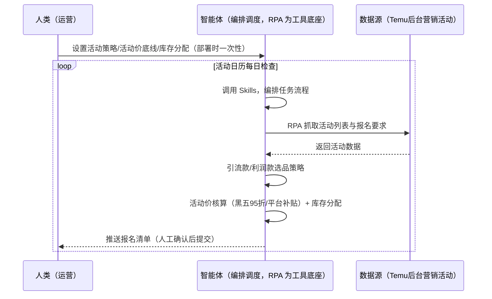
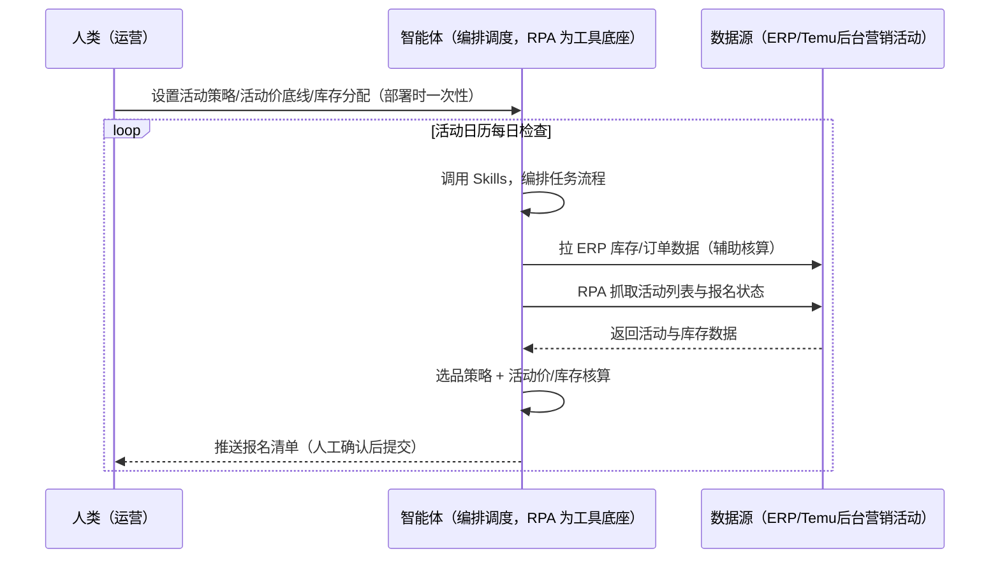

> 为 Temu 卖家团队打造的活动报名与大促管理方案。报名窗口错过大促流量被抢（不参加销量下滑严重）、活动价/库存拍脑袋报错亏钱、多活动多入口漏报。本方案由智能体调度多个工具执行按「活动日历」抓取后台营销活动列表与报名要求，智能体按引流款/利润款策略选品报名并核算活动价。活动日历每日检查，通过后确认与备货联动自动提醒。

> Agent 自动化需开通企业功能
> 点击申请1个月免费权限
> [点击申请 →](https://skieer.feishu.cn/share/base/form/shrcnFwMayykP5iaL38fnZKTbrg)

## 一、用户与需求

核心矛盾：全托管无广告、活动报名=唯一主动流量入口（不参加大促流量下滑严重）；报名窗口错过、活动价/库存拍脑袋报错亏钱、多活动多入口漏报。

两类客户痛点同源，数据来源不同：

- 未购 SaaS 客户（新卖家/小团队）：人工翻后台营销活动列表、逐条报名，全靠手；
- 已购 SaaS 客户（店小秘 ERP 等）：ERP 管订单库存，活动报名与活动价核算不覆盖，仍要人盯后台。

适用客户：全托管卖家（活动是核心流量入口）。报名动作需登录后台自建（现成应用仅活动数据导出，供复盘）。

### 1.1 不同模式卖家

| 类型 | 选择 | 建议 |
|-|-|-|
| 全托管 | 首选 | 强烈推荐（活动报名=唯一主动流量入口） |
| 半托管 | 次选 | 一般推荐（半托管有广告，活动仍重要） |
| 平台模式 | 任意 | 试点中，活动机制待确认 |

### 1.2 不同类目卖家

| 类目 | 最关注维度 | 核心逻辑 |
|-|-|-|
| 3C 数码 | 大促节奏 | 黑五/圣诞大促流量大，备货前置 |
| 家居家具 | 活动价底线 | 大件折扣空间，底线要算清 |
| 美妆个护 | 资质门槛 | 活动报名有资质门槛 |
| 服装鞋帽 | 季节活动 | 换季清仓活动价值高 |
| 户外运动 | 旺季备货 | 活动前 7 天备货入仓（联动备货单） |
| 母婴用品 | 合规要求 | 活动商品合规要求高 |

### 1.3 不同角色用户

| 用户 | 需求 | 问题 | 投入时间（估算） |
|-|-|-|-|
| 老板 | 大促流量与销量 | 不参加销量下滑严重 | 0.5 小时/周 |
| 运营 | 活动报名清单 | 多活动多入口漏报 | 1-2 小时/周 |
| 备货对接 | 活动备货联动 | 活动备货与日常备货冲突 | 1 小时/周 |

---

## 二、现在的方法与问题

### 2.1 流程步骤与问题总结

**人工方式（未购 SaaS 客户）**

| 序号 | 步骤 | 现在的方法 | 问题缺陷 |
|-|-|-|-|
| 1 | 找活动 | 手动翻后台营销活动列表 | 多活动多入口漏报 |
| 2 | 选品 | 凭感觉选 | 报错款亏钱 |
| 3 | 算活动价 | 拍脑袋 | 黑五 95 折等口径不清 |
| 4 | 报名 | 逐条提交 | 窗口错过 |
| 5 | 备货 | 活动前临时备 | 与日常备货冲突 |

**SaaS 方式（已购 ERP 客户）**

| 序号 | 步骤 | 现在的方法 | 问题缺陷 |
|-|-|-|-|
| 1 | 找活动 | ERP 不覆盖 | 靠人翻 |
| 2 | 选品 | 凭感觉 | 无策略 |
| 3 | 算活动价 | 拍脑袋 | 无核算 |
| 4 | 报名 | 手动 | 窗口错过 |
| 5 | 备货 | 无联动 | 冲突 |

### 2.2 问题分析

**人工方式根因**

| 序号 | 根因 | 具体表现 |
|-|-|-|
| 1 | 报名窗口错过 | 大促流量被抢，销量下滑严重 |
| 2 | 活动价拍脑袋 | 报错亏钱 |
| 3 | 多入口漏报 | 活动种类多（长期/主题） |

**SaaS 方式根因**

| 序号 | 根因 | 具体表现 |
|-|-|-|
| 1 | ERP 不覆盖 | 活动报名无工具 |
| 2 | 无备货联动 | 活动备货与日常备货冲突 |

---

## 三、解决方案

### 3.1 功能概述

为 Temu 卖家团队打造的活动报名与大促管理方案，按「活动日历」抓取后台营销活动列表（长期活动：清仓甩卖/官方大促/限时秒杀；主题活动：黑五/圣诞等大促专题）与报名要求，智能体按「引流款 vs 利润款」策略选品报名并核算活动价。

活动日历每日触发并调度多个工具，调起八爪鱼 RPA（Agent 的工具底座，能耦合多系统、完成自动化任务执行）抓取活动列表与报名要求、跟踪报名状态，智能体核算活动价（黑五供货价 95 折/平台补贴区域折扣）与活动库存分配，输出报名清单。活动日历每日检查，通过后确认与备货联动自动提醒。

### 3.2 系统结合

| 要素 | 说明 |
|-|-|
| 客户现有工具盘点 | **未购 SaaS 客户**：无第三方工具，活动报名全靠人工翻后台。     **已购 SaaS 客户**（主流组合）：店小秘 ERP（管订单库存，活动报名不覆盖） |
| 数据/能力来源 | **无 SaaS**：Temu 后台【店铺营销-营销活动】（登录采集，报名动作需自建；现成应用仅活动数据导出供复盘）。     **有 SaaS**：ERP 订单/库存数据（辅助活动库存核算）+ RPA 补活动列表与报名状态 |
| RPA 耦合动作 | 作为 Agent 的工具底座，按活动日历抓取活动列表/报名要求/报名状态，窗口倒计时，统一流转给智能体；通过后锁定确认提醒、备货联动告警 |
| 耦合出的新价值 | 单工具给不了的端到端结论：活动列表一次取齐 → 引流/利润款选品 → 活动价核算 → 报名清单 → 通过后确认与备货联动，**只推送报名清单与关键窗口提醒** |

### 3.3 智能体执行流程

智能体定时触发。支持**两种数据通道**，部署时按客户现有工具选择：

**通道一：无 SaaS 方式（RPA 登录后台抓活动，适合未购 ERP 的客户）**

**通道二：有 SaaS 方式（ERP 库存数据辅助核算 + RPA 补活动状态，适合已购客户）**

> Agent 自动化需开通企业功能
> 点击申请1个月免费权限
> [点击申请 →](https://skieer.feishu.cn/share/base/form/shrcnFwMayykP5iaL38fnZKTbrg)

### 3.4 为何这么设计

要同时回答三个问题：**为什么不能只用 SaaS/API？为什么不能纯靠智能体写代码？为什么 RPA 是执行底座？** 本场景的核心是"窗口提醒、选品策略、活动价核算、备货联动、挂了有人管"。

#### 1）逐项对比

| 对比维度 | SaaS/API 堆叠（ERP） | 纯智能体（智能体写代码） | 智能体+自动化工具（RPA 工具底座） |
|-|-|-|-|
| 实现方式 | ERP 管库存（部分） | 能抓后台能算，但全要自己接 | 后台抓活动 + 选品策略核算 |
| 窗口提醒 | 不覆盖 | 智能体无法常驻轮询 | RPA 定时检查防漏报 |
| 活动价核算 | 无 | 需自写活动价模型 | 折扣规则可视化配置（黑五95折等） |
| 使用成本（总拥有成本） | ERP 订阅费（主体另算） | 代理 IP + 服务器 + 开发维护人力，隐性成本高 | 一份平台订阅跑多流程，单方案边际成本 ≈ 0 |
| 维护人要求 | 低（工具现成） | 规则调整都要开发介入 | 可视化流程，运营自己可调策略 |

#### 2）优劣势说明

|  | SaaS/API 堆叠（ERP） | 纯智能体（智能体写代码） | 智能体+自动化工具（RPA 工具底座） |
|-|-|-|-|
| 优势 | 库存数据权威（辅助核算） | 无订阅费；     可深度定制活动策略 | 窗口提醒+选品策略+活动价核算；     备货联动；     非技术人员可维护 |
| 劣势 | 活动报名不覆盖 | 轮询与登录保活全自建；     AI 生成代码是生成性的 | 本地电脑运行需保持开机；     订阅费；     报名动作需后台自建 |

#### 3）结论

| 论点 | 说明 |
|-|-|
| 活动=唯一主动流量入口 | 全托管无广告，活动报名=唯一主动流量入口（不参加大促流量下滑严重）——报名是必做动作 |
| 窗口与锁定机制 | 审核 3-5 工作日；通过后须在指定时限确认价格与库存锁定（逾期取消）；错过首轮可补报分会场（实锤） |
| 活动价规则实锤 | 黑五全托管供货价打 95 折、平台补贴更多折扣（部分区域 5-6 折为平台补贴）；活动价 vs 近 30 天最低价审核 |
| 备货联动 | 活动前至少 7 天备货入仓（联动备货单场景）；活动库存售罄即失活动标识——与备货场景强联动 |
| 一个底座跑多流程 | 客户购买 RPA 平台是跑多个流程（活动/备货/日报），本方案只是其中一个——平台订阅费被多流程摊薄 |
| 时间 | 运营要的是"报名清单 + 窗口提醒 + 备货联动"，不是"翻后台" |

### 3.5 功能清单

| 功能 | 系统 | 功能说明（解决问题） |
|-|-|-|
| 会话/定时 | 智能体 | 1. 理解人类语言，调用已预设好的 Skills。     2. 编排多任务、调度多工具。 |
| 多系统数据取数 | RPA、指纹浏览器 | 1. 解决报名窗口错过、多入口漏报问题。     2. 作为智能体工具底座被调度执行，窗口倒计时、通过后锁定确认提醒。     3. **【无 SaaS 方式】** RPA 登录后台抓活动列表与报名要求。**【有 SaaS 方式】** ERP 库存辅助核算 + RPA 补活动状态。 |
| 选品策略 | 智能体 | 引流款 vs 利润款：热销稳定评分款 = 利润转化、清仓价与新品 = 引流。 |
| 活动价核算 | 智能体 | 黑五供货价 95 折 / 平台补贴区域折扣；活动价底线（供货价折扣上限）可配。 |
| 报名清单 | 智能体 | 单品/店铺模式，报名信息 = 商品链接 + 活动价 + 库存量 + 运费模板。 |
| 备货联动 | 智能体 | 活动前至少 7 天备货入仓提醒（联动备货单场景）；活动库存分配。 |
| IM通知 | 飞书、钉钉、企微等 | 解决报名窗口错过问题。报名清单、锁定确认、备货联动自动推送。 |
| 数据资产储存 | 本地电脑、云储存 | 1. Skills 资产：Temu 活动报名技能。     2. 数据储存：活动台账统一写入本地。     3. 经验知识库：大促复盘持续沉淀。 |

### 3.6 智能体执行落地过程

部署时一次性配置入参（活动策略、活动价底线、库存分配规则、参与站点与场次、数据通道），会话中无需重复输入。

**⚠️ 部署前提（不满足则方案无法跑起来）**：①RPA 需部署在**常开电脑/云机**上（活动日历每日检查需常开），并配置漏跑补跑机制；②**报名动作需登录后台自建**（现成应用仅活动数据导出，供复盘）；③**有 SaaS 方式需 ERP 账号**（库存辅助核算，可选增强，无则走后台通道）；④首次配置（登录态、活动策略、折扣规则）需服务方/技术人员介入一次，属实施成本。

#### 1）配置

| 类别 | 说明 |
|-|-|
| 智能体 | 主流智能体。 |
| 智能体工具 | 1. **数据通道（按客户现有工具二选一）**：【无 SaaS】Temu 后台营销活动（RPA 登录采集）；【有 SaaS】ERP 库存数据 + RPA 补活动状态。     2. 数据取数与自动化执行：八爪鱼 RPA，MCP 配置完成。     3. 数据分析：智能体自带。     4. IM：企业办公 IM（飞书/钉钉/企微），MCP 或 webhook 配置。 |
| 工作知识 | 1. 活动策略：引流款/利润款清单。     2. 活动价底线：供货价折扣上限。     3. 活动库存分配。     4. 参与站点与场次。     5. 备货联动规则：活动前 7 天入仓。 |
| 本地数据库 | 1. 活动台账库地址。     2. 活动价模型库地址。     3. 经验库地址。 |

#### 2）执行

| 任务 | 产出 | 产出物接收人 |
|-|-|-|
| 接收活动策略，日历触发 | 任务启动记录 | —— |
| 调用已预设 Skills，编排任务流程 | 任务编排方案 | —— |
| 经 MCP 向八爪鱼 RPA 下发取数任务 | 自动化任务指令 | —— |
| 多源取数并按活动对齐（无 SaaS：后台活动；有 SaaS：ERP+后台，智能体监控状态） | 对齐后活动数据 | —— |
| 引流/利润款选品 + 活动价核算 | 报名清单 | 运营 |
| 报名提交（人工确认后执行） | 提交回执 | —— |
| 审核结果回采 + 锁定确认提醒 | 锁定提醒 | 运营 |
| 备货联动提醒（前 7 天入仓） | 备货提醒 | 运营/备货 |
| 大促复盘（挂接活动数据导出） | 复盘报告 | 运营/老板 |

异常处理：

报名失败 → 重试并告警；

审核驳回 → 按原因分类整改；

锁定确认临界 → 告警提醒；

活动库存不足 → 联动备货预警；

置信度 &lt;70% → 转人工复核，不输出硬结论。

#### 3）结果

| 结果 | 说明 |
|-|-|
| 数据资产 | 活动台账结构化数据（活动/商品/活动价/库存/报名状态），可审计可追溯。 |
| 分析报告 | 1. 报名清单：引流/利润款 + 活动价核算。     2. 审核结果与锁定提醒。     3. 大促复盘：销量/流量回看。 |
| Skills | 智能体 Skills：Temu 活动报名技能，按大促结果迭代策略。 |

> Agent 自动化需开通企业功能
> 点击申请1个月免费权限
> [点击申请 →](https://skieer.feishu.cn/share/base/form/shrcnFwMayykP5iaL38fnZKTbrg)

---

## 四、使用前后预估

> 本方案价值 = **活动列表自动抓取 → 引流/利润款选品 → 活动价核算 → 报名清单 → 通过后锁定确认与备货联动**。报名动作需登录后台自建（现成应用仅活动数据导出供复盘）。

| 指标 | 人工 | SaaS/API（ERP） | 智能体+自动化工具 |
|-|-|-|-|
| 活动发现 | 手动翻后台 | 不覆盖 | 活动日历自动检查 |
| 选品 | 凭感觉 | 无策略 | 引流/利润款策略 |
| 活动价 | 拍脑袋 | 无核算 | 95 折等规则自动核算 |
| 报名窗口 | 易错过 | 无提醒 | 窗口倒计时、锁定确认提醒 |
| 备货联动 | 冲突 | 无联动 | 前 7 天入仓自动提醒 |
| 复盘 | 无 | 无 | 大促数据导出复盘 |

**说明**：Temu 活动机制（实锤）：卖家后台【店铺营销-营销活动】自主报名（已开放，无需联系运营）；长期活动 = 清仓甩卖/官方大促/限时秒杀，主题活动 = 黑五/圣诞等大促专题（按站点区分）；审核 3-5 工作日（活动价 vs 近 30 天最低价、退货率/好评率/履约、FBS 库存）；通过后须在指定时限确认价格与库存锁定（逾期取消）；黑五全托管供货价打 95 折、平台补贴更多折扣（部分区域 5-6 折为平台补贴、仅特定区域展示）；错过首轮可补报分会场；退出即失资源位且不可再报该场次（一天限 3 商品）；活动库存售罄即失活动标识。

---

## 五、效果证明

### 5.1 DEMO应用

TEMU 活动数据导出（全托+半托多店铺，活动复盘辅助）：https://rpa.bazhuayu.com/appstore/app/wawawa/temu-huo-dong-shu-ju-dao-chu

---

## 六、备注

### 6.1 Agent 支持

本方案不绑定具体智能体，主流 Agent 均可运行（需支持技能/Skills 加载与工具调用）：

| Agent/智能体 | 说明 |
|-|-|
| Workbuddy | 本方案运行平台，支持技能/Skills 上传加载、定时任务、MCP 工具调用与表格/报告处理 |
| 豆包（国内·字节） | 国内主流个人智能体，支持技能上传、定时任务与工具调用，上手成本低 |
| 通义千问（国内·阿里） | 支持 Agent 编排与插件生态，集成阿里电商数据能力，适合电商场景 |
| DeepSeek（国内） | 推理能力强、成本低，适合规则打分与归因分析类任务 |
| ChatGPT（国外·OpenAI） | 海外主流通用智能体，支持 GPTs/Agent 模式与工具调用 |
| Claude（国外·Anthropic） | 长文本与结构化分析能力强，原生支持 MCP 连接外部工具 |

### 6.2 名词解释

| 术语 | 说明 |
|-|-|
| 长期活动 | 清仓甩卖 / 官方大促 / 限时秒杀 |
| 主题活动 | 黑五 / 圣诞等大促专题（按站点区分） |
| 报名模式 | 单品 / 店铺，报名信息 = 商品链接 + 活动价 + 库存量 + 运费模板 |
| 锁定确认 | 通过后须在指定时限确认价格与库存锁定（逾期取消） |
| 引流款 | 清仓价与新品（吸引流量） |
| 利润款 | 热销稳定评分款（利润转化） |
| 混合数据源 | Temu 后台营销活动（登录自建采集）+ ERP 库存数据（有 SaaS 客户辅助核算）+ 活动数据导出（复盘） |
| 有 SaaS 方式 | 已购店小秘 ERP，库存辅助核算 + RPA 补活动状态 |
| 无 SaaS 方式 | 不购买第三方工具，RPA 登录后台采集 |
| 全托管 | 供货商模式，卖家只供货、平台定价销售（美区仅半托管） |
| 半托管 | 卖家自主运营与履约（美区主流模式） |
| MCP | Model Context Protocol，智能体连接外部工具的标准化通道 |

> Agent 自动化需开通企业功能
> 点击申请1个月免费权限
> [点击申请 →](https://skieer.feishu.cn/share/base/form/shrcnFwMayykP5iaL38fnZKTbrg)

---

原文：[查看原文](https://skieer.feishu.cn/wiki/Rg0CwFQP1itv3mkifdfcDZ5CnWe)
