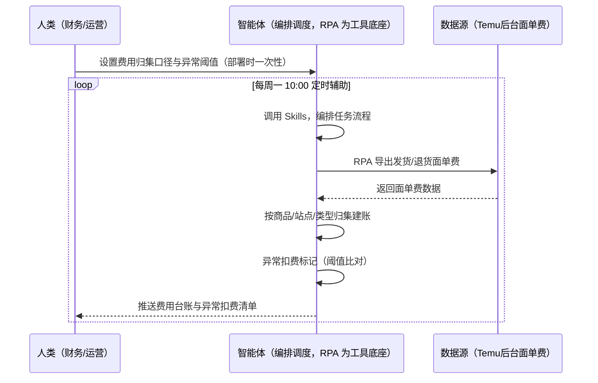
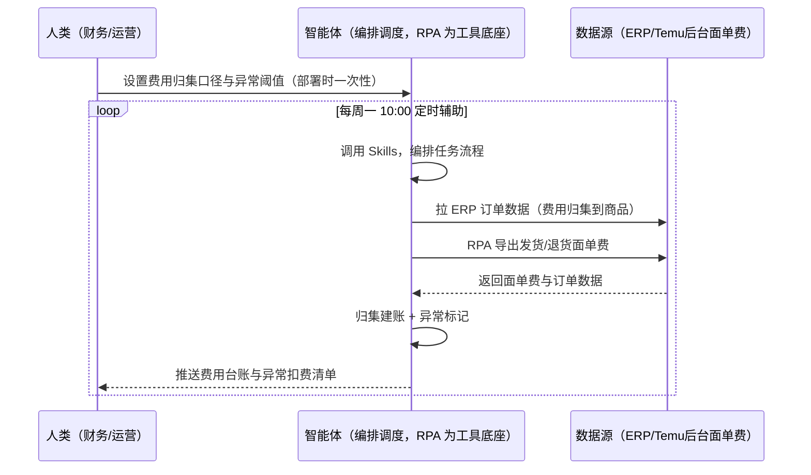

> 为 Temu 卖家团队打造的物流面单费用管理方案。发货/退货面单费逐笔核对费时、费用明细散乱无法归集、异常扣费不申诉就默认认了。本方案由智能体调度多个工具执行定时导出发货/退货面单费，智能体按费用类型归集建账、标记异常。每周定时辅助，费用台账供利润核算与对账复用，异常扣费自动标记。

> Agent 自动化需开通企业功能
> 点击申请1个月免费权限
> [点击申请 →](https://skieer.feishu.cn/share/base/form/shrcnFwMayykP5iaL38fnZKTbrg)

## 一、用户与需求

核心矛盾：发货/退货面单费逐笔核对费时、费用明细散乱无法归集进利润核算；异常扣费不申诉就默认认了（亏损无声）。

两类客户痛点同源，数据来源不同：

- 未购 SaaS 客户（新卖家/小团队）：人工登录后台逐笔导出发货/退货面单费、手动贴表格，全靠手；
- 已购 SaaS 客户（店小秘 ERP 等）：ERP 管订单库存，面单费用导出不覆盖，仍要人手动下载。

适用客户：发货频次高、需要利润精细核算的卖家。现成应用直挂（TEMU 发货面单费导出/退货面单费导出）。

### 1.1 不同模式卖家

| 类型 | 选择 | 建议 |
|-|-|-|
| 全托管 | 次选 | 一般推荐（平台履约，面单费少但需对账） |
| 半托管 | 首选 | 强烈推荐（自主履约，面单费明细多） |
| 平台模式 | 任意 | 试点中，费用机制待确认 |

### 1.2 不同类目卖家

| 类目 | 最关注维度 | 核心逻辑 |
|-|-|-|
| 3C 数码 | 面单费精度 | 客单价高，费用精度影响利润 |
| 家居家具 | 大件面单费 | 大件面单费高，占比大 |
| 美妆个护 | 退货面单费 | 退货率高，退货面单费多 |
| 服装鞋帽 | 多件拆单 | 一单多件，面单费笔数多 |
| 户外运动 | 旺季费用 | 旺季单量暴增，费用激增 |
| 母婴用品 | 费用核对 | 异常扣费影响利润 |

### 1.3 不同角色用户

| 用户 | 需求 | 问题 | 投入时间（估算） |
|-|-|-|-|
| 老板 | 费用清晰 | 面单费散乱，利润算不准 | 0.5 小时/周 |
| 财务 | 费用台账 | 逐笔核对费时 | 1-2 小时/周 |
| 运营 | 异常扣费识别 | 异常不申诉默认认了 | 0.5 小时/周 |

---

## 二、现在的方法与问题

### 2.1 流程步骤与问题总结

人工方式（未购 SaaS 客户）

| 序号 | 步骤 | 现在的方法 | 问题缺陷 |
|-|-|-|-|
| 1 | 导费用 | 手动导出发货/退货面单费 | 逐笔核对费时 |
| 2 | 归集 | 手动贴表格 | 明细散乱 |
| 3 | 建账 | 凭经验归类 | 口径不一 |
| 4 | 核对 | 手动比对 | 异常不识别 |
| 5 | 申诉 | 不知道可申诉 | 异常扣费默认认了 |

SaaS 方式（已购 ERP 客户）

| 序号 | 步骤 | 现在的方法 | 问题缺陷 |
|-|-|-|-|
| 1 | 导费用 | ERP 不覆盖 | 靠人导 |
| 2 | 归集 | 手动 | 散乱 |
| 3 | 建账 | 手动 | 口径不一 |
| 4 | 核对 | 手动 | 异常不识别 |
| 5 | 申诉 | 无提醒 | 默认认了 |

### 2.2 问题分析

人工方式根因

| 序号 | 根因 | 具体表现 |
|-|-|-|
| 1 | 逐笔核对费时 | 面单费笔数多 |
| 2 | 无归集底表 | 利润核算口径不全 |
| 3 | 异常不识别 | 亏损无声 |

SaaS 方式根因

| 序号 | 根因 | 具体表现 |
|-|-|-|
| 1 | ERP 不覆盖 | 面单费用无工具 |
| 2 | 无闭环 | 异常扣费不申诉 |

---

## 三、解决方案

### 3.1 功能概述

为 Temu 卖家团队打造的物流面单费用管理方案，定时导出发货/退货面单费，智能体按费用类型归集建账、标记异常扣费。

每周定时触发并调度多个工具，调起八爪鱼 RPA（Agent 的工具底座，能耦合多系统、完成自动化任务执行）导出发货面单费与退货面单费，智能体按商品/站点/费用类型归集建账，输出费用台账供利润核算与对账复用。每周定时辅助，费用台账供利润核算与对账复用，异常扣费自动标记。

### 3.2 系统结合

| 要素 | 说明 |
|-|-|
| 客户现有工具盘点 | **未购 SaaS 客户**：无第三方工具，面单费全靠人工导出。    
**已购 SaaS 客户**（主流组合）：店小秘 ERP（管订单库存，面单费用不覆盖） |
| 数据/能力来源 | **无 SaaS**：Temu 后台发货/退货面单费（现成应用直挂：TEMU 发货面单费导出/退货面单费导出）。    
**有 SaaS**：ERP 订单数据（辅助费用归集到商品）+ RPA 补面单费导出 |
| RPA 耦合动作 | 作为 Agent 的工具底座，按计划导出发货/退货面单费（增量导出去重），统一流转给智能体；导出失败自动重试、异常告警 |
| 耦合出的新价值 | 单工具给不了的端到端结论：面单费一次取齐 → 按商品/站点/类型归集 → 异常扣费标记 → 费用台账供利润核算/对账复用，**只推送异常扣费** |

### 3.3 智能体执行流程

智能体定时触发。支持**两种数据通道**，部署时按客户现有工具选择：

**通道一：无 SaaS 方式（RPA 导出面单费，适合未购 ERP 的客户）**

**通道二：有 SaaS 方式（ERP 订单数据辅助归集 + RPA 补面单费，适合已购客户）**

> Agent 自动化需开通企业功能
> 点击申请1个月免费权限
> [点击申请 →](https://skieer.feishu.cn/share/base/form/shrcnFwMayykP5iaL38fnZKTbrg)

### 3.4 为何这么设计

要同时回答三个问题：**为什么不能只用 SaaS/API？为什么不能纯靠智能体写代码？为什么 RPA 是执行底座？** 本场景的核心是"定时导出、费用归集、异常标记、挂了有人管"。

#### 1）逐项对比

| 对比维度 | SaaS/API 堆叠（ERP） | 纯智能体（智能体写代码） | 智能体+自动化工具（RPA 工具底座） |
|-|-|-|-|
| 实现方式 | ERP 管订单，面单费不覆盖 | 能抓后台能算，但全要自己接 | 面单费导出应用直挂 + 归集建账 |
| 定时导出 | 不覆盖 | 智能体无法常驻轮询 | RPA 定时导出防漏 |
| 归集建模 | 无 | 需自写归集逻辑 | 归集规则可视化配置 |
| 使用成本（总拥有成本） | ERP 订阅费（主体另算） | 代理 IP + 服务器 + 开发维护人力，隐性成本高 | 一份平台订阅跑多流程，单方案边际成本 ≈ 0 |
| 维护人要求 | 低（工具现成） | 规则调整都要开发介入 | 可视化流程，财务自己可调口径 |

#### 2）优劣势说明

|  | SaaS/API 堆叠（ERP） | 纯智能体（智能体写代码） | 智能体+自动化工具（RPA 工具底座） |
|-|-|-|-|
| 优势 | 订单数据权威（归集辅助） | 无订阅费；    
可深度定制归集模型 | 面单费导出应用直挂；    
归集建账即开即用；    
非技术人员可维护 |
| 劣势 | 面单费不覆盖 | 导出与归集全自建；    
AI 生成代码是生成性的 | 本地电脑运行需保持开机；    
订阅费；    
灵活性受平台模板边界限制 |

#### 3）结论

| 论点 | 说明 |
|-|-|
| 费用=利润的漏点 | 面单费是利润核算的成本项之一，散乱不归集 = 利润算不准 |
| ERP 覆盖不完整 | ERP 管订单，面单费用导出不覆盖——本方案补导出与归集 |
| 异常扣费不默认认 | 异常扣费标记后供申诉参考，避免亏损无声 |
| 一个底座跑多流程 | 客户购买 RPA 平台是跑多个流程（面单费/订单/对账），本方案只是其中一个——平台订阅费被多流程摊薄 |
| 台账复用 | 费用台账供利润核算与结算对账复用（底表共建） |
| 时间 | 财务要的是"费用台账 + 异常标记"，不是"逐笔核对" |

### 3.5 功能清单

| 功能 | 系统 | 功能说明（解决问题） |
|-|-|-|
| 会话/定时 | 智能体 | 1. 理解人类语言，调用已预设好的 Skills。    
2. 编排多任务、调度多工具。 |
| 多系统数据取数 | RPA、指纹浏览器 | 1. 解决逐笔核对费时、明细散乱问题。    
2. 作为智能体工具底座被调度执行，增量导出去重、失败自动重试。    
3. **【无 SaaS 方式】** RPA 导出发货/退货面单费。**【有 SaaS 方式】** ERP 订单数据辅助归集 + RPA 补面单费。 |
| 费用归集 | 智能体 | 按商品/站点/费用类型归集建账（面单费/广告费/ERP 扣费/罚款/仓储）。 |
| 异常标记 | 智能体 | 异常扣费阈值比对（单笔异常/频次异常），标记供申诉参考。 |
| 台账输出 | 智能体 | 费用台账 Excel 统一写入本地，供利润核算与对账复用。 |
| IM通知 | 飞书、钉钉、企微等 | 解决异常扣费滞后问题。异常扣费清单自动推送。 |
| 数据资产储存 | 本地电脑、云储存 | 1. Skills 资产：Temu 费用归集技能。    
2. 数据储存：费用台账统一写入本地。    
3. 经验知识库：异常扣费申诉结果持续沉淀。 |

### 3.6 智能体执行落地过程

部署时一次性配置入参（费用类型清单、归集维度、异常阈值、数据通道），会话中无需重复输入。

**⚠️ 部署前提（不满足则方案无法跑起来）**：①RPA 需部署在**常开电脑/云机**上（每周定时可接受任务时开机），并配置漏跑补跑机制；②后台需登录导出，登录失效自动告警；③**有 SaaS 方式需 ERP 账号**（归集辅助，可选增强，无则走后台通道）；④首次配置（登录态、归集口径、异常阈值）需服务方/技术人员介入一次，属实施成本。

#### 1）配置

| 类别 | 说明 |
|-|-|
| 智能体 | 主流智能体。 |
| 智能体工具 | 1. **数据通道（按客户现有工具二选一）**：【无 SaaS】Temu 后台面单费（现成应用直挂）；【有 SaaS】ERP 订单数据 + RPA 补面单费。    
2. 数据取数与自动化执行：八爪鱼 RPA，MCP 配置完成。    
3. 数据分析：智能体自带。    
4. 数据报告：智能体自带。    
5. IM：企业办公 IM（飞书/钉钉/企微），MCP 或 webhook 配置。 |
| 工作知识 | 1. 费用类型清单：发货面单费/退货面单费/广告费/ERP 扣费/罚款/仓储。    
2. 归集维度：商品/站点/费用类型。    
3. 异常阈值：单笔/频次。 |
| 本地数据库 | 1. 费用台账库地址。    
2. 报告库地址。    
3. 经验库地址。 |

#### 2）执行

| 任务 | 产出 | 产出物接收人 |
|-|-|-|
| 接收归集口径，定时触发 | 任务启动记录 | —— |
| 调用已预设 Skills，编排任务流程 | 任务编排方案 | —— |
| 经 MCP 向八爪鱼 RPA 下发取数任务 | 自动化任务指令 | —— |
| 多源取数并按费用类型对齐（无 SaaS：面单费导出；有 SaaS：ERP+导出，智能体监控状态） | 对齐后费用数据 | —— |
| 费用归集建账 | 费用台账 | 财务 |
| 异常扣费标记 | 异常清单 | 财务/运营 |
| 台账输出（供利润核算/对账复用） | 台账 Excel | 财务 |
| 推送费用台账与异常清单 | 群消息 | 财务/运营/老板 |

异常处理：

导出失败 → 自动重试并告警；

费用缺失 → 标注待补；

异常扣费 → 标记供申诉参考；

置信度 &lt;70% → 转人工复核，不输出硬结论。

#### 3）结果

| 结果 | 说明 |
|-|-|
| 数据资产 | 费用台账结构化数据（订单/站点/费用类型/金额/状态），利润核算与对账复用。 |
| 分析报告 | 1. 费用台账：按商品/站点/类型归集。    
2. 异常扣费清单：标记与申诉建议。 |
| Skills | 智能体 Skills：Temu 费用归集技能，按申诉结果迭代异常规则。 |

> Agent 自动化需开通企业功能
> 点击申请1个月免费权限
> [点击申请 →](https://skieer.feishu.cn/share/base/form/shrcnFwMayykP5iaL38fnZKTbrg)

---

## 四、使用前后预估

> 本方案价值 = **面单费自动导出 → 按商品/站点/类型归集建账 → 异常扣费标记 → 台账供利润核算/对账复用**。现成应用直挂（发货/退货面单费导出）。

| 指标 | 人工 | SaaS/API（ERP） | 智能体+自动化工具 |
|-|-|-|-|
| 面单费导出 | 手动下载 | 不覆盖 | 自动导出去重 |
| 费用归集 | 手动贴表 | 无 | 按类型自动归集 |
| 异常识别 | 不识别 | 无 | 阈值比对自动标记 |
| 台账复用 | 无底表 | 无 | 台账供利润/对账复用 |
| 方法论 | 无 | 单工具 | 可复用的 Skills 与归集规则 |

**说明**：面单费导出链路成熟（现成应用直挂）；费用台账为「底表共建」——利润核算（供货价-成本-物流-罚款）与结算对账（结算单 vs 费用台账）直接消费，避免重复归集；异常扣费标记后供申诉参考，不默认认账。

---

## 五、效果证明

> Agent 自动化需开通企业功能
> 点击申请1个月免费权限
> [点击申请 →](https://skieer.feishu.cn/share/base/form/shrcnFwMayykP5iaL38fnZKTbrg)

### 5.1 客户案例

**《云仓物流状态同步：微信 – 飞书 – 物流群全链路自动化》**

> 涉及多个客户群与数十个快递群，高峰期每分钟都有新消息弹出，客服需在微信、飞书、快递系统、OMS 间反复切换，单条消息处理耗时 2-3 分钟。

| 效果 | 说明 |
|-|-|
| 提效 | 物流信息处理由人工盯群变为自动流转。原本客服需同时盯数十个客户群与快递群，单条消息处理耗时 2-3 分钟，现在机器人 7×24 自动处理，覆盖拦截、查询、改地址等 7 大场景。 |
| 降本 | 日均节省 2-3 小时/人的无效盯群时间，人力投入转向异常件处理与客户关系维护等重点工作。 |
| 任务 | 打通微信 – 飞书 – 物流群全链路，微信群消息与飞书指令自动流转分发。 |
| 任务 | 降低手工复制单号导致的错漏，减少退款率与赔付损失。 |

案例详情：[云仓物流状态同步](https://skieer.feishu.cn/wiki/OKy0wkYLximV2rkRCqRcl7FcnUh)

### 5.2 DEMO应用

TEMU 发货面单费导出：https://rpa.bazhuayu.com/appstore/app/nailong/temu-fa-huo-mian-dan-fei-dao-chu

TEMU 退货面单费导出：https://rpa.bazhuayu.com/appstore/app/nailong/temu-tui-huo-mian-dan-fei-dao-chu

---

## 六、备注

### 6.1 Agent 支持

本方案不绑定具体智能体，主流 Agent 均可运行（需支持技能/Skills 加载与工具调用）：

| Agent/智能体 | 说明 |
|-|-|
| Workbuddy | 本方案运行平台，支持技能/Skills 上传加载、定时任务、MCP 工具调用与表格/报告处理 |
| 豆包（国内·字节） | 国内主流个人智能体，支持技能上传、定时任务与工具调用，上手成本低 |
| 通义千问（国内·阿里） | 支持 Agent 编排与插件生态，集成阿里电商数据能力，适合电商场景 |
| DeepSeek（国内） | 推理能力强、成本低，适合规则打分与归因分析类任务 |
| ChatGPT（国外·OpenAI） | 海外主流通用智能体，支持 GPTs/Agent 模式与工具调用 |
| Claude（国外·Anthropic） | 长文本与结构化分析能力强，原生支持 MCP 连接外部工具 |

### 6.2 名词解释

| 术语 | 说明 |
|-|-|
| 面单费 | 发货/退货物流面单费用（按单计费） |
| 费用归集 | 按商品/站点/费用类型建账，供利润核算与对账复用 |
| 异常扣费 | 单笔/频次超阈值的扣费，标记供申诉参考 |
| 底表共建 | 费用台账作为公共底表，利润核算与结算对账直接消费 |
| 混合数据源 | Temu 后台面单费（现成应用直挂）+ ERP 订单数据（有 SaaS 客户归集辅助） |
| 有 SaaS 方式 | 已购店小秘 ERP，订单数据辅助归集 + RPA 补面单费 |
| 无 SaaS 方式 | 不购买第三方工具，RPA 导出面单费 |
| 全托管 | 供货商模式，卖家只供货、平台定价销售（美区仅半托管） |
| 半托管 | 卖家自主运营与履约（美区主流模式） |
| MCP | Model Context Protocol，智能体连接外部工具的标准化通道 |

> Agent 自动化需开通企业功能
> 点击申请1个月免费权限
> [点击申请 →](https://skieer.feishu.cn/share/base/form/shrcnFwMayykP5iaL38fnZKTbrg)

---

原文：[查看原文](https://skieer.feishu.cn/wiki/XU9hwVhNBiXyq3kJuE5coBSvnlc)
