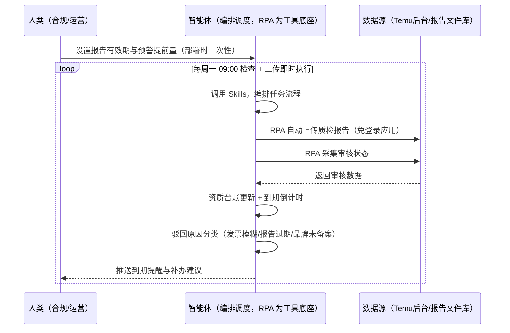
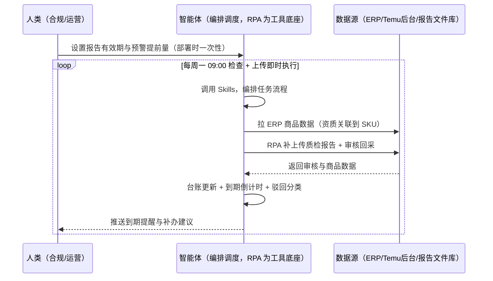

> 为 Temu 卖家团队打造的质检与资质管理方案。质检报告有效期通常 1 年（过期失效）、审核 7-10 个工作日、约 35% 因资料不全被驳回；资质造假最高罚 5 万+封店。本方案由智能体调度多个工具执行自动上传质检报告、跟踪认证到期。资质到期自动提醒，报告上传自动执行，审核结果自动回采。

> Agent 自动化需开通企业功能
> 点击申请1个月免费权限
> [点击申请 →](https://skieer.feishu.cn/share/base/form/shrcnFwMayykP5iaL38fnZKTbrg)

## 一、用户与需求

核心矛盾：资质是「上架前置 + 罚款高危」双属性——质检报告过期失效、约 35% 因资料不全被驳回（发票模糊/报告过期/品牌未备案为主因）、资质造假最高罚 5 万+封店。

两类客户痛点同源，数据来源不同：

- 未购 SaaS 客户（新卖家/小团队）：人工整理资料、手动上传报告、靠记忆盯到期，全靠手；
- 已购 SaaS 客户（店小秘 ERP 等）：ERP 管订单库存，资质管理与到期提醒不覆盖，仍要人盯。

适用客户：欧盟站卖家（GPSR 欧代/制造商信息贴标）与资质敏感类目卖家。质检报告自动上传现成应用直挂（免登录）。

### 1.1 不同模式卖家

| 类型 | 选择 | 建议 |
|-|-|-|
| 全托管 | 首选 | 强烈推荐（资质=上架前置+罚款高危双属性） |
| 半托管 | 次选 | 一般推荐（自营履约，资质同样重要） |
| 平台模式 | 任意 | 试点中，资质要求待确认 |

### 1.2 不同类目卖家

| 类目 | 最关注维度 | 核心逻辑 |
|-|-|-|
| 3C 数码 | CE/FCC | 带电类认证，缺失即驳回 |
| 家居家具 | 检测报告 | 材质检测，过期失效 |
| 美妆个护 | 备案资质 | 品牌备案，缺失禁售 |
| 服装鞋帽 | 面料检测 | 成分检测报告 |
| 户外运动 | 安全认证 | 功能件认证门槛 |
| 母婴用品 | CPC 认证 | 安全类目，认证前置 |

### 1.3 不同角色用户

| 用户 | 需求 | 问题 | 投入时间（估算） |
|-|-|-|-|
| 老板 | 不被罚款封店 | 资质造假/过期风险 | 0.5 小时/周 |
| 合规 | 资质台账+到期提醒 | 报告过期/驳回 | 1-2 小时/周 |
| 运营 | 上传执行 | 手工上传费时 | 1 小时/周 |

---

## 二、现在的方法与问题

### 2.1 流程步骤与问题总结

人工方式（未购 SaaS 客户）

| 序号 | 步骤 | 现在的方法 | 问题缺陷 |
|-|-|-|-|
| 1 | 备资料 | 手动整理发票/报告 | 资料不全被驳回 |
| 2 | 传报告 | 手动上传 | 费时、易错 |
| 3 | 盯到期 | 靠记忆 | 过期失效 |
| 4 | 查审核 | 手动查状态 | 7-10 工作日无跟踪 |
| 5 | 补办 | 过期才办 | 罚款高危 |

SaaS 方式（已购 ERP 客户）

| 序号 | 步骤 | 现在的方法 | 问题缺陷 |
|-|-|-|-|
| 1 | 备资料 | ERP 部分覆盖 | 品牌备案等靠人 |
| 2 | 传报告 | 手动 | 无自动上传 |
| 3 | 盯到期 | 靠人 | 过期风险 |
| 4 | 查审核 | 手动 | 无回采 |
| 5 | 补办 | 过期才办 | 罚款高危 |

### 2.2 问题分析

人工方式根因

| 序号 | 根因 | 具体表现 |
|-|-|-|
| 1 | 资料不全被驳回 | 约 35% 因资料不全被驳回 |
| 2 | 到期靠记忆 | 报告过期失效 |
| 3 | 上传手工 | 费时易错 |

SaaS 方式根因

| 序号 | 根因 | 具体表现 |
|-|-|-|
| 1 | ERP 不覆盖资质 | 资质台账与到期提醒无工具 |
| 2 | 无闭环 | 审核结果不回采 |

---

## 三、解决方案

### 3.1 功能概述

为 Temu 卖家团队打造的质检与资质管理方案，自动上传质检报告、跟踪认证到期，资质台账统一管理。

定时触发并调度多个工具，调起八爪鱼 RPA（Agent 的工具底座，能耦合多系统、完成自动化任务执行）自动上传质检报告（免登录现成应用直挂）、采集审核状态，智能体按有效期管理资质台账、输出到期提醒与补办建议。资质到期自动提醒，报告上传自动执行，审核结果自动回采。

### 3.2 系统结合

| 要素 | 说明 |
|-|-|
| 客户现有工具盘点 | **未购 SaaS 客户**：无第三方工具，资质全靠人工管理。    
**已购 SaaS 客户**（主流组合）：店小秘 ERP（管订单库存，资质管理不覆盖） |
| 数据/能力来源 | **无 SaaS**：质检报告上传（现成应用直挂：1_KWS_质检报告自动上传_全能版，免登录）+ 后台审核状态（登录采集）。    
**有 SaaS**：ERP 商品数据（辅助关联资质到 SKU）+ RPA 补报告上传与审核回采 |
| RPA 耦合动作 | 作为 Agent 的工具底座，按计划自动上传质检报告（回执校验、失败重试）、采集审核状态，按 SKU 对齐资质台账，统一流转给智能体 |
| 耦合出的新价值 | 单工具给不了的端到端结论：报告上传一次自动化 → 审核状态回采 → 到期倒计时提醒 → 补办建议，**只推送到期与驳回风险** |

### 3.3 智能体执行流程

智能体定时触发。支持**两种数据通道**，部署时按客户现有工具选择：

**通道一：无 SaaS 方式（RPA 自动上传报告，适合未购 ERP 的客户）**

**通道二：有 SaaS 方式（ERP 商品数据关联 + RPA 补上传回采，适合已购客户）**

> Agent 自动化需开通企业功能
> 点击申请1个月免费权限
> [点击申请 →](https://skieer.feishu.cn/share/base/form/shrcnFwMayykP5iaL38fnZKTbrg)

### 3.4 为何这么设计

要同时回答三个问题：**为什么不能只用 SaaS/API？为什么不能纯靠智能体写代码？为什么 RPA 是执行底座？** 本场景的核心是"定时巡检、自动上传、到期提醒、挂了有人管"。

#### 1）逐项对比

| 对比维度 | SaaS/API 堆叠（ERP） | 纯智能体（智能体写代码） | 智能体+自动化工具（RPA 工具底座） |
|-|-|-|-|
| 实现方式 | ERP 管商品，资质不覆盖 | 能传报告能算，但全要自己接 | 报告上传应用直挂 + 台账管理 |
| 自动上传 | 不覆盖 | 需自建上传逻辑 | 免登录应用直挂、回执校验 |
| 到期管理 | 无 | 需自写台账逻辑 | 台账+倒计时可视化配置 |
| 使用成本（总拥有成本） | ERP 订阅费（主体另算） | 代理 IP + 服务器 + 开发维护人力，隐性成本高 | 一份平台订阅跑多流程，单方案边际成本 ≈ 0 |
| 维护人要求 | 低（工具现成） | 规则调整都要开发介入 | 可视化流程，合规自己可调提前量 |

#### 2）优劣势说明

|  | SaaS/API 堆叠（ERP） | 纯智能体（智能体写代码） | 智能体+自动化工具（RPA 工具底座） |
|-|-|-|-|
| 优势 | 商品数据权威（资质关联） | 无订阅费；    
可深度定制资质模型 | 报告上传应用直挂；    
台账+到期提醒；    
非技术人员可维护 |
| 劣势 | 资质管理不覆盖 | 上传与台账全自建；    
AI 生成代码是生成性的 | 本地电脑运行需保持开机；    
订阅费；    
上传需登录态 |

#### 3）结论

| 论点 | 说明 |
|-|-|
| 资质=双高危 | 「上架前置 + 罚款高危」双属性：报告过期即失效、资质造假最高罚 5 万+封店（实锤） |
| 驳回主因实锤 | 约 35% 因资料不全被驳回（发票模糊/报告过期/品牌未备案为主因）；审核 7-10 个工作日；报告有效期通常 1 年 |
| GPSR 红线 | 欧盟站 GPSR（欧代/制造商信息贴标）不达标退回或禁售（实锤） |
| 一个底座跑多流程 | 客户购买 RPA 平台是跑多个流程（质检/上架/罚款预警），本方案只是其中一个——平台订阅费被多流程摊薄 |
| 与上架/罚款联动 | 本场景与「上架合规预检」「罚款预警」场景联动（事前合规 > 事后申诉） |
| 时间 | 合规要的是"到期自动提醒 + 报告自动上传"，不是"翻文件柜" |

### 3.5 功能清单

| 功能 | 系统 | 功能说明（解决问题） |
|-|-|-|
| 会话/定时 | 智能体 | 1. 理解人类语言，调用已预设好的 Skills。    
2. 编排多任务、调度多工具。 |
| 多系统数据取数 | RPA、指纹浏览器 | 1. 解决报告过期/驳回/手工上传问题。    
2. 作为智能体工具底座被调度执行，上传回执校验、失败重试。    
3. **【无 SaaS 方式】** RPA 自动上传质检报告（免登录应用直挂）。**【有 SaaS 方式】** ERP 商品数据关联 + RPA 补上传回采。 |
| 资质台账 | 智能体 | 按 SKU 关联资质文件，统一台账管理（有效期/状态/站点）。 |
| 到期提醒 | 智能体 | 有效期倒计时（默认提前 30 天提醒），过期失效预警。 |
| 驳回分类 | 智能体 | 驳回原因分类（发票模糊/报告过期/品牌未备案），补办建议。 |
| 审核回采 | 智能体 | 审核 7-10 个工作日状态跟踪，结果自动回采台账。 |
| IM通知 | 飞书、钉钉、企微等 | 解决到期/驳回滞后问题。到期提醒与驳回清单自动推送。 |
| 数据资产储存 | 本地电脑、云储存 | 1. Skills 资产：Temu 资质管理技能。    
2. 数据储存：资质台账统一写入本地。    
3. 经验知识库：驳回案例持续沉淀。 |

### 3.6 智能体执行落地过程

部署时一次性配置入参（报告有效期口径、预警提前量、资质文件库路径、数据通道），会话中无需重复输入。

**⚠️ 部署前提（不满足则方案无法跑起来）**：①RPA 需部署在**常开电脑/云机**上（每周定时可接受任务时开机），并配置漏跑补跑机制；②报告上传需登录态（免登录应用直挂为主，登录失效自动告警）；③**有 SaaS 方式需 ERP 账号**（资质关联，可选增强，无则走后台通道）；④首次配置（报告文件库、台账规则、预警提前量）需服务方/技术人员介入一次，属实施成本。

#### 1）配置

| 类别 | 说明 |
|-|-|
| 智能体 | 主流智能体。 |
| 智能体工具 | 1. **数据通道（按客户现有工具二选一）**：【无 SaaS】报告上传应用直挂 + 后台审核回采；【有 SaaS】ERP 商品数据 + RPA 补上传回采。    
2. 数据取数与自动化执行：八爪鱼 RPA，MCP 配置完成。    
3. 数据分析：智能体自带。    
4. 数据报告：智能体自带。    
5. IM：企业办公 IM（飞书/钉钉/企微），MCP 或 webhook 配置。 |
| 工作知识 | 1. 报告有效期口径（默认 1 年）。    
2. 预警提前量（默认 30 天）。    
3. 资质文件库路径。    
4. 站点合规清单（GPSR/CPC/CE 等）。 |
| 本地数据库 | 1. 资质台账库地址。    
2. 报告文件库地址。    
3. 经验库地址。 |

#### 2）执行

| 任务 | 产出 | 产出物接收人 |
|-|-|-|
| 接收台账规则，定时触发 | 任务启动记录 | —— |
| 调用已预设 Skills，编排任务流程 | 任务编排方案 | —— |
| 经 MCP 向八爪鱼 RPA 下发上传任务 | 自动化任务指令 | —— |
| 多源取数并按 SKU 对齐（无 SaaS：上传+回采；有 SaaS：ERP+上传，智能体监控状态） | 对齐后资质数据 | —— |
| 资质台账更新 | 台账更新 | 合规 |
| 到期倒计时（提前 30 天提醒） | 到期提醒 | 合规/运营 |
| 驳回原因分类 + 补办建议 | 补办清单 | 合规 |
| 推送到期提醒与驳回清单 | 群消息 | 合规/运营/老板 |

异常处理：

上传失败 → 自动重试并告警；

审核超期 → 标记催办；

报告缺失 → 标注待补办；

驳回 → 按原因分类整改；

置信度 &lt;70% → 转人工复核，不输出硬结论。

#### 3）结果

| 结果 | 说明 |
|-|-|
| 数据资产 | 资质台账结构化数据（SKU/报告/有效期/审核状态/站点），可审计可追溯。 |
| 分析报告 | 1. 到期提醒：有效期倒计时。    
2. 驳回清单：原因分类与补办建议。    
3. 审核状态跟踪。 |
| Skills | 智能体 Skills：Temu 资质管理技能，按驳回案例迭代。 |

> Agent 自动化需开通企业功能
> 点击申请1个月免费权限
> [点击申请 →](https://skieer.feishu.cn/share/base/form/shrcnFwMayykP5iaL38fnZKTbrg)

---

## 四、使用前后预估

> 本方案价值 = **报告自动上传 → 审核状态回采 → 资质台账 → 到期倒计时提醒 → 补办建议**。质检报告自动上传现成应用直挂（免登录）。

| 指标 | 人工 | SaaS/API（ERP） | 智能体+自动化工具 |
|-|-|-|-|
| 报告上传 | 手工上传 | 不覆盖 | 免登录应用自动上传 |
| 到期管理 | 靠记忆 | 不覆盖 | 台账+倒计时自动提醒 |
| 审核跟踪 | 手动查 | 无 | 7-10 工作日自动回采 |
| 驳回整改 | 不知改哪 | 无 | 原因分类+补办建议 |
| 罚款风险 | 事后被罚 | 无预警 | 事前提醒 |
| 方法论 | 无 | 单工具 | 可复用的 Skills 与台账规则 |

**说明**：资质规则（实锤）：质检报告有效期通常 1 年（过期失效）、审核 7-10 个工作日、约 35% 因资料不全被驳回（发票模糊/报告过期/品牌未备案为主因）；资质造假最高罚 5 万+封店、2024 黑五大促大批卖家因资质被罚（万元到百万不等）；欧盟站 GPSR（欧代/制造商信息贴标）不达标退回或禁售；资质是「上架前置+罚款高危」双属性，本场景价值高。

---

## 五、效果证明

### 5.1 DEMO应用

1_KWS_质检报告自动上传_全能版：https://rpa.bazhuayu.com/appstore/app/wx0909/1-kws--zhi-jian-bao-gao-zi-dong-shang-chuan--quan-neng-ban

---

## 六、备注

### 6.1 Agent 支持

本方案不绑定具体智能体，主流 Agent 均可运行（需支持技能/Skills 加载与工具调用）：

| Agent/智能体 | 说明 |
|-|-|
| Workbuddy | 本方案运行平台，支持技能/Skills 上传加载、定时任务、MCP 工具调用与表格/报告处理 |
| 豆包（国内·字节） | 国内主流个人智能体，支持技能上传、定时任务与工具调用，上手成本低 |
| 通义千问（国内·阿里） | 支持 Agent 编排与插件生态，集成阿里电商数据能力，适合电商场景 |
| DeepSeek（国内） | 推理能力强、成本低，适合规则打分与归因分析类任务 |
| ChatGPT（国外·OpenAI） | 海外主流通用智能体，支持 GPTs/Agent 模式与工具调用 |
| Claude（国外·Anthropic） | 长文本与结构化分析能力强，原生支持 MCP 连接外部工具 |

### 6.2 名词解释

| 术语 | 说明 |
|-|-|
| 资质台账 | 按 SKU 关联资质文件的统一管理表 |
| GPSR | 欧盟通用产品安全法规（欧代/制造商信息贴标） |
| 有效期倒计时 | 报告有效期（默认 1 年），提前 30 天提醒 |
| 驳回主因 | 发票模糊 / 报告过期 / 品牌未备案 |
| 审核回采 | 审核 7-10 个工作日状态自动回采台账 |
| 混合数据源 | 报告上传应用（免登录直挂）+ 后台审核状态 + ERP 商品数据（有 SaaS 客户） |
| 有 SaaS 方式 | 已购店小秘 ERP，商品数据关联 + RPA 补上传回采 |
| 无 SaaS 方式 | 不购买第三方工具，RPA 自动上传质检报告 |
| 全托管 | 供货商模式，卖家只供货、平台定价销售（美区仅半托管） |
| 半托管 | 卖家自主运营与履约（美区主流模式） |
| MCP | Model Context Protocol，智能体连接外部工具的标准化通道 |

> Agent 自动化需开通企业功能
> 点击申请1个月免费权限
> [点击申请 →](https://skieer.feishu.cn/share/base/form/shrcnFwMayykP5iaL38fnZKTbrg)

---

原文：[查看原文](https://skieer.feishu.cn/wiki/QpYdwQwIZiggZdkeDBhcS9dlnGh)
