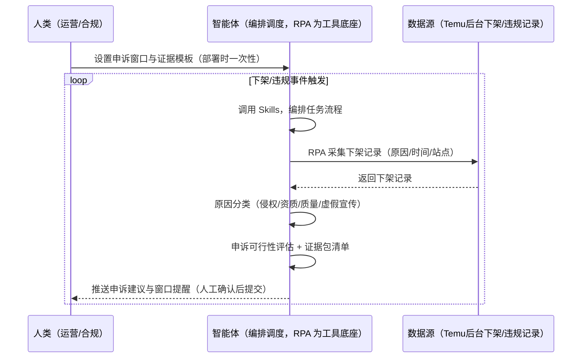
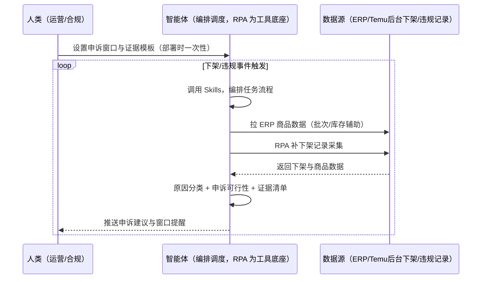

> 为 Temu 卖家团队打造的违规与下架监控方案。下架了才知道、申诉窗口错过、证据包准备慢。下架高发原因：侵权（仿牌/盗图/品牌未授权）、资质缺失、质量投诉、虚假宣传。本方案由智能体调度多个工具执行监控商品下架/违规记录，按原因分类评估申诉可行性。下架/违规事件触发，只推送申诉建议与窗口提醒。

> Agent 自动化需开通企业功能
> 点击申请1个月免费权限
> [点击申请 →](https://skieer.feishu.cn/share/base/form/shrcnFwMayykP5iaL38fnZKTbrg)

## 一、用户与需求

核心矛盾：下架了才知道（链接权重受损、在售库存损失）；申诉窗口通常 48h 内，错过即无效；证据包准备慢（底单/采购发票/授权书/检测报告）。

两类客户痛点同源，数据来源不同：

- 未购 SaaS 客户（新卖家/小团队）：人工盯下架、手动准备证据，全靠手；
- 已购 SaaS 客户（店小秘 ERP 等）：ERP 管订单库存，下架原因跟踪与申诉窗口提醒不覆盖，仍要人盯。

适用客户：品牌/侵权敏感类目卖家。商品下架（本土店）现成应用直挂；申诉证据准备智能体侧可辅助。

### 1.1 不同模式卖家

| 类型 | 选择 | 建议 |
|-|-|-|
| 全托管 | 首选 | 强烈推荐（下架=链接权重+在售库存双损失） |
| 半托管 | 次选 | 一般推荐（自营履约，下架影响同样大） |
| 平台模式 | 任意 | 试点中，违规机制待确认 |

### 1.2 不同类目卖家

| 类目 | 最关注维度 | 核心逻辑 |
|-|-|-|
| 3C 数码 | 侵权风险 | 仿牌/专利风险高 |
| 家居家具 | 质量投诉 | 材质质量问题下架 |
| 美妆个护 | 虚假宣传 | 夸大宣传处罚 |
| 服装鞋帽 | 盗图风险 | 图片侵权高发 |
| 户外运动 | 认证缺失 | 资质不全下架 |
| 母婴用品 | 安全合规 | 安全类目下架影响大 |

### 1.3 不同角色用户

| 用户 | 需求 | 问题 | 投入时间（估算） |
|-|-|-|-|
| 老板 | 下架损失最小化 | 下架了才知道 | 0.5 小时/周 |
| 运营 | 申诉建议+窗口提醒 | 窗口错过 | 1-2 小时/周 |
| 合规 | 证据包准备 | 证据准备慢 | 1 小时/周 |

---

## 二、现在的方法与问题

### 2.1 流程步骤与问题总结

人工方式（未购 SaaS 客户）

| 序号 | 步骤 | 现在的方法 | 问题缺陷 |
|-|-|-|-|
| 1 | 发现下架 | 手动翻后台 | 下架了才知道 |
| 2 | 查原因 | 手动看下架记录 | 原因分类靠人 |
| 3 | 备证据 | 手动找底单/发票 | 证据准备慢 |
| 4 | 申诉 | 手动提交 | 48h 窗口错过 |
| 5 | 跟踪 | 手动查结果 | 无系统跟踪 |

SaaS 方式（已购 ERP 客户）

| 序号 | 步骤 | 现在的方法 | 问题缺陷 |
|-|-|-|-|
| 1 | 发现下架 | ERP 不覆盖 | 靠人翻 |
| 2 | 查原因 | 手动 | 无分类 |
| 3 | 备证据 | 手动 | 无清单 |
| 4 | 申诉 | 手动 | 窗口错过 |
| 5 | 跟踪 | 无 | 无闭环 |

### 2.2 问题分析

人工方式根因

| 序号 | 根因 | 具体表现 |
|-|-|-|
| 1 | 下架后知后觉 | 链接权重+在售库存双损失 |
| 2 | 申诉窗口错过 | 48h 内有效，错过即无效 |
| 3 | 证据准备慢 | 底单/发票/授权书散乱 |

SaaS 方式根因

| 序号 | 根因 | 具体表现 |
|-|-|-|
| 1 | ERP 不覆盖 | 下架原因与申诉无工具 |
| 2 | 无闭环 | 申诉结果不回填迭代 |

---

## 三、解决方案

### 3.1 功能概述

为 Temu 卖家团队打造的违规与下架监控方案，监控商品下架/违规记录，按原因分类评估申诉可行性、输出证据包清单与窗口期提醒。

下架/违规事件触发并调度多个工具，调起八爪鱼 RPA（Agent 的工具底座，能耦合多系统、完成自动化任务执行）采集下架记录（原因/时间/站点），智能体按原因分类（侵权/资质/质量/虚假宣传）评估申诉可行性、输出申诉证据包清单与窗口期提醒。下架/违规事件触发，只推送申诉建议与窗口提醒。

### 3.2 系统结合

| 要素 | 说明 |
|-|-|
| 客户现有工具盘点 | **未购 SaaS 客户**：无第三方工具，下架全靠人工盯后台。     **已购 SaaS 客户**（主流组合）：店小秘 ERP（管订单库存，下架监控不覆盖） |
| 数据/能力来源 | **无 SaaS**：商品下架记录（现成应用直挂：TEMU 商品下架(本土店)）+ 后台违规记录（登录采集）。     **有 SaaS**：ERP 商品数据（辅助定位批次/库存）+ RPA 补下架记录采集 |
| RPA 耦合动作 | 作为 Agent 的工具底座，下架/违规事件触发采集记录（原因/时间/站点，记录快照），统一流转给智能体；采集失败自动重试、窗口临界告警 |
| 耦合出的新价值 | 单工具给不了的端到端结论：下架记录一次取齐 → 原因分类 → 申诉可行性评估 → 证据包清单 → 窗口提醒，**只推送申诉建议与窗口提醒** |

### 3.3 智能体执行流程

智能体事件触发（下架/违规事件）。支持**两种数据通道**，部署时按客户现有工具选择：

**通道一：无 SaaS 方式（RPA 采集下架记录，适合未购 ERP 的客户）**

**通道二：有 SaaS 方式（ERP 商品数据辅助 + RPA 补下架记录，适合已购客户）**

> Agent 自动化需开通企业功能
> 点击申请1个月免费权限
> [点击申请 →](https://skieer.feishu.cn/share/base/form/shrcnFwMayykP5iaL38fnZKTbrg)

### 3.4 为何这么设计

要同时回答三个问题：**为什么不能只用 SaaS/API？为什么不能纯靠智能体写代码？为什么 RPA 是执行底座？** 本场景的核心是"事件驱动、原因分类、窗口提醒、挂了有人管"。

#### 1）逐项对比

| 对比维度 | SaaS/API 堆叠（ERP） | 纯智能体（智能体写代码） | 智能体+自动化工具（RPA 工具底座） |
|-|-|-|-|
| 实现方式 | ERP 管商品，下架监控不覆盖 | 能抓后台能分类，但全要自己接 | 下架采集应用直挂 + 原因分类 |
| 事件驱动 | 不覆盖 | 智能体无法常驻轮询 | RPA 事件驱动、秒级响应 |
| 申诉评估 | 无 | 需自写分类与证据逻辑 | 分类规则+证据模板可视化配置 |
| 使用成本（总拥有成本） | ERP 订阅费（主体另算） | 代理 IP + 服务器 + 开发维护人力，隐性成本高 | 一份平台订阅跑多流程，单方案边际成本 ≈ 0 |
| 维护人要求 | 低（工具现成） | 规则调整都要开发介入 | 可视化流程，运营自己可调窗口 |

#### 2）优劣势说明

|  | SaaS/API 堆叠（ERP） | 纯智能体（智能体写代码） | 智能体+自动化工具（RPA 工具底座） |
|-|-|-|-|
| 优势 | 商品数据权威（批次定位） | 无订阅费；     可深度定制申诉模型 | 下架采集应用直挂；     原因分类+证据清单；     非技术人员可维护 |
| 劣势 | 下架监控不覆盖 | 采集与分类全自建；     AI 生成代码是生成性的 | 本地电脑运行需保持开机；     订阅费；     申诉提交需人工 |

#### 3）结论

| 论点 | 说明 |
|-|-|
| 下架=双损失 | 下架即损失（链接权重 + 在售库存）；越快申诉恢复损失越小（实锤） |
| 申诉窗口 48h | 申诉需在窗口期内提交底单/发票/授权书等证据；资质类申诉对证据链要求高（实锤） |
| 下架高发原因 | 侵权（仿牌/盗图/品牌未授权）、资质缺失（报告过期/认证不全）、质量投诉、虚假宣传（实锤） |
| 与上架/质检联动 | 本场景与「质检资质」「上架合规」场景联动（事前合规 > 事后申诉） |
| 一个底座跑多流程 | 客户购买 RPA 平台是跑多个流程（下架/质检/罚款），本方案只是其中一个——平台订阅费被多流程摊薄 |
| 时间 | 运营要的是"申诉建议 + 窗口提醒 + 证据清单"，不是"翻后台找底单" |

### 3.5 功能清单

| 功能 | 系统 | 功能说明（解决问题） |
|-|-|-|
| 会话/定时 | 智能体 | 1. 理解人类语言，调用已预设好的 Skills。     2. 编排多任务、调度多工具。 |
| 多系统数据取数 | RPA、指纹浏览器 | 1. 解决下架后知后觉、证据准备慢问题。     2. 作为智能体工具底座被调度执行，事件驱动采集、窗口临界告警。     3. **【无 SaaS 方式】** RPA 采集下架/违规记录（现成应用直挂）。**【有 SaaS 方式】** ERP 商品数据辅助 + RPA 补下架记录。 |
| 原因分类 | 智能体 | 侵权/资质/质量/虚假宣传四类分类。 |
| 申诉可行性评估 | 智能体 | 按原因类型评估申诉可行性（资质类证据链要求高）。 |
| 证据包清单 | 智能体 | 底单/采购发票/授权书/检测报告清单模板化。 |
| 窗口提醒 | 智能体 | 申诉窗口（通常 48h）倒计时，临界告警。 |
| IM通知 | 飞书、钉钉、企微等 | 解决窗口错过问题。申诉建议与窗口提醒自动推送。 |
| 数据资产储存 | 本地电脑、云储存 | 1. Skills 资产：Temu 申诉技能。     2. 数据储存：下架记录统一写入本地。     3. 经验知识库：申诉结果回填迭代。 |

### 3.6 智能体执行落地过程

部署时一次性配置入参（申诉窗口期、证据模板、推送群、数据通道），会话中无需重复输入。

**⚠️ 部署前提（不满足则方案无法跑起来）**：①RPA 需部署在**常开电脑/云机**上（事件驱动需常开），并配置漏跑补跑机制；②**申诉提交由人工确认**，本方案只出建议与证据清单（涉及合规动作）；③**有 SaaS 方式需 ERP 账号**（批次定位，可选增强，无则走后台通道）；④首次配置（登录态、分类规则、证据模板）需服务方/技术人员介入一次，属实施成本。

#### 1）配置

| 类别 | 说明 |
|-|-|
| 智能体 | 主流智能体。 |
| 智能体工具 | 1. **数据通道（按客户现有工具二选一）**：【无 SaaS】Temu 后台下架/违规（现成应用直挂）；【有 SaaS】ERP 商品数据 + RPA 补下架记录。     2. 数据取数与自动化执行：八爪鱼 RPA，MCP 配置完成。     3. 数据分析：智能体自带。     4. 数据报告：智能体自带。     5. IM：企业办公 IM（飞书/钉钉/企微），MCP 或 webhook 配置。 |
| 工作知识 | 1. 申诉窗口期（通常 48h 内）。     2. 证据模板：底单/采购发票/授权书/检测报告。     3. 分类规则：侵权/资质/质量/虚假宣传。 |
| 本地数据库 | 1. 下架记录库地址。     2. 证据包库地址。     3. 经验库地址。 |

#### 2）执行

| 任务 | 产出 | 产出物接收人 |
|-|-|-|
| 接收下架事件，事件触发 | 任务启动记录 | —— |
| 调用已预设 Skills，编排任务流程 | 任务编排方案 | —— |
| 经 MCP 向八爪鱼 RPA 下发取数任务 | 自动化任务指令 | —— |
| 多源取数并按商品对齐（无 SaaS：后台采集；有 SaaS：ERP+后台，智能体监控状态） | 对齐后下架数据 | —— |
| 原因分类（侵权/资质/质量/虚假宣传） | 分类结果 | 运营 |
| 申诉可行性评估 + 证据包清单 | 证据清单 | 合规/运营 |
| 窗口倒计时（48h） | 窗口提醒 | 运营 |
| 推送申诉建议与窗口提醒（人工确认后提交） | 群消息 | 运营/合规/老板 |

异常处理：

采集失败 → 自动重试并告警；

原因无法分类 → 转人工判定；

窗口临界 → 告警提醒；

证据缺失 → 标注待补；

置信度 &lt;70% → 转人工复核，不输出硬结论。

#### 3）结果

| 结果 | 说明 |
|-|-|
| 数据资产 | 下架记录库结构化数据（商品/原因/时间/站点/申诉状态），可审计可追溯。 |
| 分析报告 | 1. 申诉建议：按原因分类。     2. 证据包清单：模板化。     3. 窗口提醒：48h 倒计时。 |
| Skills | 智能体 Skills：Temu 申诉技能，按申诉结果迭代分类规则。 |

> Agent 自动化需开通企业功能
> 点击申请1个月免费权限
> [点击申请 →](https://skieer.feishu.cn/share/base/form/shrcnFwMayykP5iaL38fnZKTbrg)

---

## 四、使用前后预估

> 本方案价值 = **下架/违规事件采集 → 原因分类 → 申诉可行性评估 → 证据包清单 → 窗口提醒**。商品下架（本土店）现成应用直挂。

| 指标 | 人工 | SaaS/API（ERP） | 智能体+自动化工具 |
|-|-|-|-|
| 下架发现 | 后知后觉 | 不覆盖 | 事件驱动秒级发现 |
| 原因分类 | 靠人 | 无 | 四类自动分类 |
| 证据准备 | 手动找 | 无 | 证据清单模板化 |
| 申诉窗口 | 易错过 | 无提醒 | 48h 倒计时自动提醒 |
| 损失控制 | 权重+库存双损 | 无预警 | 越快申诉损失越小 |
| 方法论 | 无 | 单工具 | 可复用的 Skills 与分类规则 |

**说明**：下架高发原因（实锤）：侵权（仿牌/盗图/品牌未授权）、资质缺失（报告过期/认证不全）、质量投诉、虚假宣传（活动权限受限或罚款）；申诉需在窗口期内提交底单/采购发票/授权书等证据（资质类申诉对证据链要求高）；下架后链接权重受损，越快申诉恢复损失越小；本场景与「质检资质」「上架合规」场景联动（事前合规 > 事后申诉）。

---

## 五、效果证明

> Agent 自动化需开通企业功能
> 点击申请1个月免费权限
> [点击申请 →](https://skieer.feishu.cn/share/base/form/shrcnFwMayykP5iaL38fnZKTbrg)

### 5.1 客户案例

**《社媒违禁词监控：日均处理 300+ 违规帖》**

> 面向多账号多平台的价格体系与舆情治理，自动巡检违规帖与违禁词内容，锁定低价倾销与负面信息并留证。

| 效果 | 说明 |
|-|-|
| 提效 | 违规内容处理由人工逐页排查变为日均 300+ 条自动处理。原本需监控上百个电商链接与全网社媒内容、逐条人工审阅，现在 7×24 自动采集与识别。 |
| 降本 | 免除市场与法务人工逐条筛查的重复投入，投入转向维权处置与渠道治理等重点工作。 |
| 任务 | 覆盖电商链接价格合规、社媒违规内容与新闻舆情三类风险场景，全渠道统一监控。 |
| 任务 | 违规内容自动留证，为维权与渠道沟通提供证据链。 |

案例详情：[维权|违禁词监控：八爪鱼RPA日均处理300+违规帖，守牢价格体系，扼杀负面舆情](https://skieer.feishu.cn/wiki/VBfdwmbNbiSVHhkMt1tc528Tn0d)

### 5.2 DEMO应用

TEMU 商品下架(本土店)：https://rpa.bazhuayu.com/appstore/app/wawawa/temu--shang-pin-xia-jia--ben-tu-dian-

---

## 六、备注

### 6.1 Agent 支持

本方案不绑定具体智能体，主流 Agent 均可运行（需支持技能/Skills 加载与工具调用）：

| Agent/智能体 | 说明 |
|-|-|
| Workbuddy | 本方案运行平台，支持技能/Skills 上传加载、定时任务、MCP 工具调用与表格/报告处理 |
| 豆包（国内·字节） | 国内主流个人智能体，支持技能上传、定时任务与工具调用，上手成本低 |
| 通义千问（国内·阿里） | 支持 Agent 编排与插件生态，集成阿里电商数据能力，适合电商场景 |
| DeepSeek（国内） | 推理能力强、成本低，适合规则打分与归因分析类任务 |
| ChatGPT（国外·OpenAI） | 海外主流通用智能体，支持 GPTs/Agent 模式与工具调用 |
| Claude（国外·Anthropic） | 长文本与结构化分析能力强，原生支持 MCP 连接外部工具 |

### 6.2 名词解释

| 术语 | 说明 |
|-|-|
| 申诉窗口 | 通常 48h 内提交证据，逾期无效 |
| 下架高发原因 | 侵权 / 资质缺失 / 质量投诉 / 虚假宣传 |
| 证据包 | 底单 / 采购发票 / 授权书 / 检测报告 |
| 资质类申诉 | 对证据链要求高的申诉类型 |
| 链接权重 | 下架后链接权重受损，越快申诉恢复损失越小 |
| 混合数据源 | 后台下架/违规记录（现成应用直挂）+ ERP 商品数据（有 SaaS 客户批次定位） |
| 有 SaaS 方式 | 已购店小秘 ERP，商品数据辅助 + RPA 补下架记录 |
| 无 SaaS 方式 | 不购买第三方工具，RPA 采集下架记录 |
| 全托管 | 供货商模式，卖家只供货、平台定价销售（美区仅半托管） |
| 半托管 | 卖家自主运营与履约（美区主流模式） |
| MCP | Model Context Protocol，智能体连接外部工具的标准化通道 |

> Agent 自动化需开通企业功能
> 点击申请1个月免费权限
> [点击申请 →](https://skieer.feishu.cn/share/base/form/shrcnFwMayykP5iaL38fnZKTbrg)

---

原文：[查看原文](https://skieer.feishu.cn/wiki/IVjuw0BmTiTdcskNfbfcfwqinhg)
