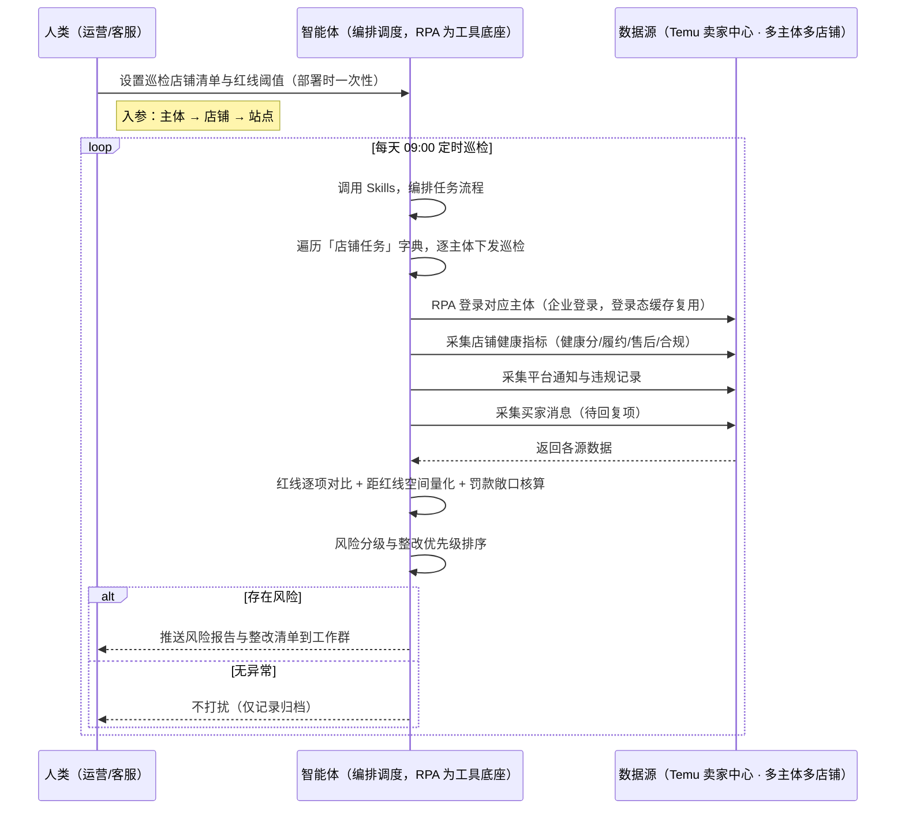
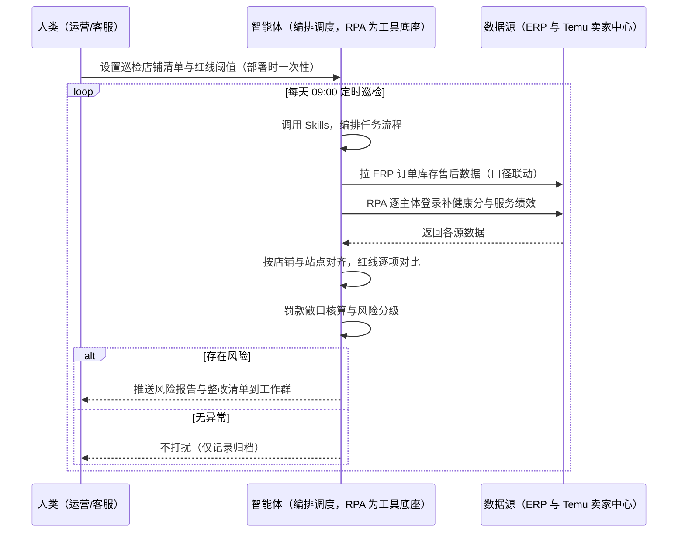

> 为 Temu 卖家团队打造的店铺健康度巡检方案。多主体、多店铺、多站点，店铺健康状况却分散在后台多个页面——健康分、履约与售后表现、违规与处罚记录、平台通知、买家消息，每天靠运营逐个主体登录、逐页翻查，巡检频次低、漏检多、下滑发现晚；而健康分、履约、售后任一指标踩线，轻则限流、活动报名受限，重则罚款甚至冻结。本方案由智能体调度多个工具执行「多主体自动登录 → 健康指标采集 → 平台通知与违规采集 → 买家消息采集 → 红线逐项对比 → 风险分级 → 整改清单」，按实锤规则库核算距红线空间与罚款敞口，只推送风险与整改项。定时自动执行，全程自动化，无异常不打扰。

> Agent 自动化需开通企业功能
> 点击申请1个月免费权限
> [点击申请 →](https://skieer.feishu.cn/share/base/form/shrcnFwMayykP5iaL38fnZKTbrg)

[查看原视频](https://skieer.feishu.cn/wiki/BI0FwHqTyib7DAkuciBckGcpnVV)

## 一、用户与需求

核心矛盾：多主体多店铺的健康状况分散在多个页面，人工巡检频次低、漏检多；指标踩线触发限流、活动受限与罚款，等收到通知已经晚了。

两类客户痛点同源，数据来源不同：

- 未购 SaaS 客户（新卖家/小团队）：人工逐个主体登录、逐页翻健康分与违规记录，凭经验判断危不危险，全靠手；
- 已购 SaaS 客户（店小秘 ERP 等）：ERP 管订单库存，健康度巡检不覆盖，健康分、服务绩效、通知与违规仍要人翻后台。

适用客户：多主体/多店铺/多站点，或店铺健康度直接影响流量与罚款的卖家。单店铺小卖家价值有限（人工每周看一次即可，本方案不推荐）。

### 1.1 不同模式卖家

| 类型 | 选择 | 建议 |
|-|-|-|
| 半托管 | 首选 | 强烈推荐（自主履约+自主客服，健康指标与买家消息全量巡检） |
| 全托管 | 首选 | 强烈推荐（履约/售后/合规全口径；客服由平台承接，本方案聚焦指标与通知） |
| 平台模式 | 次选 | 一般推荐（规则与罚款机制待确认，先做指标与通知巡检） |

### 1.2 不同类目卖家

| 类目 | 最关注维度 | 核心逻辑 |
|-|-|-|
| 3C 数码 | 履约+缺货 | 客单价高，缺货与延迟入仓罚款大 |
| 家居家具 | 发货及时率 | 大件备货周期长，发货及时率易踩线 |
| 美妆个护 | 品质分+售后率 | 品质分与售后率双红线联动（品质分 &lt;60 且售后率 ≥5%） |
| 服装鞋帽 | 退货率 | 换季退货集中，退货率直接影响服务指标 |
| 户外运动 | 旺季履约 | 旺季单量暴增，履约指标波动大 |
| 母婴用品 | 全面从严 | 安全类目，合规与质检指标从严监控 |

### 1.3 不同角色用户

| 用户 | 需求 | 问题 | 投入时间（估算） |
|-|-|-|-|
| 老板 | 店铺不被限流/罚款 | 指标下滑后知后觉 | 0.5 小时/周 |
| 运营 | 健康度看板+整改 | 逐个店铺翻后台费时 | 1-2 小时/天 |
| 客服 | 待回复消息不漏 | 多店铺消息分散 | 1 小时/天 |
| 合规 | 违规与处罚早发现 | 通知分散易漏 | 1 小时/周 |

---

## 二、现在的方法与问题

### 2.1 流程步骤与问题总结

人工方式（未购 SaaS 客户）

| 序号 | 步骤 | 现在的方法 | 问题缺陷 |
|-|-|-|-|
| 1 | 登后台 | 逐个主体登录、逐店铺切换站点 | 多主体多店铺，登录就耗掉大半时间 |
| 2 | 看健康 | 手动翻数据中心服务绩效/健康分 | 指标分散，巡检频次低 |
| 3 | 看通知 | 靠人盯平台通知与违规记录 | 通知分散易漏，处罚通知滞后 |
| 4 | 看消息 | 手动翻买家消息 | 回复时效有要求，漏回影响服务指标 |
| 5 | 汇总整改 | 手动记表 | 无红线口径、无优先级 |

SaaS 方式（已购 ERP 客户）

| 序号 | 步骤 | 现在的方法 | 问题缺陷 |
|-|-|-|-|
| 1 | 登后台 | ERP 管订单库存 | 健康度巡检不覆盖 |
| 2 | 看健康 | ERP 无健康分/服务绩效 | 仍要靠人翻后台 |
| 3 | 看通知 | 无 | 靠人盯 |
| 4 | 看消息 | ERP 客服模块部分覆盖 | 与健康指标不联动 |
| 5 | 汇总整改 | 手动 | 无闭环、不沉淀 |

### 2.2 问题分析

人工方式根因

| 序号 | 根因 | 具体表现 |
|-|-|-|
| 1 | 巡检频次低 | 多主体多店铺，人工只能抽查，漏检常态化 |
| 2 | 指标分散在多个页面 | 健康分/履约/售后/违规/通知各在一处，看全要翻很多页 |
| 3 | 无红线口径 | 距红线多少空间、哪项先踩线，说不清 |
| 4 | 消息与服务指标脱节 | 买家消息漏回，直接反映到服务维度指标 |

SaaS 方式根因

| 序号 | 根因 | 具体表现 |
|-|-|-|
| 1 | ERP 不覆盖健康度 | 订单库存之外，健康分与服务绩效仍是盲区 |
| 2 | 无跨页面组装 | 各模块数据不联动，出不了「一店铺一结论」 |
| 3 | 整改不沉淀 | 整改经验在个人手上，换人就重来 |

---

## 三、解决方案

### 3.1 功能概述

为 Temu 卖家团队打造的店铺健康度巡检方案，解决多主体多店铺巡检频次低、红线对比靠人、整改无依据的问题。

定时触发并调度多个工具，调起八爪鱼 RPA（Agent 的工具底座，能耦合多系统、完成自动化任务执行）逐主体登录、按「店铺任务」清单逐店铺切换站点统一取数，一次取齐「店铺健康指标 + 平台通知与违规记录 + 买家消息」，智能体做红线逐项对比、距红线空间量化、罚款敞口核算与风险分级，输出整改清单。每天定时巡检，有风险才推送，踩线前就预警。

### 3.2 系统结合

| 要素 | 说明 |
|-|-|
| 客户现有工具盘点 | **未购 SaaS 客户**：无第三方工具，健康度全靠逐主体登录后台手动查。      
**已购 SaaS 客户**（主流组合）：店小秘 ERP（管订单库存，健康度巡检不覆盖） |
| 数据/能力来源 | **无 SaaS**：Temu 卖家中心（数据中心服务绩效/健康分、店铺管理违规信息、平台通知、买家消息，RPA 登录采集）。      
**有 SaaS**：ERP 订单/售后数据（辅助定位责任批次）+ RPA 后台取健康与通知（ERP 未覆盖部分） |
| RPA 耦合动作 | 作为 Agent 的工具底座，按「店铺任务」清单（主体 → 店铺 → 站点）逐主体登录（登录态缓存复用，避免重复登录），逐店铺采集健康指标/通知/消息，按店铺与站点对齐去重，统一流转给智能体；任一店铺采集失败自动重试并标注待补 |
| 耦合出的新价值 | 单工具给不了的端到端结论：多主体多店铺健康数据一次取齐 → 红线逐项对比 → 距红线空间量化 → 罚款敞口核算 → 风险分级与整改清单，有风险自动推送工作群，免去人工逐店铺翻后台 |

### 3.3 智能体执行流程

智能体定时触发。支持**两种数据通道**，部署时按客户现有工具选择：

**通道一：无 SaaS 方式（RPA 逐主体登录后台取数，适合未购 ERP 的客户）**

**通道二：有 SaaS 方式（ERP 数据联动 + RPA 补健康度盲区，适合已购客户）**

> Agent 自动化需开通企业功能
> 点击申请1个月免费权限
> [点击申请 →](https://skieer.feishu.cn/share/base/form/shrcnFwMayykP5iaL38fnZKTbrg)

### 3.4 为何这么设计

要同时回答三个问题：**为什么不能只用 SaaS/API？为什么不能纯靠智能体写代码？本场景的核心是"多主体多店铺、每天定时、一次取齐、红线对比、有风险推送、挂了有人管"。**

#### 1）逐项对比

| 对比维度 | SaaS/API 堆叠（店小秘） | 纯智能体（智能体写代码） | 智能体+自动化工具（RPA 工具底座） |
|-|-|-|-|
| 实现方式 | ERP 管订单库存，健康度巡检不覆盖 | 能写脚本抓后台，但多主体登录与页面适配全要自己接 | 一个底座跑多个流程（巡检/合规/售后/选品……），健康度只是其中一个 |
| 多主体多店铺登录 | ERP 不登录平台后台 | 多账号登录态维持、验证码、代理隔离全自建 | 指纹浏览器+平台沉淀的登录态管理，多主体批量巡检 |
| 页面适配 | ERP 不覆盖健康度页面 | 后台改版即失效，要自己维护选择器 | 平台模板持续适配，改版不用卖家管 |
| 定时与推送 | ERP 无健康度告警 | 调度器/进程常驻/告警通道全自建 | 平台调度稳定触发，失败重试 + 异常告警，有风险才推送 |
| 使用成本（总拥有成本） | 一套订阅管一段，健康度不在其中 | 服务器+代理+开发维护人力，隐性成本高 | 一份平台订阅跑所有流程，单方案边际成本 ≈ 0 |
| 维护人要求 | 低（但不覆盖本场景） | 规则与选择器调整都要开发介入 | 可视化流程，运营自己可调红线阈值与推送群 |

#### 2）优劣势说明

|  | SaaS/API 堆叠（店小秘） | 纯智能体（智能体写代码） | 智能体+自动化工具（RPA 工具底座） |
|-|-|-|-|
| 优势 | 订单库存数据权威、多平台统一 | 无订阅费；    
可深度定制红线规则；    
技术上完全可行 | 一个底座跑多流程、多主体一次取齐；    
红线对比/敞口核算/整改清单即开即用；    
非技术人员可维护 |
| 劣势 | 健康度与服务绩效不覆盖；    
无跨页面组装；整改靠人 | 多主体登录态、页面适配、调度全自建；    
AI 生成代码是生成性的，漏检风险不可控 | 本地电脑运行需保持开机；    
订阅费；    
灵活性受平台模板边界限制 |

#### 3）结论

| 论点 | 说明 |
|-|-|
| 只用 SaaS/API 缺"健康度巡检" | 店小秘解决订单库存，健康分、服务绩效、通知与违规它不覆盖——这是本方案的增量 |
| 纯智能体缺"工程底座" | 取数与登录态维持占这类任务 70% 的工作量，不在"写对比逻辑"；RPA 作为工具底座把这 70% 已经造好 |
| 一个底座跑多流程 | 客户购买 RPA 平台是跑多个流程（巡检/合规/售后/订单/选品），本方案只是其中一个——平台订阅费被多流程摊薄，单方案边际成本接近 0 |
| 确定性 vs 生成性 | 巡检是确定性任务——同样的账号，要求"每天把该看的店铺一家不漏地看完、看到同一组指标"。RPA 流程行为可预期，AI 生成的代码能跑通 ≠ 长期不漏检 |
| 时间 | 运营要的是"每天 9:00 拿到风险清单和整改项"，不是"每天手动逐个登录店铺翻后台"；判断层交给智能体，执行层交给工具底座 |

### 3.5 功能清单

| 功能 | 系统 | 功能说明（解决问题） |
|-|-|-|
| 会话/定时 | 智能体 | 1. 理解人类语言，调用已预设好的 Skills。      
2. 编排多任务、调度多工具。 |
| 多主体多店铺取数 | RPA、指纹浏览器 | 1. 解决多主体多店铺巡检频次低、指标下滑发现晚的问题。      
2. 作为智能体工具底座被调度执行，按「店铺任务」清单逐主体登录，登录态缓存复用；采集失败自动重试、缺失标注待补。      
3. **【无 SaaS 方式】** RPA 登录 Temu 卖家中心采集健康分/服务绩效/违规记录/平台通知/买家消息。**【有 SaaS 方式】** ERP 订单售后数据联动 + RPA 补健康度盲区。 |
| 数据清洗对齐 | 智能体 | 按主体/店铺/站点对齐去重，解决多来源数据口径不一致问题。 |
| 红线对比 | 智能体 | 健康分、履约、售后、合规逐项对比平台红线，标记风险并量化距红线空间。 |
| 罚款敞口核算 | 智能体 | 按实锤规则库（延迟入仓/缺货/品质/资质）核算风险敞口，区分"已罚"与"将罚"。 |
| 风险分级与整改 | 智能体 | 输出红/黄/绿分级 + 整改清单（按优先级排序），整改与申诉由人工确认后执行。 |
| IM通知 | 飞书、钉钉、企微等 | 解决风险发现滞后问题。有风险才推送，无异常不打扰。 |
| 数据资产储存 | 本地电脑、云储存 | 1. Skills 资产：红线阈值、罚款规则库与整改模板。      
2. 数据储存：健康度记录按日沉淀，可审计。      
3. 经验知识库：整改记录与申诉结果持续沉淀。 |

### 3.6 智能体执行落地过程

部署时一次性配置入参（巡检店铺清单、红线阈值、推送群、数据通道），会话中无需重复输入。

**⚠️ 部署前提（不满足则方案无法跑起来）**：①RPA 需部署在**常开电脑/云机**上（每天定时巡检，关机即停），并配置漏跑补跑机制；②多主体登录依赖**指纹浏览器与已配置好的登录态**（登录态失效需人工重登一次）；③**Temu 后台菜单与指标口径会迭代**，以平台最新界面与规则为准，红线阈值需定期人工校准；④整改与申诉为平台操作，**由人工确认后执行**；⑤首次配置（店铺清单、登录态、红线阈值、规则库）需服务方/技术人员介入一次，属实施成本。

#### 1）配置

| 类别 | 说明 |
|-|-|
| 智能体 | 主流智能体。 |
| 智能体工具 | 1. **数据通道（按客户现有工具二选一）**：【无 SaaS】Temu 卖家中心（RPA 登录采集）；【有 SaaS】店小秘 ERP 数据 + RPA 补健康度盲区。      
2. 数据取数与自动化执行：八爪鱼 RPA，MCP 配置完成。      
3. 数据分析：智能体自带。      
4. 数据报告：智能体自带。      
5. IM：企业办公 IM（飞书/钉钉/企微），MCP 或 webhook 配置。 |
| 工作知识 | 1. 巡检店铺清单：主体 → 店铺 → 站点。      
2. 红线阈值：健康分、履约、售后、合规各项（按平台当前规则配置）。      
3. 罚款规则库：延迟入仓/缺货/品质/资质等口径。      
4. 整改模板：按指标类型预设。 |
| 本地数据库 | 1. 健康度记录库地址。      
2. 风险与整改清单地址。      
3. 经验库地址。 |

#### 2）执行

| 任务 | 产出 | 产出物接收人 |
|-|-|-|
| 接收巡检配置，定时触发 | 任务启动记录 | —— |
| 调用已预设 Skills，编排任务流程 | 任务编排方案 | —— |
| 经 MCP 向八爪鱼 RPA 下发巡检任务 | 自动化任务指令 | —— |
| 遍历「店铺任务」清单，逐主体登录并采集（无 SaaS：后台采集；有 SaaS：ERP+后台，智能体监控状态） | 对齐后健康数据 | —— |
| 红线逐项对比，标记风险 | 风险标签 | 运营 |
| 距红线空间量化 + 罚款敞口核算 | 敞口结论 | 运营/合规 |
| 生成风险分级与整改清单（人工确认后整改/申诉） | 整改清单 | 运营/客服 |
| 推送风险报告（有风险才推送） | 群消息 | 运营/老板 |

异常处理：

登录失效/需验证 → 告警并跳过该主体，人工重登后补跑；

页面采集失败 → 自动重试，仍失败标注待补；

指标缺失 → 沿用上次快照并标注；

规则口径不确定 → 转人工判定，不输出硬结论；

置信度 &lt;70% → 转人工复核，不输出硬结论。

#### 3）结果

| 结果 | 说明 |
|-|-|
| 数据资产 | 全量健康度结构化数据（主体/店铺/站点/健康分/履约/售后/合规/风险标签/整改状态），可审计可追溯。 |
| 分析报告 | 1. 健康度报告：多店铺一表对比 + 各指标红线对比。      
2. 风险清单：超标项附距红线空间、罚款敞口与责任环节。      
3. 整改清单：按优先级排序的整改项与模板。 |
| Skills | 智能体 Skills：红线阈值、罚款规则库与整改模板，随巡检结果迭代。 |

> Agent 自动化需开通企业功能
> 点击申请1个月免费权限
> [点击申请 →](https://skieer.feishu.cn/share/base/form/shrcnFwMayykP5iaL38fnZKTbrg)

---

## 四、使用前后预估

> 本方案价值 = **多主体多店铺一次取齐 → 红线逐项对比 → 距红线空间量化 → 罚款敞口核算 → 整改清单**。把运营从"逐个店铺翻后台"中解放出来，健康度监控从"抽查"变成"全量巡检"。

| 指标 | 人工 | SaaS/API（店小秘） | 智能体+自动化工具 |
|-|-|-|-|
| 巡检耗时 | 每天 1-2 小时（估算，视店铺数） | 健康度不覆盖，仍靠人 | 全自动；人工转为审核整改（每周约 0.5 小时） |
| 巡检覆盖率 | 抽查，漏检常态化 | 不适用 | 清单内主体/店铺/站点全覆盖 |
| 发现时效 | 限流或罚单后才知道 | 不覆盖 | 每天巡检，踩线前预警 |
| 红线对比 | 凭经验 | 无 | 逐项对比 + 距红线空间量化 |
| 罚款敞口 | 被动等罚单 | 不覆盖 | 按规则库核算风险敞口 |
| 整改质量 | 无模板 | 无 | 清单+模板就绪 |
| 方法论 | 无，换人结论不同 | 单系统 | 可复用的 Skills 与规则库 |

**说明**：健康分、履约、售后、违规等指标取自平台后台（准确字段）；红线阈值与罚款口径按平台当前规则配置，平台规则调整需人工校准；本方案只出风险结论与整改建议，整改与申诉由人工确认后执行；未购 SaaS 客户的巡检耗时按店铺数量估算，店铺越多收益越明显。

---

## 五、效果证明

---

## 六、备注

### 6.1 Agent 支持

本方案不绑定具体智能体，主流 Agent 均可运行（需支持技能/Skills 加载与工具调用）：

| Agent/智能体 | 说明 |
|-|-|
| Workbuddy | 本方案运行平台，支持技能/Skills 上传加载、定时任务、MCP 工具调用与表格/报告处理 |
| 豆包（国内·字节） | 国内主流个人智能体，支持技能上传、定时任务与工具调用，上手成本低 |
| 通义千问（国内·阿里） | 支持 Agent 编排与插件生态，集成阿里电商数据能力，适合电商场景 |
| DeepSeek（国内） | 推理能力强、成本低，适合规则打分与归因分析类任务 |
| ChatGPT（国外·OpenAI） | 海外主流通用智能体，支持 GPTs/Agent 模式与工具调用 |
| Claude（国外·Anthropic） | 长文本与结构化分析能力，原生支持 MCP 连接外部工具 |

### 6.2 名词解释

| 术语 | 说明 |
|-|-|
| 店铺健康度 | 店铺综合表现的评价集合：健康分、履约、售后、商品合规等（后台服务绩效/数据中心） |
| 健康分 | 平台对店铺运营质量给出的综合评分，是流量与活动资格的重要参考 |
| 服务绩效 | 履约与售后维度的表现指标集合（发货/退货/纠纷等） |
| 履约 | 订单发货与入仓的及时性表现，是 Temu 权重最高的考核维度之一 |
| 违规记录 | 平台对店铺与商品的处罚记录（违规原因/时间/处罚类型/处置状态） |
| 罚款敞口 | 按平台规则口径估算的、尚未落地但可能发生的罚款金额 |
| 双红线 | 品质分与售后率等指标同时踩线时触发的联动处罚条件 |
| 店铺任务 | 本方案的巡检清单结构：主体 → 店铺 → 站点，RPA 按此逐层遍历 |
| 登录态缓存 | 同一主体下多店铺只登录一次并复用会话，避免重复登录与风控 |
| 指纹浏览器 | 隔离 Cookie 与浏览器指纹的工具，多账号多主体防关联 |
| 混合数据源 | 后台取数（健康度/通知/消息）+ ERP 数据（有 SaaS 客户订单售后联动） |
| 有 SaaS 方式 | 已购店小秘 ERP，订单售后数据联动 + RPA 补健康度盲区 |
| 无 SaaS 方式 | 不购买第三方工具，由 RPA 逐主体登录后台采集 |
| 全托管 | 供货商模式，卖家只供货、平台定价销售与承接客服 |
| 半托管 | 卖家自主运营与履约，需自行处理发货与买家消息 |
| MCP | Model Context Protocol，智能体连接外部工具的标准化通道 |

> Agent 自动化需开通企业功能
> 点击申请1个月免费权限
> [点击申请 →](https://skieer.feishu.cn/share/base/form/shrcnFwMayykP5iaL38fnZKTbrg)

---

原文：[查看原文](https://skieer.feishu.cn/wiki/BI0FwHqTyib7DAkuciBckGcpnVV)
