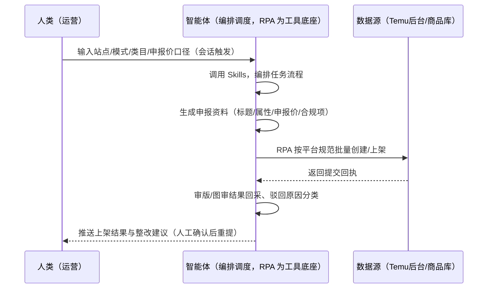
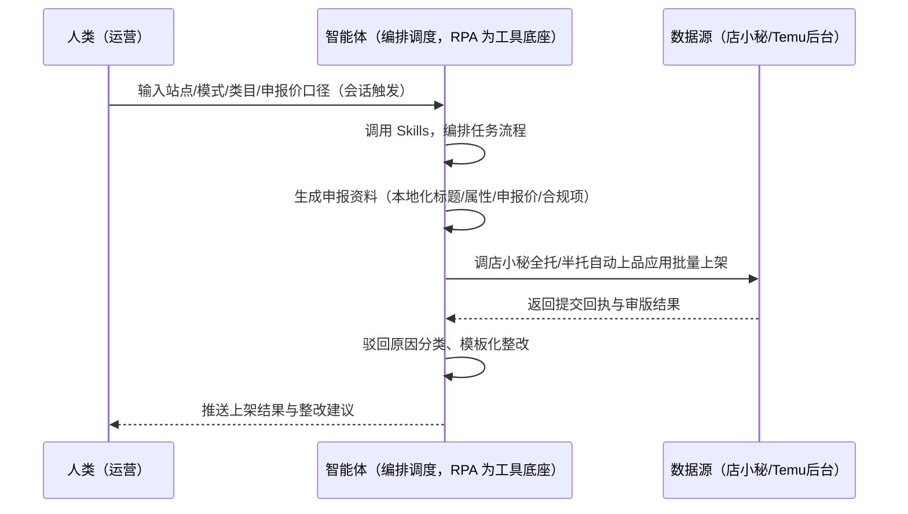

> 为 Temu 卖家团队打造的商品发布与合规预检方案。逐条上品慢、多 SKU 铺货要一整天；标题/属性/申报价凭感觉，驳回率高；全托/半托两套流程易混。本方案由智能体调度多个工具执行按平台规范批量创建/上架商品，智能体生成申报资料并做合规预检。选品通过即触发，上架结果与驳回原因自动回采。

> Agent 自动化需开通企业功能
> 点击申请1个月免费权限
> [点击申请 →](https://skieer.feishu.cn/share/base/form/shrcnFwMayykP5iaL38fnZKTbrg)

## 一、用户与需求

核心矛盾：逐条上品慢、多 SKU 铺货要一整天；标题/属性/申报价凭感觉，驳回率高（价格不符/图片不合规/资质缺失为主因）；全托/半托两套流程易混。

两类客户痛点同源，数据来源不同：

- 未购 SaaS 客户（新卖家/小团队）：人工逐条填写上架表单、手工准备申报资料，全靠手；
- 已购 SaaS 客户（店小秘 ERP 等）：店小秘有全托/半托自动上品现成应用（寄样-审版-图审链路），但申报资料生成、合规预检仍要人做。

适用客户：多 SKU 铺货型卖家。双路径均有现成应用直挂（店小秘全托/半托自动上品）。

### 1.1 不同模式卖家

| 类型 | 选择 | 建议 |
|-|-|-|
| 全托管 | 首选 | 强烈推荐（店小秘全托自动上品：寄样-审版-图审链路） |
| 半托管 | 次选 | 一般推荐（美区仅半托管；店小秘半托自动上品：自行上架+库存维护） |
| 平台模式 | 任意 | 试点中，先确认目标站点与模式可用性 |

### 1.2 不同类目卖家

| 类目 | 最关注维度 | 核心逻辑 |
|-|-|-|
| 3C 数码 | 属性合规 | 参数类目属性多，填错即驳回 |
| 家居家具 | 图片规范 | 大件需多角度图，合规要求高 |
| 美妆个护 | 资质预检 | 需检测报告，资质缺失即驳回 |
| 服装鞋帽 | 尺码本地化 | 多尺码 SKU，本地化要求高 |
| 户外运动 | 认证门槛 | 认证不全即驳回 |
| 母婴用品 | 安全合规 | CPC 等认证前置，缺失即禁售 |

### 1.3 不同角色用户

| 用户 | 需求 | 问题 | 投入时间（估算） |
|-|-|-|-|
| 老板 | 上架效率与通过率 | 多 SKU 铺货慢，驳回率高 | 0.5 小时/周 |
| 运营 | 批量上架+驳回整改 | 逐条填表繁琐 | 2-4 小时/周 |
| 合规 | 资质预检 | 资质缺失被驳回/罚款 | 1 小时/周 |

---

## 二、现在的方法与问题

### 2.1 流程步骤与问题总结

人工方式（未购 SaaS 客户）

| 序号 | 步骤 | 现在的方法 | 问题缺陷 |
|-|-|-|-|
| 1 | 填资料 | 逐条填标题/属性/申报价 | 多 SKU 要一整天 |
| 2 | 备资质 | 手动找资质文件 | 缺失被驳回 |
| 3 | 上架 | 逐条提交 | 驳回率高，反复改 |
| 4 | 查结果 | 手动看审版/图审结果 | 驳回原因不清 |
| 5 | 整改 | 凭感觉改 | 不知道改哪里 |

SaaS 方式（已购店小秘 ERP 客户）

| 序号 | 步骤 | 现在的方法 | 问题缺陷 |
|-|-|-|-|
| 1 | 填资料 | 店小秘批量上品 | 申报资料生成靠人 |
| 2 | 备资质 | 手动备 | 预检靠人 |
| 3 | 上架 | 店小秘自动上品（寄样-审版-图审） | 已覆盖主体 |
| 4 | 查结果 | 半自动 | 驳回原因分类靠人 |
| 5 | 整改 | 手动改 | 无模板化整改 |

### 2.2 问题分析

人工方式根因

| 序号 | 根因 | 具体表现 |
|-|-|-|
| 1 | 逐条填表 | 多 SKU 上架效率低 |
| 2 | 凭感觉申报 | 标题/属性/申报价凭感觉，驳回率高 |
| 3 | 资质缺失 | 上架前无预检，被驳回/罚款 |

**SaaS 方式根因**

| 序号 | 根因 | 具体表现 |
|-|-|-|
| 1 | 资料生成靠人 | 店小秘管上架执行，申报资料与合规预检不覆盖 |
| 2 | 驳回不闭环 | 驳回原因不自动分类回填 |

---

## 三、解决方案

### 3.1 功能概述

为 Temu 卖家团队打造的商品发布与合规预检方案，按平台规范批量创建/上架商品，智能体生成申报资料并做合规预检。

选品通过即触发并调度多个工具，调起八爪鱼 RPA（Agent 的工具底座，能耦合多系统、完成自动化任务执行）按平台规范批量创建/上架商品（全托管：店小秘全托自动上品走寄样-审版-图审链路；半托管：店小秘半托自动上品自行上架维护库存），智能体按站点本地化生成标题/属性/价格申报建议并输出合规检查清单。选品通过即触发，上架结果与驳回原因自动回采。

### 3.2 系统结合

| 要素 | 说明 |
|-|-|
| 客户现有工具盘点 | **未购 SaaS 客户**：无第三方工具，上架全靠逐条手填。    
**已购 SaaS 客户**（主流组合）：店小秘 ERP（全托/半托自动上品现成应用直挂） |
| 数据/能力来源 | **无 SaaS**：Temu 后台上架表单（登录操作，RPA 自建流程）+ 商品库（本地维护）。    
**有 SaaS**：店小秘全托/半托自动上品（寄样-审版-图审链路）+ 智能体补申报资料生成与合规预检 |
| RPA 耦合动作 | 作为 Agent 的工具底座，按平台规范批量创建/上架（表单字段校验映射、提交回执校验、失败重试），统一流转给智能体；批量节奏控制防平台风控 |
| 耦合出的新价值 | 单工具给不了的端到端结论：申报资料一次生成 → 合规预检 → 批量上架 → 驳回原因自动分类 → 模板化整改，上架通过率可追踪 |

### 3.3 智能体执行流程

用户向智能体输入会话（入参：站点与模式、类目、申报价口径、合规资质文件）。支持**两种数据通道**，部署时按客户现有工具选择：

**通道一：无 SaaS 方式（RPA 自建上架流程，适合未购 ERP 的客户）**

**通道二：有 SaaS 方式（店小秘自动上品直挂 + 智能体补资料，适合已购客户）**

> Agent 自动化需开通企业功能
> 点击申请1个月免费权限
> [点击申请 →](https://skieer.feishu.cn/share/base/form/shrcnFwMayykP5iaL38fnZKTbrg)

### 3.4 为何这么设计

要同时回答三个问题：**为什么不能只用 SaaS/API？为什么不能纯靠智能体写代码？为什么 RPA 是执行底座？** 本场景的核心是"模板化发布、合规预检、驳回闭环、挂了有人管"。

#### 1）逐项对比

| 对比维度 | SaaS/API 堆叠（店小秘） | 纯智能体（智能体写代码） | 智能体+自动化工具（RPA 工具底座） |
|-|-|-|-|
| 实现方式 | 店小秘自动上品（主体） | 能调后台能生成文案，但发布动作不可留痕 | 店小秘直挂 + 智能体补资料预检 |
| 发布确定性 | 模板化执行可靠 | 生成式输出可能产生非法值/格式错乱 | RPA 按固定模板执行，可留痕可重跑 |
| 合规预检 | 不覆盖 | 需自写词库与资质核对 | 词库/资质清单结构化，预检即开即用 |
| 使用成本（总拥有成本） | 店小秘订阅费（主体） | 代理 IP + 服务器 + 开发维护人力，隐性成本高 | 一份平台订阅跑多流程，单方案边际成本 ≈ 0 |
| 维护人要求 | 低（工具现成） | 规则调整都要开发介入 | 可视化流程，运营自己可调模板 |

#### 2）优劣势说明

|  | SaaS/API 堆叠（店小秘） | 纯智能体（智能体写代码） | 智能体+自动化工具（RPA 工具底座） |
|-|-|-|-|
| 优势 | 自动上品链路成熟（寄样-审版-图审） | 无订阅费；    
可深度定制申报模型 | 店小秘直挂+资料生成+合规预检，驳回闭环；    
非技术人员可维护 |
| 劣势 | 申报资料与预检不覆盖 | AI 生成代码是生成性的，发布动作不可控 | 本地电脑运行需保持开机；    
订阅费；    
批量节奏需防风控 |

#### 3）结论

| 论点 | 说明 |
|-|-|
| 发布动作必须确定性 | 后台表单需按模板逐字段校验映射，发布动作必须可留痕、可重跑——脚本按固定模板执行最可靠 |
| 文案与预检交给智能体 | 标题/卖点/多语言文案生成 + 合规预检是生成性任务，智能体擅长；发布始终由 RPA/店小秘确定性完成 |
| 一个底座跑多流程 | 客户购买 RPA 平台是跑多个流程（上架/图片/合规），本方案只是其中一个——平台订阅费被多流程摊薄 |
| 驳回闭环 | 驳回主因：价格不符/图片不合规/资质缺失——分类回填后模板化整改，通过率可追踪（目标 ≥80%） |
| 时间 | 运营要的是"批量上架 + 驳回整改闭环"，不是"逐条手填" |

### 3.5 功能清单

| 功能 | 系统 | 功能说明（解决问题） |
|-|-|-|
| 会话/定时 | 智能体 | 1. 理解人类语言，调用已预设好的 Skills。    
2. 编排多任务、调度多工具。 |
| 多系统数据取数 | RPA、指纹浏览器 | 1. 解决逐条上品慢、驳回率高问题。    
2. 作为智能体工具底座被调度执行，提交回执校验、失败重试、批量节奏控制。    
3. **【无 SaaS 方式】** RPA 自建批量创建/上架流程。**【有 SaaS 方式】** 店小秘全托/半托自动上品直挂（寄样-审版-图审链路）。 |
| 申报资料生成 | 智能体 | 按站点本地化生成标题/属性/申报价建议（禁纯机翻）；主图纯白底 ≥800×800、场景图 ≥3 张。 |
| 合规预检 | 智能体 | 按目标站点合规清单（GPSR 欧代/CPC/CE/FCC/FDA）逐项核对资质，输出放行/拦截清单。 |
| 驳回原因分类 | 智能体 | 驳回主因分类（价格不符/图片不合规/资质缺失），模板化整改建议。 |
| IM通知 | 飞书、钉钉、企微等 | 解决上架结果交付滞后问题。上架结果与驳回清单自动推送。 |
| 数据资产储存 | 本地电脑、云储存 | 1. Skills 资产：Temu 上架技能与申报模板。    
2. 数据储存：上架台账统一写入本地。    
3. 经验知识库：驳回案例持续沉淀。 |

### 3.6 智能体执行落地过程

会话启动只需输入站点/模式/类目/申报价口径；下表其余配置项（合规资质文件、词库、数据通道）均为部署时一次性预设。

**⚠️ 部署前提（不满足则方案无法跑起来）**：①RPA 需部署在**常开电脑/云机**上（批量上架需任务时开机）；②多店铺同一环境操作易触发平台风控（限流/审核），建议按店铺分环境、控制批量节奏；③**有 SaaS 方式需店小秘账号**（全托/半托自动上品应用直挂）；④首次配置（表单映射、合规词库、资质清单）需服务方/技术人员介入一次，属实施成本。

#### 1）配置

| 类别 | 说明 |
|-|-|
| 智能体 | 主流智能体。 |
| 智能体工具 | 1. **数据通道（按客户现有工具二选一）**：【无 SaaS】Temu 后台表单（RPA 自建批量发布）；【有 SaaS】店小秘全托/半托自动上品应用直挂。    
2. 数据取数与自动化执行：八爪鱼 RPA，MCP 配置完成。    
3. 数据分析：智能体自带。    
4. IM：企业办公 IM（飞书/钉钉/企微），MCP 或 webhook 配置。 |
| 工作知识 | 1. 站点与模式（全托/半托）。    
2. 类目属性模板。    
3. 申报价口径。    
4. 合规资质文件（GPSR/CPC/CE 等）。    
5. 合规词库（按站点语言维护）。 |
| 本地数据库 | 1. 商品库地址。    
2. 上架台账地址。    
3. 合规清单地址。 |

#### 2）执行

| 任务 | 产出 | 产出物接收人 |
|-|-|-|
| 接收站点/模式/类目，会话触发 | 任务启动记录 | —— |
| 调用已预设 Skills，编排任务流程 | 任务编排方案 | —— |
| 生成申报资料（标题/属性/申报价/合规项） | 申报资料包 | —— |
| 合规预检（资质核对/违禁词扫描） | 放行/拦截清单 | 合规/运营 |
| 经 MCP 向八爪鱼 RPA 下发批量上架任务 | 自动化任务指令 | —— |
| 批量创建/上架（店小秘直挂或自建） | 提交回执 | —— |
| 审版/图审结果回采、驳回原因分类 | 驳回整改清单 | 运营 |
| 推送上架结果与整改建议 | 群消息 | 运营/老板 |

异常处理：

提交失败 → 重试并告警；

驳回项按原因分类 → 模板化整改、人工确认后重提；

批量节奏异常（风控） → 降频重试；

置信度 &lt;70% → 转人工复核，不输出硬结论。

#### 3）结果

| 结果 | 说明 |
|-|-|
| 数据资产 | 上架台账结构化数据（SKU/站点/模式/申报价/审核状态/驳回原因），可审计可追溯。 |
| 分析报告 | 1. 上架结果：通过/驳回统计（通过率 = 通过数/提交数）。    
2. 驳回整改清单：按原因分类。    
3. 合规预检报告。 |
| Skills | 智能体 Skills：Temu 上架技能，按驳回原因迭代资料模板。 |

> Agent 自动化需开通企业功能
> 点击申请1个月免费权限
> [点击申请 →](https://skieer.feishu.cn/share/base/form/shrcnFwMayykP5iaL38fnZKTbrg)

---

## 四、使用前后预估

> 本方案价值 = **申报资料自动生成 → 合规预检 → 批量上架 → 驳回原因自动分类 → 模板化整改**。双路径均有现成应用直挂（店小秘全托/半托自动上品）。

| 指标 | 人工 | SaaS/API（店小秘） | 智能体+自动化工具 |
|-|-|-|-|
| 上架效率 | 逐条手填一整天 | 自动上品（寄样-审版-图审） | 批量上架+资料生成 |
| 申报资料 | 凭感觉 | 不覆盖 | 本地化自动生成 |
| 合规预检 | 靠人 | 不覆盖 | 资质/违禁词自动核对 |
| 驳回整改 | 不知道改哪里 | 无分类 | 驳回原因自动分类回填 |
| 通过率 | 不可追踪 | 部分可追踪 | 通过率可追踪（目标 ≥80%） |
| 方法论 | 无 | 单工具链路 | 可复用的 Skills 与模板库 |

**说明**：模式口径（实锤）：2026 最新美区仅开放半托管（全托管无法入驻美区），欧亚拉美全托管正常，另有「平台模式」（2025 下半年试点中，卖家仅供货、平台全链路）——上架前先确认目标站点与模式可用性；批量自动化注意平台风控（同一环境多店铺登录、操作频率异常易触发限流/审核，建议按店铺分环境、控制批量节奏）。

---

## 五、效果证明

> Agent 自动化需开通企业功能
> 点击申请1个月免费权限
> [点击申请 →](https://skieer.feishu.cn/share/base/form/shrcnFwMayykP5iaL38fnZKTbrg)

### 5.1 客户案例

**《RPA＋AI 爆款图批量自动生成》**

> 电商商品图片质量成为影响购买决策的关键因素，传统专业拍摄成本高、耗时长，面对海量 SKU 难以满足营销需求。RPA 自动上传原图、操作 AI 模型并回传平台。

| 效果 | 说明 |
|-|-|
| 提效 | 出图效率提升约 20 倍。原本日处理约 10 张（套模板 + 逐张替换），现在日处理 200+ 张，原图上传、模型调用与成品回传全自动。 |
| 降本 | 减少美工投入 3 人。原本需美工逐张处理与替换，现在由 RPA 自动调度 AI 模型完成；需求沟通成本降低 80%，节约人力用于视觉策划、品牌调性与大促素材规划等重点工作。 |
| 任务 | AI 自动识别商品主体轮廓，商品 100% 不变形（沿用客户实证口径）。 |
| 任务 | 自动生成办公室、户外、休闲等场景图，用于辅图与广告素材，提升转化。 |

案例详情：[生图|RPA＋AI爆款图批量自动生成](https://skieer.feishu.cn/wiki/IxeGwIQHuirgOFkkUNpcqWImnCf)

### 5.2 DEMO应用

店小秘—TEMU 半托铺货自动上架商品—AI 换图版：https://rpa.bazhuayu.com/appstore/app/zidonghua/dian-xiao-mi-temu-ban-tuo-pu-huo-zi-dong-shang-jia-shang-pin-ai-huan-tu-ban--dian-shang-zi-dong-hua-

店小秘-TEMU 全托自动上品：https://rpa.bazhuayu.com/appstore/app/zidonghua/dian-xiao-mi-temu-quan-tuo-zi-dong-shang-pin---mu-zi-qing-

店小秘-TEMU 半托自动上品：https://rpa.bazhuayu.com/appstore/app/zidonghua/dian-xiao-mi-temu-ban-tuo-zi-dong-shang-pin---mu-zi-qing-

店小秘-TEMU 半托自动上品：https://rpa.bazhuayu.com/appstore/app/zidonghua/dian-xiao-mi-temu-ban-tuo-zi-dong-shang-pin---mu-zi-qing-

---

## 六、备注

### 6.1 Agent 支持

本方案不绑定具体智能体，主流 Agent 均可运行（需支持技能/Skills 加载与工具调用）：

| Agent/智能体 | 说明 |
|-|-|
| Workbuddy | 本方案运行平台，支持技能/Skills 上传加载、定时任务、MCP 工具调用与表格/报告处理 |
| 豆包（国内·字节） | 国内主流个人智能体，支持技能上传、定时任务与工具调用，上手成本低 |
| 通义千问（国内·阿里） | 支持 Agent 编排与插件生态，集成阿里电商数据能力，适合电商场景 |
| DeepSeek（国内） | 推理能力强、成本低，适合规则打分与归因分析类任务 |
| ChatGPT（国外·OpenAI） | 海外主流通用智能体，支持 GPTs/Agent 模式与工具调用 |
| Claude（国外·Anthropic） | 长文本与结构化分析能力强，原生支持 MCP 连接外部工具 |

### 6.2 名词解释

| 术语 | 说明 |
|-|-|
| 寄样-审版-图审 | 全托管上架链路：寄样审核 → 审版 → 图片审核 |
| 合规预检 | 按目标站点合规清单（GPSR/CPC/CE/FCC/FDA）逐项核对资质 |
| 驳回主因 | 价格不符 / 图片不合规 / 资质缺失 |
| 图片规范 | 主图纯白底 ≥800×800、场景图 ≥3 张、禁中文文案 |
| 平台模式 | 2025 下半年试点中，卖家仅供货、平台全链路 |
| 混合数据源 | Temu 后台表单（自建/店小秘直挂）+ 商品库（本地）+ 合规资质文件 |
| 有 SaaS 方式 | 已购店小秘 ERP，全托/半托自动上品应用直挂 |
| 无 SaaS 方式 | 不购买第三方工具，RPA 自建批量上架流程 |
| 全托管 | 供货商模式，卖家只供货、平台定价销售（美区仅半托管） |
| 半托管 | 卖家自主运营与履约（美区主流模式） |
| MCP | Model Context Protocol，智能体连接外部工具的标准化通道 |

> Agent 自动化需开通企业功能
> 点击申请1个月免费权限
> [点击申请 →](https://skieer.feishu.cn/share/base/form/shrcnFwMayykP5iaL38fnZKTbrg)

---

原文：[查看原文](https://skieer.feishu.cn/wiki/YX6dwCSExitljUk6z6ncE85mn2c)
