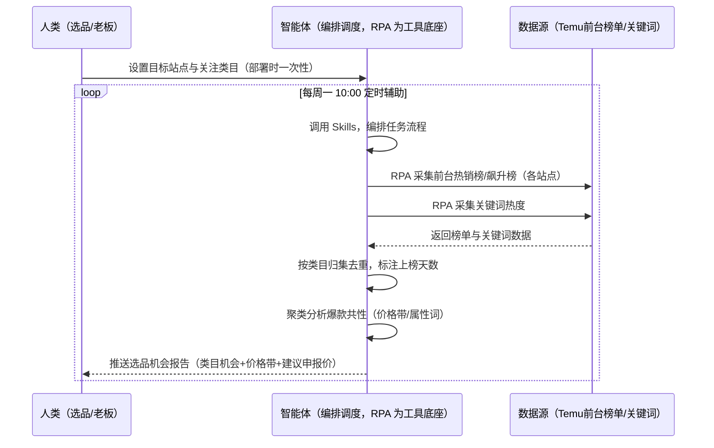
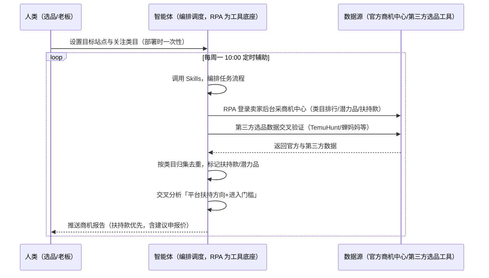

> 为 Temu 卖家团队打造的市场机会发现方案。选品靠刷榜截图信息散乱、不知道哪些是平台扶持款、跟风时红利已过。本方案由智能体调度多个工具执行定时采集前台热销榜/飙升榜 + 关键词数据，并登录官方商机中心取数，输出类目机会与平台扶持方向。每周定时辅助，输出选品机会报告，供你申报选品。

> Agent 自动化需开通企业功能
> 点击申请1个月免费权限
> [点击申请 →](https://skieer.feishu.cn/share/base/form/shrcnFwMayykP5iaL38fnZKTbrg)

## 一、用户与需求

核心矛盾：选品靠刷榜截图、信息散乱不成体系；不知道哪些是平台扶持款/潜力品；跟风时红利已过、同款内卷压价。

两类客户痛点同源，数据来源不同：

- 未购 SaaS 客户（新卖家/小团队）：人工翻 Temu 前台榜单截图、手动记关键词热度，全靠手；
- 已购 SaaS 客户（TemuHunt/知了数据/蝉妈妈 Temu 版等）：有第三方选品数据可用，但榜单聚类、扶持款识别、机会评分仍要人做，且第三方数据口径需与官方交叉验证。

适用客户：选品规模中等以上的卖家。前台榜单公开可采（无 SaaS 通道即可跑），官方商机中心需登录卖家后台（有账号即可，非额外 SaaS）；第三方工具为可选增强。

### 1.1 不同模式卖家

| 类型 | 选择 | 建议 |
|-|-|-|
| 全托管 | 首选 | 强烈推荐（供货制下选品=核价底气，榜单+商机双源） |
| 半托管 | 次选 | 一般推荐（美区仅半托管，需自行运营，榜单参考价值同等） |
| 平台模式 | 任意 | 试点中，选品逻辑同全托管，可先观望 |

### 1.2 不同类目卖家

| 类目 | 最关注维度 | 核心逻辑 |
|-|-|-|
| 3C 数码 | 认证成本 | 带电类认证成本高，机会品需先过认证门槛 |
| 家居家具 | 价格带 | 大件竞争集中在中低价格带，需差异化 |
| 美妆个护 | 合规资质 | 资质缺失直接禁售，机会品须资质可控 |
| 服装鞋帽 | 季节节奏 | 按站点季节提前 2-3 周选品 |
| 户外运动 | 旺季备货 | 旺季前集中选品，备货窗口前置 |
| 母婴用品 | 安全认证 | 安全类目准入门槛高，机会品有限但竞争小 |

### 1.3 不同角色用户

| 用户 | 需求 | 问题 | 投入时间（估算） |
|-|-|-|-|
| 老板 | 选品方向与投入节奏 | 选品靠感觉，试错成本高 | 1 小时/周 |
| 选品 | 类目机会+价格带+申报建议 | 刷榜截图散乱，扶持信号错过 | 2-3 小时/周 |
| 运营 | 平台扶持方向 | 官方商机中心不会看 | 1 小时/周 |

---

## 二、现在的方法与问题

### 2.1 流程步骤与问题总结

人工方式（未购 SaaS 客户）

| 序号 | 步骤 | 现在的方法 | 问题缺陷 |
|-|-|-|-|
| 1 | 看榜单 | 手动翻前台热销榜/飙升榜截图 | 信息散乱，无历史对比 |
| 2 | 看关键词 | 手动记关键词热度 | 热度无趋势，判断靠感觉 |
| 3 | 找扶持 | 不知道平台扶持款在哪看 | 扶持信号错过 |
| 4 | 定品 | 凭经验定类目与价格带 | 跟风时红利已过，同款内卷压价 |
| 5 | 验证 | 上架后才知道行不行 | 试错成本高 |

SaaS 方式（已购 TemuHunt/知了/蝉妈妈等客户）

| 序号 | 步骤 | 现在的方法 | 问题缺陷 |
|-|-|-|-|
| 1 | 看榜单 | 第三方工具看榜单数据 | 数据口径与官方有差异 |
| 2 | 看关键词 | 第三方关键词数据 | 需人工解读机会 |
| 3 | 找扶持 | 官方商机中心有扶持款标签 | 需登录后台，人工逐条看 |
| 4 | 定品 | 凭经验+第三方数据 | 聚类分析、机会评分靠人 |
| 5 | 验证 | 上架后回看动销 | 无系统化回采迭代 |

### 2.2 问题分析

人工方式根因

| 序号 | 根因 | 具体表现 |
|-|-|-|
| 1 | 榜单信息散乱 | 截图无结构化，无法对比趋势 |
| 2 | 扶持信号错过 | 商机中心数据多但不会看 |
| 3 | 跟风内卷 | 机会品识别靠感觉，红利期已过才发现 |
| 4 | 无历史沉淀 | 选品经验在人脑里，换人就不一样 |

**SaaS 方式根因**

| 序号 | 根因 | 具体表现 |
|-|-|-|
| 1 | 数据有但缺分析 | 第三方数据需人工聚类解读 |
| 2 | 官方后台靠人工翻 | 商机中心需登录，扶持款/潜力品信号易错过 |
| 3 | 无闭环回采 | 上架后动销表现不自动回采，模型不迭代 |

---

## 三、解决方案

### 3.1 功能概述

为 Temu 卖家团队打造的市场机会发现方案，前台榜单公开采集 + 官方商机中心登录取数双通道，输出类目机会与平台扶持方向报告。

定时触发并调度多个工具，调起八爪鱼 RPA（Agent 的工具底座，能耦合多系统、完成自动化任务执行）采集 Temu 前台热销榜/飙升榜与关键词数据，并登录官方商机中心取类目排行/潜力品/价格带/扶持款，输出「类目机会 + 价格带 + 建议申报价」报告。每周定时辅助，输出选品机会报告，供你申报选品。

### 3.2 系统结合

| 要素 | 说明 |
|-|-|
| 客户现有工具盘点 | **未购 SaaS 客户**：无第三方工具，选品全靠刷榜截图。    
**已购 SaaS 客户**（主流组合）：TemuHunt（免费选品数据）、知了数据/极鲸数据/蝉妈妈 Temu 版（付费，数据更细） |
| 数据/能力来源 | **无 SaaS**：Temu 前台热销榜/飙升榜（各站点，公开可采，RPA 采集）+ 关键词热度。    
**有 SaaS**：官方商机中心（类目排行/潜力品/价格带/关键词/扶持款，数据每日凌晨更新，官方口径最准，需登录卖家后台）+ 第三方选品数据交叉验证 |
| RPA 耦合动作 | 作为 Agent 的工具底座，按计划调度多数据源取数（前台公开采集 + 后台登录采集），按类目归集去重、标注上榜天数，统一流转给智能体分析；任一数据源失败自动重试、异常告警 |
| 耦合出的新价值 | 单工具给不了的端到端结论：榜单趋势 + 关键词热度 + 官方扶持方向一次取齐 → 聚类分析爆款共性 → 剔除竞争过度类目 → 输出机会评分与建议申报价，**只推送机会报告，无异常不打扰** |

### 3.3 智能体执行流程

智能体定时触发。支持**两种数据通道**，部署时按客户账号与工具选择：

**通道一：无 SaaS 方式（RPA 采集前台榜单，适合未购第三方工具的客户）**

**通道二：有 SaaS 方式（官方商机中心取数，数据最准，适合有后台账号客户）**

> Agent 自动化需开通企业功能
> 点击申请1个月免费权限
> [点击申请 →](https://skieer.feishu.cn/share/base/form/shrcnFwMayykP5iaL38fnZKTbrg)

### 3.4 为何这么设计

要同时回答三个问题：**为什么不能只用 SaaS/API？为什么不能纯靠智能体写代码？为什么 RPA 是执行底座？** 本场景的核心是"定时取数、榜单去重、聚类分析、机会评分、挂了有人管"。

#### 1）逐项对比

| 对比维度 | SaaS/API 堆叠（第三方选品工具） | 纯智能体（智能体写代码） | 智能体+自动化工具（RPA 工具底座） |
|-|-|-|-|
| 实现方式 | 第三方工具给榜单/关键词数据 | 能抓前台能拼数据，但全要自己接 | 前台公开采集 + 官方后台登录采集，一处对齐 |
| 多系统耦合 | 单工具数据，官方商机中心不覆盖 | 全自建：登录态、翻页、聚类逻辑 | 平台沉淀多源取数与对齐，可视化配置 |
| 官方数据覆盖 | 第三方口径，与官方有差异 | 需自写登录采集，会话易失效 | 后台登录采集会话保活，断点续跑 |
| 使用成本（总拥有成本） | 蝉妈妈等付费，免费版口径有限 | 代理 IP + 服务器 + 开发维护人力，隐性成本高 | 一份平台订阅跑多流程，单方案边际成本 ≈ 0 |
| 维护人要求 | 低（工具现成） | 规则调整都要开发介入 | 可视化流程，选品自己可调类目、榜单深度 |

#### 2）优劣势说明

|  | SaaS/API 堆叠（第三方工具） | 纯智能体（智能体写代码） | 智能体+自动化工具（RPA 工具底座） |
|-|-|-|-|
| 优势 | 数据现成、免开发 | 无订阅费；    
可深度定制选品模型 | 前台+官方双源覆盖；    
聚类/机会评分即开即用；    
非技术人员可维护 |
| 劣势 | 官方商机中心不覆盖；    
口径差异 | 反爬对抗与登录保活全自建；    
AI 生成代码是生成性的 | 本地电脑运行需保持开机；    
订阅费；    
后台采集受登录态影响 |

#### 3）结论

| 论点 | 说明 |
|-|-|
| 前台看趋势、后台看扶持 | 前台榜单公开反映消费趋势，官方商机中心反映平台补贴方向（扶持款/潜力品标签，核价容忍度更高），双源互补 |
| 纯智能体缺"工程底座" | 榜单翻页、去重、登录保活 70% 的工作在工程；RPA 作为工具底座把这 70% 已经造好 |
| 一个底座跑多流程 | 客户购买 RPA 平台是跑多个流程（选品/竞品/VOC），本方案只是其中一个——平台订阅费被多流程摊薄 |
| 机会判断交给智能体 | 聚类方法透明、样本 &lt;30 条标注仅供参考、机会评分公式公开，判断层在智能体 |
| 时间 | 选品要的是"每周一张可决策的机会报告"，不是"每周调一次爬虫脚本" |

### 3.5 功能清单

| 功能 | 系统 | 功能说明（解决问题） |
|-|-|-|
| 会话/定时 | 智能体 | 1. 理解人类语言，调用已预设好的 Skills。    
2. 编排多任务、调度多工具。 |
| 多系统数据取数 | RPA、指纹浏览器 | 1. 解决榜单截图散乱、扶持信号错过问题。    
2. 作为智能体工具底座被调度执行，采集失败自动重试并告警。    
3. **【无 SaaS 方式】** RPA 采集前台热销榜/飙升榜 + 关键词热度。**【有 SaaS 方式】** RPA 登录后台采商机中心 + 第三方选品数据交叉验证。 |
| 数据清洗对齐 | 智能体 | 按类目归集去重、标注上榜天数，解决榜单数据散乱问题。 |
| 聚类分析 | 智能体 | 分析爆款共性（价格带/属性词/类目机会），剔除竞争过度类目。 |
| 机会评分 | 智能体 | 机会品 = 榜单在榜 + 同款竞争数 &lt; 阈值 + 认证成本可控；建议价格带 = 榜单商品中位供货价 ±20%。 |
| 扶持方向识别 | 智能体 | 官方「潜力品/平台扶持款」信号优先跟进（平台补贴流量，核价容忍度更高）。 |
| IM通知 | 飞书、钉钉、企微等 | 解决选品报告交付滞后问题。选品机会报告自动推送。 |
| 数据资产储存 | 本地电脑、云储存 | 1. Skills 资产：Temu 选品技能与类目机会库。    
2. 数据储存：榜单监控库统一写入本地。    
3. 经验知识库：选品结果与核价回填持续沉淀。 |

### 3.6 智能体执行落地过程

部署时一次性配置入参（目标站点、关注类目、榜单深度 TOP50/100、数据通道），会话中无需重复输入。

**⚠️ 部署前提（不满足则方案无法跑起来）**：①RPA 需部署在**常开电脑/云机**上，并配置漏跑补跑机制；②**有 SaaS 方式需卖家后台账号**（商机中心需登录，登录失效自动告警、人工介入后断点续跑）；③前台榜单有反爬风控，需自备账号并遵守平台条款；④首次配置（登录态、类目归集规则、机会评分参数）需服务方/技术人员介入一次，属实施成本。

#### 1）配置

| 类别 | 说明 |
|-|-|
| 智能体 | 主流智能体。 |
| 智能体工具 | 1. **数据通道（按客户现有账号二选一）**：【无 SaaS】Temu 前台榜单 + 关键词（RPA 采集）；【有 SaaS】官方商机中心（登录采集）+ 第三方选品工具交叉验证。    
2. 数据取数与自动化执行：八爪鱼 RPA，MCP 配置完成。    
3. 数据分析：智能体自带。    
4. IM：企业办公 IM（飞书/钉钉/企微），MCP 或 webhook 配置。 |
| 工作知识 | 1. 目标站点（美区仅半托管/欧亚拉全托管正常）与关注类目。    
2. 榜单深度：TOP50/100。    
3. 数据窗口：近 7/30 天。    
4. 机会评分参数（同款竞争阈值、认证成本清单）。 |
| 本地数据库 | 1. 榜单监控库地址。    
2. 选品机会库地址。    
3. 经验库地址。 |

#### 2）执行

| 任务 | 产出 | 产出物接收人 |
|-|-|-|
| 接收目标站点与类目，定时触发 | 任务启动记录 | —— |
| 调用已预设 Skills，编排任务流程 | 任务编排方案 | —— |
| 经 MCP 向八爪鱼 RPA 下发取数任务 | 自动化任务指令 | —— |
| 多源取数并按类目归集（无 SaaS：前台榜单；有 SaaS：商机中心+第三方，智能体监控状态） | 对齐后榜单与商机数据 | —— |
| 聚类分析爆款共性 | 类目机会清单 | 选品 |
| 机会评分与建议申报价 | 选品机会报告 | 选品/老板 |
| 扶持方向识别（潜力品/扶持款优先） | 商机报告 | 选品 |
| 推送选品机会报告 | 群消息 | 选品/老板 |

异常处理：

榜单改版 → 告警并降级为类目列表采集；

登录失效 → 告警人工介入后断点续跑；

样本 &lt;30 条 → 标注仅供参考；

数据缺失 → 用历史数据补并标注；

置信度 &lt;70% → 转人工复核，不输出硬结论。

#### 3）结果

| 结果 | 说明 |
|-|-|
| 数据资产 | 榜单监控库结构化数据（商品/价格/上榜天数/关键词热度/来源页面），可审计可追溯。 |
| 分析报告 | 1. 选品机会报告：类目机会 + 价格带 + 建议申报价。    
2. 商机报告：平台扶持方向（扶持款优先）+ 进入门槛。 |
| Skills | 智能体 Skills：Temu 选品技能，按核价结果与动销表现月度回填迭代。 |

> Agent 自动化需开通企业功能
> 点击申请1个月免费权限
> [点击申请 →](https://skieer.feishu.cn/share/base/form/shrcnFwMayykP5iaL38fnZKTbrg)

---

## 四、使用前后预估

> 本方案价值 = **榜单趋势 + 关键词热度 + 官方扶持方向一次取齐 → 聚类分析 → 机会评分与申报建议**。前台榜单公开可采（无 SaaS 即可跑），官方商机中心需登录后台（官方口径最准，每日凌晨更新）。

| 指标 | 人工 | SaaS/API（第三方工具） | 智能体+自动化工具 |
|-|-|-|-|
| 榜单监控 | 手动翻页截图 | 工具内看榜单 | 定时自动采集、趋势对比 |
| 关键词热度 | 手动记录 | 第三方关键词数据 | 自动取数、热度趋势 |
| 扶持方向 | 不知道在哪看 | 不覆盖 | 官方商机中心自动识别 |
| 机会判断 | 凭感觉跟风 | 数据+人工解读 | 聚类分析+机会评分（透明） |
| 报告产出 | 无/散乱 | 无结构化报告 | 周报自动推送 |
| 方法论 | 无 | 单工具数据 | 可复用的 Skills 与机会库（按核价/动销回填迭代） |

**说明**：第三方工具（TemuHunt 免费、知了/极鲸/蝉妈妈付费）提供榜单与关键词数据，但**官方商机中心需登录卖家后台**、口径最准（数据每日凌晨更新）；本方案双通道互补——前台看趋势、后台看扶持；榜单头部多平台自营/大卖，中小卖家需结合竞争度与认证门槛交叉判断。

---

## 五、效果证明

> Agent 自动化需开通企业功能
> 点击申请1个月免费权限
> [点击申请 →](https://skieer.feishu.cn/share/base/form/shrcnFwMayykP5iaL38fnZKTbrg)

### 5.1 客户案例

**《家居龙头：20+ 海外平台商品数据自动化，日均 2.5 万条》**

> 20+ 海外平台的商品价格、运费、SKU、排名等多维度数据原靠人工抽样采集。RPA 实现全自动全量采集与入库，为跨境运营决策提供数据底座。

| 效果 | 说明 |
|-|-|
| 提效 | 多平台商品数据采集效率提升约 85%。原本 20+ 海外平台的商品数据靠人工抽样采集，现在全自动全量采集入库，日均 2.5 万条，运营上班即可看到最新数据。 |
| 降本 | 告别「导表格、拼数据」的重复劳动，运营团队从人工采集转为直接使用数据做选品与定价决策。 |
| 任务 | 覆盖 20+ 海外平台，价格/运费/SKU/EAN/首图/类目排名等 8+ 核心字段，支持变体信息全采集。 |
| 任务 | 采集稳定率 99%+，跨语言、跨页面结构、跨价格展示方式全部适配。 |

案例详情：[跨境取数：家居龙头的20+海外平台商品数据自动化实践](https://skieer.feishu.cn/wiki/Iko0wtqEfiOdzlkstYBc5DI3nUe)

**《竞品 AI 快报：多平台动态 7×24 监控与自动出报》**

> 某大型教培集团需盯多家竞品公众号、课程与活动动态，人工巡查信息零散难汇总。RPA 自动巡查多平台账号并生成竞品快报。

| 效果 | 说明 |
|-|-|
| 提效 | 竞品动态巡查由人工每日逐平台翻阅变为 7×24 自动监控。原本市场团队需人工登录多平台逐篇查看推文、课程与活动，现在自动抓取、自动分析、自动出报告。 |
| 降本 | 市场团队用于公众号巡查、内容摘抄与情报汇总的重复性工作量降低约 80%，投入转向课程优化、活动策划与市场竞争策略等重点工作。 |
| 任务 | 竞品课程、价格及营销动态识别准确率提升至 95% 以上，减少遗漏与误判。 |
| 任务 | 多平台账号自动巡查，情报按周期自动汇总成报。 |

案例详情：[快报|社媒监控：竞品AI快报生成自动化](https://skieer.feishu.cn/wiki/UNA7wUatCih1D2kXL5Fco3MpnGe)

### 5.2 DEMO应用

Temu 关键词取数：https://rpa.bazhuayu.com/appstore/app/wawawa/temu-guan-jian-ci-qu-shu

TEMU 流量分析数据采集：https://rpa.bazhuayu.com/appstore/app/wawawa/temu-liu-liang-fen-xi-shu-ju-cai-ji

---

## 六、备注

### 6.1 Agent 支持

本方案不绑定具体智能体，主流 Agent 均可运行（需支持技能/Skills 加载与工具调用）：

| Agent/智能体 | 说明 |
|-|-|
| Workbuddy | 本方案运行平台，支持技能/Skills 上传加载、定时任务、MCP 工具调用与表格/报告处理 |
| 豆包（国内·字节） | 国内主流个人智能体，支持技能上传、定时任务与工具调用，上手成本低 |
| 通义千问（国内·阿里） | 支持 Agent 编排与插件生态，集成阿里电商数据能力，适合电商场景 |
| DeepSeek（国内） | 推理能力强、成本低，适合规则打分与归因分析类任务 |
| ChatGPT（国外·OpenAI） | 海外主流通用智能体，支持 GPTs/Agent 模式与工具调用 |
| Claude（国外·Anthropic） | 长文本与结构化分析能力强，原生支持 MCP 连接外部工具 |

### 6.2 名词解释

| 术语 | 说明 |
|-|-|
| 热销榜/飙升榜 | Temu 前台公开榜单（temu.com 各站点），反映消费趋势 |
| 商机中心 | 官方卖家后台栏目：类目排行/潜力品/价格带/关键词/扶持款，数据每日凌晨更新 |
| 扶持款/潜力品 | 平台补贴流量的商品标签，核价容忍度更高，优先跟进 |
| 机会评分 | 机会品 = 榜单在榜 + 同款竞争数 &lt; 阈值 + 认证成本可控（公式公开可调） |
| 建议价格带 | 榜单商品中位供货价 ±20% |
| 混合数据源 | 前台公开榜单（免费、覆盖无 SaaS 客户）+ 官方商机中心（口径最准、需登录）+ 第三方选品工具（可选增强，交叉验证） |
| 有 SaaS 方式 | 已购 TemuHunt/知了/蝉妈妈等，第三方数据 + 官方商机中心交叉验证 |
| 无 SaaS 方式 | 不购买第三方工具，由 RPA 采集前台榜单与关键词 |
| 全托管 | 供货商模式，卖家只供货、平台定价销售（美区仅半托管） |
| 半托管 | 卖家自主运营与履约（美区主流模式） |
| MCP | Model Context Protocol，智能体连接外部工具的标准化通道 |

> Agent 自动化需开通企业功能
> 点击申请1个月免费权限
> [点击申请 →](https://skieer.feishu.cn/share/base/form/shrcnFwMayykP5iaL38fnZKTbrg)

---

原文：[查看原文](https://skieer.feishu.cn/wiki/KxKjwoWcMivrZmk71Q9cPTYinXt)
