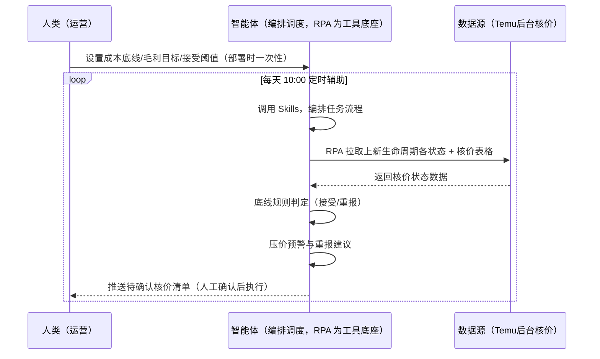
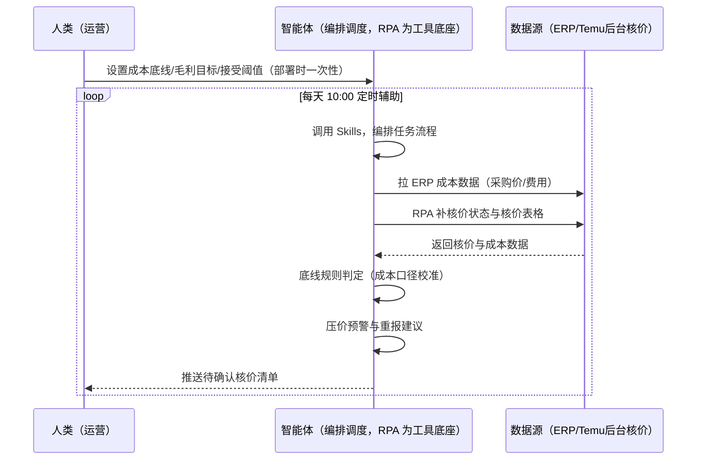

> 为 Temu 卖家团队打造的核价管理与上新生命周期监控方案。平台 AI 自动比价核价，全托管无议价空间、半托管可申诉；核价=利润天花板，是供应商模式的核心博弈点。本方案由智能体调度多个工具执行拉取上新生命周期各状态商品与核价表格，按成本底线自动判定接受/重报。每天定时辅助，只推送需人工确认的核价与预警。

> Agent 自动化需开通企业功能
> 点击申请1个月免费权限
> [点击申请 →](https://skieer.feishu.cn/share/base/form/shrcnFwMayykP5iaL38fnZKTbrg)

## 一、用户与需求

核心矛盾：平台 AI 自动比价（对标 1688/淘宝/京东/亚马逊/Shein），全托管无议价空间、半托管可人工申诉；申报价 ≤ 同行最低价 1.2 倍、同款新上架不得高于前款 99%；核价周期 1-5 工作日、驳回后 24h 内可重报。核价=利润天花板，响应慢或误点直接损失利润。

两类客户痛点同源，数据来源不同：

- 未购 SaaS 客户（新卖家/小团队）：人工盯核价状态、逐条点同意/重报，全靠手；
- 已购 SaaS 客户（店小秘 ERP 等）：ERP 管订单库存，核价状态监控与报价策略不覆盖，仍要人盯后台。

适用客户：SKU 多、核价频次高的全托管供货商。现成应用直挂（TEMU 商品核价/核价表格下载/上新生命周期管理）。

### 1.1 不同模式卖家

| 类型 | 选择 | 建议 |
|-|-|-|
| 全托管 | 首选 | 强烈推荐（核价=利润天花板，无议价空间更需盯紧） |
| 半托管 | 次选 | 一般推荐（半托管可人工申诉，博弈空间大） |
| 平台模式 | 任意 | 试点中，逻辑同全托管 |

### 1.2 不同类目卖家

| 类目 | 最关注维度 | 核心逻辑 |
|-|-|-|
| 3C 数码 | 核价频次 | 迭代快，核价频次高 |
| 家居家具 | 毛利空间 | 大件金额高，压价影响大 |
| 美妆个护 | 成本底线 | 资质成本高，底线要算清 |
| 服装鞋帽 | 同款比对 | 同款多，99 折逻辑影响大 |
| 户外运动 | 旺季核价 | 旺季压价博弈关键期 |
| 母婴用品 | 认证成本 | 认证摊销进底线，别被压穿 |

### 1.3 不同角色用户

| 用户 | 需求 | 问题 | 投入时间（估算） |
|-|-|-|-|
| 老板 | 利润天花板不被压穿 | 压价没感知 | 0.5 小时/周 |
| 运营 | 核价状态+报价策略 | 盯核价与手动确认费时 | 1-3 小时/周 |
| 核价对接 | 重报话术 | 驳回后 24h 重报窗口易错过 | 0.5 小时/周 |

---

## 二、现在的方法与问题

### 2.1 流程步骤与问题总结

**人工方式（未购 SaaS 客户）**

| 序号 | 步骤 | 现在的方法 | 问题缺陷 |
|-|-|-|-|
| 1 | 看核价 | 手动登录后台看状态 | 核价周期 1-5 工作日，盯费时 |
| 2 | 判接受 | 凭感觉判断 | 成本底线不清，误点亏钱 |
| 3 | 点确认 | 手动点同意/重报 | 接口冲突风险 |
| 4 | 重报 | 驳回后手动改价 | 24h 窗口易错过 |
| 5 | 沉淀 | 凭记忆 | 压价规律不沉淀 |

**SaaS 方式（已购 ERP 客户）**

| 序号 | 步骤 | 现在的方法 | 问题缺陷 |
|-|-|-|-|
| 1 | 看核价 | ERP 不覆盖 | 靠人盯 |
| 2 | 判接受 | 凭感觉 | 无底线模型 |
| 3 | 点确认 | 手动 | 接口冲突 |
| 4 | 重报 | 手动 | 窗口错过 |
| 5 | 沉淀 | 无 | 压价不迭代 |

### 2.2 问题分析

**人工方式根因**

| 序号 | 根因 | 具体表现 |
|-|-|-|
| 1 | 核价盯不过来 | SKU 多，核价周期长，人工易漏 |
| 2 | 底线不清 | 误点同意，利润被压穿 |
| 3 | 重报窗口错过 | 驳回后 24h 内可重报，错过即损失 |

**SaaS 方式根因**

| 序号 | 根因 | 具体表现 |
|-|-|-|
| 1 | ERP 不覆盖 | 核价状态监控与报价策略无工具 |
| 2 | 无闭环 | 成交价不回填迭代成本模型 |

---

## 三、解决方案

### 3.1 功能概述

为 Temu 卖家团队打造的核价管理与上新生命周期监控方案，拉取上新生命周期各状态商品（价格申报中/待卖家确认/已生效/已作废）与核价表格，按成本底线自动判定接受/重报。

每天定时触发并调度多个工具，调起八爪鱼 RPA（Agent 的工具底座，能耦合多系统、完成自动化任务执行）拉取核价状态与核价表格，智能体按「成本底线 + 毛利目标」判定（核价 ≥ 接受值 → 同意；&lt; 底线 → 重报），输出报价策略与压价预警。每天定时辅助，只推送需人工确认的核价与预警。

### 3.2 系统结合

| 要素 | 说明 |
|-|-|
| 客户现有工具盘点 | **未购 SaaS 客户**：无第三方工具，核价全靠人工盯后台。     **已购 SaaS 客户**（主流组合）：店小秘 ERP（管订单库存，核价状态不覆盖） |
| 数据/能力来源 | **无 SaaS**：Temu 后台核价状态与核价表格（登录采集，RPA 现成应用直挂：TEMU 商品核价/核价表格下载/上新生命周期管理）。     **有 SaaS**：ERP 成本数据（采购价/费用）+ RPA 补核价状态采集 |
| RPA 耦合动作 | 作为 Agent 的工具底座，按计划拉取核价状态（价格申报中/待卖家确认/已生效/已作废）与核价表格，状态轮询防漏，统一流转给智能体；禁止与后台手动点「同意」同时操作（接口冲突致核价失败/商品下架） |
| 耦合出的新价值 | 单工具给不了的端到端结论：核价状态一次取齐 → 底线规则判定 → 接受/重报建议 → 成交价回填迭代成本模型，**只推送需人工确认的核价与预警** |

### 3.3 智能体执行流程

智能体定时触发。支持**两种数据通道**，部署时按客户现有工具选择：

**通道一：无 SaaS 方式（RPA 采集核价状态，适合未购 ERP 的客户）**

**通道二：有 SaaS 方式（ERP 成本数据校准 + RPA 补核价状态，适合已购客户）**

> Agent 自动化需开通企业功能
> 点击申请1个月免费权限
> [点击申请 →](https://skieer.feishu.cn/share/base/form/shrcnFwMayykP5iaL38fnZKTbrg)

### 3.4 为何这么设计

要同时回答三个问题：**为什么不能只用 SaaS/API？为什么不能纯靠智能体写代码？为什么 RPA 是执行底座？** 本场景的核心是"定时拉取、底线判定、窗口提醒、挂了有人管"。

#### 1）逐项对比

| 对比维度 | SaaS/API 堆叠（ERP） | 纯智能体（智能体写代码） | 智能体+自动化工具（RPA 工具底座） |
|-|-|-|-|
| 实现方式 | ERP 管成本数据（部分） | 能抓后台能算，但全要自己接 | 核价应用直挂 + 底线判定 |
| 状态轮询 | 核价状态不覆盖 | 智能体无法常驻轮询 | RPA 定时轮询防漏 |
| 底线模型 | 无 | 需自写成本模型与维护 | 底线规则可视化配置、成交价回填迭代 |
| 使用成本（总拥有成本） | ERP 订阅费（主体另算） | 代理 IP + 服务器 + 开发维护人力，隐性成本高 | 一份平台订阅跑多流程，单方案边际成本 ≈ 0 |
| 维护人要求 | 低（工具现成） | 规则调整都要开发介入 | 可视化流程，运营自己可调底线与阈值 |

#### 2）优劣势说明

|  | SaaS/API 堆叠（ERP） | 纯智能体（智能体写代码） | 智能体+自动化工具（RPA 工具底座） |
|-|-|-|-|
| 优势 | 成本数据权威（校准底线） | 无订阅费；     可深度定制核价模型 | 核价应用直挂、状态轮询防漏；     底线判定即开即用；     非技术人员可维护 |
| 劣势 | 核价状态不覆盖 | 轮询与登录保活全自建；     AI 生成代码是生成性的 | 本地电脑运行需保持开机；     订阅费；     自动核价时禁止与手动操作同时进行 |

#### 3）结论

| 论点 | 说明 |
|-|-|
| 核价=利润天花板 | 平台 AI 自动比价（1688/淘宝/京东/亚马逊/Shein），全托管无议价空间、半托管可人工申诉——核价是供应商模式的核心博弈点 |
| 底线规则=防压穿 | 核价 ≥ 接受值 → 同意；&lt; 底线 → 重报；「待卖家确认」是唯一可操作窗口，响应快=配合度高印象 |
| 窗口红线 | 核价周期 1-5 工作日、驳回后 24h 内可重报、申报价 ≤ 同行最低价 1.2 倍、同款新上架不得高于前款 99%（实锤） |
| 接口冲突风险 | 自动核价时禁止与后台手动点「同意」同时操作（接口冲突致核价失败/商品下架）——部署前提必写 |
| 一个底座跑多流程 | 客户购买 RPA 平台是跑多个流程（核价/上架/合规），本方案只是其中一个——平台订阅费被多流程摊薄 |
| 时间 | 运营要的是"待确认核价自动推送 + 底线判定"，不是"盯后台" |

### 3.5 功能清单

| 功能 | 系统 | 功能说明（解决问题） |
|-|-|-|
| 会话/定时 | 智能体 | 1. 理解人类语言，调用已预设好的 Skills。     2. 编排多任务、调度多工具。 |
| 多系统数据取数 | RPA、指纹浏览器 | 1. 解决核价盯不过来、误点亏钱问题。     2. 作为智能体工具底座被调度执行，状态轮询防漏、与手动操作互斥防接口冲突。     3. **【无 SaaS 方式】** RPA 采集核价状态与核价表格（现成应用直挂）。**【有 SaaS 方式】** ERP 成本数据校准 + RPA 补核价状态。 |
| 底线判定 | 智能体 | 核价 ≥ 接受值 → 同意；&lt; 底线 → 重报（每个 SKU 成本底线+毛利目标可配）。 |
| 压价预警 | 智能体 | 平台压价频次与幅度统计，按成交价迭代成本模型。 |
| 重报建议 | 智能体 | 驳回后 24h 内可重报——重报话术模板 + 窗口倒计时提醒。 |
| IM通知 | 飞书、钉钉、企微等 | 解决待确认核价滞后问题。待确认核价清单自动推送。 |
| 数据资产储存 | 本地电脑、云储存 | 1. Skills 资产：Temu 核价策略技能。     2. 数据储存：核价台账统一写入本地。     3. 经验知识库：成交价回填迭代底线模型。 |

### 3.6 智能体执行落地过程

部署时一次性配置入参（SKU 成本底线、毛利目标、接受核价阈值、重报话术模板、数据通道），会话中无需重复输入。

**⚠️ 部署前提（不满足则方案无法跑起来）**：①RPA 需部署在**常开电脑/云机**上，并配置漏跑补跑机制；②**自动核价时禁止与后台手动点「同意」同时操作**（接口冲突致核价失败/商品下架）；③**有 SaaS 方式需 ERP 账号**（成本数据校准，可选增强，无则走后台通道）；④首次配置（登录态、底线模型、重报模板）需服务方/技术人员介入一次，属实施成本。

#### 1）配置

| 类别 | 说明 |
|-|-|
| 智能体 | 主流智能体。 |
| 智能体工具 | 1. **数据通道（按客户现有工具二选一）**：【无 SaaS】Temu 后台核价（现成应用直挂）；【有 SaaS】ERP 成本数据 + RPA 补核价状态。     2. 数据取数与自动化执行：八爪鱼 RPA，MCP 配置完成。     3. 数据分析：智能体自带。     4. IM：企业办公 IM（飞书/钉钉/企微），MCP 或 webhook 配置。 |
| 工作知识 | 1. 每个 SKU 的成本底线。     2. 毛利目标。     3. 接受核价阈值。     4. 重报话术模板。     5. 申报价规则：≤ 同行最低价 1.2 倍、同款新上架 ≤ 前款 99%。 |
| 本地数据库 | 1. 核价台账库地址。     2. 成本模型库地址。     3. 经验库地址。 |

#### 2）执行

| 任务 | 产出 | 产出物接收人 |
|-|-|-|
| 接收成本底线，定时触发 | 任务启动记录 | —— |
| 调用已预设 Skills，编排任务流程 | 任务编排方案 | —— |
| 经 MCP 向八爪鱼 RPA 下发取数任务 | 自动化任务指令 | —— |
| 多源取数并按 SKU 对齐（无 SaaS：核价采集；有 SaaS：ERP 成本+核价，智能体监控状态） | 对齐后核价数据 | —— |
| 底线规则判定（接受/重报） | 待确认核价清单 | 运营 |
| 压价预警与重报建议 | 报价策略 | 运营/老板 |
| 推送待确认核价清单（人工确认后执行） | 群消息 | 运营 |
| 成交价回填，迭代成本模型 | 成本模型更新 | 数据库 |

异常处理：

采集失败 → 自动重试并告警；

核价状态缺失 → 标注待补；

底线判定低置信度 → 转人工复核；

重报窗口临界 → 告警提醒；

置信度 &lt;70% → 转人工复核，不输出硬结论。

#### 3）结果

| 结果 | 说明 |
|-|-|
| 数据资产 | 核价台账结构化数据（SKU/核价状态/申报价/成交价/压价记录），可审计可追溯。 |
| 分析报告 | 1. 待确认核价清单：接受/重报建议。     2. 压价预警：压价频次与幅度。     3. 报价策略：按成交价迭代。 |
| Skills | 智能体 Skills：Temu 核价策略技能，按成交价与压价频次迭代底线模型。 |

> Agent 自动化需开通企业功能
> 点击申请1个月免费权限
> [点击申请 →](https://skieer.feishu.cn/share/base/form/shrcnFwMayykP5iaL38fnZKTbrg)

---

## 四、使用前后预估

> 本方案价值 = **核价状态自动拉取 → 底线规则判定 → 接受/重报建议 → 成交价回填迭代**。现成应用直挂（TEMU 商品核价/核价表格下载/上新生命周期管理）。

| 指标 | 人工 | SaaS/API（ERP） | 智能体+自动化工具 |
|-|-|-|-|
| 核价盯守 | 手动盯后台 | 不覆盖 | 定时轮询防漏 |
| 接受判定 | 凭感觉 | 无底线模型 | 底线规则自动判定 |
| 重报窗口 | 易错过 | 无提醒 | 24h 窗口倒计时提醒 |
| 压价感知 | 被压才知 | 无统计 | 压价频次/幅度自动统计 |
| 接口安全 | 手动误操作 | 无约束 | 自动/手动互斥防冲突 |
| 方法论 | 无 | 单工具 | 可复用的 Skills 与成本模型 |

**说明**：Temu 核价机制（实锤）：平台 AI 自动比价（对标 1688/淘宝/京东/亚马逊/Shein），全托管无议价空间、半托管可人工申诉；「99 折逻辑」同款新上架价不得高于前款 99%、申报价须 ≤ 同行最低价 1.2 倍；全托管毛利率普遍 10%-15%（平台出价 = 终端售价 55%-65%），核价 = 利润天花板；注意：自动核价时禁止与后台手动点「同意」同时操作（接口冲突致核价失败/商品下架）。

---

## 五、效果证明

### 5.1 DEMO应用

TEMU 商品核价：https://rpa.bazhuayu.com/appstore/app/wawawa/temu-shang-pin-he-jia

TEMU 核价表格信息下载：https://rpa.bazhuayu.com/appstore/app/wawawa/temu-he-jia-biao-ge-xin-xi-xia-zai

TEMU-上新生命周期管理数据采集：https://rpa.bazhuayu.com/appstore/app/dev_xw6rz1/temu--shang-xin-sheng-ming-zhou-qi-guan-li-shu-ju-cai-ji-

---

## 六、备注

### 6.1 Agent 支持

本方案不绑定具体智能体，主流 Agent 均可运行（需支持技能/Skills 加载与工具调用）：

| Agent/智能体 | 说明 |
|-|-|
| Workbuddy | 本方案运行平台，支持技能/Skills 上传加载、定时任务、MCP 工具调用与表格/报告处理 |
| 豆包（国内·字节） | 国内主流个人智能体，支持技能上传、定时任务与工具调用，上手成本低 |
| 通义千问（国内·阿里） | 支持 Agent 编排与插件生态，集成阿里电商数据能力，适合电商场景 |
| DeepSeek（国内） | 推理能力强、成本低，适合规则打分与归因分析类任务 |
| ChatGPT（国外·OpenAI） | 海外主流通用智能体，支持 GPTs/Agent 模式与工具调用 |
| Claude（国外·Anthropic） | 长文本与结构化分析能力强，原生支持 MCP 连接外部工具 |

### 6.2 名词解释

| 术语 | 说明 |
|-|-|
| 核价 | 平台 AI 自动比价（1688/淘宝/京东/亚马逊/Shein），对标同款定价 |
| 上新生命周期 | 价格申报中/待卖家确认/已生效/已作废四状态 |
| 99 折逻辑 | 同款新上架价不得高于前款 99% |
| 申报价规则 | 申报价 ≤ 同行最低价 1.2 倍 |
| 待卖家确认 | 核价唯一可操作窗口（响应快 = 配合度高印象） |
| 成本底线 | 每个 SKU 的可接受最低供货价（含采购+头程+认证摊销+目标毛利） |
| 混合数据源 | Temu 后台核价（现成应用直挂）+ ERP 成本数据（有 SaaS 客户校准） |
| 有 SaaS 方式 | 已购店小秘 ERP，成本数据校准 + RPA 补核价状态 |
| 无 SaaS 方式 | 不购买第三方工具，RPA 现成应用采集核价 |
| 全托管 | 供货商模式，卖家只供货、平台定价销售（美区仅半托管） |
| 半托管 | 卖家自主运营与履约（美区主流模式） |
| MCP | Model Context Protocol，智能体连接外部工具的标准化通道 |

> Agent 自动化需开通企业功能
> 点击申请1个月免费权限
> [点击申请 →](https://skieer.feishu.cn/share/base/form/shrcnFwMayykP5iaL38fnZKTbrg)

---

原文：[查看原文](https://skieer.feishu.cn/wiki/ZSrFw86Sli92n3kq32PcJShDnka)
