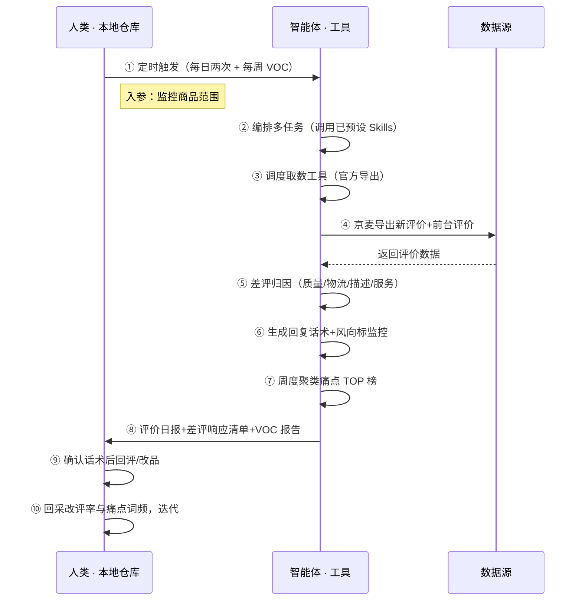

> 用主流的 **Agent 编排任务、调度和组合**「自动化、表格、分析、报告分析」工具。从京麦后台官方导出新评价（好评/中评/差评/追评/晒图）与前台评价数据（商家自有权限，官方导出不模拟登录），智能体做差评归因（质量/物流/描述/服务）、生成合规回复话术、风向标评价分监控，周度聚类输出痛点 TOP 榜与竞品对比——官方给数据，本方案把评价变成改品与话术依据。

> Agent 自动化需开通企业功能
> 点击申请1个月免费权限
> [点击申请 →](https://skieer.feishu.cn/share/base/form/shrcnFwMayykP5iaL38fnZKTbrg)

## 一、用户与需求

**核心矛盾**：差评发现滞后、回复不及时影响转化；差评归因靠人工逐条看；评价内容里的产品缺陷/卖点无人挖掘——归因分类=质量/物流/描述/服务四类，VOC 结论反哺改品与话术。

### 1.1 不同模式卖家

| 类型 | 选择 | 建议 |
|-|-|-|
| 品牌卖家 | 首选 | 强烈推荐（口碑是品牌资产） |
| 精铺卖家 | 首选 | 强烈推荐（差评影响转化） |
| 铺货型 | 次选 | 一般推荐（评价少） |

### 1.2 不同类目卖家

| 类目 | 最关注维度 | 核心逻辑 |
|-|-|-|
| 3C 数码 | 质量差评 | 功能缺陷投诉多 |
| 服装鞋帽 | 尺码描述 | 描述不符差评多 |
| 家居家具 | 物流差评 | 大件运输易损 |
| 美妆个护 | 体验差评 | 肤感评价敏感 |
| 食品保健 | 品质口碑 | 好评率影响大 |

### 1.3 不同角色用户

| 用户 | 需求 | 问题 | 投入时间预估 |
|-|-|-|-|
| 老板 | 好评率不跌 | 差评滞后 | 0.5 小时/周 |
| 客服 | 回复话术 | 逐条写话术慢 | 2-3 小时/周 |
| 产品 | 改进依据 | 痛点无人挖 | 1 小时/周 |

---

## 二、现在的方法与问题

### 2.1 流程步骤与问题总结

| 序号 | 步骤 | 现在的方法 | 问题缺陷 |
|-|-|-|-|
| 1 | 看评价 | 手动刷新后台 | 差评滞后 |
| 2 | 归因 | 人工逐条 | 慢且漏 |
| 3 | 回评 | 逐条写 | 话术无沉淀 |
| 4 | 挖痛点 | 不挖 | 产品改进无依据 |

### 2.2 问题分析

| 序号 | 根因 | 具体表现 |
|-|-|-|
| 1 | 数据闲置 | 后台评价导出后没人分析 |
| 2 | 无归因模型 | 分类靠人工 |
| 3 | 无话术库 | 回评无沉淀 |
| 4 | 无 VOC 分析 | 痛点无人挖掘 |

---

## 三、解决方案

### 3.1 功能概述

为京东卖家团队打造的智能体驱动评价口碑与 VOC 分析方案。

每天两次触发并调度多个工具，从京麦后台官方导出新评价与前台评价数据（商家自有权限，不模拟登录），输出完整的口碑闭环，涵盖「差评归因、回复话术、风向标监控、痛点 TOP 榜、竞品对比、改评率验证」。

### 3.2 智能体执行流程

智能体定时触发；智能体编排任务时**调用已预设好的 Skills**，再经 MCP 调度工具完成取数与分析。

### 3.3 为何不全用智能体解决

智能体确实可以写出能跑的采集脚本（Playwright/Selenium 都行），但京东评价页批量爬取同样触发风控。本方案的正解是**官方导出 + Agent 分析**：京麦后台导出自家评价是商家自有权限的官方动作；前台评价按合理频率只读采集属正常浏览。智能体的价值不在"爬评价"，而在把评价内容组织成"差评归因、话术、改品依据"——这是官方工具不做、也做不了的分析层。

#### 1）逐项对比

| 对比维度 | 智能体写代码直接采集 | 官方导出/只读取数 + Agent 判断 |
|-|-|-|
| 账号风险 | 高频爬评价页触发验证码、设备指纹封锁、封店风险 | 京麦官方导出（自有权限）+ 前台低频只读，合规稳定 |
| 归因判断 | 脚本只采数据，差评归因靠人工 | 智能体自动四类归因、话术生成、痛点聚类 |
| 话术沉淀 | 无沉淀，逐条写 | 话术库沉淀，人工确认后回评 |
| 数据沉淀 | 采集数据散落 | 评价/VOC 库统一入库，多期可审计 |
| 维护成本 | 反爬对抗、改版修复需开发持续投入 | 取数路径固定，判断规则沉淀为 Skills |
| 成本结构 | 代理 IP + 服务器 + 开发维护人力 | 按调用/月费计价 |

#### 2）优劣势说明

|  | 官方导出 + Agent 判断 | 智能体写代码直接采集 |
|-|-|-|
| 优势 | 合规稳定、无封店风险；归因/话术/聚类自动沉淀；非技术人员可维护 | 采集频率看似更自由 |
| 劣势 | 依赖官方导出数据（需商家自有账号）；回评动作需人工确认 | 封店/法律风险不可控，长期稳定性几乎为零 |
| 本场景特别提醒 | 回评话术需人工确认后执行——回复动作影响风向标 | 同左——且明确：高频爬取京东评价页属高风险动作，不建议 |

#### 3）结论

| 论点 | 说明 |
|-|-|
| 确定性 vs 生成性 | 归因与聚类是确定性计算——同样的评价，要求"分类一致、不漏差评"。AI 生成的代码是生成性的，能跑通 ≠ 长期合规稳定。 |
| 资产沉淀 | 话术库、归因规则、痛点库沉淀在平台里是活的——多店铺复用、换人接手都成立；写在个人表格里是死的。 |
| 风险无豁免 | 京东风控不豁免任何自动化。这条路没有"用代码就比官方导出更稳"的捷径——官方链路合规，自建爬取赌封店。 |
| 时间 | 客服要的是"差评自动归因出话术"，不是"逐条翻评价"。取数交给官方链路，智能体的价值放在归因、话术这些判断层。 |

> Agent 自动化需开通企业功能
> 点击申请1个月免费权限
> [点击申请 →](https://skieer.feishu.cn/share/base/form/shrcnFwMayykP5iaL38fnZKTbrg)

### 3.4 功能清单

| 功能 | 系统 | 功能说明（解决问题） |
|-|-|-|
| 会话/定时 | 智能体 | 1. 理解人类语言，调用已预设好的 Skills。   2. 编排多任务、调度多工具。 |
| 数据取数 | 京麦官方导出/前台只读 | 1. 解决差评滞后、评价翻不完问题。   2. 作为智能体工具被调度执行，官方导出失败告警重试。   3. 京麦后台导出新评价（好评/中评/差评/追评/晒图）+ 前台评价数据（低频只读）。 |
| 数据清洗 | 智能体 | 评价去重、订单关联，解决多来源口径不一致问题。 |
| 数据分析与报告 | 智能体 | 基于预设 Skills，解决差评归因慢、痛点无人挖问题。   1. 差评归因：质量/物流/描述/服务四类。   2. 话术生成：合规回复草稿。   3. 风向标评价分监控。   4. VOC 聚类：痛点 TOP 榜+竞品对比+卖点词库。 |
| IM通知 | 飞书、钉钉、企微等 | 解决差评危机滞后问题。评价日报、差评响应清单自动推送。 |
| 数据资产储存 | 本地电脑、云储存 | 1. Skills 资产：差评归因与话术规则。   2. 数据储存：评价与 VOC 数据统一入库。   3. 经验知识库：改评率与痛点词频回填迭代。 |

### 3.5 智能体执行落地过程

部署时配置监控商品范围即可运行；下表其余配置项（智能体工具、Webhook、归因分类）均为部署时一次性预设，会话中无需重复输入。

#### 1）配置

| 类别 | 说明 |
|-|-|
| 智能体 | 主流智能体。 |
| 智能体工具 | 1.取数：京麦后台官方导出 + 前台评价低频只读（商家自有账号，不模拟登录）。   2.数据分析：智能体自带。   3.数据报告：智能体自带。   4.数据储存：Excel，智能体自带。   5.IM：企业办公 IM（飞书/钉钉/企微），MCP 或 webhook 配置。 |
| 工作知识 | 1.监控商品范围。   2.归因分类（质量/物流/描述/服务）。   3.话术模板与合规红线。   4.风向标目标线。   5.VOC 聚类周期（周）。 |
| 本地数据库 | 1.评价库地址。   2.话术库地址。   3.VOC 报告库地址。 |

#### 2）执行

方案由智能体来编排、调度、执行，人类接报告信息、决策、下一步任务。

| 任务 | 产出 | 产出物接收人 |
|-|-|-|
| 接收监控范围，定时触发 | 任务启动记录 | —— |
| 调用已预设 Skills，编排任务流程 | 任务编排方案 | —— |
| 京麦导出+前台只读取数 | 评价数据 | —— |
| 差评归因+话术生成 | 差评响应清单 | 客服 |
| 周度 VOC 聚类 | VOC 报告 | 产品/运营 |
| 推送工作群 | 评价日报 | 客服/老板 |

异常处理

| 触发 | 处理 |
|-|-|
| 官方导出失败 | 告警重试，人工确认 |
| 涉及质量投诉 | 升级人工 |
| 采集不全 | 补采重跑 |
| 归因置信度低 | 转人工复核 |

#### 3）结果

| 结果 | 说明 |
|-|-|
| 数据资产 | 评价/VOC/话术全量数据，可审计。 |
| 分析报告 | 1. 评价日报：好评率/差评明细。   2. 差评响应清单：归因+话术。   3. VOC 报告：痛点 TOP 榜+竞品对比。   4. 改评率验证：回评后效果。   5. 风向标监控：评价分趋势。 |
| Skills | 智能体 Skills：差评归因与话术规则。 |

> Agent 自动化需开通企业功能
> 点击申请1个月免费权限
> [点击申请 →](https://skieer.feishu.cn/share/base/form/shrcnFwMayykP5iaL38fnZKTbrg)

---

## 四、使用前后预估

| 指标 | 前 | 后 | 改善 |
|-|-|-|-|
| 差评发现 | 滞后数天 | 当日推送 | 提前处置 |
| 归因效率 | 人工逐条 | 自动分类 | 省 100% 时间 |
| 回复话术 | 无沉淀 | 话术库 | 响应快 |
| 痛点挖掘 | 无人做 | 周度 VOC | 改品有据 |
| 口碑监控 | 不盯 | 风向标看板 | 不滑坡 |
| 方法论 | 无，换人标准不同 | 可重复执行的 Skills | 从 0 到体系化 |

---

## 五、效果证明

> Agent 自动化需开通企业功能
> 点击申请1个月免费权限
> [点击申请 →](https://skieer.feishu.cn/share/base/form/shrcnFwMayykP5iaL38fnZKTbrg)

### 5.1 客户案例

**《大疆：十余平台 × 7 大类营销与客服数据自动采集》**

> 十余个国内外电商平台与社媒渠道，直播、评论、客服会话、搜索等非结构化数据原需大量人力处理。RPA 完成十余个系统、7 大类核心数据自动采集入库。

| 效果 | 说明 |
|-|-|
| 提效 | 跨平台营销与客服数据采集效率显著提升。原本十余个平台与社媒渠道、7 大类数据需每日 5-6 小时人工导表，现在全自动采集入库，数据时效提升至 T+1。 |
| 降本 | 免除专职导表的人力投入，节约人力用于数据建模、投放复盘与客服策略分析等重点工作。 |
| 任务 | 覆盖十余个国内外电商平台与社媒渠道，含直播、评论、客服会话、搜索等 7 大类非结构化数据。 |
| 任务 | 形成全渠道统一数据底座，跨平台口径一致，供分析团队直接取用。 |

案例详情：[客服：全球无人机巨头跨平台电商与客服数据自动化采集](https://skieer.feishu.cn/wiki/OmO7wGX3yiASCBkqRsfcWPUMnOe)

### 5.2 DEMO应用

京东-商品评价/评论采集：https://rpa.bazhuayu.com/appstore/app/wawawa/id-664edeb0362d4886acfabb8b

京东京麦评论获取：https://rpa.bazhuayu.com/appstore/app/ffrpa/jing-dong-jing-mai-ping-lun-huo-qu

京东京麦评论回复：https://rpa.bazhuayu.com/appstore/app/ffrpa/jing-dong-jing-mai-ping-lun-hui-fu

京东京麦评论回复：https://rpa.bazhuayu.com/appstore/app/ffrpa/jing-dong-jing-mai-ping-lun-hui-fu

---

## 六、备注

### 6.1 Agent 支持

本方案不绑定具体智能体，主流 Agent 均可运行（需支持技能/Skills 加载与工具调用）：

| Agent/智能体 | 说明 |
|-|-|
| Workbuddy | 本方案运行平台，支持技能/Skills 上传加载、定时任务、MCP 工具调用与表格/报告处理 |
| 豆包（国内·字节） | 国内主流个人智能体，支持技能上传、定时任务与工具调用，上手成本低 |
| 通义千问（国内·阿里） | 支持 Agent 编排与插件生态，集成阿里电商数据能力，适合电商场景 |
| DeepSeek（国内） | 推理能力强、成本低，适合规则打分与归因分析类任务 |
| ChatGPT（国外·OpenAI） | 海外主流通用智能体，支持 GPTs/Agent 模式与工具调用 |
| Claude（国外·Anthropic） | 长文本与结构化分析能力强，原生支持 MCP 连接外部工具 |

### 6.2 名词解释

| 术语 | 说明 |
|-|-|
| 京麦 | 京东商家工作台，本方案评价数据来源 |
| 风向标 | 京东店铺综合服务评分 |
| 差评归因 | 质量/物流/描述/服务四类 |
| 改评率 | 回评后买家修改评价的比例 |
| VOC | Voice of Customer，客户之声 |
| 痛点 TOP 榜 | 评价中高频问题排序 |
| 官方导出 | 商家自有权限下平台允许的数据导出动作，不涉及模拟登录 |
| MCP | Model Context Protocol，智能体连接外部工具的标准化通道 |
| 指纹浏览器 | 隔离 Cookie/浏览器指纹的工具，多店铺防关联 |

> Agent 自动化需开通企业功能
> 点击申请1个月免费权限
> [点击申请 →](https://skieer.feishu.cn/share/base/form/shrcnFwMayykP5iaL38fnZKTbrg)

---

原文：[查看原文](https://skieer.feishu.cn/wiki/DcOfw0p0qioXDLkyJNtcoyTqnde)
