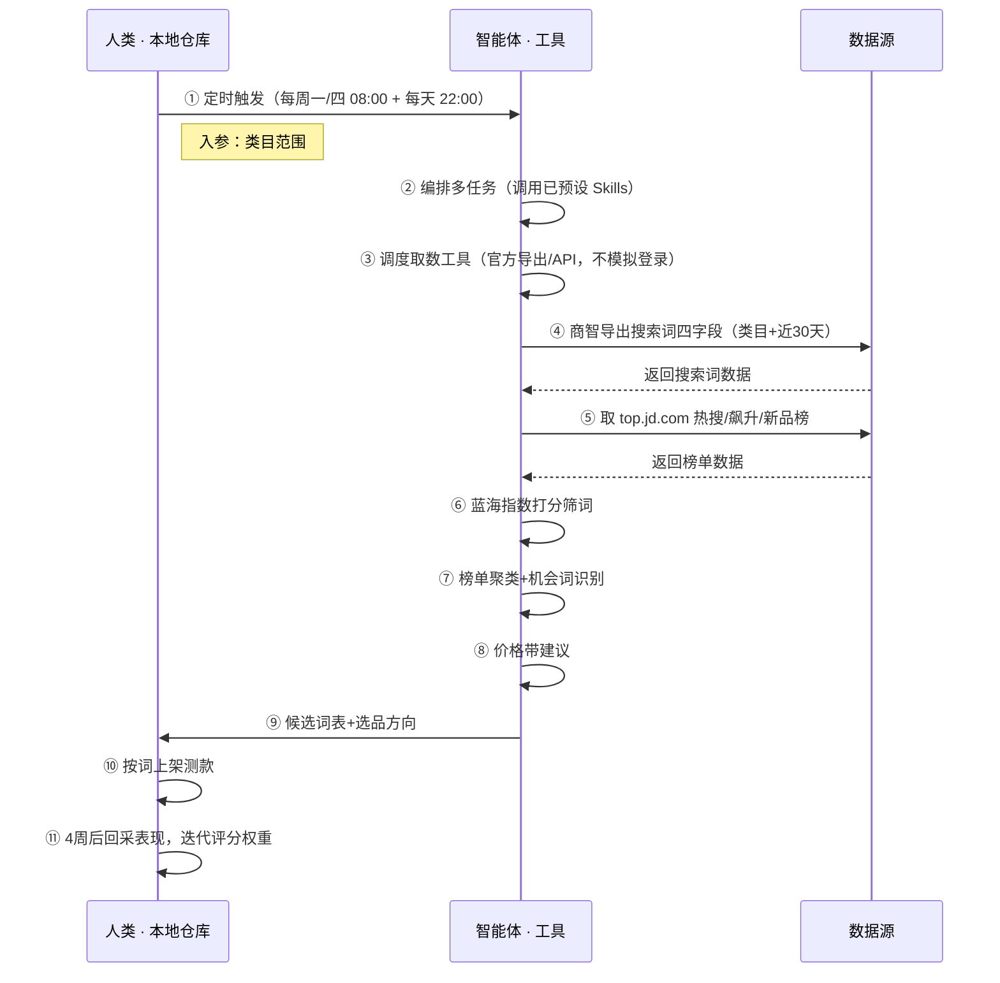

> 用主流的 **Agent 编排任务、调度和组合**「表格、分析、报告分析」工具。从京东商智官方导出搜索词与榜单数据（商家自有权限，合规取数），按蓝海指数公式打分筛词、聚类榜单爆款共性，输出类目机会词与价格带建议——官方工具给数据，本方案把数据变成可直接测款的判断。

> Agent 自动化需开通企业功能
> 点击申请1个月免费权限
> [点击申请 →](https://skieer.feishu.cn/share/base/form/shrcnFwMayykP5iaL38fnZKTbrg)

## 一、用户与需求

**核心矛盾**：商智里词很多但"哪些值得测款"要靠人判断；榜单商品共性看不出，错过上升期红利；大促前后数据波动大不会校准——蓝海指数=搜索热度×点击率×转化率÷竞争商品数，指数越高越值得测款；机会词=同时在热搜/飙升榜出现且上榜天数≥2 天的蓝海爆款属性。

### 1.1 不同模式卖家

| 类型 | 选择 | 建议 |
|-|-|-|
| 品牌卖家 | 首选 | 强烈推荐（类目词库大，需持续盯榜） |
| 精铺卖家 | 首选 | 强烈推荐（测款命中率是关键） |
| 铺货型 | 次选 | 一般推荐（词池大但命中率低） |

### 1.2 不同类目卖家

| 类目 | 最关注维度 | 核心逻辑 |
|-|-|-|
| 3C 数码 | 蓝海指数 | 标品竞争激烈，找竞争商品数少的词 |
| 家居家具 | 价格带 | 榜单中位价±20% 区间 |
| 美妆个护 | 飙升榜 | 趋势品早布局 |
| 服装鞋帽 | 上新节奏 | 新品榜早跟早发 |
| 户外运动 | 上榜天数 | 连续上榜≥2 天=稳定需求 |
| 母婴用品 | 搜索增速 | 大促前后数据失真需校准 |

### 1.3 不同角色用户

| 用户 | 需求 | 问题 | 投入时间预估 |
|-|-|-|-|
| 老板 | 测款命中率高 | 凭感觉选词 | 0.5 小时/周 |
| 选品 | 候选词表 | 商智词多看不出重点 | 2-4 小时/周 |
| 运营 | 价格带建议 | 榜单共性看不出 | 1 小时/周 |

---

## 二、现在的方法与问题

### 2.1 流程步骤与问题总结

| 序号 | 步骤 | 现在的方法 | 问题缺陷 |
|-|-|-|-|
| 1 | 导数据 | 商智手动导出 | 导出后不会用 |
| 2 | 选词 | 凭感觉 | 测款命中率低 |
| 3 | 看榜单 | 手动翻 | 榜单共性看不出 |
| 4 | 定价格带 | 凭经验 | 错过上升期 |
| 5 | 校准数据 | 不校准 | 大促前后数据失真 |

### 2.2 问题分析

| 序号 | 根因 | 具体表现 |
|-|-|-|
| 1 | 数据闲置 | 商智数据导出后躺在 Excel |
| 2 | 无打分模型 | 蓝海指数不计算 |
| 3 | 无聚类分析 | 榜单共性看不出 |
| 4 | 无趋势跟踪 | 上榜天数不沉淀 |
| 5 | 数据失真 | 大促前后不校准 |

---

## 三、解决方案

### 3.1 功能概述

为京东卖家团队打造的智能体驱动市场机会发现方案。

定时触发并调度多个工具，从京东商智官方导出搜索词四字段与 top.jd.com 榜单数据（商家自有权限、合规取数，不模拟登录操作），输出完整的市场分析，涵盖「候选词表、蓝海指数排序、类目机会词、价格带建议、选品方向」。

### 3.2 智能体执行流程

智能体定时触发；智能体编排任务时**调用已预设好的 Skills**，再经 MCP 调度工具完成取数与分析。

### 3.3 为何不全用智能体解决

智能体确实可以写出能跑的采集脚本（Playwright/Selenium 都行），但京东对商家后台和前台页面都有严格风控——模拟登录/批量爬取大概率触发验证码、设备指纹封锁甚至封店，且有法律风险。本方案的正解是**数据走官方合规链路**：商智是商家自有权限的官方数据工具，导出是平台允许的动作；智能体的价值放在官方数据之上的打分、聚类、判断——把"数据"变成"结论"。

#### 1）逐项对比

| 对比维度 | 智能体写代码直接采集 | 官方数据源 + Agent 判断 |
|-|-|-|
| 账号风险 | 模拟登录商家后台/批量爬取，触发风控验证码、设备指纹封锁，长期运行封店是大概率事件，且有法律风险 | 商智官方导出/API 取数，平台允许，账号安全由官方链路保障 |
| 数据稳定性 | 页面改版即失效，需持续对抗 | 官方数据口径稳定，不受页面变动影响 |
| 打分判断 | 脚本只取数不算分，蓝海指数仍要人工算 | 智能体按蓝海指数公式自动打分、聚类、排序 |
| 数据沉淀 | 采集数据散落，无法横向对比 | 词库/榜单库统一入库，多期可审计可追溯 |
| 维护成本 | 反爬对抗、改版修复需开发持续投入 | 取数路径固定，判断规则沉淀为 Skills |
| 成本结构 | 代理 IP + 服务器 + 开发维护人力 | 商智订阅费（官方）+ 按调用/月费计价 |

#### 2）优劣势说明

|  | 官方数据源 + Agent 判断 | 智能体写代码直接采集 |
|-|-|-|
| 优势 | 合规稳定、无封店风险；判断规则沉淀可复用；非技术人员可维护 | 无商智订阅费（若卖家已有商智则此优势不成立） |
| 劣势 | 依赖商智数据口径（至尊版才有行业趋势类数据）；需人工确认导出 | 采集自由度看似更高，但封店/法律风险不可控，长期稳定性几乎为零 |
| 本场景特别提醒 | 蓝海指数高且竞争商品数少才值得测款；避开大促前后失真窗口 | 同左——且明确：京东商家后台模拟登录属高风险动作，不建议 |

#### 3）结论

| 论点 | 说明 |
|-|-|
| 确定性 vs 生成性 | 蓝海指数打分是确定性计算——同样的搜索数据，要求"每次算得一致"。AI 生成的代码是生成性的，能跑通 ≠ 长期稳定合规。 |
| 资产沉淀 | 蓝海词库、评分权重、类目机会库沉淀在平台里是活的——多类目复用、换人接手都成立；写在个人表格里是死的。 |
| 风险无豁免 | 京东风控不豁免任何自动化。这条路没有"用代码就比官方导出更稳"的捷径——官方链路合规，自建采集赌封店。 |
| 时间 | 选品要的是"数据进来自动出候选词表"，不是"导出后自己翻 Excel"。取数交给官方链路，智能体的价值放在打分、聚类这些判断层。 |

> Agent 自动化需开通企业功能
> 点击申请1个月免费权限
> [点击申请 →](https://skieer.feishu.cn/share/base/form/shrcnFwMayykP5iaL38fnZKTbrg)

### 3.4 功能清单

| 功能 | 系统 | 功能说明（解决问题） |
|-|-|-|
| 会话/定时 | 智能体 | 1. 理解人类语言，调用已预设好的 Skills。  
2. 编排多任务、调度多工具。 |
| 数据取数 | 商智导出/官方应用 | 1. 解决商智数据导出后闲置、不会用问题。  
2. 作为智能体工具被调度执行，取数失败告警重试（官方导出不涉及模拟登录）。  
3. 从商智导出搜索词四字段（搜索热度/点击率/转化率/竞争商品数）+ 取 top.jd.com 热搜/飙升/新品榜（标题/价格/上榜天数）。 |
| 数据清洗 | 智能体 | 去重、剔除已上架词、跨期对齐，解决多源口径不一致问题。 |
| 数据分析与报告 | 智能体 | 基于预设 Skills，解决选词凭感觉、榜单共性看不出问题。  
1. 蓝海指数=搜索热度×点击率×转化率÷竞争商品数，指数越高越值得测款。  
2. 榜单聚类：机会词=热搜/飙升同现且上榜≥2 天。  
3. 价格带建议：榜单中位价±20% 区间。  
4. 剔除与货源不符的词。 |
| IM通知 | 飞书、钉钉、企微等 | 解决选品滞后问题。候选词表、机会报告自动推送。 |
| 数据资产储存 | 本地电脑、云储存 | 1. Skills 资产：京东榜单选品与蓝海规则。  
2. 数据储存：词库与机会报告统一写入本地，可追溯。  
3. 经验知识库：按测款表现回填迭代评分权重。 |

### 3.5 智能体执行落地过程

部署时配置类目范围即可自动运行；下表其余配置项（智能体工具、Webhook、蓝海指数阈值）均为部署时一次性预设，会话中无需重复输入。

#### 1）配置

| 类别 | 说明 |
|-|-|
| 智能体 | 主流智能体。 |
| 智能体工具 | 1.取数：京东商智官方导出/官方应用（商家自有账号授权，不模拟登录）。  
2.数据分析：智能体自带。  
3.数据报告：智能体自带。  
4.数据储存：Excel，智能体自带。  
5.IM：企业办公 IM（飞书/钉钉/企微），MCP 或 webhook 配置。 |
| 工作知识 | 1.类目范围。  
2.排除无效词与蓝海指数阈值。  
3.测款预算上限。  
4.蓝海指数=搜索热度×点击率×转化率÷竞争商品数。  
5.机会词=热搜/飙升同现且上榜≥2 天。  
6.价格带=榜单中位价±20%。7.避开大促前后失真窗口。 |
| 本地数据库 | 1.候选词库地址。  
2.机会报告地址。  
3.经验库地址。 |

#### 2）执行

方案由智能体来编排、调度、执行，人类接报告信息、决策、下一步任务。

| 任务 | 产出 | 产出物接收人 |
|-|-|-|
| 接收类目配置，定时触发 | 任务启动记录 | —— |
| 调用已预设 Skills，编排任务流程 | 任务编排方案 | —— |
| 商智导出搜索词+取榜单数据 | 市场数据 | —— |
| 蓝海指数打分筛词 | 打分结果 | 选品 |
| 榜单聚类+机会词识别 | 机会词清单 | 选品 |
| 价格带建议 | 价格建议 | 选品/运营 |
| 候选词表输出 | 候选词表 | 选品 |

**异常处理**

| 触发 | 处理 |
|-|-|
| 商智取数失败 | 告警重试，人工确认导出 |
| 大促数据失真 | 避开失真窗口 |
| 样本不足 | 标注仅供参考 |
| 低置信度词 | 转人工复核 |
| 字段不完整 | 校验补采 |

#### 3）结果

| 结果 | 说明 |
|-|-|
| 数据资产 | 全量市场数据结构化数据（词/搜索热度/点击率/转化率/竞争商品数/蓝海指数/上榜天数），可审计。 |
| 分析报告 | 1. 分析方法论：官方取数 + 蓝海打分 + 榜单聚类，从 0 到体系化。  
2. 候选词表：按蓝海指数排序，直接可测款。  
3. 类目机会词：热搜/飙升同现机会。  
4. 价格带建议：中位价±20% 区间。  
5. 测款回采：4 周后验证并迭代权重。 |
| Skills | 智能体 Skills：京东榜单选品与蓝海规则。 |

> Agent 自动化需开通企业功能
> 点击申请1个月免费权限
> [点击申请 →](https://skieer.feishu.cn/share/base/form/shrcnFwMayykP5iaL38fnZKTbrg)

---

## 四、使用前后预估

| 指标 | 前 | 后 | 改善 |
|-|-|-|-|
| 选词效率 | 导出后手动翻 | 自动打分出表 | 省 100% 时间 |
| 选词依据 | 凭感觉 | 蓝海指数打分 | 命中率高 |
| 榜单分析 | 手动翻 | 聚类报告 | 共性可见 |
| 趋势跟踪 | 不沉淀 | 上榜天数入库 | 上升期不漏 |
| 数据校准 | 不校准 | 避开失真窗口 | 数据真 |
| 方法论 | 无，换人标准不同 | 可重复执行的 Skills | 从 0 到体系化 |

---

## 五、效果证明

> Agent 自动化需开通企业功能
> 点击申请1个月免费权限
> [点击申请 →](https://skieer.feishu.cn/share/base/form/shrcnFwMayykP5iaL38fnZKTbrg)

### 5.1 客户案例

**《竞品 AI 快报：多平台动态 7×24 监控与自动出报》**

> 某大型教培集团需盯多家竞品公众号、课程与活动动态，人工巡查信息零散难汇总。RPA 自动巡查多平台账号并生成竞品快报。

| 效果 | 说明 |
|-|-|
| 提效 | 竞品动态巡查由人工每日逐平台翻阅变为 7×24 自动监控。原本市场团队需人工登录多平台逐篇查看推文、课程与活动，现在自动抓取、自动分析、自动出报告。 |
| 降本 | 市场团队用于公众号巡查、内容摘抄与情报汇总的重复性工作量降低约 80%，投入转向课程优化、活动策划与市场竞争策略等重点工作。 |
| 任务 | 竞品课程、价格及营销动态识别准确率提升至 95% 以上，减少遗漏与误判。 |
| 任务 | 多平台账号自动巡查，情报按周期自动汇总成报。 |

案例详情：[快报|社媒监控：竞品AI快报生成自动化](https://skieer.feishu.cn/wiki/UNA7wUatCih1D2kXL5Fco3MpnGe)

### 5.2 DEMO应用

京东-根据关键词采集商品列表：https://rpa.bazhuayu.com/appstore/app/ffrpa/id-670f91b95840a46a181c3f56

---

## 六、备注

### 6.1 Agent 支持

本方案不绑定具体智能体，主流 Agent 均可运行（需支持技能/Skills 加载与工具调用）：

| Agent/智能体 | 说明 |
|-|-|
| Workbuddy | 本方案运行平台，支持技能/Skills 上传加载、定时任务、MCP 工具调用与表格/报告处理 |
| 豆包（国内·字节） | 国内主流个人智能体，支持技能上传、定时任务与工具调用，上手成本低 |
| 通义千问（国内·阿里） | 支持 Agent 编排与插件生态，集成阿里电商数据能力，适合电商场景 |
| DeepSeek（国内） | 推理能力强、成本低，适合规则打分与归因分析类任务 |
| ChatGPT（国外·OpenAI） | 海外主流通用智能体，支持 GPTs/Agent 模式与工具调用 |
| Claude（国外·Anthropic） | 长文本与结构化分析能力强，原生支持 MCP 连接外部工具 |

### 6.2 名词解释

| 术语 | 说明 |
|-|-|
| 商智 | 京东商家后台官方数据分析工具（sz.jd.com），本方案数据源 |
| 蓝海指数 | 搜索热度×点击率×转化率÷竞争商品数，指数越高越值得测款 |
| 热搜榜/飙升榜/新品榜 | top.jd.com 官方榜单 |
| 机会词 | 热搜/飙升同现且上榜≥2 天 |
| 价格带 | 榜单中位价±20% 区间 |
| 官方导出 | 商家自有权限下平台允许的数据导出动作，不涉及模拟登录 |
| MCP | Model Context Protocol，智能体连接外部工具的标准化通道 |
| 指纹浏览器 | 隔离 Cookie/浏览器指纹的工具，多店铺防关联 |

> Agent 自动化需开通企业功能
> 点击申请1个月免费权限
> [点击申请 →](https://skieer.feishu.cn/share/base/form/shrcnFwMayykP5iaL38fnZKTbrg)

---

原文：[查看原文](https://skieer.feishu.cn/wiki/EiESwCUp7icP64kJpSwcE9YFngc)
