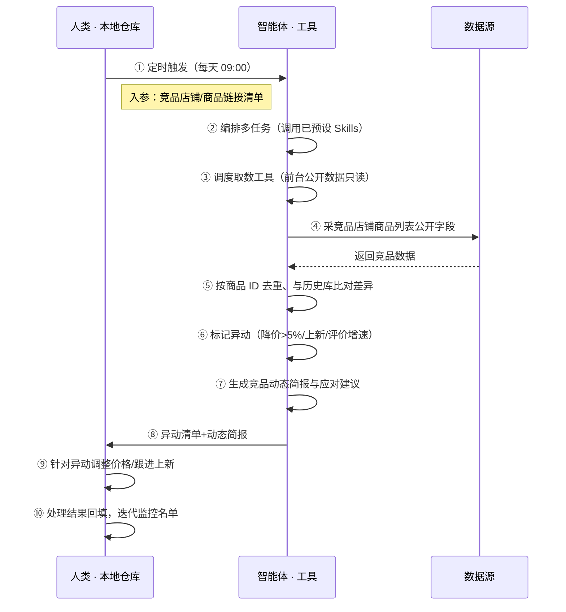

> 用主流的 **Agent 编排任务、调度和组合**「自动化、表格、分析、报告分析」工具。只读采集竞品店铺前台公开数据（商品列表页标题/价格/评价数/好评度/付款人数，不登录后台不模拟操作），按商品 ID 去重比对历史库标记异动，输出竞品动态简报与应对建议——官方商智给部分竞品数据，本方案用前台公开数据补全并做异动诊断。

> Agent 自动化需开通企业功能
> 点击申请1个月免费权限
> [点击申请 →](https://skieer.feishu.cn/share/base/form/shrcnFwMayykP5iaL38fnZKTbrg)

## 一、用户与需求

**核心矛盾**：盯竞品全靠手动翻店铺，新品上架不知情、被对手先一步截流；价格变动不能实时发现；评价增速看不到不知道谁在起量——异动识别=降价>5%、上新、评价月增>50 条自动标记。

### 1.1 不同模式卖家

| 类型 | 选择 | 建议 |
|-|-|-|
| 品牌卖家 | 首选 | 强烈推荐（核心竞品多，需持续盯守） |
| 精铺卖家 | 次选 | 一般推荐（只监控 TOP5 竞品） |
| 铺货型 | 任意 | 不推荐（竞品多且杂，监控成本高） |

### 1.2 不同类目卖家

| 类目 | 最关注维度 | 核心逻辑 |
|-|-|-|
| 3C 数码 | 价格异动 | 竞品降价冲击大，重点盯价格 |
| 家居家具 | 上新节奏 | 新品上架早发现 |
| 美妆个护 | 评价增速 | 增速异常（刷评嫌疑）需关注 |
| 服装鞋帽 | 价格+上新 | 款式迭代快，盯上新节奏 |
| 户外运动 | 价格+评价 | 功能品看竞品差评缺口 |

### 1.3 不同角色用户

| 用户 | 需求 | 问题 | 投入时间预估 |
|-|-|-|-|
| 老板 | 市场格局 | 月底才看到竞品汇总 | 0.5 小时/周 |
| 选品 | 竞品差距清单 | 数据散在页面无法横向对比 | 2-4 小时/周 |
| 运营 | 价格异动提醒 | 竞品调价全靠手动翻 | 1-2 小时/周 |

---

## 二、现在的方法与问题

### 2.1 流程步骤与问题总结

| 序号 | 步骤 | 现在的方法 | 问题缺陷 |
|-|-|-|-|
| 1 | 找竞品 | 手动搜类目记 ASIN | 漏记、记错 |
| 2 | 翻详情 | 逐个打开详情页抄数据 | 一个竞品 5 分钟，10 个一下午 |
| 3 | 比对变化 | 凭印象"好像降了" | 无环比计算 |
| 4 | 盯上新 | 手动刷新 | 新品上架不知情 |
| 5 | 汇报 | 月底口头汇总 | 无数据支撑 |

### 2.2 问题分析

| 序号 | 根因 | 具体表现 |
|-|-|-|
| 1 | 数据跨页面分散 | 逐个打开效率低 |
| 2 | 频率做不到 | 竞品变化以天计，人工以周计 |
| 3 | 无环比口径 | 降价 5% 无人感知 |
| 4 | 上新无感知 | 被对手先一步截流 |
| 5 | 经验不沉淀 | 换个人结论不一样 |

---

## 三、解决方案

### 3.1 功能概述

为京东卖家团队打造的智能体驱动竞品监控方案。

定时触发并调度多个工具，只读采集竞品店铺前台公开数据（不登录商家后台、不模拟人工操作），输出完整的竞品动态分析，涵盖「多期环比计算、降价/上新/起量标注、竞品动态简报、应对建议」。

### 3.2 智能体执行流程

智能体定时触发；智能体编排任务时**调用已预设好的 Skills**，再经 MCP 调度工具完成取数与分析。

### 3.3 为何不全用智能体解决

智能体确实可以写出能跑的采集脚本（Playwright/Selenium 都行），但京东对前台页面的批量爬取同样有风控——高频采集会触发验证码、设备指纹封锁。本方案的正解是**只读公开数据 + 低频合规采集**：竞品店铺前台展示的商品标题/价格/评价数是公开可见信息，按合理频率只读访问属正常浏览行为；智能体的价值不在"偷数据"，而在把公开数据组织成"谁在抢生意、怎么应对"的判断。

1）逐项对比

| 对比维度 | 智能体写代码高频爬取 | 前台公开数据只读 + Agent 判断 |
|-|-|-|
| 风控风险 | 高频爬取触发验证码、设备指纹封锁、IP 封禁 | 按合理频率只读公开页面，接近人工浏览行为，风险可控 |
| 合规边界 | 绕过反爬措施有法律风险（非法获取计算机信息系统数据） | 采集前台公开展示信息，商家自有权限可获取的信息 |
| 异动判断 | 脚本只采数据，涨跌判断仍靠人工 | 智能体自动环比比对、异动标注、应对建议 |
| 数据沉淀 | 采集数据散落，无法横向对比 | 竞品库统一入库，多期可审计 |
| 维护成本 | 反爬对抗、改版修复需开发持续投入 | 取数路径固定，判断规则沉淀为 Skills |
| 成本结构 | 代理 IP + 服务器 + 开发维护人力 | 按调用/月费计价 |

2）优劣势说明

|  | 前台公开数据只读 + Agent 判断 | 智能体写代码高频爬取 |
|-|-|-|
| 优势 | 合规可控、无封店风险；异动判断自动沉淀；非技术人员可维护 | 采集频率看似更自由 |
| 劣势 | 只能拿前台公开字段（付款人数为模糊值）；需控制采集频率 | 封店/法律风险不可控，长期稳定性几乎为零 |
| 本场景特别提醒 | 降低采集频率、模拟真人浏览节奏，避开高峰时段 | 同左——且明确：高频爬取京东前台属高风险动作，不建议 |

3）结论

| 论点 | 说明 |
|-|-|
| 确定性 vs 生成性 | 竞品比对是确定性任务——同样的字段，要求"不重不漏稳定出表"。AI 生成的代码是生成性的，能跑通 ≠ 每天准点合规不漏采。 |
| 资产沉淀 | 竞品库、异动规则、应对话术沉淀在平台里是活的——多店铺复用、换人接手都成立；写在个人脚本里是死的。 |
| 风险无豁免 | 京东风控不豁免任何自动化。这条路没有"用代码就比只读采集更安全"的捷径——高频爬取赌封店，合规取数才稳。 |
| 时间 | 运营要的是"每天拿到异动清单"，不是"每天翻 10 个竞品店"。执行层交给平台，智能体的价值放在异动归因、应对建议这些判断层。 |

> Agent 自动化需开通企业功能
> 点击申请1个月免费权限
> [点击申请 →](https://skieer.feishu.cn/share/base/form/shrcnFwMayykP5iaL38fnZKTbrg)

### 3.4 功能清单

| 功能 | 系统 | 功能说明（解决问题） |
|-|-|-|
| 会话/定时 | 智能体 | 1. 理解人类语言，调用已预设好的 Skills。   2. 编排多任务、调度多工具。 |
| 数据采集 | RPA（前台公开数据只读） | 1. 解决竞品页面多需逐个打开、手动记录易漏易错问题。   2. 作为智能体工具被调度执行，只读竞品店铺前台公开页面，按合理频率采集避免风控。   3. 采竞品商品列表标题/价格/评价数/好评度/付款人数（前台公开字段）。 |
| 数据清洗 | 智能体 | 按商品 ID 去重、与历史库比对差异，解决多期数据对不上问题。 |
| 数据分析与报告 | 智能体 | 基于预设 Skills，解决涨跌凭感觉问题。   1. 环比计算：价格环比%、评价增速、付款人数变化。   2. 异动标注：降价>5%、新品上架、评价月增>50 条自动标记。   3. 应对建议：跟进降价/上新分析/差评缺口提示。 |
| IM通知 | 飞书、钉钉、企微等 | 解决竞品变化发现滞后问题。异动清单、动态简报自动推送工作群。 |
| 数据资产储存 | 本地电脑、云储存 | 1. Skills 资产：竞品对标指标与异动判断规则。   2. 数据储存：竞品数据统一写入竞品监控库，多期可审计。   3. 经验知识库：审核通过的应对建议持续沉淀。 |

### 3.5 智能体执行落地过程

部署时配置竞品名单即可自动运行；下表其余配置项（智能体工具、Webhook、异动阈值）均为部署时一次性预设，会话中无需重复输入。

#### 1）配置

| 类别 | 说明 |
|-|-|
| 智能体 | 主流智能体。 |
| 智能体工具 | 1.采集：八爪鱼RPA（前台公开数据只读，低频合规采集）。   2.数据分析：智能体自带。   3.数据报告：智能体自带。   4.数据储存：Excel，智能体自带。   5.IM：企业办公 IM（飞书/钉钉/企微），MCP 或 webhook 配置。 |
| 工作知识 | 1.竞品店铺/商品链接名单。   2.异动阈值：降价>5%、评价月增>50 条。   3.对标维度：价格/评价/好评度/付款人数。   4.采集频率与时段（低频、错峰）。   5.应对策略库。 |
| 本地数据库 | 1.竞品监控库地址。   2.异动报告地址。   3.经验库地址。 |

#### 2）执行

方案由智能体来编排、调度、执行，人类接报告信息、决策、下一步任务。

| 任务 | 产出 | 产出物接收人 |
|-|-|-|
| 接收竞品名单，定时触发 | 任务启动记录 | —— |
| 调用已预设 Skills，编排任务流程 | 任务编排方案 | —— |
| 只读采竞品前台公开数据 | 竞品原始数据 | —— |
| 按商品 ID 去重、历史比对 | 差异数据 | —— |
| 异动标注（降价/上新/起量） | 异动标签 | 运营 |
| 生成动态简报与应对建议 | 竞品动态简报 | 选品/运营 |
| 推送工作群并附数据支撑 | 异动提醒 | 运营 |

异常处理

| 触发 | 处理 |
|-|-|
| 页面改版抓取失败 | 告警并保留上次快照 |
| 触发验证码 | 降低频率、暂停当日采集 |
| 数据采集不全 | 降级说明本次覆盖率 |
| 异动置信度低 | 转人工复核，不输出硬结论 |

#### 3）结果

| 结果 | 说明 |
|-|-|
| 数据资产 | 全量竞品结构化数据（标题/价格/评价数/好评度/付款人数/环比变化/异动标签），多期可审计。 |
| 分析报告 | 1. 分析方法论：多期环比 + 异动标注，从 0 到体系化。   2. 异动清单：降价/上新/起量一目了然。   3. 竞品动态简报：谁在抢生意、怎么应对。   4. 趋势报告：按周沉淀，可回看。 |
| Skills | 智能体 Skills：竞品对标指标与异动判断规则。 |

> Agent 自动化需开通企业功能
> 点击申请1个月免费权限
> [点击申请 →](https://skieer.feishu.cn/share/base/form/shrcnFwMayykP5iaL38fnZKTbrg)

---

## 四、使用前后预估

| 指标 | 前 | 后 | 改善 |
|-|-|-|-|
| 监控耗时 | 10 个竞品一下午 | 全自动，0 人工 | 省 100% 时间 |
| 监控频率 | 不定期 | 每天 09:00 | 固定节奏 |
| 异动感知 | 事后发现 | 当天自动推送 | 提前数天 |
| 上新感知 | 不知情 | 自动标记 | 不落单 |
| 应对依据 | 凭印象 | 数据+建议 | 有据可依 |
| 方法论 | 无，换人结论不同 | 可重复执行的 Skills | 从 0 到体系化 |

---

## 五、效果证明

> Agent 自动化需开通企业功能
> 点击申请1个月免费权限
> [点击申请 →](https://skieer.feishu.cn/share/base/form/shrcnFwMayykP5iaL38fnZKTbrg)

### 5.1 客户案例

**《竞品 AI 快报：多平台动态 7×24 监控与自动出报》**

> 某大型教培集团需盯多家竞品公众号、课程与活动动态，人工巡查信息零散难汇总。RPA 自动巡查多平台账号并生成竞品快报。

| 效果 | 说明 |
|-|-|
| 提效 | 竞品动态巡查由人工每日逐平台翻阅变为 7×24 自动监控。原本市场团队需人工登录多平台逐篇查看推文、课程与活动，现在自动抓取、自动分析、自动出报告。 |
| 降本 | 市场团队用于公众号巡查、内容摘抄与情报汇总的重复性工作量降低约 80%，投入转向课程优化、活动策划与市场竞争策略等重点工作。 |
| 任务 | 竞品课程、价格及营销动态识别准确率提升至 95% 以上，减少遗漏与误判。 |
| 任务 | 多平台账号自动巡查，情报按周期自动汇总成报。 |

案例详情：[快报|社媒监控：竞品AI快报生成自动化](https://skieer.feishu.cn/wiki/UNA7wUatCih1D2kXL5Fco3MpnGe)

### 5.2 DEMO应用

京东-商品信息采集：https://rpa.bazhuayu.com/appstore/app/ffrpa/id-664eef02362d4886acfabcbe

京东-根据关键词采集商品列表：https://rpa.bazhuayu.com/appstore/app/ffrpa/id-670f91b95840a46a181c3f56

---

## 六、备注

### 6.1 Agent 支持

本方案不绑定具体智能体，主流 Agent 均可运行（需支持技能/Skills 加载与工具调用）：

| Agent/智能体 | 说明 |
|-|-|
| Workbuddy | 本方案运行平台，支持技能/Skills 上传加载、定时任务、MCP 工具调用与表格/报告处理 |
| 豆包（国内·字节） | 国内主流个人智能体，支持技能上传、定时任务与工具调用，上手成本低 |
| 通义千问（国内·阿里） | 支持 Agent 编排与插件生态，集成阿里电商数据能力，适合电商场景 |
| DeepSeek（国内） | 推理能力强、成本低，适合规则打分与归因分析类任务 |
| ChatGPT（国外·OpenAI） | 海外主流通用智能体，支持 GPTs/Agent 模式与工具调用 |
| Claude（国外·Anthropic） | 长文本与结构化分析能力强，原生支持 MCP 连接外部工具 |

### 6.2 名词解释

| 术语 | 说明 |
|-|-|
| 环比 | 本期与上一周期对比的变化率，如今日价格 vs 昨日价格 |
| 降价异动 | 竞品价格降幅 >5%，自动标记 |
| 起量信号 | 竞品评价月增 >50 条，关注 |
| 付款人数 | 京东商品页展示的模糊销量口径 |
| 好评度 | 京东商品页展示的评价满意度 |
| 前台公开数据 | 商品列表页展示的公开信息，按合理频率只读访问 |
| MCP | Model Context Protocol，智能体连接外部工具的标准化通道 |
| 指纹浏览器 | 隔离 Cookie/浏览器指纹的工具，多店铺防关联 |

> Agent 自动化需开通企业功能
> 点击申请1个月免费权限
> [点击申请 →](https://skieer.feishu.cn/share/base/form/shrcnFwMayykP5iaL38fnZKTbrg)

---

原文：[查看原文](https://skieer.feishu.cn/wiki/KywJw387iieEP0kV3ZfcbkinnAg)
