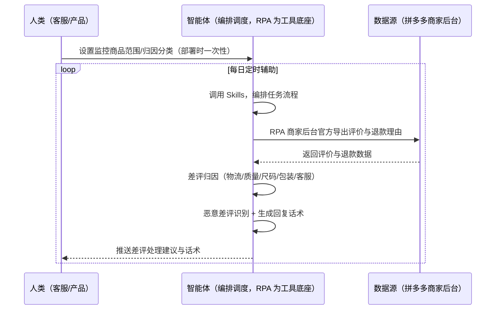
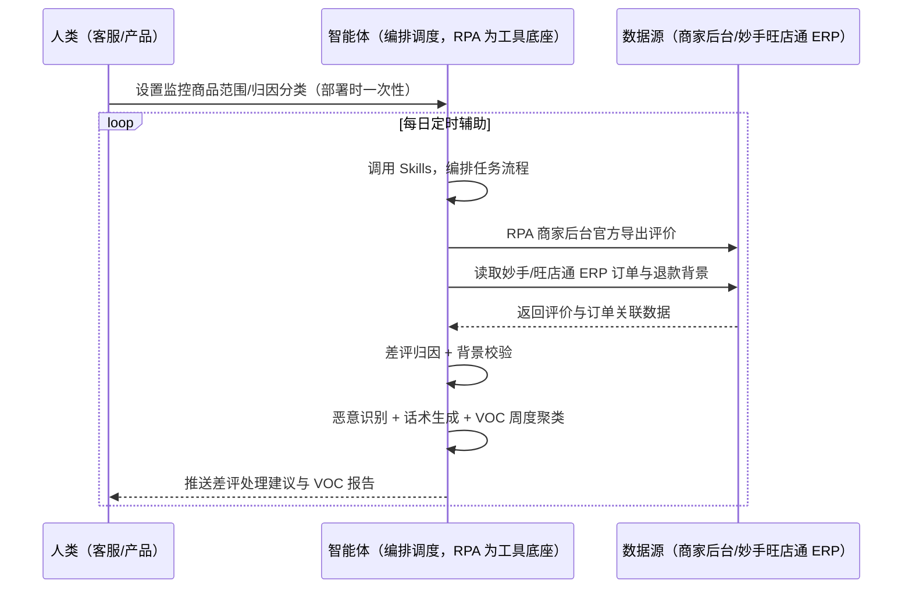

> 为拼多多卖家团队打造的评价口碑与 VOC 分析方案。好评率下滑发现滞后、差评处理不及时影响转化、差评归因靠人工逐条看、评价里的产品缺陷与真实卖点无人挖掘。本方案由智能体调度多个工具执行商家后台官方导出评价与退款理由（商家自有权限、不模拟登录）+ 差评归因 + 恶意差评识别 + 话术生成 + 周度 VOC 聚类，输出差评处理建议与 VOC 报告。每日定时辅助，只推送差评处理建议与 VOC 结论，无异常不打扰。

> Agent 自动化需开通企业功能
> 点击申请1个月免费权限
> [点击申请 →](https://skieer.feishu.cn/share/base/form/shrcnFwMayykP5iaL38fnZKTbrg)

## 一、用户与需求

核心矛盾：好评率下滑发现滞后、差评处理不及时影响转化；差评归因靠人工逐条看；评价内容里的产品缺陷/真实卖点无人挖掘——归因分类=物流/质量/尺码/包装/客服五类，VOC 结论反哺改品/卖点/客服。

两类客户痛点同源，数据来源不同：

- 未购 SaaS 客户（新卖家/小团队）：手动刷新后台看评价、逐条写回复话术、不挖痛点，全靠手；
- 已购 SaaS 客户（妙手/旺店通 ERP 等）：ERP 管订单/发货，评价归因与话术不覆盖，仍要人手动做。

适用客户：有口碑管理需求的拼多多卖家。商家后台导出自家评价与退款理由是商家自有权限的官方动作；本方案把评价变成改品与话术依据。

### 1.1 不同模式卖家

| 类型 | 选择 | 建议 |
|-|-|-|
| 品牌卖家 | 首选 | 强烈推荐（口碑是品牌资产） |
| 精铺卖家 | 首选 | 强烈推荐（好评率影响流量权重） |
| 铺货型 | 次选 | 一般推荐（评价少） |

### 1.2 不同类目卖家

| 类目 | 最关注维度 | 核心逻辑 |
|-|-|-|
| 3C 数码 | 质量差评 | 功能缺陷投诉多 |
| 服装鞋帽 | 尺码差评 | 尺码不符差评多 |
| 家居家具 | 物流差评 | 大件运输易损 |
| 美妆个护 | 体验差评 | 肤感评价敏感 |
| 食品保健 | 品质口碑 | 好评率影响大 |

### 1.3 不同角色用户

| 用户 | 需求 | 问题 | 投入时间（估算） |
|-|-|-|-|
| 老板 | 好评率不跌 | 差评滞后 | 0.5 小时/周 |
| 客服 | 回复话术 | 逐条写话术慢 | 2-3 小时/周 |
| 产品 | 改进依据 | 痛点无人挖 | 1 小时/周 |

---

## 二、现在的方法与问题

### 2.1 流程步骤与问题总结

**人工方式（未购 SaaS 客户）**

| 序号 | 步骤 | 现在的方法 | 问题缺陷 |
|-|-|-|-|
| 1 | 看评价 | 手动刷新后台 | 差评滞后 |
| 2 | 归因 | 人工逐条 | 慢且漏 |
| 3 | 回评/申诉 | 逐条操作 | 恶意差评漏识别 |
| 4 | 挖痛点 | 不挖 | 产品改进无依据 |

**SaaS 方式（已购妙手/旺店通 ERP 客户）**

| 序号 | 步骤 | 现在的方法 | 问题缺陷 |
|-|-|-|-|
| 1 | 看评价 | ERP 不覆盖 | 靠人刷后台 |
| 2 | 归因 | 人工逐条 | 慢且漏 |
| 3 | 回评/申诉 | 逐条操作 | 恶意识别靠经验 |
| 4 | 挖痛点 | 不挖 | 无 VOC |

### 2.2 问题分析

**人工方式根因**

| 序号 | 根因 | 具体表现 |
|-|-|-|
| 1 | 数据闲置 | 后台评价导出后没人分析 |
| 2 | 无归因模型 | 分类靠人工 |
| 3 | 无恶意识别 | 恶意差评误伤 |
| 4 | 无 VOC 分析 | 痛点无人挖掘 |

**SaaS 方式根因**

| 序号 | 根因 | 具体表现 |
|-|-|-|
| 1 | ERP 不覆盖口碑 | 订单管得好，评价归因无工具 |
| 2 | 无闭环 | 好评率结果不回填 |

---

## 三、解决方案

### 3.1 功能概述

为拼多多卖家团队打造的评价口碑与 VOC 分析方案，商家后台官方导出评价与退款理由 + 差评归因 + 恶意识别 + 话术生成，输出差评处理建议与 VOC 报告。

每日定时触发并调度多个工具，调起八爪鱼 RPA（Agent 的工具底座，能耦合多系统、完成自动化任务执行）从商家后台官方导出评价与退款理由（商家自有权限、不模拟登录），智能体做差评归因（物流/质量/尺码/包装/客服）、识别恶意差评、生成回复话术，周度聚类输出 VOC 报告。每日定时辅助，只推送差评处理建议与 VOC 结论，无异常不打扰。

### 3.2 系统结合

| 要素 | 说明 |
|-|-|
| 客户现有工具盘点 | **未购 SaaS 客户**：无第三方工具，评价靠手动刷后台。     **已购 SaaS 客户**（主流组合）：妙手/旺店通 ERP（国内主流电商 ERP，管订单/发货，评价归因不覆盖） |
| 数据/能力来源 | **无 SaaS**：商家后台官方导出评价（好评率/差评数/差评内容/评价趋势）+ 退款理由。     **有 SaaS**：商家后台官方导出 + 妙手/旺店通 ERP 订单数据关联（判断复购/退款背景） |
| RPA 耦合动作 | 作为 Agent 的工具底座，按计划从商家后台官方导出评价与退款理由（商家自有权限、失败重试告警）+ 评价内容举报/申诉辅助，统一流转给智能体；低置信度归因转人工 |
| 耦合出的新价值 | 单工具给不了的端到端结论：评价数据一次取齐 → 差评五类归因 → 恶意识别 + 回复话术 → VOC 聚类报告，**只推送差评处理建议与 VOC 结论** |

### 3.3 智能体执行流程

智能体定时触发。支持**两种数据通道**，部署时按客户现有工具选择：

**通道一：无 SaaS 方式（商家后台官方导出，适合未购 ERP 的客户）**

**通道二：有 SaaS 方式（官方导出 + ERP 订单关联，适合已购客户）**

> Agent 自动化需开通企业功能
> 点击申请1个月免费权限
> [点击申请 →](https://skieer.feishu.cn/share/base/form/shrcnFwMayykP5iaL38fnZKTbrg)

### 3.4 为何这么设计

要同时回答三个问题：**为什么不能只用 SaaS/API？为什么不能纯靠智能体写代码？为什么 RPA 是执行底座？** 本场景的核心是"定时导评、归因话术、VOC 聚类、挂了有人管"。

#### 1）逐项对比

| 对比维度 | SaaS/API 堆叠（妙手/旺店通） | 纯智能体（智能体写代码） | 智能体+自动化工具（RPA 工具底座） |
|-|-|-|-|
| 实现方式 | ERP 给订单背景，评价归因无覆盖 | 能爬能分析，但全要自己接 | 商家后台官方导出应用直挂 |
| 风控合规 | 自有数据合规，评价无工具 | 高频爬评价页触发验证码、设备指纹封锁、账号处罚，且有法律风险 | 商家后台官方导出（商家自有权限），合规稳定 |
| 归因判断 | 靠人工逐条 | 需自写分类模型 | 现成导出直挂、归因即开即用 |
| 使用成本（总拥有成本） | ERP 订阅费 | 代理 IP + 服务器 + 开发维护人力，隐性成本高 | 一份平台订阅跑多流程，单方案边际成本 ≈ 0 |
| 维护人要求 | 低（工具现成） | 规则调整都要开发介入 | 可视化流程，客服自己可调归因分类 |

#### 2）优劣势说明

|  | SaaS/API 堆叠（ERP） | 纯智能体（智能体写代码） | 智能体+自动化工具（RPA 工具底座） |
|-|-|-|-|
| 优势 | 订单背景数据真实 | 无订阅费；     可深度定制归因模型 | 商家后台官方导出直挂；     归因/话术即开即用；     非技术人员可维护 |
| 劣势 | 评价归因不覆盖；     判断依赖人工 | 高频爬取有封号与法律风险；     导出与保活全自建 | 本地电脑运行需保持开机；     订阅费；     回评/申诉动作需人工确认 |

#### 3）结论

| 论点 | 说明 |
|-|-|
| 官方链路合规 | 商家后台导出自家评价与退款理由是商家自有权限的官方动作——不模拟登录、不批量爬取，长期稳定 |
| 归因有模型 | 差评五类归因（物流/质量/尺码/包装/客服）沉淀为 Skills，换人可复用 |
| 恶意识别 | 退款理由与商品不符/频次异常的可疑差评特征模型，减少误伤 |
| 一个底座跑多流程 | 客户购买 RPA 平台是跑多个流程（选品/竞品/口碑），本方案只是其中一个——平台订阅费被多流程摊薄 |
| 时间 | 客服要的是"差评自动归因出话术"，不是"逐条翻评价" |

### 3.5 功能清单

| 功能 | 系统 | 功能说明（解决问题） |
|-|-|-|
| 会话/定时 | 智能体 | 1. 理解人类语言，调用已预设好的 Skills。     2. 编排多任务、调度多工具。 |
| 多系统数据取数 | RPA、指纹浏览器 | 1. 解决差评滞后、评价翻不完问题。     2. 作为智能体工具底座被调度执行，官方导出失败重试告警。     3. **【无 SaaS 方式】** RPA 商家后台官方导出评价（好评率/差评数/差评内容/评价趋势）+ 退款理由。**【有 SaaS 方式】** 商家后台官方导出 + 读取妙手/旺店通 ERP 订单背景。 |
| 差评归因 | 智能体 | 物流/质量/尺码/包装/客服五类归因，低置信度转人工。 |
| 恶意识别 | 智能体 | 退款理由与商品不符/频次异常的可疑差评特征识别，输出催改/申诉建议。 |
| 话术生成 | 智能体 | 合规回复草稿，人工确认后执行。 |
| VOC 聚类 | 智能体 | 周度聚类产品改进清单 + 卖点素材 + 退款原因 TOP3，输出 VOC 报告。 |
| IM通知 | 飞书、钉钉、企微等 | 解决差评危机滞后问题。评价日报、好评率预警自动推送。 |
| 数据资产储存 | 本地电脑、云储存 | 1. Skills 资产：差评归因与话术规则。     2. 数据储存：评价与 VOC 数据统一入库。     3. 经验知识库：好评率与痛点词频回填迭代。 |

### 3.6 智能体执行落地过程

部署时一次性配置入参（监控商品范围、归因分类、数据通道），会话中无需重复输入。

**⚠️ 部署前提（不满足则方案无法跑起来）**：①RPA 需部署在**常开电脑/云机**上，并配置漏跑补跑机制；②**需商家后台登录态**（官方导出，登录失效自动告警，不模拟登录）；③回评/申诉动作**需人工确认**后执行（评价处理影响店铺权重）；④首次配置（登录态、归因分类、话术库）需服务方/技术人员介入一次，属实施成本。

#### 1）配置

| 类别 | 说明 |
|-|-|
| 智能体 | 主流智能体。 |
| 智能体工具 | 1. **数据通道（按客户现有工具二选一）**：【无 SaaS】商家后台官方导出；【有 SaaS】官方导出 + 妙手/旺店通 ERP。     2. 数据取数与自动化执行：八爪鱼 RPA，MCP 配置完成。     3. 数据分析：智能体自带。     4. IM：企业办公 IM（飞书/钉钉/企微），MCP 或 webhook 配置。 |
| 工作知识 | 1. 监控商品范围。     2. 归因分类（物流/质量/尺码/包装/客服）。     3. 话术模板与合规红线。     4. 好评率预警线（&lt;90%）。     5. VOC 聚类周期（周）。 |
| 本地数据库 | 1. 评价库地址。     2. 话术库地址。     3. VOC 报告库地址。 |

#### 2）执行

| 任务 | 产出 | 产出物接收人 |
|-|-|-|
| 接收监控范围，定时触发 | 任务启动记录 | —— |
| 调用已预设 Skills，编排任务流程 | 任务编排方案 | —— |
| 经 MCP 向八爪鱼 RPA 下发取数任务 | 自动化任务指令 | —— |
| 多源取数（无 SaaS：商家后台导出；有 SaaS：官方导出+ERP 订单背景，智能体监控状态） | 评价数据 | —— |
| 差评归因 + 恶意识别 + 话术 | 差评处理建议 | 客服 |
| 好评率趋势预警 | 预警报告 | 客服/老板 |
| 周度 VOC 聚类 | VOC 报告 | 产品/运营 |
| 推送评价日报 | 群消息 | 客服/老板 |

异常处理：

官方导出失败 → 告警重试，人工确认；

登录失效 → 告警人工介入后断点续跑；

涉及质量投诉 → 升级人工；

归因置信度低 → 转人工复核，不输出硬结论。

#### 3）结果

| 结果 | 说明 |
|-|-|
| 数据资产 | 评价/VOC/话术全量数据，可审计可追溯。 |
| 分析报告 | 1. 评价日报：好评率/差评明细。     2. 差评处理建议：归因+话术+申诉/优化方向。     3. 恶意差评清单：特征明细。     4. VOC 报告：产品改进清单+卖点素材+退款原因 TOP3。     5. 好评率趋势：预警线监控。 |
| Skills | 智能体 Skills：差评归因与话术规则。 |

> Agent 自动化需开通企业功能
> 点击申请1个月免费权限
> [点击申请 →](https://skieer.feishu.cn/share/base/form/shrcnFwMayykP5iaL38fnZKTbrg)

---

## 四、使用前后预估

> 本方案价值 = **商家后台官方导出 → 差评归因 + 恶意识别 → 回复话术 + 申诉建议 → VOC 聚类报告**。数据走官方合规链路（商家自有权限导出，不模拟登录）。

| 指标 | 人工 | SaaS/API（ERP） | 智能体+自动化工具 |
|-|-|-|-|
| 差评发现 | 滞后数天 | 不覆盖 | 当日推送 |
| 归因效率 | 人工逐条 | 无 | 自动五类归因 |
| 恶意识别 | 靠经验 | 无 | 特征模型 |
| 回复话术 | 无沉淀 | 无 | 话术库 |
| 痛点挖掘 | 无人做 | 无 | 周度 VOC |
| 方法论 | 无，换人标准不同 | 无 | 可重复执行的 Skills |

**说明**：商家后台导出自家评价与退款理由是商家自有权限的官方动作；归因分类=物流/质量/尺码/包装/客服五类；好评率 &lt;90% 自动预警；回评/申诉动作需人工确认后执行（实锤红线）。

---

## 五、效果证明

> Agent 自动化需开通企业功能
> 点击申请1个月免费权限
> [点击申请 →](https://skieer.feishu.cn/share/base/form/shrcnFwMayykP5iaL38fnZKTbrg)

### 5.1 客户案例

**《大疆：十余平台 × 7 大类营销与客服数据自动采集》**

> 十余个国内外电商平台与社媒渠道，直播、评论、客服会话、搜索等非结构化数据原需大量人力处理。RPA 完成十余个系统、7 大类核心数据自动采集入库。

| 效果 | 说明 |
|-|-|
| 提效 | 跨平台营销与客服数据采集效率显著提升。原本十余个平台与社媒渠道、7 大类数据需每日 5-6 小时人工导表，现在全自动采集入库，数据时效提升至 T+1。 |
| 降本 | 免除专职导表的人力投入，节约人力用于数据建模、投放复盘与客服策略分析等重点工作。 |
| 任务 | 覆盖十余个国内外电商平台与社媒渠道，含直播、评论、客服会话、搜索等 7 大类非结构化数据。 |
| 任务 | 形成全渠道统一数据底座，跨平台口径一致，供分析团队直接取用。 |

案例详情：[客服：全球无人机巨头跨平台电商与客服数据自动化采集](https://skieer.feishu.cn/wiki/OmO7wGX3yiASCBkqRsfcWPUMnOe)

### 5.2 DEMO应用

拼多多-评价内容举报（多店铺）：https://rpa.bazhuayu.com/appstore/app/dev_6etn2n/pin-duo-duo--ping-jia-nei-rong-ju-bao--duo-dian-pu-

拼多多-评价导出（多店铺）：https://rpa.bazhuayu.com/appstore/app/dev_6etn2n/pin-duo-duo--ping-jia-dao-chu--duo-dian-pu-

---

## 六、备注

### 6.1 Agent 支持

本方案不绑定具体智能体，主流 Agent 均可运行（需支持技能/Skills 加载与工具调用）：

| Agent/智能体 | 说明 |
|-|-|
| Workbuddy | 本方案运行平台，支持技能/Skills 上传加载、定时任务、MCP 工具调用与表格/报告处理 |
| 豆包（国内·字节） | 国内主流个人智能体，支持技能上传、定时任务与工具调用，上手成本低 |
| 通义千问（国内·阿里） | 支持 Agent 编排与插件生态，集成阿里电商数据能力，适合电商场景 |
| DeepSeek（国内） | 推理能力强、成本低，适合规则打分与归因分析类任务 |
| ChatGPT（国外·OpenAI） | 海外主流通用智能体，支持 GPTs/Agent 模式与工具调用 |
| Claude（国外·Anthropic） | 长文本与结构化分析能力强，原生支持 MCP 连接外部工具 |

### 6.2 名词解释

| 术语 | 说明 |
|-|-|
| 好评率 | 商品好评数量占总评价的比例 |
| 差评归因 | 物流/质量/尺码/包装/客服五类 |
| 恶意差评 | 退款理由与商品不符/频次异常的可疑差评 |
| 催改 | 与买家沟通修改差评 |
| VOC | Voice of Customer，客户之声 |
| 退款原因 TOP3 | 退款理由聚类前三位 |
| 官方导出 | 商家自有权限下平台允许的数据导出动作，不涉及模拟登录 |
| 妙手/旺店通 | 国内主流电商 ERP，管订单/发货，评价归因不覆盖 |
| 无 SaaS 方式 | 不购买第三方工具，商家后台官方导出 |
| 有 SaaS 方式 | 已购妙手/旺店通 ERP，官方导出 + ERP 订单背景关联 |
| MCP | Model Context Protocol，智能体连接外部工具的标准化通道 |
| 指纹浏览器 | 隔离 Cookie/浏览器指纹的工具，多店铺防关联 |

> Agent 自动化需开通企业功能
> 点击申请1个月免费权限
> [点击申请 →](https://skieer.feishu.cn/share/base/form/shrcnFwMayykP5iaL38fnZKTbrg)

---

原文：[查看原文](https://skieer.feishu.cn/wiki/GS91wlf2liFBThkM8jocgGy1ngd)
