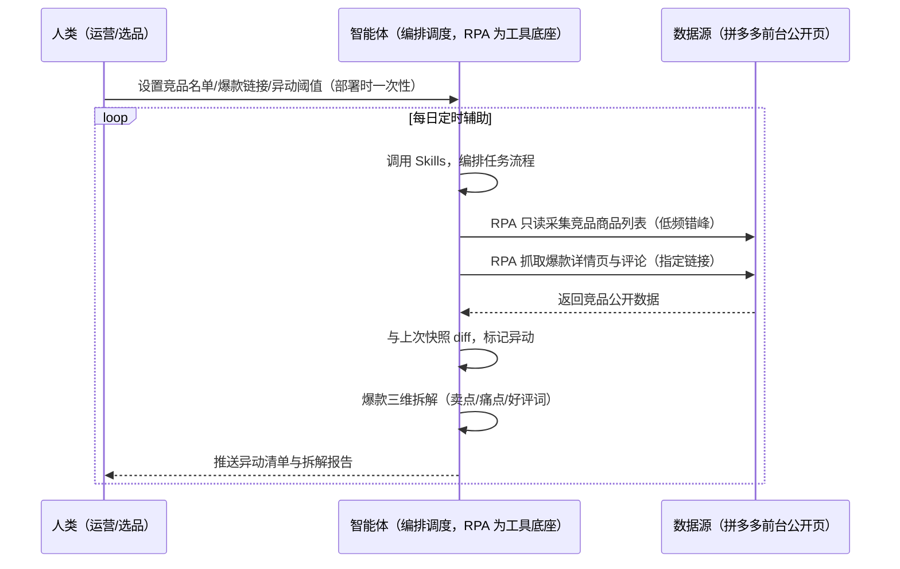
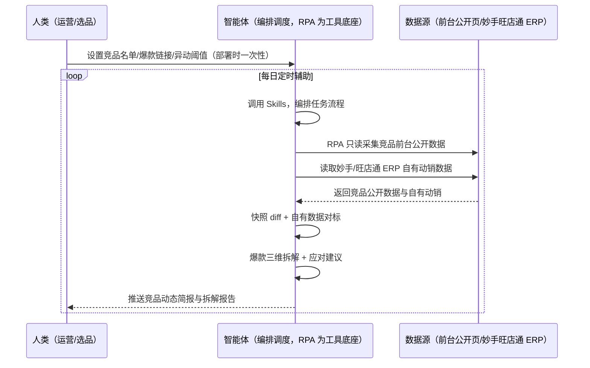

> 为拼多多卖家团队打造的竞品监控与爆款拆解方案。盯竞品全靠手动翻店铺、新品上架/价格异动/销量趋势不知情、爆款卖点痛点靠肉眼拆不透。本方案由智能体调度多个工具执行只读采集竞品店铺前台公开数据（标题/价格/已拼件数/评论数/评分）+ 对指定爆款链接抓详情页全文本与评论做三维拆解，输出异动清单与爆款拆解报告。每日定时辅助，只推送异动与拆解结论，无异常不打扰。

> Agent 自动化需开通企业功能
> 点击申请1个月免费权限
> [点击申请 →](https://skieer.feishu.cn/share/base/form/shrcnFwMayykP5iaL38fnZKTbrg)

## 一、用户与需求

核心矛盾：盯竞品全靠手动翻店铺，新品上架/价格异动/销量趋势不知情；爆款卖点/痛点靠肉眼拆，拆不透——异动识别=价格降幅>5%、销量暴增>50%、新增 SKU；爆款拆解=卖点结构/买家痛点/好评关键词三维。

两类客户痛点同源，数据来源不同：

- 未购 SaaS 客户（新卖家/小团队）：手动翻竞品店铺、逐条看爆款详情和评论，全靠手；
- 已购 SaaS 客户（妙手/旺店通 ERP 等）：ERP 管订单/发货/库存，竞品监控与爆款拆解不覆盖，仍要人手动做。

适用客户：有核心竞品监控需求的拼多多卖家。竞品店铺前台展示的商品标题/价格/已拼件数是公开可见信息，按合理频率只读访问属正常浏览行为；本方案把公开数据变成"谁在抢生意、爆款怎么赢"的判断。

### 1.1 不同模式卖家

| 类型 | 选择 | 建议 |
|-|-|-|
| 品牌卖家 | 首选 | 强烈推荐（核心竞品多，需持续盯守） |
| 精铺卖家 | 首选 | 强烈推荐（爆款拆解是跟品依据） |
| 铺货型 | 次选 | 一般推荐（只监控重点竞品） |

### 1.2 不同类目卖家

| 类目 | 最关注维度 | 核心逻辑 |
|-|-|-|
| 3C 数码 | 价格异动 | 标品价格战，盯降幅 |
| 家居家具 | 上新+价格 | 新品早发现 |
| 美妆个护 | 卖点拆解 | 成分/功效文案拆解 |
| 服装鞋帽 | 爆款拆解 | 款式/定价/评价痛点 |
| 母婴用品 | 销量趋势 | 起量信号早发现 |

### 1.3 不同角色用户

| 用户 | 需求 | 问题 | 投入时间（估算） |
|-|-|-|-|
| 老板 | 竞品格局 | 月底才看汇总 | 0.5 小时/周 |
| 选品 | 爆款拆解报告 | 肉眼拆不透 | 2-4 小时/周 |
| 运营 | 异动提醒 | 竞品调价全靠手动翻 | 1-2 小时/周 |

---

## 二、现在的方法与问题

### 2.1 流程步骤与问题总结

人工方式（未购 SaaS 客户）

| 序号 | 步骤 | 现在的方法 | 问题缺陷 |
|-|-|-|-|
| 1 | 盯竞品 | 手动翻店铺 | 价格异动不知情 |
| 2 | 拆爆款 | 肉眼逐条看 | 拆不透、耗时 |
| 3 | 比对变化 | 凭印象 | 无环比口径 |
| 4 | 跟品 | 凭感觉 | 无数据支撑 |

SaaS 方式（已购妙手/旺店通 ERP 客户）

| 序号 | 步骤 | 现在的方法 | 问题缺陷 |
|-|-|-|-|
| 1 | 盯竞品 | ERP 不覆盖 | 靠人翻 |
| 2 | 拆爆款 | 肉眼 | 拆不透 |
| 3 | 比对变化 | 凭印象 | 无环比 |
| 4 | 跟品 | 凭感觉 | 无依据 |

### 2.2 问题分析

人工方式根因

| 序号 | 根因 | 具体表现 |
|-|-|-|
| 1 | 采集手工 | 异动发现滞后 |
| 2 | 拆解凭肉眼 | 爆款特征说不清 |
| 3 | 无环比口径 | 价格变动无感知 |
| 4 | 经验不沉淀 | 换人结论不同 |

SaaS 方式根因

| 序号 | 根因 | 具体表现 |
|-|-|-|
| 1 | ERP 不覆盖竞品 | 订单/库存管得好，竞品监控无工具 |
| 2 | 无闭环 | 跟品结果不回填 |

---

## 三、解决方案

### 3.1 功能概述

为拼多多卖家团队打造的竞品监控与爆款拆解方案，只读采集竞品前台公开数据 + 爆款三维拆解，输出异动清单与拆解报告。

每日定时触发并调度多个工具，调起八爪鱼 RPA（Agent 的工具底座，能耦合多系统、完成自动化任务执行）只读采集竞品店铺/商品前台公开数据（标题/价格/已拼件数/评论数/评分）+ 对指定爆款链接抓详情页全文本与评论，智能体按快照 diff 标记异动、按三维拆解爆款，输出应对建议与跟品方向。每日定时辅助，只推送异动与拆解结论，无异常不打扰。

### 3.2 系统结合

| 要素 | 说明 |
|-|-|
| 客户现有工具盘点 | **未购 SaaS 客户**：无第三方工具，盯竞品全靠手动翻店。    
**已购 SaaS 客户**（主流组合）：妙手/旺店通 ERP（国内主流电商 ERP，管订单/发货/库存，竞品监控不覆盖） |
| 数据/能力来源 | **无 SaaS**：竞品店铺/商品前台公开数据只读采集（标题/价格/已拼件数/评论数/评分）+ 爆款详情页与评论（低频合规）。    
**有 SaaS**：前台公开数据只读采集 + 妙手/旺店通 ERP 自有动销数据辅助对标 |
| RPA 耦合动作 | 作为 Agent 的工具底座，按计划只读采集竞品前台公开数据（低频限速、错峰采集）+ 抓取指定爆款详情页与评论，统一流转给智能体；页面改版自动告警 |
| 耦合出的新价值 | 单工具给不了的端到端结论：多期快照 → 异动 diff → 爆款三维拆解 → 应对建议，**只推送异动清单与拆解报告** |

### 3.3 智能体执行流程

智能体定时触发。支持**两种数据通道**，部署时按客户现有工具选择：

**通道一：无 SaaS 方式（前台公开数据只读，适合未购 ERP 的客户）**

**通道二：有 SaaS 方式（前台只读 + ERP 动销对标，适合已购客户）**

> Agent 自动化需开通企业功能
> 点击申请1个月免费权限
> [点击申请 →](https://skieer.feishu.cn/share/base/form/shrcnFwMayykP5iaL38fnZKTbrg)

### 3.4 为何这么设计

要同时回答三个问题：**为什么不能只用 SaaS/API？为什么不能纯靠智能体写代码？为什么 RPA 是执行底座？** 本场景的核心是"定时盯店、异动 diff、三维拆解、挂了有人管"。

#### 1）逐项对比

| 对比维度 | SaaS/API 堆叠（妙手/旺店通） | 纯智能体（智能体写代码） | 智能体+自动化工具（RPA 工具底座） |
|-|-|-|-|
| 实现方式 | ERP 给自有动销，竞品数据无覆盖 | 能爬能分析，但全要自己接 | 前台只读应用直挂 + 详情页抓取 |
| 风控合规 | 自有数据合规，竞品无工具 | 高频爬取触发验证码、设备指纹封锁、账号处罚，且有法律风险 | 前台公开数据低频只读，接近人工浏览行为，风险可控 |
| 异动判断 | 无环比口径 | 需自写快照与 diff | 现成应用直挂、快照自动留档 |
| 使用成本（总拥有成本） | ERP 订阅费 | 代理 IP + 服务器 + 开发维护人力，隐性成本高 | 一份平台订阅跑多流程，单方案边际成本 ≈ 0 |
| 维护人要求 | 低（工具现成） | 规则调整都要开发介入 | 可视化流程，运营自己可调阈值 |

#### 2）优劣势说明

|  | SaaS/API 堆叠（ERP） | 纯智能体（智能体写代码） | 智能体+自动化工具（RPA 工具底座） |
|-|-|-|-|
| 优势 | 自有动销数据真实 | 无订阅费；    
可深度定制拆解模型 | 前台只读直挂；    
异动/拆解即开即用；    
非技术人员可维护 |
| 劣势 | 竞品数据不覆盖；    
判断依赖人工 | 高频爬取有封号与法律风险；    
快照与保活全自建 | 本地电脑运行需保持开机；    
订阅费；    
前台字段为展示口径（已拼件数） |

#### 3）结论

| 论点 | 说明 |
|-|-|
| 公开数据合规 | 竞品店铺前台展示的商品标题/价格/已拼件数是公开可见信息，按合理频率只读访问属正常浏览行为——不登录后台、不模拟操作 |
| 异动早发现 | 快照 diff 标记价格降幅>5%、销量暴增>50%、新增 SKU、批量下架，当天推送不靠翻店 |
| 拆解有模板 | 爆款三维拆解（卖点结构/买家痛点/好评关键词）沉淀为 Skills，换人可复用 |
| 一个底座跑多流程 | 客户购买 RPA 平台是跑多个流程（选品/竞品/口碑），本方案只是其中一个——平台订阅费被多流程摊薄 |
| 时间 | 运营要的是"每天拿到异动清单、爆款拆解报告"，不是"手动翻店" |

### 3.5 功能清单

| 功能 | 系统 | 功能说明（解决问题） |
|-|-|-|
| 会话/定时 | 智能体 | 1. 理解人类语言，调用已预设好的 Skills。    
2. 编排多任务、调度多工具。 |
| 多系统数据取数 | RPA、指纹浏览器 | 1. 解决竞品页面多、爆款拆解耗时问题。    
2. 作为智能体工具底座被调度执行，只读前台公开页面、低频错峰避免风控。    
3. **【无 SaaS 方式】** RPA 只读采集竞品商品列表 + 抓取爆款详情页与评论。**【有 SaaS 方式】** 前台只读采集 + 读取妙手/旺店通 ERP 自有动销。 |
| 快照 diff | 智能体 | 与上次快照对比，价格降幅>5%、销量暴增>50%、新增 SKU、批量下架自动标记。 |
| 爆款拆解 | 智能体 | 三维拆解：卖点结构/买家痛点/好评关键词。 |
| 应对建议 | 智能体 | 跟进降价/上新分析/跟品方向建议。 |
| IM通知 | 飞书、钉钉、企微等 | 解决竞品变化发现滞后问题。异动清单、拆解报告自动推送。 |
| 数据资产储存 | 本地电脑、云储存 | 1. Skills 资产：竞品对标与爆款拆解规则。    
2. 数据储存：竞品库统一写入本地，多期可审计。    
3. 经验知识库：跟品结果回填迭代。 |

### 3.6 智能体执行落地过程

部署时一次性配置入参（竞品名单、爆款链接、异动阈值、数据通道），会话中无需重复输入。

**⚠️ 部署前提（不满足则方案无法跑起来）**：①RPA 需部署在**常开电脑/云机**上，并配置漏跑补跑机制；②**只读前台公开数据需控制采集频率**（低频错峰，触发验证码自动降速暂停，不登录后台不模拟操作）；③首次配置（竞品名单、阈值、拆解模板）需服务方/技术人员介入一次，属实施成本。

#### 1）配置

| 类别 | 说明 |
|-|-|
| 智能体 | 主流智能体。 |
| 智能体工具 | 1. **数据通道（按客户现有工具二选一）**：【无 SaaS】前台公开数据只读采集（RPA）；【有 SaaS】前台只读 + 妙手/旺店通 ERP。    
2. 数据取数与自动化执行：八爪鱼 RPA，MCP 配置完成。    
3. 数据分析：智能体自带。    
4. IM：企业办公 IM（飞书/钉钉/企微），MCP 或 webhook 配置。 |
| 工作知识 | 1. 竞品店铺链接清单。    
2. 爆款链接清单。    
3. 异动阈值：价格降幅>5%、销量暴增>50%。    
4. 拆解维度：卖点/痛点/好评关键词。    
5. 采集频率与时段（低频、错峰）。 |
| 本地数据库 | 1. 竞品监控库地址。    
2. 拆解报告库地址。    
3. 经验库地址。 |

#### 2）执行

| 任务 | 产出 | 产出物接收人 |
|-|-|-|
| 接收竞品名单，定时触发 | 任务启动记录 | —— |
| 调用已预设 Skills，编排任务流程 | 任务编排方案 | —— |
| 经 MCP 向八爪鱼 RPA 下发取数任务 | 自动化任务指令 | —— |
| 多源取数（无 SaaS：前台只读；有 SaaS：前台 + ERP 动销，智能体监控状态） | 竞品原始数据 | —— |
| 快照 diff、异动标注 | 异动标签 | 运营 |
| 爆款三维拆解 | 拆解报告 | 选品/运营 |
| 应对建议 + 动态简报 | 竞品动态简报 | 选品/老板 |
| 推送异动提醒 | 群消息 | 运营 |

异常处理：

页面改版抓取失败 → 告警并保留上次快照；

触发验证码 → 降低频率、暂停当日采集；

数据采集不全 → 降级说明本次覆盖率；

拆解样本不足 → 标注仅供参考；

异动置信度低 → 转人工复核。

#### 3）结果

| 结果 | 说明 |
|-|-|
| 数据资产 | 全量竞品结构化数据（标题/价格/已拼件数/评论数/评分/环比/异动标签/拆解结论），多期可审计。 |
| 分析报告 | 1. 异动清单：降价/暴增/上新/下架一目了然。    
2. 爆款拆解报告：卖点/痛点/好评关键词。    
3. 动态简报：按周沉淀，可回看。 |
| Skills | 智能体 Skills：竞品对标与爆款拆解规则。 |

> Agent 自动化需开通企业功能
> 点击申请1个月免费权限
> [点击申请 →](https://skieer.feishu.cn/share/base/form/shrcnFwMayykP5iaL38fnZKTbrg)

---

## 四、使用前后预估

> 本方案价值 = **前台公开数据只读采集 → 快照 diff → 异动清单 + 爆款三维拆解 → 应对建议**。数据为前台公开信息低频只读，合规稳定。

| 指标 | 人工 | SaaS/API（ERP） | 智能体+自动化工具 |
|-|-|-|-|
| 监控耗时 | 10 个竞品一下午 | 不覆盖 | 全自动，只推送异动 |
| 异动感知 | 事后发现 | 无 | 当天自动推送 |
| 爆款拆解 | 肉眼不透 | 无 | 三维报告 |
| 应对依据 | 凭印象 | 无 | 数据+建议 |
| 方法论 | 无，换人结论不同 | 无 | 可重复执行的 Skills |

**说明**：竞品店铺前台展示的商品标题/价格/已拼件数是公开可见信息，按合理频率只读访问属正常浏览行为；异动识别=价格降幅>5%、销量暴增>50%、新增 SKU；爆款拆解=卖点结构/买家痛点/好评关键词三维（实锤口径）。

---

## 五、效果证明

> Agent 自动化需开通企业功能
> 点击申请1个月免费权限
> [点击申请 →](https://skieer.feishu.cn/share/base/form/shrcnFwMayykP5iaL38fnZKTbrg)

### 5.1 客户案例

**《竞品 AI 快报：多平台动态 7×24 监控与自动出报》**

> 某大型教培集团需盯多家竞品公众号、课程与活动动态，人工巡查信息零散难汇总。RPA 自动巡查多平台账号并生成竞品快报。

| 效果 | 说明 |
|-|-|
| 提效 | 竞品动态巡查由人工每日逐平台翻阅变为 7×24 自动监控。原本市场团队需人工登录多平台逐篇查看推文、课程与活动，现在自动抓取、自动分析、自动出报告。 |
| 降本 | 市场团队用于公众号巡查、内容摘抄与情报汇总的重复性工作量降低约 80%，投入转向课程优化、活动策划与市场竞争策略等重点工作。 |
| 任务 | 竞品课程、价格及营销动态识别准确率提升至 95% 以上，减少遗漏与误判。 |
| 任务 | 多平台账号自动巡查，情报按周期自动汇总成报。 |

案例详情：[快报|社媒监控：竞品AI快报生成自动化](https://skieer.feishu.cn/wiki/UNA7wUatCih1D2kXL5Fco3MpnGe)

---

## 六、备注

### 6.1 Agent 支持

本方案不绑定具体智能体，主流 Agent 均可运行（需支持技能/Skills 加载与工具调用）：

| Agent/智能体 | 说明 |
|-|-|
| Workbuddy | 本方案运行平台，支持技能/Skills 上传加载、定时任务、MCP 工具调用与表格/报告处理 |
| 豆包（国内·字节） | 国内主流个人智能体，支持技能上传、定时任务与工具调用，上手成本低 |
| 通义千问（国内·阿里） | 支持 Agent 编排与插件生态，集成阿里电商数据能力，适合电商场景 |
| DeepSeek（国内） | 推理能力强、成本低，适合规则打分与归因分析类任务 |
| ChatGPT（国外·OpenAI） | 海外主流通用智能体，支持 GPTs/Agent 模式与工具调用 |
| Claude（国外·Anthropic） | 长文本与结构化分析能力强，原生支持 MCP 连接外部工具 |

### 6.2 名词解释

| 术语 | 说明 |
|-|-|
| 快照 diff | 与上次采集数据对比，标记变动项 |
| 已拼件数 | 拼多多商品页展示的拼单数量（模糊销量口径） |
| 价格降幅 | 竞品价格降幅 >5%，自动标记 |
| 销量暴增 | 竞品销量环比暴增 >50%，自动标记 |
| 爆款拆解 | 卖点结构/买家痛点/好评关键词三维分析 |
| 前台公开数据 | 商品列表页展示的公开信息，按合理频率只读访问 |
| 妙手/旺店通 | 国内主流电商 ERP，管订单/发货/库存，竞品监控不覆盖 |
| 无 SaaS 方式 | 不购买第三方工具，前台公开数据只读采集 |
| 有 SaaS 方式 | 已购妙手/旺店通 ERP，前台只读 + ERP 动销对标 |
| MCP | Model Context Protocol，智能体连接外部工具的标准化通道 |
| 指纹浏览器 | 隔离 Cookie/浏览器指纹的工具，多店铺防关联 |

> Agent 自动化需开通企业功能
> 点击申请1个月免费权限
> [点击申请 →](https://skieer.feishu.cn/share/base/form/shrcnFwMayykP5iaL38fnZKTbrg)

---

原文：[查看原文](https://skieer.feishu.cn/wiki/JN2BwI7uUieCcskENHXcldYJnnc)
