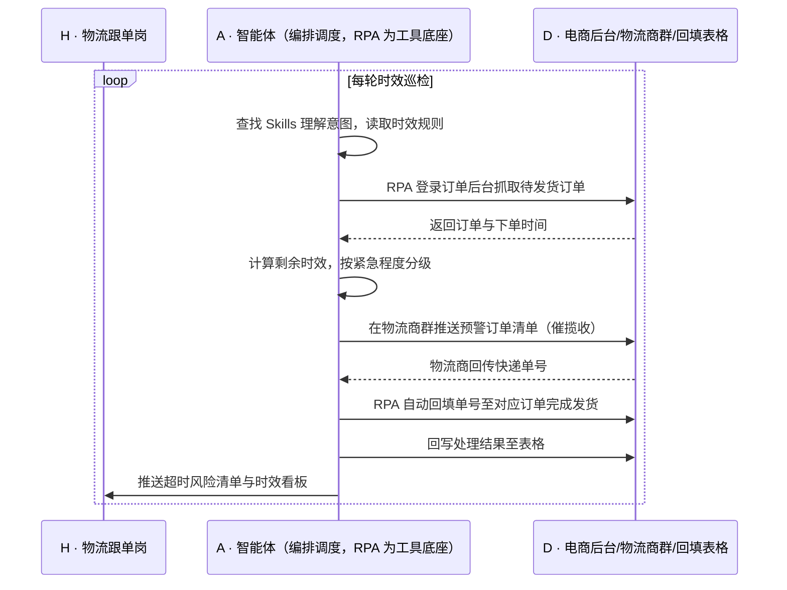

> 平台要求下单后 24h 或 48h 内必须发货，超时就算延迟发货，罚款、扣分、流量降权一起来；但订单量每天波动，客服用人工去盯每一单的发货倒计时根本不现实，临近超时的订单往往在收到罚款通知时才被发现。本方案用智能体调度「八爪鱼 RPA、电商后台订单系统、IM、物流商群」协同执行：每天定时抓取即将超时的订单数据，自动把超时预警订单推送给合作的物流商催揽收，并把物流商回传的快递单号自动回填到对应订单，完成发货。案例口径订单 100% 及时发货、节省罚款 10w+。定时自动执行，全程自动化，无异常不打扰。

> Agent 自动化需开通企业功能
> 点击申请1个月免费权限
> [点击申请 →](https://skieer.feishu.cn/share/base/form/shrcnFwMayykP5iaL38fnZKTbrg)

---

## 一、用户与需求

核心矛盾：

- 平台 24h/48h 发货时效是硬约束，超时即罚款并影响店铺权重
- 订单量日常波动，人工无法实时、精准监控所有订单的发货倒计时
- 临近超时的订单优先级难以判断，容易出现"先发不急的、急的反而超时"
- 与物流商的沟通靠群里喊话，漏推、迟推导致揽收延迟
- 快递单号靠人工从群里复制回填，易错、易漏，回填不及时仍算未发货

适用客户：日单量数百以上、与第三方物流商合作发货的电商团队，涵盖服饰、家居、3C、食品等类目；**已用钉钉/企业微信做物流协同的客户**，本方案直接复用现有群与流程；**自建仓储、自有物流团队的客户**，可将预警对象改为仓内作业组，同样适用。部署后由实施方一次性配置时效规则与推送对象，客服/仓储人员日常不需要写代码，只需处理预警清单。

### 1.1 不同模式卖家

| 类型 | 选择 | 建议 |
|-|-|-|
| 第三方物流发货（快递合作） | 首选 | 强烈推荐——需跨企业催揽收，人工沟通成本最高 |
| 多平台多店铺卖家 | 首选 | 强烈推荐——平台规则不同、订单分散，人工难以统一盯时效 |
| 自建仓储团队 | 次选 | 一般推荐——可改为仓内作业预警，同样受益 |
| 极低单量卖家 | 不做 | 单量少，人工盯单可覆盖 |

### 1.2 不同类目卖家

| 类目 | 最关注维度 | 核心逻辑 |
|-|-|-|
| 服饰/鞋包 | 大促爆单 | 单量波动剧烈，临近超时订单最集中 |
| 家居/大件 | 配送特殊要求 | 大件需预约，超时判定与揽收更复杂 |
| 3C/数码 | 高货值 | 罚款与权重损失影响更大，容错率低 |
| 食品/快消 | 保质期 | 发货延迟直接影响到货品质 |
| 美妆/个护 | 促销期峰值 | 大促期单量翻倍，人工盯不过来 |
| 母婴 | 时效敏感 | 客户对发货速度敏感，超时易差评 |

### 1.3 不同角色用户

| 用户 | 需求 | 问题 | 投入时间（估算） |
|-|-|-|-|
| 客服/物流跟单岗 | 及时发现临界订单 | 逐单算倒计时不现实，靠运气发现 | 全天盯单 |
| 仓储/发货岗 | 按优先级安排发货 | 拿不到超时排序，拣货顺序凭感觉 | 依赖上游信息 |
| 物流商对接人 | 及时拿到待揽收清单 | 群里消息被淹没，漏揽收 | 被动接收 |
| 老板 | 不被罚款、店铺不被降权 | 罚款与扣分滞后才知道 | 看报表决策 |

---

## 二、现在的方法与问题

### 2.1 流程步骤与问题总结

| 序号 | 步骤 | 现在的方法 | 问题缺陷 |
|-|-|-|-|
| 1 | 查看订单时效 | 人工在后台按时间排序翻看 | 订单多时漏看，无法覆盖全量 |
| 2 | 计算剩余时效 | 人工心算下单时间与时效差 | 易算错，临界订单难识别 |
| 3 | 通知物流商 | 在群里喊话或逐个私聊 | 消息淹没，漏推迟推 |
| 4 | 催揽收 | 打电话或反复催 | 沟通成本高，效果不稳定 |
| 5 | 回填快递单号 | 从群里复制单号手工回填 | 易错、易漏，回填慢仍算未发货 |
| 6 | 事后复盘 | 收到罚款通知再回头找原因 | 滞后，无法挽回损失 |

### 2.2 问题分析

| 序号 | 根因 | 具体表现 |
|-|-|-|
| 1 | 时效是滚动倒计时，无法人工全量跟踪 | 每单时效不同，人工只能抽查 |
| 2 | 跨企业协同靠群消息 | 信息非结构化，物流商难以按优先级处理 |
| 3 | 单号回填仍是手工环节 | 复制粘贴耗时且易错，成为发货闭环的最后堵点 |
| 4 | 无预警分级机制 | 急与不急混在一起，处理顺序错配 |
| 5 | 无数据沉淀 | 超时原因无法归因，罚款无法追溯到具体环节 |

---

## 三、解决方案

### 3.1 功能概述

为电商团队打造的"发货超时自动提醒"方案：一句话调度「订单后台 + 物流商群 + 回填表格」，定时抓取即将超时订单、按剩余时效分级推送物流商催揽收，并把回传单号自动回填到订单完成发货。

一句话下达指令（如「把 48 小时内还没揽收的订单按紧急程度推给物流商，单号回来了自动填」），智能体通过查找 Skills 文档库理解意图、匹配 5 个 RPA 自动化任务（抓取在途订单 → 计算剩余时效并分级 → 推送物流商预警 → 抓取回传单号 → 回填订单完成发货），经 MCP 调度八爪鱼 RPA 执行，最后生成时效看板与超时风险清单。全程自动化，运行状态实时反馈，跑完推送结果。

### 3.2 系统结合

| 要素 | 说明 |
|-|-|
| 客户现有工具盘点 | 商家通常已使用**电商后台订单系统（订单与发货状态）、钉钉/企业微信/微信群（与物流商协同）、Excel/表格**（单号登记）；三者靠人工串起来，信息在群与表之间反复搬运 |
| 数据/能力来源 | 订单与时效数据取自**电商后台**；预警推送与揽收沟通走**IM 群**；单号回填走**后台订单**；时效规则由商家与平台规则共同定义 |
| RPA 耦合动作 | 作为 Agent 的工具底座被调度执行：定时抓取待发货订单 → 计算剩余时效并分级 → 在物流商群推送预警清单 → 抓取物流商回传单号 → 回填订单完成发货 |
| 耦合出的新价值 | 平台后台只管订单状态、微信群只管沟通——单系统都无法完成"预警-催揽收-回填-发货"的闭环。本方案交付的是**临界订单自动被发现、物流商被及时催办、单号自动回填的发货保障能力，只推送**紧急订单清单与超时风险预警 |

### 3.3 智能体执行流程

每日定时多次触发（如每 2 小时一轮，大促期加密）；入参：时效规则、物流商群、分级阈值。

> Agent 自动化需开通企业功能
> 点击申请1个月免费权限
> [点击申请 →](https://skieer.feishu.cn/share/base/form/shrcnFwMayykP5iaL38fnZKTbrg)

### 3.4 为何这么设计

要同时回答三个问题：**为什么不能只用纯代码 Agent？为什么不能只用纯 RPA？为什么两者要结合？** 本场景的核心是"跨企业与跨系统的时效协同"——既要盯住滚动倒计时，又要把结构化信息送到物流商手里，还要把回传数据填回后台。

#### 1）逐项对比

| 对比维度 | 纯代码 Agent（Codex 等） | 纯 RPA（八爪鱼） | 智能体+RPA（MCP 结合） |
|-|-|-|-|
| 实现方式 | 调订单接口算时效并推送 | 可视化配置抓单、算时效、发群消息流程 | 智能体做分级判断与话术组织，RPA 执行取数与回填 |
| 多平台登录与取数 | 需平台开放订单接口 | 平台沉淀各电商后台订单页操作模板 | RPA 覆盖多平台取数，智能体负责统一口径 |
| 风控与多账号隔离 | 自建频次与账号管理 | 内置频率控制与多账号隔离 | 沿用平台能力，异常降频告警 |
| 清洗与入库 | 自写时效计算与分级逻辑 | 擅长操作，分级判断能力弱 | 智能体按时效规则分级、生成风险清单 |
| 使用成本（总拥有成本） | 无订阅费，但接口不通则落地受限 | 订阅费 + 常开电脑/云机成本 | 订阅费 + 一次性配置，规则调整改技能即可 |
| 维护人要求 | 需开发能力，规则变更需改码 | 业务人员可维护模板 | 业务人员可维护时效规则与分级阈值 |

#### 2）优劣势说明

|  | 纯代码 Agent | 纯 RPA | 智能体+RPA |
|-|-|-|-|
| 优势 | 无订阅费、时效计算逻辑可深度定制 | 覆盖多平台取数、可高频定时、操作留痕 | 分级判断与话术由智能体承担，RPA 负责取数与回填，闭环完整 |
| 劣势 | 平台接口不开放时取不到数据 | 缺分级判断，预警不加区分则物流商不重视 | 需一次性配置投入，预警频率受平台限制 |

**特别提醒**：本方案只做**预警与催办**，不代替物流商的揽收动作，也不代替商家判断是否使用虚假发货等手段规避时效（此类行为违反平台规则，方案明确不支持）。账号与合规责任由使用方承担。

#### 3）结论

| 论点 | 说明 |
|-|-|
| 确定性 vs 生成性 | 算时效、发预警、回填单号是确定性操作，RPA 可预期可留痕；生成式脚本在高频轮询下稳定性不足 |
| 分工而非替代 | "哪单最急、该催谁"属判断（智能体强）；"打开后台取数、在群里发消息、回填单号"属操作（RPA 强） |
| 资产沉淀 | 时效规则、分级阈值、物流商对接规则沉淀在技能库是活的，写在脚本里是死的 |
| 不消耗 AI token | 取数、推送、回填为规则化流水线，仅风险归因与看板摘要调用模型 |
| 风险无豁免 | 平台对发货时效与操作频率均有约束，方案价值是在规则内把时效管住 |
| 时间 | 物流跟单要的是"临界单自动浮出来"，不是每天人工翻订单算倒计时 |

### 3.5 功能清单

| 功能 | 系统 | 功能说明（解决问题） |
|-|-|-|
| 会话/定时 | 智能体 | 1. 理解时效管控意图，编排巡检任务。  
2. 按小时/每日多次定时触发，大促期加密。 |
| 待发货订单抓取 | RPA | 1. 解决人工翻页查看订单时效的问题。  
2. 作为智能体工具被调度执行（含失败重试）。  
3. 登录电商后台抓取待发货订单与下单时间。 |
| 时效计算与分级 | 智能体 | 1. 计算剩余发货时效。  
2. 按紧急程度分级（如 4h 内、8h 内、24h 内）。 |
| 物流商预警推送 | RPA | 1. 解决群里喊话被淹没、漏推迟推的问题。  
2. 在钉钉/企业微信/微信群按分级推送订单清单催揽收。 |
| 单号回填发货 | RPA | 1. 抓取物流商回传的快递单号。  
2. 自动回填至对应订单，完成发货状态更新。 |
| 风险看板 | 智能体 | 1. 生成超时风险清单与时效分布。  
2. 统计超时订单与原因分类。 |
| IM 通知 | 智能体 | 1. 紧急订单即时提醒。  
2. 取数失败、推送异常告警。 |
| 数据资产储存 | 智能体 | 1. 时效台账与超时记录沉淀为数据资产与 Skills。  
2. 经验知识库记录各平台时效规则与物流商对接经验。 |

### 3.6 智能体执行落地过程

时效规则、分级阈值、物流商群、回填字段等均为部署时一次性配置；日常自动触发，无需重复输入，只需处理紧急预警。

**⚠️ 部署前提（不满足则方案无法跑起来）**

① 需部署常开的电脑或云机承载 RPA 运行，并配置漏跑补跑机制；② 电商后台账号与 IM 群机器人需具备合法权限，群内推送需物流商知悉并接受；③ 各平台发货时效规则需配置准确（含节假日顺延等特殊规则）；④ 快递单号回填字段需与后台一致，避免回填失败；⑤ 首次配置需实施方介入一次，多平台多店铺时工作量相应增加。

#### 1）配置（4 步）

| 步骤 | 操作 | 说明 |
|-|-|-|
| 第 1 步 | 在八爪鱼 RPA 创建 API-Key | 开通平台调用凭证 |
| 第 2 步 | 配置时效巡检 RPA 应用 | 配置订单抓取路径、群推送动作与单号回填流程 |
| 第 3 步 | 在智能体侧配置 MCP | 将 RPA 注册为智能体可调用的工具 |
| 第 4 步 | 封装时效管控 Skills | 写入时效规则、分级阈值、推送模板与统计口径 |

| 类别 | 说明 |
|-|-|
| 智能体 | 主流智能体 |
| 智能体工具 | 1. 自动化：八爪鱼 RPA，MCP 配置。  
2. 计算与判断：智能体自带。  
3. 协同：钉钉/企业微信/微信。  
4. 台账：Excel/在线表格。 |
| 工作知识 | 1. 店铺与账号清单。  
2. 各平台发货时效规则。  
3. 分级阈值与推送模板。  
4. 物流商与群对应关系。 |
| 本地数据库 | 1. 时效台账库。  
2. 超时记录与原因库。  
3. 单号回填日志库。 |

#### 2）执行

| 任务 | 产出 | 产出物接收人 |
|-|-|-|
| 定时触发巡检 | 任务启动记录 | —— |
| RPA 抓取待发货订单 | 订单与时效数据 | —— |
| 计算剩余时效并分级 | 分级预警清单 | —— |
| 推送物流商预警 | 预警消息与清单 | 物流商对接人 |
| 抓取回传单号并回填 | 发货状态更新 | —— |
| 推送风险看板 | 时效看板与风险清单 | 仓储/客服主管 |

异常处理：

- 登录失效/验证码 → 暂停任务并告警，等待人工处理；
- 订单数据为空 → 跳过本轮并记录，不误发预警；
- 群推送失败 → 重试 2 次，仍失败则转私聊/邮件并告警；
- 单号未回传或格式异常 → 保留待回填状态，下一轮继续尝试；
- 回填失败 → 记录失败原因（如订单已关闭），列入人工处理清单。

#### 3）结果

| 结果 | 说明 |
|-|-|
| 数据资产 | 时效台账、超时记录、单号回填日志，支持超时归因 |
| 分析报告 | 1. 时效达标率。  
2. 超时订单清单与原因分类。  
3. 物流商揽收时效对比。 |
| Skills | 沉淀的时效巡检、分级预警与单号回填预设技能资产 |

> Agent 自动化需开通企业功能
> 点击申请1个月免费权限
> [点击申请 →](https://skieer.feishu.cn/share/base/form/shrcnFwMayykP5iaL38fnZKTbrg)

---

## 四、使用前后预估

> 本方案价值 = **人工翻单算时效 → 自动巡检分级预警 → 单号自动回填发货**。把物流跟单从"逐单算倒计时、群里催揽收、手工填单号"的重复劳动中解放出来，让发货时效从"靠运气不漏"变成"系统盯着跑"。

| 指标 | 人工 | 纯代码 Agent | 智能体+自动化工具 |
|-|-|-|-|
| 时效监控 | 抽查式翻单，覆盖不全 | 需平台开放订单接口 | 全量订单按时效规则自动巡检 |
| 发货达标 | 临界单易漏，超时才发现 | — | 案例口径：订单 100% 及时发货（需物流商按预警及时揽收） |
| 物流协同 | 群里喊话，消息淹没 | — | 按紧急程度分级定向推送 |
| 单号回填 | 手工复制，易错易漏 | 需自写回填逻辑 | 自动抓取并回填，闭环完整 |
| 罚款损失 | 案例口径：年罚款可达 10w+ | — | 案例口径：节省罚款 10w+ |
| 沉淀 | 超时原因无法归因 | 代码即资产，人走即失 | 时效台账+经验知识库两层沉淀 |

说明：数据取自八爪鱼应用案例口径（订单 100% 及时发货、节省罚款 10w+），实际效果随订单量、物流商响应速度与平台规则变化；人工耗时为物流跟单岗位口径估算。

---

## 五、效果证明

> Agent 自动化需开通企业功能
> 点击申请1个月免费权限
> [点击申请 →](https://skieer.feishu.cn/share/base/form/shrcnFwMayykP5iaL38fnZKTbrg)

### 5.1 客户案例

**《无货源跨境多平台分销自动发货》**

> 一人身兼老板、运营、客服、履约，夜晚处理店小秘与万邑链订单，单条订单处理需 3-5 分钟，订单高峰熬夜也赶不上进度。

| 效果 | 说明 |
|-|-|
| 提效 | 跨境分销履约从「熬夜手工操作」变为自动批量执行。原本需在店小秘与万邑链、Excel 间反复切换，完成订单导出、地址解密、SKU 筛选、模板清洗、渠道比价与导入发货，现在全流程自动跑完。 |
| 降本 | 一人即可承担原先老板、运营、客服、履约多岗的重复操作，人力投入转向货源洽谈与店铺运营等重点工作。 |
| 任务 | Temu 待审核订单自动导出、解密与筛选，发货模板自动适配。 |
| 任务 | 自动查询仓库/渠道并对比运费选最优方案，保障合规发货。 |

案例详情：[无货源|跨境多平台分销自动发货，低成本创业新可能](https://skieer.feishu.cn/wiki/W8dUwc8pni0R6jkpH10cRMavnId)

---

## 六、备注

### 6.1 Agent 支持

本方案不绑定具体智能体，主流 Agent 均可运行（**需支持 MCP 连接、技能/Skills 加载与工具调用**）：

| Agent/智能体 | 说明 |
|-|-|
| Workbuddy | 本方案运行平台，支持技能/Skills 上传加载、定时任务、MCP 工具调用与表格/报告处理 |
| 豆包（国内·字节） | 国内主流个人智能体，支持技能上传、定时任务与工具调用，上手成本低 |
| 通义千问（国内·阿里） | 支持 Agent 编排与插件生态，集成阿里电商数据能力，适合电商场景 |
| DeepSeek（国内） | 推理能力强、成本低，适合规则判断与归因分析类任务 |
| ChatGPT（国外·OpenAI） | 海外主流通用智能体，支持 GPTs/Agent 模式与工具调用 |
| Claude（国外·Anthropic） | 长文本与结构化分析能力强，原生支持 MCP 连接外部工具 |

### 6.2 名词解释

| 术语 | 说明 |
|-|-|
| 发货时效 | 平台规定卖家在买家下单后必须完成发货的时间上限（常见 24h/48h） |
| 延迟发货 | 超过平台发货时效仍未发货的违规行为，通常伴随罚款与扣分 |
| 揽收 | 物流商上门取件并扫码进入物流网络的动作，是"已发货"的关键节点 |
| 快递单号 | 物流商分配的唯一运单编号，回填到订单后才算完成发货 |
| 回填 | 将快递单号写入电商后台订单，使订单状态变为已发货 |
| 分级预警 | 按剩余时效长短对订单分层（如 4h/8h/24h），确定处理优先级 |
| 阈值 | 触发预警的时效剩余值，可按平台与类目分别设置 |
| 群机器人 | 在 IM 群中自动推送消息的机器人，用于结构化推送预警 |
| 时效台账 | 记录订单时效状态与处理过程的表册 |
| 发货倒计时 | 从下单时间起算、到时效截止时的剩余时间 |
| 虚假发货 | 上传无效单号以规避时效的违规行为，平台明令禁止 |
| MCP | 模型上下文协议，让智能体以标准方式调用外部工具（如 RPA）的接口规范 |

> Agent 自动化需开通企业功能
> 点击申请1个月免费权限
> [点击申请 →](https://skieer.feishu.cn/share/base/form/shrcnFwMayykP5iaL38fnZKTbrg)

---

原文：[查看原文](https://skieer.feishu.cn/wiki/QsSDwnc2biejEzkCuv4cobWTn1d)
