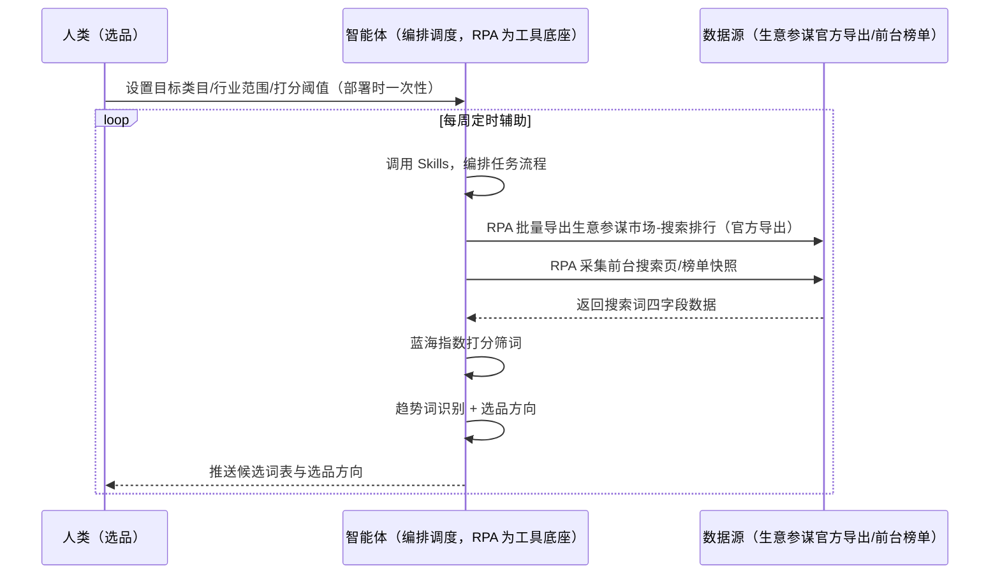
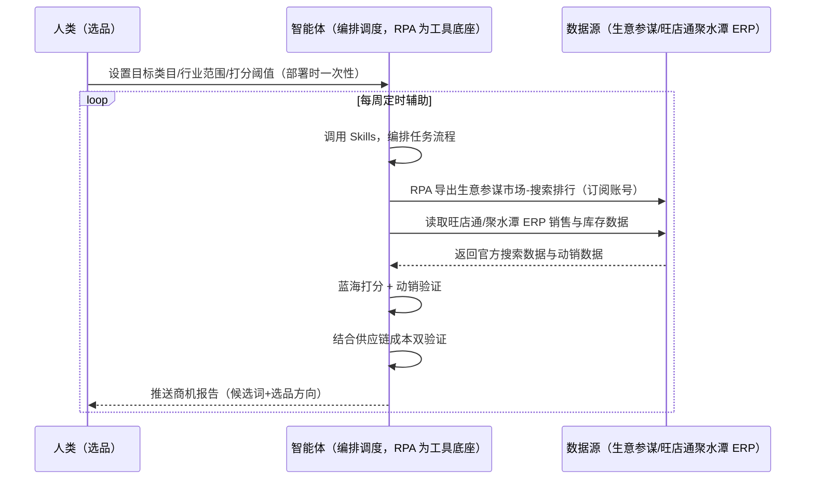

> 为淘宝卖家团队打造的市场机会发现方案。生意参谋里词很多但哪些值得测款靠人判断、蓝海词判断凭感觉命中率低、大促前后数据失真不会校准。本方案由智能体调度多个工具执行批量导出生意参谋市场-搜索排行数据（商家自有权限、官方导出）+ 蓝海指数打分筛词 + 趋势词识别，输出候选词表与选品方向。每周定时辅助，输出选品方向与商机清单，供你验证测款。

> Agent 自动化需开通企业功能
> 点击申请1个月免费权限
> [点击申请 →](https://skieer.feishu.cn/share/base/form/shrcnFwMayykP5iaL38fnZKTbrg)

## 一、用户与需求

核心矛盾：生意参谋里词很多但"哪些值得测款"要靠人判断；蓝海词判断凭感觉命中率低；大促前后数据失真不会校准——蓝海指数=搜索人气×支付转化率÷在线商品数（或按平台口径换算），指数越高越值得测款。

两类客户痛点同源，数据来源不同：

- 未购 SaaS 客户（新卖家/小团队）：人工刷榜单截图、逐词看生意参谋、手动翻搜索排行，全靠手；
- 已购 SaaS 客户（旺店通/聚水潭 ERP 等）：ERP 管订单/发货/库存，市场机会分析不覆盖，仍要人手动做。

适用客户：有选品规模需求的淘宝/天猫卖家。生意参谋是商家自有权限的官方数据工具，导出是平台允许的动作；本方案把官方数据变成可直接测款的判断。

### 1.1 不同模式卖家

| 类型 | 选择 | 建议 |
|-|-|-|
| 品牌卖家 | 首选 | 强烈推荐（类目词库大，需持续盯） |
| 精铺卖家 | 首选 | 强烈推荐（测款命中率是关键） |
| 铺货型 | 次选 | 一般推荐（词池大但命中率低） |

### 1.2 不同类目卖家

| 类目 | 最关注维度 | 核心逻辑 |
|-|-|-|
| 3C 数码 | 蓝海指数 | 标品竞争激烈，找在线商品数少的词 |
| 家居家具 | 支付转化率 | 大件转化决策周期长 |
| 美妆个护 | 搜索人气增速 | 趋势品早布局 |
| 服装鞋帽 | 在线商品数 | 竞争度看商品数 |
| 母婴用品 | 数据校准 | 大促前后失真需校准 |

### 1.3 不同角色用户

| 用户 | 需求 | 问题 | 投入时间（估算） |
|-|-|-|-|
| 老板 | 测款命中率高 | 凭感觉选词 | 0.5 小时/周 |
| 选品 | 候选词表 | 生意参谋词多看不出重点 | 2-4 小时/周 |
| 运营 | 选品方向 | 榜单共性看不出 | 1 小时/周 |

---

## 二、现在的方法与问题

### 2.1 流程步骤与问题总结

人工方式（未购 SaaS 客户）

| 序号 | 步骤 | 现在的方法 | 问题缺陷 |
|-|-|-|-|
| 1 | 导数据 | 生意参谋手动导出 | 导出后不会用 |
| 2 | 选词 | 凭感觉 | 测款命中率低 |
| 3 | 看趋势 | 手动翻 | 上升趋势看不出 |
| 4 | 校准数据 | 不校准 | 大促前后数据失真 |

SaaS 方式（已购旺店通/聚水潭 ERP 客户）

| 序号 | 步骤 | 现在的方法 | 问题缺陷 |
|-|-|-|-|
| 1 | 导数据 | ERP 不覆盖选品 | 靠人手动导 |
| 2 | 选词 | 凭感觉 | 命中率低 |
| 3 | 看趋势 | 手动翻 | 无分析 |
| 4 | 校准数据 | 不校准 | 无回测 |

### 2.2 问题分析

人工方式根因

| 序号 | 根因 | 具体表现 |
|-|-|-|
| 1 | 数据闲置 | 生意参谋数据躺在 Excel |
| 2 | 无打分模型 | 蓝海指数不计算 |
| 3 | 无趋势分析 | 搜索人气增速不沉淀 |
| 4 | 数据失真 | 大促前后不校准 |

SaaS 方式根因

| 序号 | 根因 | 具体表现 |
|-|-|-|
| 1 | ERP 不覆盖选品 | 订单/库存管得好，市场分析无工具 |
| 2 | 无闭环 | 测款结果不回填迭代 |

---

## 三、解决方案

### 3.1 功能概述

为淘宝卖家团队打造的市场机会发现方案，批量导出生意参谋市场-搜索排行数据 + 蓝海指数打分筛词，输出候选词表与选品方向。

每周定时触发并调度多个工具，调起八爪鱼 RPA（Agent 的工具底座，能耦合多系统、完成自动化任务执行）批量导出生意参谋市场-搜索排行数据（商家自有权限、官方导出、不模拟登录），智能体按蓝海指数公式打分筛词、聚类榜单爆款共性、识别趋势词，输出候选词表与选品方向。每周定时辅助，输出选品方向与商机清单，供你验证测款。

### 3.2 系统结合

| 要素 | 说明 |
|-|-|
| 客户现有工具盘点 | **未购 SaaS 客户**：无第三方工具，选品全靠手动查词。     **已购 SaaS 客户**（主流组合）：旺店通/聚水潭 ERP（国内主流电商 ERP，管订单/发货/库存，选品不覆盖） |
| 数据/能力来源 | **无 SaaS**：生意参谋市场-搜索排行官方导出（商家自有权限，不模拟登录）+ 前台搜索页/榜单只读。     **有 SaaS**：生意参谋官方导出（市场行情-搜索排行，订阅制）+ 旺店通/聚水潭 ERP 的销售/库存数据辅助判断 |
| RPA 耦合动作 | 作为 Agent 的工具底座，按计划批量导出生意参谋搜索词数据（官方导出、失败重试告警）+ 采集前台榜单快照，统一流转给智能体；低置信度词转人工 |
| 耦合出的新价值 | 单工具给不了的端到端结论：官方搜索数据一次取齐 → 蓝海指数打分 → 候选词表 + 选品方向 + 趋势词，**只推送候选词表与商机清单** |

### 3.3 智能体执行流程

智能体定时触发。支持**两种数据通道**，部署时按客户现有工具选择：

**通道一：无 SaaS 方式（官方导出 + 前台只读，适合未购 ERP 的客户）**

**通道二：有 SaaS 方式（生意参谋官方导出 + ERP 数据，适合已购客户）**

> Agent 自动化需开通企业功能
> 点击申请1个月免费权限
> [点击申请 →](https://skieer.feishu.cn/share/base/form/shrcnFwMayykP5iaL38fnZKTbrg)

### 3.4 为何这么设计

要同时回答三个问题：**为什么不能只用 SaaS/API？为什么不能纯靠智能体写代码？为什么 RPA 是执行底座？** 本场景的核心是"定时导词、蓝海打分、挂了有人管"。

#### 1）逐项对比

| 对比维度 | SaaS/API 堆叠（生意参谋/旺店通） | 纯智能体（智能体写代码） | 智能体+自动化工具（RPA 工具底座） |
|-|-|-|-|
| 实现方式 | 官方工具给搜索数据（生意参谋），ERP 给动销 | 能导数能分析，但全要自己接 | 官方导出应用直挂 + 前台榜单只读 |
| 数据合规 | 官方导出是商家自有权限允许动作 | 模拟登录/批量爬取触发风控验证码、设备指纹封锁、账号处罚，且有法律风险 | 官方导出 + 前台公开数据低频只读，合规稳定 |
| 批量导词 | 需人工逐模块导出 | 需自写导出与限速 | 现成应用直挂、批量导出、失败重试 |
| 使用成本（总拥有成本） | 生意参谋订阅费 + ERP 订阅费 | 代理 IP + 服务器 + 开发维护人力，隐性成本高 | 一份平台订阅跑多流程，单方案边际成本 ≈ 0 |
| 维护人要求 | 低（工具现成） | 规则调整都要开发介入 | 可视化流程，选品自己可调阈值 |

#### 2）优劣势说明

|  | SaaS/API 堆叠（官方工具） | 纯智能体（智能体写代码） | 智能体+自动化工具（RPA 工具底座） |
|-|-|-|-|
| 优势 | 生意参谋官方口径权威；     ERP 动销数据真实 | 无订阅费；     可深度定制选品模型 | 官方导出直挂；     蓝海打分即开即用；     非技术人员可维护 |
| 劣势 | 需订阅与登录态；     趋势判断依赖人工 | 模拟登录/批量爬取有封号与法律风险；     登录保活与导出全自建 | 本地电脑运行需保持开机；     订阅费；     官方导出受登录态影响 |

#### 3）结论

| 论点 | 说明 |
|-|-|
| 词=流量入口 | 淘宝搜索流量占比高，蓝海词判断 = 搜索人气×支付转化率÷在线商品数（实锤公式），指数越高越值得测款 |
| 合规无豁免 | 阿里风控不豁免任何自动化——本方案数据走官方合规链路（生意参谋商家自有权限导出），不模拟登录、不批量爬取，长期稳定 |
| 商机需双验证 | 商机判断需结合蓝海词与供应链成本双验证，避免「数据好看做不了」的坑 |
| 一个底座跑多流程 | 客户购买 RPA 平台是跑多个流程（选品/竞品/口碑），本方案只是其中一个——平台订阅费被多流程摊薄 |
| 时间 | 选品要的是"每周一张可决策的候选词表"，不是"导出后自己翻 Excel" |

### 3.5 功能清单

| 功能 | 系统 | 功能说明（解决问题） |
|-|-|-|
| 会话/定时 | 智能体 | 1. 理解人类语言，调用已预设好的 Skills。     2. 编排多任务、调度多工具。 |
| 多系统数据取数 | RPA、指纹浏览器 | 1. 解决生意参谋数据导出后闲置、不会用问题。     2. 作为智能体工具底座被调度执行，导出失败重试告警、反爬拦截降速。     3. **【无 SaaS 方式】** RPA 批量导出生意参谋市场-搜索排行 + 采集前台榜单。**【有 SaaS 方式】** RPA 导出生意参谋（订阅账号）+ 读取旺店通/聚水潭 ERP 动销数据。 |
| 蓝海打分 | 智能体 | 蓝海指数=搜索人气×支付转化率÷在线商品数，指数越高越值得测款。 |
| 趋势识别 | 智能体 | 搜索人气增速异常的词标记，避开大促前后失真窗口。 |
| 候选词输出 | 智能体 | 剔除与货源不符的词、剔除已上架词，按类目输出候选词表。 |
| IM通知 | 飞书、钉钉、企微等 | 解决商机清单交付滞后问题。候选词表与选品方向自动推送。 |
| 数据资产储存 | 本地电脑、云储存 | 1. Skills 资产：淘宝选品与蓝海规则技能。     2. 数据储存：词库与榜单快照统一写入本地。     3. 经验知识库：按测款表现回填迭代评分权重。 |

### 3.6 智能体执行落地过程

部署时一次性配置入参（目标类目、行业范围、蓝海指数阈值、数据通道），会话中无需重复输入。

**⚠️ 部署前提（不满足则方案无法跑起来）**：①RPA 需部署在**常开电脑/云机**上，并配置漏跑补跑机制；②**需商家后台登录态**（生意参谋官方导出，登录失效自动告警，不模拟登录）；③首次配置（登录态、词库、打分参数）需服务方/技术人员介入一次，属实施成本。

#### 1）配置

| 类别 | 说明 |
|-|-|
| 智能体 | 主流智能体。 |
| 智能体工具 | 1. **数据通道（按客户现有工具二选一）**：【无 SaaS】生意参谋官方导出 + 前台榜单（RPA 采集）；【有 SaaS】生意参谋订阅账号 + 旺店通/聚水潭 ERP。     2. 数据取数与自动化执行：八爪鱼 RPA，MCP 配置完成。     3. 数据分析：智能体自带。     4. IM：企业办公 IM（飞书/钉钉/企微），MCP 或 webhook 配置。 |
| 工作知识 | 1. 目标类目/行业范围。     2. 排除无效词与蓝海指数阈值。     3. 测款预算上限。     4. 蓝海指数=搜索人气×支付转化率÷在线商品数。     5. 避开大促前后失真窗口。 |
| 本地数据库 | 1. 候选词库地址。     2. 机会报告地址。     3. 经验库地址。 |

#### 2）执行

| 任务 | 产出 | 产出物接收人 |
|-|-|-|
| 接收类目配置，定时触发 | 任务启动记录 | —— |
| 调用已预设 Skills，编排任务流程 | 任务编排方案 | —— |
| 经 MCP 向八爪鱼 RPA 下发取数任务 | 自动化任务指令 | —— |
| 多源取数（无 SaaS：官方导出+前台榜单；有 SaaS：生意参谋+ERP 动销，智能体监控状态） | 对齐后搜索词数据 | —— |
| 蓝海指数打分筛词 | 打分结果 | 选品 |
| 趋势词识别 + 选品方向 | 选品方向 | 选品/运营 |
| 候选词表输出 | 候选词表 | 选品 |
| 推送候选词表与选品方向 | 群消息 | 选品/运营/老板 |

异常处理：

导出失败 → 自动重试并告警；

登录失效 → 告警人工介入后断点续跑；

大促数据失真 → 避开失真窗口；

低置信度词 → 转人工复核，不输出硬结论。

#### 3）结果

| 结果 | 说明 |
|-|-|
| 数据资产 | 全量市场数据结构化数据（词/搜索人气/点击率/支付转化率/在线商品数/蓝海指数），可审计可追溯。 |
| 分析报告 | 1. 候选词表：按蓝海指数排序，直接可测款。     2. 趋势词：搜索人气增速异常标记。     3. 选品方向：类目机会 + 价格带 + 季节性。     4. 测款回采：2 周后验证并迭代权重。 |
| Skills | 智能体 Skills：淘宝选品与蓝海规则技能，按月迭代趋势判断。 |

> Agent 自动化需开通企业功能
> 点击申请1个月免费权限
> [点击申请 →](https://skieer.feishu.cn/share/base/form/shrcnFwMayykP5iaL38fnZKTbrg)

---

## 四、使用前后预估

> 本方案价值 = **生意参谋官方导出 → 蓝海指数打分 → 候选词表 + 选品方向 → 测款回采**。数据走官方合规链路（商家自有权限导出，不模拟登录）。

| 指标 | 人工 | SaaS/API（官方工具） | 智能体+自动化工具 |
|-|-|-|-|
| 选词效率 | 导出后手动翻 | 无专属应用 | 官方导出自动打分出表 |
| 选词依据 | 凭感觉 | 生意参谋数据靠人看 | 蓝海指数打分 |
| 趋势感知 | 不沉淀 | 不自动 | 增速标记 |
| 数据校准 | 不校准 | 不校准 | 避开失真窗口 |
| 方法论 | 无，换人标准不同 | 单工具数据 | 可复用的 Skills 与词库 |

**说明**：淘宝搜索流量占比高，词=流量入口；蓝海指数=搜索人气×支付转化率÷在线商品数（实锤公式）；官方数据走生意参谋商家自有权限导出（合规链路）；商机判断需结合蓝海词与供应链成本双验证。

---

## 五、效果证明

> Agent 自动化需开通企业功能
> 点击申请1个月免费权限
> [点击申请 →](https://skieer.feishu.cn/share/base/form/shrcnFwMayykP5iaL38fnZKTbrg)

### 5.1 客户案例

**《竞品 AI 快报：多平台动态 7×24 监控与自动出报》**

> 某大型教培集团需盯多家竞品公众号、课程与活动动态，人工巡查信息零散难汇总。RPA 自动巡查多平台账号并生成竞品快报。

| 效果 | 说明 |
|-|-|
| 提效 | 竞品动态巡查由人工每日逐平台翻阅变为 7×24 自动监控。原本市场团队需人工登录多平台逐篇查看推文、课程与活动，现在自动抓取、自动分析、自动出报告。 |
| 降本 | 市场团队用于公众号巡查、内容摘抄与情报汇总的重复性工作量降低约 80%，投入转向课程优化、活动策划与市场竞争策略等重点工作。 |
| 任务 | 竞品课程、价格及营销动态识别准确率提升至 95% 以上，减少遗漏与误判。 |
| 任务 | 多平台账号自动巡查，情报按周期自动汇总成报。 |

案例详情：[快报|社媒监控：竞品AI快报生成自动化](https://skieer.feishu.cn/wiki/UNA7wUatCih1D2kXL5Fco3MpnGe)

### 5.2 DEMO应用

生意参谋-搜索热词：https://rpa.bazhuayu.com/appstore/app/wawawa/id-66277fdb3925e44ee0e53562

生意参谋市场搜索词：https://rpa.bazhuayu.com/appstore/app/dev_ct-5bw/sheng-yi-can-mou-shi-chang-sou-suo-ci

---

## 六、备注

### 6.1 Agent 支持

本方案不绑定具体智能体，主流 Agent 均可运行（需支持技能/Skills 加载与工具调用）：

| Agent/智能体 | 说明 |
|-|-|
| Workbuddy | 本方案运行平台，支持技能/Skills 上传加载、定时任务、MCP 工具调用与表格/报告处理 |
| 豆包（国内·字节） | 国内主流个人智能体，支持技能上传、定时任务与工具调用，上手成本低 |
| 通义千问（国内·阿里） | 支持 Agent 编排与插件生态，集成阿里电商数据能力，适合电商场景 |
| DeepSeek（国内） | 推理能力强、成本低，适合规则打分与归因分析类任务 |
| ChatGPT（国外·OpenAI） | 海外主流通用智能体，支持 GPTs/Agent 模式与工具调用 |
| Claude（国外·Anthropic） | 长文本与结构化分析能力强，原生支持 MCP 连接外部工具 |

### 6.2 名词解释

| 术语 | 说明 |
|-|-|
| 生意参谋 | 淘宝/天猫商家官方数据分析工具，本方案数据源 |
| 蓝海指数 | 搜索人气×支付转化率÷在线商品数，指数越高越值得测款 |
| 搜索排行 | 生意参谋市场-搜索排行模块 |
| 在线商品数 | 该词对应的在售商品数量 |
| 官方导出 | 商家自有权限下平台允许的数据导出动作，不涉及模拟登录 |
| 旺店通/聚水潭 | 国内主流电商 ERP，管订单/发货/库存，选品不覆盖 |
| 无 SaaS 方式 | 不购买第三方工具，官方导出 + 前台榜单只读 |
| 有 SaaS 方式 | 已购旺店通/聚水潭 ERP，生意参谋订阅 + ERP 动销数据 |
| MCP | Model Context Protocol，智能体连接外部工具的标准化通道 |
| 指纹浏览器 | 隔离 Cookie/浏览器指纹的工具，多店铺防关联 |

> Agent 自动化需开通企业功能
> 点击申请1个月免费权限
> [点击申请 →](https://skieer.feishu.cn/share/base/form/shrcnFwMayykP5iaL38fnZKTbrg)

---

原文：[查看原文](https://skieer.feishu.cn/wiki/Ux3QwfVRDiJvd9kSaVccqWqrnwd)
