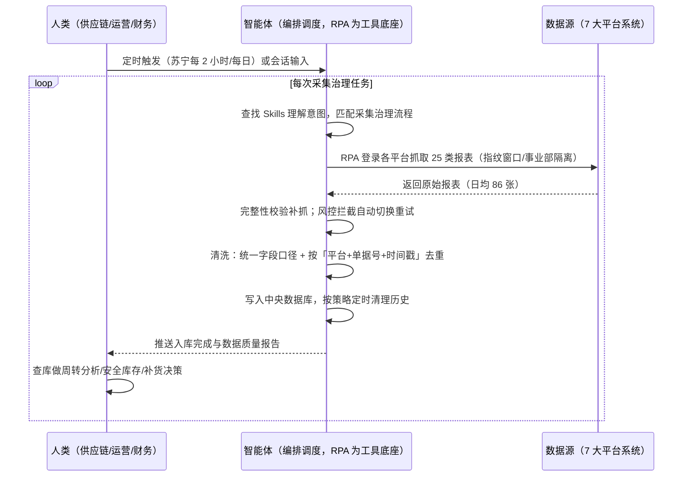

> 商家每天需要拿到全平台统一、可信的库存数据来支撑周转分析、安全库存与补货决策，但现状是人工逐个登录多个系统、每天导出 近百张报表再手工拼表核对，这造成了数据滞后、错误率、数据格式不一，多账号同环境操作还易被平台风控。本方案由智能体调度多个工具执行多平台库存数据自动采集 + 按平台风控与更新节奏定时抓取 + 清洗去重入库，输出中央数据库里的统一库存数据，数据 T+1 可用（部分平台 T+0）、错误率降至 0.1%。定时自动执行，全程自动化，无异常不打扰。

> Agent 自动化需开通企业功能
> 点击申请1个月免费权限
> [点击申请 →](https://skieer.feishu.cn/share/base/form/shrcnFwMayykP5iaL38fnZKTbrg)

## 一、用户与需求

核心矛盾：

- 供应链团队每天要靠人工登录多个平台、多个账号，逐个导出订单/库存/采购报表，再手工统一格式、拼表核对——纯体力活且数据滞后两天
- 各平台风控规则与数据更新时点（如苏宁 T-1）全靠人脑记，账号易被风控、更新时点易错过
- 数据格式不一、无唯一标识去重，拼错约 3% 不易察觉
- 「采集→风控定时→清洗入库」每一环都是重复、易错、靠人的操作，库存决策永远建立在又慢又可能出错的数据上

适用客户：有跨平台库存数据整合需求的多平台品牌商家——品牌事业群（多平台多账号、日均数十张报表，强烈推荐，本方案即按该量级设计）、多平台腰部品牌（先跑库存、订单核心报表，验证后再扩展）、需要统一口径给财务对账与供应链决策的团队。本方案部署后按平台频率自动运行，业务人员不需要写代码，看数据与报告即可。

### 1.1 不同规模商家

| 类型 | 选择 | 建议 |
|-|-|-|
| 品牌事业群 | 首选 | 强烈推荐，本案例主角。多平台多账号叠加每日数十张报表，人工逐平台导出已不可行，风控与数据治理同步成为刚需 |
| 多平台腰部品牌 | 次选 | 一般推荐。先跑库存、订单两类核心报表与统一入库，验证后再扩展报表范围与账号隔离 |
| 单平台商家 | 任意 | 不推荐。每日少量报表直接平台导出即可，不值得搭建自动化采集链路 |

### 1.2 不同类目商家

| 类目 | 最关注维度 | 核心逻辑 |
|-|-|-|
| 大家电（洗衣机/空调/冰箱等） | 分仓库存与周转 | 大件重货资金占用高、多仓分布，需每日盯各平台各仓可售与周转；滞销积压损失大 |
| 3C 数码 | 新品备货与库存健康度 | 产品迭代快，库存过多被淘汰、过少丢单，需高频库存数据支撑补货 |
| 服装 | SKU 矩阵与季末清仓 | 单款多 SKU、季节性强，需跨平台汇总在库可售，提前识别季末滞销 |
| 快消/日化 | 动销与补货节奏 | 复购型品类，需按平台销量节奏对齐补货，避免断货影响店铺评分 |
| 美妆 | 效期与批次管理 | 效期敏感，需平台在库、仓龄数据定期汇总，防止临期积压 |

### 1.3 不同角色用户

| 用户 | 需求 | 问题 | 投入时间（估算） |
|-|-|-|-|
| 供应链数字化负责人 | 每天一上班就有最新库存数据 | 数据靠专员逐平台导表，T+2 才出，看到的总是"昨天的昨天" | 决策时即时取数，无需等表 |
| 库存专员（原 2 名全职） | 从"搬数据"中解放出来 | 每天 7 小时逐个登录导出 86 张报表，再花时间拼接核对，纯重复体力活 | 采集清洗全自动，转岗做数据分析 |
| 电商运营/数据运营/财务 | 统一口径的库存、可售数据 | 数据等专员导出后分发，口径不一致、对不上账 | 从中央库取数，即查即用 |
| 电商运营/账号管理员 | 多账号安全运营 | 多账号同环境易被关联风控，封店风险高 | 账号健康监控替代人工盯守 |
| IT/信息化 | 自动化流程稳定可维护 | 手工链路依赖个人，平台规则靠人脑记，人员变动流程即断 | 一次性实施配置后低维护 |
| 采购 | 供应商库存与采购订单进度 | 采购数据散落各系统，与实际库存对不上，影响补货计划制定 | 中央库直接查采购入库进度，对接供应商 |
| 物流 | 出入库数据与配送状态 | 物流数据在菜鸟等系统需单独查，无法与销售/库存联动 | 物流/菜鸟 ASCP 数据自动采集入库，联动查询 |

---

## 二、现在的方法与问题

### 2.1 流程步骤与问题总结

| 序号 | 步骤 | 现在的方法 | 问题缺陷 |
|-|-|-|-|
| 1 | 登录各平台后台 | 专员逐个登录平台、账号，多账号在同一浏览器切换 | 账号多、验证码频繁、登录态易过期，多账号同环境易被关联风控 |
| 2 | 记忆各平台规则 | 凭经验记差异：天猫风控严格、苏宁数据 T-1 更新、京东沧海分权管理 | 规则靠人脑记忆换人即丢；守着更新时点要设闹钟人工抢抓 |
| 3 | 逐张导出报表 | 凭记忆找菜单位置，逐张导出订单/库存/采购报表 | 日均 86 张、耗时约 7 小时；易漏平台、漏表 |
| 4 | 手工统一与拼接 | 把十几个 Excel 手工改表头、复制粘贴进总表 | 行错位、重复行、漏行，人工拼接错误率约 3% |
| 5 | 核对分发 | 人眼比对或抽检，拼好后分发给供应链、运营、财务 | 核对返工耗时；时效 T+2，各部门拿到的都是滞后数据 |
| 6 | 存储与下次再用 | 结果存在个人电脑/群文件，下次分析再从头拼一遍 | 无中央库、历史不可查，口径每次不一定一致 |

### 2.2 问题分析

| 序号 | 根因 | 具体表现 |
|-|-|-|
| 1 | 采集靠人工 | 每天逐个登录导出多张报表，全职专员被困，年人力成本约 50 万元+ |
| 2 | 时效滞后 | 数据 T+2 才到各部门，平台更新时点靠人守，错过即晚一天 |
| 3 | 账号风控风险 | 多账号同环境易被关联风控；各平台规则不沉淀，靠老员工人脑记忆 |
| 4 | 数据质量不可控 | 手工拼接无唯一标识去重、无口径统一，错误率高，错误难定位 |
| 5 | 数据不沉淀 | 报表散落个人电脑，无中央库，历史不可查、换人即丢，无法支撑趋势分析 |

---

## 三、解决方案

### 3.1 功能概述

为多平台库存数据采集治理场景打造的智能体驱动方案，定时调度多平台报表自动采集 + 风控适配与定时抓取 + 清洗去重入库，输出中央数据库统一库存数据与数据质量报告。

定时自动触发，智能体通过查找 Skills 理解意图、匹配采集治理流程，经 MCP 调度八爪鱼 RPA 依次执行：

- 登录各大系统抓取订单/库存/采购等报表
- 采集后做完整性校验、缺表自动补抓
- 再自动解析报表、统一字段口径、按「平台+单据号+时间戳」唯一标识去重
- 清洗结果写入中央数据库并按策略定时清理历史数据
- 最后输出数据质量报告。全程自动化，运行状态实时反馈，异常告警推送到群

### 3.2 系统结合

| 要素 | 说明 |
|-|-|
| 系统组成 | 智能体（WorkBuddy，任务编排+数据质量校验）+ MCP 协议层（连接工具、传递指令、同步状态）+ 八爪鱼 RPA（浏览器操作、多平台登录取数、清洗入库）+ 指纹浏览器（多账号隔离）+ 中央数据库（统一存储） |
| 数据/能力来源 | 平台系统（含天猫、苏宁、京东 VC、京东沧海（沧海系统）、菜鸟 ASCP/SCP 等，需登录）+ 指纹浏览器（多账号独立环境）+ 本地中央数据库（清洗后统一存储） |
| RPA 耦合动作 | 作为 Agent 的工具底座被调度执行：按账号映射自动登录 系统抓取报表（天猫指纹浏览器模拟真人、苏宁按 T-1 节奏每 2 小时抓取、京东沧海按事业部隔离）→ 完整性校验补抓 → 解析报表统一口径 → 按「平台+单据号+时间戳」去重 → 写入中央数据库 → 定时清理历史 |
| 耦合出的新价值 | 单系统给不了的端到端结论：后台各管一段、报表散落个人电脑，本方案串成「到点自动登录 → 自动抓表 → 自动清洗入库」一条数据管道，**只推送统一口径、历史可查的中央库数据**——供应链、运营、财务直接查库做周转分析、安全库存与补货决策 |

### 3.3 智能体执行流程

定时自动触发，智能体自动调度：

> Agent 自动化需开通企业功能
> 点击申请1个月免费权限
> [点击申请 →](https://skieer.feishu.cn/share/base/form/shrcnFwMayykP5iaL38fnZKTbrg)

### 3.4 为何这么设计

要同时回答三个问题：**为什么不能只用纯代码 Agent？为什么不能只用纯 RPA？为什么两者要结合？** 本场景的核心是"跨 平台多账号的取数治理链路要常年稳定可信，而不是跑通一次"。

#### 1）逐项对比

| 对比维度 | 纯代码 Agent（Codex 等） | 纯 RPA（八爪鱼） | 智能体+RPA（MCP 结合） |
|-|-|-|-|
| 实现方式 | AI 写代码生成并运行取数脚本，调试脚本处理异常 | 模拟人操作网页，拖拽/自然语言搭建流程 | 智能体理解需求编排任务 + RPA 执行采集治理动作 |
| 多平台登录与取数 | 账号登录态、验证码、各平台菜单路径全自研，页面改版即失效 | 平台级采集模板沉淀，登录态过期自动处理 | 复杂登录取数交给 RPA，模板维护由平台侧跟进 |
| 风控与多账号隔离 | 风控策略自己摸索试错，试错成本可能触发封号 | 天猫指纹模拟真人/京东事业部隔离等适配经验沉淀 | RPA 按平台策略稳定执行，智能体专注调度与治理 |
| 清洗与入库 | pandas 脚本能做，但口径一变就改代码，无沉淀 | 可视化清洗规则 + 中央库写入，口径调整业务可参与 | RPA 执行确定性清洗，智能体校验质量并报告 |
| 使用成本（总拥有成本） | 工程底座（登录态/反爬/调度/入库/告警）全自建长期维护 | 平台订阅，一个底座跑多个流程，边际成本低 | RPA 本地执行采集不消耗 AI token（仅少量清洗分析需 AI），长期成本更低 |
| 维护人要求 | 需懂代码、专人专职维护 | 业务人员可上手 | 业务人员看数据与报告，异常告警有人管 |

#### 2）优劣势说明

|  | 纯代码 Agent | 纯 RPA | 智能体+RPA（MCP 结合） |
|-|-|-|-|
| 优势 | 代码能力出色，接口型取数快；     复杂数据处理能力强 | 模拟人操作稳定，登录/点击/导出天生擅长；     平台模板沉淀可复用；     业务人员可上手 | 智能体懂调度与质量校验；     RPA 稳定执行登录取数清洗；     模板组件化自由组合，异常有人管 |
| 劣势 | 网页模拟难适配、企业级稳定性差；     反爬/风控策略要自己试错；     维护成本与 token 成本高 | 缺 AI 深度理解与校验能力；     超复杂数据加工受平台边界限制 | 需先配置 MCP 连接；     本地电脑需保持开机（或云机） |

**特别提醒**：

本方案 RPA 需运行在常开电脑/云机上承载多平台定时任务

多账号的自动化行为都在各平台风控之下，采集频率与指纹环境必须在平台规则内合规使用（案例天猫账号稳定不封禁、苏宁按 T-1 节奏每 2 小时抓取本身就是合规实践），不存在"用代码就比 RPA 更安全"的捷径。

#### 3）结论

| 论点 | 说明 |
|-|-|
| 补齐 Agent 短板 | 登录多系统、导出报表、清洗入库等执行动作，纯代码/纯 Agent 都难长期稳定，需 RPA 补位结合 |
| 确定性 vs 生成性 | 365 天不间断是确定性工程；AI 生成的代码能跑通一次 ≠ 能稳定跑一年、能覆盖全部报表分支而不出错 |
| 资产沉淀 | 各平台登录方式、风控适配、清洗口径与去重规则沉淀在 RPA 平台是"活的"，换人接手、跨客户复用都成立 |
| 风险无豁免 | 所有自动化在天猫/京东/苏宁风控面前无豁免，数据错误也不会因"用代码"自动消失，安全与质量取决于合规频率与确定性规则 |
| 不消耗 AI token | 登录取数、清洗入库等重复任务由 RPA 本地执行不占 token（实锤），仅质量校验等少量环节需 AI |
| 时间 | 供应链要的是每天一上班就有 T+1、口径统一、可信可查的数据，而不是养团队天天修取数清洗脚本 |

### 3.5 功能清单

| 功能 | 系统 | 功能说明（解决问题） |
|-|-|-|
| 会话/定时触发 | 智能体 | 1. 理解自然语言意图，查找 Skills 文档库。     2. 匹配对应采集治理流程、编排多任务（苏宁每 2 小时/每日定时或会话触发）。 |
| 多平台报表采集 | RPA | 1. 解决 7 平台 16 账号 25 类报表人工逐个登录导出的问题。     2. 作为智能体工具底座被调度执行（含失败重试/补采机制）。     3. 登录天猫、京东 VC、苏宁、菜鸟 ASCP/SCP 等 7 大系统，按账号与事业部抓取订单、库存、采购等报表字段。 |
| 风控适配与定时 | RPA、指纹浏览器 | 1. 解决平台风控差异导致采集难落地、更新时点（苏宁 T-1）守不住的问题。     2. 作为智能体工具被调度执行，按平台频率矩阵到点自动抓取。     3. 天猫采集挂载指纹浏览器模拟真人、京东沧海按事业部账号组隔离运行，登录态过期自动处理、风控拦截自动切换重试。 |
| 数据清洗与去重 | RPA | 1. 解决各平台报表格式不统一、口径靠人手工对齐、重复计入的问题。     2. 自动解析 25 类报表、统一字段口径，按「平台+单据号+时间戳」唯一标识去重。 |
| 中央入库与历史管理 | 本地数据库 | 1. 解决数据散落十几个 Excel、跨系统整合难、历史不可查的问题。     2. 清洗结果自动写入中央数据库，按策略定时清理历史数据。 |
| 数据质量校验 | 智能体 | 入库前校验、入库后输出数据质量报告（清洗率/去重率/异常记录），脏数据不静默入库。 |
| IM通知 | 飞书、钉钉、企微等 | 解决采集/入库失败无人知、异常发现滞后问题。采集状态、质量报告自动推送。 |
| 数据资产储存 | 本地电脑、云储存 | 1. Skills 资产：多平台库存采集治理技能。     2. 数据储存：原始报表与清洗后数据统一写入中央库。     3. 经验知识库：去重口径与字段映射回填迭代。 |

### 3.6 智能体执行落地过程

部署时一次性配置入参（平台账号映射、报表清单、平台频率与风控策略、去重与清理口径），日常按频率自动触发即可，无需重复输入；采集平台或报表范围变化时，更新配置后即生效。

**⚠️ 部署前提（不满足则方案无法跑起来）**：①RPA 需部署在**常开电脑/云机**上，并配置漏跑补跑机制；②**平台账号登录态**（登录失效自动告警），每账号准备独立指纹浏览器环境；③各平台采集频率须在平台规则内设置，禁止超频（案例按苏宁 T-1 更新节奏每 2 小时抓取）；④中央数据库需提前就绪并提供读写权限；⑤首次配置（账号映射、风控策略、去重与口径对齐、清理策略）需服务方/技术人员介入一次，属实施成本。

#### 1）配置（四步）

| 步骤 | 操作 | 说明 |
|-|-|-|
| 第一步 | 八爪鱼 RPA 创建 API-Key | 打开客户端→开放能力→API-Key→创建→复制保存（关闭后无法再次查看完整内容） |
| 第二步 | 配置 RPA 应用 | MCP 工具→可被搜索的应用→添加各平台报表采集应用→AI 一键生成名称描述→确定，配置给机器人 |
| 第三步 | 智能体配置 MCP 连接 | 八爪鱼 RPA 接入指引→选择「其他」→方式二（JSON 配置通用格式）→复制→智能体自定义连接器→配置 MCP→粘贴→填 API-Key→保存→信任 MCP 服务→工具启用 |
| 第四步 | 配置口径并封装 Skill | 与业务核对去重标识（平台+单据号+时间戳）与字段口径映射 → 配置平台频率矩阵 → 调试完成后封装为固定 Skill（到点自动触发，异常自动告警） |

| 类别 | 说明 |
|-|-|
| 智能体 | 主流智能体（支持 MCP 连接、Skills 加载）。 |
| 智能体工具 | 1. 采集执行与自动化：八爪鱼 RPA（MCP 协议接入，六个通用工具），MCP 配置完成。     2. 数据质量校验与报告：智能体自带。     3. 数据储存：中央数据库。     4. IM：企业办公 IM（飞书/钉钉/企微），MCP 或 webhook 配置。 |
| 工作知识 | 1. 平台账号映射与事业部隔离（7 平台 16 账号）。     2. 报表清单与导出路径（25 类）。     3. 平台频率矩阵与风控策略（天猫指纹/苏宁节奏/京东分权）。     4. 字段口径映射与去重口径（平台+单据号+时间戳）。     5. 历史数据清理策略。 |
| 本地数据库 | 1. 统一报表库路径（原始数据）。     2. 中央数据库地址（清洗后数据）。     3. 数据质量报告输出路径。 |

#### 2）执行

| 任务 | 产出 | 产出物接收人 |
|-|-|-|
| 接收定时/会话任务（按平台频率矩阵） | 任务启动记录 | —— |
| 一次性输入或确认平台报表清单 | 参数确认 | —— |
| 经 MCP 向八爪鱼 RPA 下发采集任务 | 自动化任务指令 | —— |
| 分平台登录 7 大系统采集（指纹窗口/事业部隔离） | 原始报表（日均 86 张） | —— |
| 完整性校验、缺表补抓；风控拦截切换重试 | 完整报表集 | —— |
| 解析报表、统一字段口径 | 标准化数据 | —— |
| 按「平台+单据号+时间戳」去重 | 去重后数据 | —— |
| 清洗结果写入中央数据库 | 库存库更新 | 数据库 |
| 推送采集入库状态与数据质量报告 | 状态/质量报告 | 供应链、运营、财务 |

异常处理：

- 登录失效/验证码 → 自动重试 2 次，仍失败切换备用指纹窗口并告警人工介入；
- 平台风控拦截 → 立即暂停该账号采集，切换备用环境、按平台规则降频重试；
- 单平台采集失败/报表缺失 → 跳过并记录，完整性校验检出后自动补抓；
- 报表解析失败 → 自动重试 2 次，仍失败告警并保留原始文件待人工处理；
- 字段口径异常 → 无法映射的记录标记转人工复核；
- 入库写入失败 → 事务回滚并告警，避免脏数据半写入；
- 苏宁数据时点 → 按其 T-1 更新节奏触发，标注数据日期防止误读。

#### 3）结果

| 结果 | 说明 |
|-|-|
| 数据资产 | 中央数据库全量库存数据：系统报表（订单/库存/采购），口径统一、带唯一标识、历史可查 |
| 分析报告 | 1. 数据质量报告（清洗率/去重率/异常记录）。     2. 采集状态报告。     3. 账号健康报告。     4. 库存周转分析/安全库存预警/补货决策数据（基于中央库）。 |
| Skills | 智能体 Skills：多平台库存采集治理技能（平台频率与风控策略、口径与去重规则可维护，二次运行无需重复配置） |

> Agent 自动化需开通企业功能
> 点击申请1个月免费权限
> [点击申请 →](https://skieer.feishu.cn/share/base/form/shrcnFwMayykP5iaL38fnZKTbrg)

---

## 四、使用前后预估

> 本方案价值 = **定时自动触发 → 平台报表自动采集 → 风控适配稳定运行 → 清洗去重入库 → 中央库直接查数**。把供应链团队从每天搬数中解放出来，库存决策从"滞后两天、约 3% 会错"变成"T+1 可用、口径统一、历史可查"。

| 指标 | 人工 | 纯代码 Agent | 智能体+自动化工具 |
|-|-|-|-|
| 数据时效 | T+2（人工导出拼接） | 脚本能跑但维护不稳 | 定时自动，T+1（部分 T+0） |
| 每日采集人工耗时 | 约 7 小时/天 + 手工拼表 | 需专职维护 | 全自动，人工转数据分析 |
| 账号风控 | 多账号同环境易关联风控 | 自己试错易触发封号 | 指纹隔离 + 平台适配经验，16 账号稳定运行 |
| 数据错误率 | 约 3%（手工拼接核对仍出错） | 口径覆盖不全即出脏数据 | 自动去重 + 口径统一，降至 0.1% |
| 数据沉淀 | 散落个人电脑，历史不可查 | 无沉淀 | 中央库全量沉淀，可追溯 |
| 方法论 | 无，换人标准不同 | 无沉淀 | 可复用的 Skills 与口径配置 |

**说明**：多平台多账号每日数十张报表、靠人工逐个登录导出（实锤，小天鹅 7 平台 16 账号日均 86 张）；各平台风控规则差异大、更新时点不同（实锤，天猫指纹浏览器、苏宁 T-1 每 2 小时、京东沧海事业部隔离）；RPA 本地执行不消耗 AI token，仅质量校验等少量环节需 AI。

---

## 五、效果证明

> Agent 自动化需开通企业功能
> 点击申请1个月免费权限
> [点击申请 →](https://skieer.feishu.cn/share/base/form/shrcnFwMayykP5iaL38fnZKTbrg)

### 5.1 客户案例

**《小天鹅：7 平台 16 账号库存数据自动化，年省成本 50 万》**

> 美的集团旗下小天鹅事业部，7 个电商平台、16 个账号、每日 86 张报表原需专员逐个登录导出 7 小时/天。八爪鱼 RPA 替代全部人工采集，7 大系统、25 类报表自动采集入库。

| 效果 | 说明 |
|-|-|
| 提效 | 多平台报表采集效率提升约 85%。原本 7 个平台 16 个账号、86 张报表需逐个登录导出，每天耗 7 小时，现在全自动采集入库；数据时效由 T+2 提升至 T+1，部分平台已 T+0。 |
| 降本 | 减少数据专员 2 人（原文：2 名全职数据专员的「搬数据」工作被完全替代，年节省人力成本 50 万元）。原本需 2 人全职导表，现在 0 人；2 名专员转岗至数据分析岗，投入库存分析、周转率优化、滞销品预警等高价值工作。 |
| 任务 | 7 个电商平台 16 个账号、25 类报表自动采集入库；错误率降至 0.1%。 |
| 任务 | 天猫指纹浏览器、苏宁每 2 小时定时抓取、京东按事业部隔离账号，多平台差异化策略稳定运行。 |

案例详情：[小天鹅：百亿级洗衣机巨头的多平台库存数据自动化实践](https://skieer.feishu.cn/wiki/Q6Qjw2FtDiNFgWkOVHacEFJ0nlh)

---

## 六、备注

### 6.1 Agent 支持

本方案不绑定具体智能体，主流 Agent 均可运行（需支持 MCP 连接、技能/Skills 加载与工具调用）：

| Agent/智能体 | 说明 |
|-|-|
| Workbuddy | 本方案运行平台，支持技能/Skills 上传加载、定时任务、MCP 工具调用与表格/报告处理 |
| 豆包（国内·字节） | 国内主流个人智能体，支持技能上传、定时任务与工具调用，上手成本低 |
| 通义千问（国内·阿里） | 支持 Agent 编排与插件生态，集成阿里电商数据能力，适合电商场景 |
| DeepSeek（国内） | 推理能力强、成本低，适合规则打分与归因分析类任务 |
| ChatGPT（国外·OpenAI） | 海外主流通用智能体，支持 GPTs/Agent 模式与工具调用 |
| Claude（国外·Anthropic） | 长文本与结构化分析能力强，原生支持 MCP 连接外部工具 |

### 6.2 名词解释

| 术语 | 说明 |
|-|-|
| T+0 / T+1 / T+2 | 链路时效口径，T = 业务数据发生当天。T+1 即次日可用，T+2 即隔日可用，数字越小越快；本方案从人工 T+2 提升至 T+1（部分平台 T+0） |
| T-1（苏宁平台特性） | 苏宁库存/订单数据非实时，次日更新前一天的数据（T = 今天，T-1 = 昨天的数据内容），属平台侧天生滞后、无法改变；RPA 每 2 小时轮询，数据更新后第一时间抓走 |
| 沧海系统 | 京东面向供应商的仓储/订单协同系统，本案例含京东沧海分权管理（按事业部隔离账号） |
| 京东 VC | 京东供应商中心（Vendor Center），供应商与京东采购协同后台 |
| 菜鸟 ASCP/SCP | 菜鸟供应链计划与协同平台，商家库存/补货计划数据源 |
| 业务账号 | 商家在各平台开设的运营账号，本案例 7 平台共 16 个 |
| 采集频率 | 自动化对某平台/报表的抓取间隔，需匹配平台数据更新节奏并合规 |
| 指纹浏览器 | 为每个账号模拟独立浏览器指纹（UA/Canvas/时区等）的浏览器，用于多账号隔离与规避平台风控 |
| 风控 | 平台对异常操作（频繁登录、自动化特征等）的检测与限制，可能触发验证码、频控甚至封禁 |
| 事业部隔离 | 按业务事业部划分账号与数据权限，账号组独立运行、互不干扰 |
| 唯一标识去重 | 以「平台+单据号+时间戳」组合作为数据唯一键，同一单据重复出现时自动去重 |
| 口径映射 | 把各平台不同字段名/单位/格式统一到一套标准口径的规则配置 |
| 中央数据库 | 统一存储各平台清洗后数据的数据库/数仓，跨平台查询分析的单一数据源 |
| 数据质量报告 | 清洗入库后输出的质量校验结果，含清洗率、去重率、异常记录 |
| 安全库存 | 为应对需求波动与供应不确定而额外持有的库存量，低于阈值即触发补货预警 |
| MCP | Model Context Protocol，智能体连接外部工具的标准化通道 |
| API-Key | 八爪鱼 RPA 身份凭证，智能体进入 RPA 身份验证的专属钥匙 |
| Skill 文档 | 把调试好的流程封装成智能体可识别的固定技能文档 |

> Agent 自动化需开通企业功能
> 点击申请1个月免费权限
> [点击申请 →](https://skieer.feishu.cn/share/base/form/shrcnFwMayykP5iaL38fnZKTbrg)

---

原文：[查看原文](https://skieer.feishu.cn/wiki/Jj6LwqhbtiZknnkCVAGcH4xCnXg)
