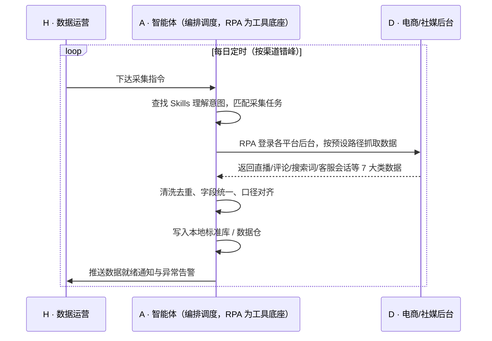

> 多平台多渠道经营的品牌，数据团队每天要在十余个电商与社媒后台之间来回切换——登录、翻入口、导出、拼表，3-5 小时就耗在"搬数据"上，拿到的还是 T+n 才凑齐、各部门口径各异的表格。本方案用智能体调度「八爪鱼 RPA、各平台后台、社媒后台、本地数据仓」协同执行：自动登录十余个系统，按预设路径抓取直播、评论、搜索、客服会话等 7 大类核心数据，清洗去重、字段统一后写入统一数据仓，并向用研、客服、市场推送同一份数据就绪通知。数据时效由 T+n 提升到 T+1，人工逐日导出的时间基本释放，全渠道数据沉淀为可直接取用的底座。定时自动执行，全程自动化，无异常不打扰。

> Agent 自动化需开通企业功能
> 点击申请1个月免费权限
> [点击申请 →](https://skieer.feishu.cn/share/base/form/shrcnFwMayykP5iaL38fnZKTbrg)

## 一、用户与需求

核心矛盾：

- 十余个电商与社媒后台各自为政，数据每天靠人工逐个登录、逐个导表，3-5 小时/天消耗在重复搬运上
- 数据时效滞后，T+n 才凑齐，内容与客服的响应窗口已经过去
- 直播、评论、搜索词、客服会话等非结构化数据散落在各系统，无法统一口径
- 数据存在个人电脑与共享盘里，不沉淀、不可回溯，换人就断档

适用客户：渠道数量在 5 个以上的品牌与多平台精铺卖家（渠道越多价值越大），涵盖 3C/智能硬件、家电家居、服饰美妆等类目；**已部署 BI 的客户**，本方案负责把数据自动送进 BI，让看板从"手工喂数"变成"自动更新"；**未部署 BI 的客户**，本方案输出的标准库可直接用表格工具打开使用。部署后由实施方一次性完成渠道与字段配置，业务人员日常不需要写代码，仅处理异常告警。

### 1.1 不同模式卖家

| 类型 | 选择 | 建议 |
|-|-|-|
| 品牌（多渠道经营，渠道 10+） | 首选 | 强烈推荐——渠道越多、系统越杂，统一数据底座的价值越大 |
| 多平台精铺（渠道 5-10） | 次选 | 一般推荐——渠道达 5 个以上即可明显受益 |
| 单平台小卖家 | 不做 | 渠道单一，平台后台自带报表即可覆盖 |

### 1.2 不同类目卖家

| 类目 | 最关注维度 | 核心逻辑 |
|-|-|-|
| 3C/智能硬件 | 客服会话与评论 | 产品体验反馈集中在会话与评论区，需全量沉淀才能做问题归因 |
| 家电家居 | 直播数据 | 直播转化与流量按场次归集，人工难以逐场整理 |
| 服饰美妆 | 内容与口碑 | 评论与种草内容直接影响复购，需要按款、按渠道沉淀 |
| 户外运动 | 多区域数据 | 国内外渠道字段口径不同，需统一后才可横向对比 |
| 母婴 | 站内搜索词 | 搜索词反映真实需求，是选品与详情优化的直接输入 |
| 食品快消 | 大促期数据量 | 大促期间评论/会话量激增，人工导表跟不上节奏 |

### 1.3 不同角色用户

| 用户 | 需求 | 问题 | 投入时间（估算） |
|-|-|-|-|
| 用户研究/客服运营 | 拿到全渠道原始数据做分析 | 逐平台登录导出，数据分散在各处 | 3-5 小时/天 |
| 市场/运营 | 基于同一份数据协同决策 | 各部门各导一份，口径不一致 | 2-3 小时/天 |
| 数据/BI 岗 | 稳定、可追溯的数据源 | 数据靠人喂，断一天看板就停更 | 1-2 小时/天 |
| 老板 | 数据底座支撑经营决策 | 数据滞后、口径乱，决策靠经验 | 看报表决策 |

---

## 二、现在的方法与问题

### 2.1 流程步骤与问题总结

| 序号 | 步骤 | 现在的方法 | 问题缺陷 |
|-|-|-|-|
| 1 | 登录各平台 | 人工逐个登录电商与社媒后台 | 十余个系统、账号多，仅登录就耗时 |
| 2 | 定位数据位置 | 人工翻找直播/评论/会话/搜索入口 | 路径深、入口常变，容易漏导 |
| 3 | 导出数据 | 逐个页面导出报表 | 格式不一，反复切换系统 |
| 4 | 清洗整理 | Excel 手工拼表、去重 | 字段不统一，人工成本高且易错 |
| 5 | 入库沉淀 | 手工保存到共享盘 | 无统一库，历史数据难追溯 |
| 6 | 分发使用 | 群里发文件 | 版本混乱，各部门口径不一致 |

### 2.2 问题分析

| 序号 | 根因 | 具体表现 |
|-|-|-|
| 1 | 系统分散、无统一入口 | 十余个后台各管一段，数据只能靠人在系统间搬运 |
| 2 | 非结构化数据无法批量导出 | 评论、会话、弹幕等需清洗后使用，人工难处理 |
| 3 | 登录态与账号管理复杂 | 多账号、多角色，人工登录易触发验证，且耗时 |
| 4 | 缺乏统一字段规范 | 各平台字段命名与统计口径不同，横向对比需反复对齐 |
| 5 | 无自动调度与补采机制 | 人工执行随人员状态波动，漏一天就断档 |

---

## 三、解决方案

### 3.1 功能概述

为多渠道经营的品牌打造的"全渠道营销与客服数据自动采集入库"方案：一句话调度「各平台后台 + 社媒后台 + 本地数据仓」，自动登录十余个系统抓取 7 大类核心数据，清洗去重、字段统一后统一入库，向用研、客服、市场输出同一份数据底座。

一句话下达指令（如「把各平台的直播、评论、搜索词、客服会话数据采回来入库」），智能体通过查找 Skills 文档库理解意图、匹配 6 个 RPA 自动化任务（平台登录 → 数据定位抓取 → 数据清洗 → 字段统一 → 统一入库 → 就绪通知），经 MCP 调度八爪鱼 RPA 执行，最后生成采集完整率与异常清单报告。全程自动化，运行状态实时反馈，跑完推送结果。

### 3.2 系统结合

| 要素 | 说明 |
|-|-|
| 客户现有工具盘点 | 品牌通常同时使用多个电商平台后台（天猫/京东/拼多多/得物等）、多个社媒后台（B站/视频号/快手等），以及内部 BI/表格工具；数据能力分散在各系统，缺乏统一入口 |
| 数据/能力来源 | 无 BI 客户：RPA 采集清洗后直接写入**本地标准库/表格**，业务人员用表格工具打开；有 BI 客户：标准库写入**数据仓**，由 BI 直接取数。通道按客户现有工具选择，采集源均为各平台后台的官方导出/页面（已开放 API 的走 API，未开放的走后台导出与页面采集，按平台规则控制频率） |
| RPA 耦合动作 | 作为 Agent 的工具底座被调度执行：按计划登录各系统 → 按预设路径抓取 7 大类数据 → 自动清洗去重 → 统一字段入库 → 推送数据就绪通知 |
| 耦合出的新价值 | 各平台只提供自家后台数据、BI 工具只负责展示——单系统都无法完成"跨十余系统、统一字段、每日自动入库"。本方案交付的是**一份口径统一、每日自动更新的全渠道数据底座，只推送**采集完整率、数据量趋势与异常清单 |

### 3.3 智能体执行流程

每日定时触发（按渠道分批错峰）；支持两种数据通道（无 BI / 有 BI），按客户现有工具选择。

> Agent 自动化需开通企业功能
> 点击申请1个月免费权限
> [点击申请 →](https://skieer.feishu.cn/share/base/form/shrcnFwMayykP5iaL38fnZKTbrg)

### 3.4 为何这么设计

要同时回答三个问题：**为什么不能只用纯代码 Agent？为什么不能只用纯 RPA？为什么两者要结合？** 本场景的核心是"十余个异构系统的登录与取数，加上非结构化数据的清洗入库"——难点不在分析，而在每天稳定地跨系统把数据搬回来。

#### 1）逐项对比

| 对比维度 | 纯代码 Agent（Codex 等） | 纯 RPA（八爪鱼） | 智能体+RPA（MCP 结合） |
|-|-|-|-|
| 实现方式 | 为每个渠道写抓取与解析代码 | 可视化配置各渠道采集流程 | 智能体编排调度，RPA 作为工具底座执行 |
| 多平台登录与取数 | 逐渠道自写登录态与请求逻辑，账号多易失效 | 平台沉淀多渠道登录经验，配置即用 | RPA 负责登录取数，智能体负责编排与判断 |
| 风控与多账号隔离 | 自建代理、指纹与频率控制，工程量大 | 内置指纹浏览器与频率控制机制 | 沿用平台风控能力，智能体按异常动态降频 |
| 清洗与入库 | 自写解析、去重、字段映射与入库脚本 | 采集后需另行处理，清洗能力弱 | 智能体做清洗与口径对齐，RPA 负责落库动作 |
| 使用成本（总拥有成本） | 无订阅费，但十余渠道适配与长期维护人力成本高 | 订阅费 + 常开电脑/云机成本，无维护人力 | 订阅费 + 一次性配置，后续维护由平台模板与智能体策略承担 |
| 维护人要求 | 需具备开发能力，渠道改版需改代码 | 业务人员可维护模板 | 业务人员可维护，异常由智能体归因提示 |

#### 2）优劣势说明

|  | 纯代码 Agent | 纯 RPA | 智能体+RPA |
|-|-|-|-|
| 优势 | 无订阅费、逻辑可深度定制、适合一次性取数 | 多渠道模板沉淀、登录态与风控经验现成、7×24 定时调度 | 兼具编排判断与稳定执行，清洗/口径由智能体承担，RPA 只做确定的机械动作 |
| 劣势 | 十余渠道适配量大、无人维护即失效、清洗与调度全自建 | 缺判断与编排能力，异常场景需人工干预；本地运行需常开电脑/云机 | 需一次性配置投入，通道边界受平台导出能力限制 |

**特别提醒**：各平台对自动化访问均有风控与条款约束，**没有"用代码就比 RPA 更安全"的捷径**。本方案优先使用官方导出/API 通道，未开放通道按平台规则控制访问频率；账号安全责任由使用方承担。

#### 3）结论

| 论点 | 说明 |
|-|-|
| 确定性 vs 生成性 | 每日跨渠道采集与入库是确定性任务，RPA 行为可预期；生成式脚本能跑通一次 ≠ 能连续一年稳定跑 |
| 资产沉淀 | 渠道模板、字段映射、清洗规则沉淀在平台与技能库是活的，写在脚本里是死的 |
| 分工而非替代 | 智能体强在理解意图、清洗口径与异常归因；RPA 强在稳定登录、批量取数与落库，二者互补 |
| 风险无豁免 | 平台风控对自动化无豁免，方案的价值是把风险控制在规则之内，而不是绕过规则 |
| 不消耗 AI token | 采集与字段清洗为规则化流水线、不调用模型；仅评论/会话等文本的结构化解析需调用模型，可按抽样与批次策略控制用量 |
| 时间 | 业务团队要的是每天准时拿到口径统一的数据，不是每周维护一轮采集脚本 |

### 3.5 功能清单

| 功能 | 系统 | 功能说明（解决问题） |
|-|-|-|
| 会话/定时 | 智能体 | 1. 理解采集意图，编排多渠道×多类目任务。   2. 每日定时或会话触发，失败自动补采。 |
| 全渠道数据采集 | RPA | 1. 解决十余系统逐日人工登录导出的问题。   2. 作为智能体工具被调度执行（含失败重试/补采）。   3. 登录各平台与社媒后台，抓取直播、评论、搜索词、客服会话等 7 大类数据。 |
| 数据清洗与口径对齐 | 智能体 | 1. 去重、字段统一、统计口径对齐。   2. 异常数据标记并回传清单。 |
| 统一入库 | RPA/智能体 | 1. 按"渠道-日期-类目"规范写入本地标准库或数据仓。   2. 保留原始层，支持回溯。 |
| 数据分发 | 智能体 | 1. 数据就绪通知推送用研/客服/市场。   2. 供 BI 或表格工具直接取用。 |
| IM 通知 | 智能体 | 1. 采集完成推送。   2. 账号异常、采集中断即时告警。 |
| 数据资产储存 | 智能体 | 1. 全渠道历史数据（原始库+标准库）沉淀为 Skills 与数据资产。   2. 经验知识库记录渠道字段映射与异常处理经验，供后续复用。 |

### 3.6 智能体执行落地过程

渠道清单、账号、字段映射、入库规则等均为部署时一次性配置；日常自动触发，无需重复输入，只需关注异常通知。

**⚠️ 部署前提（不满足则方案无法跑起来）**

① 需部署常开的电脑或云机承载 RPA 运行，并配置漏跑补跑机制；② 各平台账号需具备合法登录权限，登录态需保持有效，验证码/二次验证场景需配套处理方案；③ 各平台采集需遵守其平台条款与频率限制，优先使用官方导出/API 通道；④ 本地数据库或数据仓需提前就绪，字段规范需与用研、客服、市场三方对齐；⑤ 首次配置需实施方介入一次，渠道数量越多实施工作量越大。

#### 1）配置（4 步）

| 步骤 | 操作 | 说明 |
|-|-|-|
| 第 1 步 | 在八爪鱼 RPA 创建 API-Key | 开通平台调用凭证 |
| 第 2 步 | 配置各渠道 RPA 采集应用 | 按渠道配置登录方式、数据路径与采集字段 |
| 第 3 步 | 在智能体侧配置 MCP | 将 RPA 注册为智能体可调用的工具 |
| 第 4 步 | 封装口径 Skills | 写入字段规范、清洗规则、入库命名与分发口径 |

| 类别 | 说明 |
|-|-|
| 智能体 | 主流智能体 |
| 智能体工具 | 1. 自动化：八爪鱼 RPA，MCP 配置。   2. 数据处理：智能体自带。   3. 数据储存：本地数据库/数据仓。   4. IM：飞书/钉钉/企微。 |
| 工作知识 | 1. 渠道与账号清单。   2. 7 大类数据字段规范。   3. 清洗去重与口径规则。   4. 入库命名规则。 |
| 本地数据库 | 1. 全渠道原始库。   2. 清洗后标准库。   3. 采集日志与异常库。 |

#### 2）执行

| 任务 | 产出 | 产出物接收人 |
|-|-|-|
| 定时触发采集 | 任务启动记录 | —— |
| RPA 登录各渠道抓取数据 | 各渠道原始数据 | —— |
| 清洗去重、字段统一 | 标准数据集 | —— |
| 写入标准库/数据仓 | 入库结果与日志 | —— |
| 推送数据就绪 | 数据就绪通知 | 用研/客服/市场 |
| 异常归类与告警 | 异常清单 | 数据运营 |

异常处理：

- 渠道登录失败 → 自动重试 2 次，仍失败则跳过该渠道并告警；
- 遇验证码/二次验证 → 触发告警并记录，等待人工处理，不强行绕过；
- 页面结构变更 → 跳过该渠道并告警，等待模板更新后自动恢复；
- 数据为空或格式异常 → 标记异常，下轮自动补采；
- 采集超时 → 记录断点，下一轮续采；
- 账号风控提示 → 立即停止该渠道采集并告警。

#### 3）结果

| 结果 | 说明 |
|-|-|
| 数据资产 | 全渠道 7 大类数据（原始库+标准库），支持历史回溯与趋势分析 |
| 分析报告 | 1. 采集完整率。   2. 各渠道数据量趋势。   3. 异常与缺漏清单。 |
| Skills | 沉淀的多渠道采集、清洗与口径对齐预设技能资产 |

> Agent 自动化需开通企业功能
> 点击申请1个月免费权限
> [点击申请 →](https://skieer.feishu.cn/share/base/form/shrcnFwMayykP5iaL38fnZKTbrg)

---

## 四、使用前后预估

> 本方案价值 = **十余系统人工搬数 → 每日自动采集入库 → 一份口径统一的数据底座**。把数据团队从"登录、导出、拼表"的重复劳动中解放出来，让数据供给从"人喂"变成"自动流动"。

| 指标 | 人工 | 纯代码 Agent | 智能体+自动化工具 |
|-|-|-|-|
| 采集耗时 | 3-5 小时/天逐平台导出 | 首次开发 2-4 周，后续仍需维护 | 每日自动执行，人工仅处理异常 |
| 数据时效 | T+n 才凑齐 | 取决于脚本稳定性，断跑即断档 | 提升至 T+1 |
| 覆盖范围 | 人工只能优先主渠道 | 覆盖取决于已开发渠道数 | 12+ 平台与社媒系统全覆盖 |
| 数据口径 | 各部门各导一份，口径不一 | 依赖脚本内写死的映射 | 统一字段与口径，沉淀在技能库 |
| 错误率 | 手工拼表易错 | 改版即报错，需人工排查 | 异常自动标记并回传清单 |
| 沉淀 | 数据散在个人表格 | 代码即资产，人走即失 | 模板+技能+历史库三层沉淀 |

说明：数据取自八爪鱼应用案例口径（12+ 平台、7 大类数据、T+1 时效），实际效果随渠道数量、平台导出能力与规则变化；人工耗时为岗位口径估算。

---

## 五、效果证明

> Agent 自动化需开通企业功能
> 点击申请1个月免费权限
> [点击申请 →](https://skieer.feishu.cn/share/base/form/shrcnFwMayykP5iaL38fnZKTbrg)

### 5.1 客户案例

**《大疆：十余平台 × 7 大类营销与客服数据自动采集》**

> 十余个国内外电商平台与社媒渠道，直播、评论、客服会话、搜索等非结构化数据原需大量人力处理。RPA 完成十余个系统、7 大类核心数据自动采集入库。

| 效果 | 说明 |
|-|-|
| 提效 | 跨平台营销与客服数据采集效率显著提升。原本十余个平台与社媒渠道、7 大类数据需每日 5-6 小时人工导表，现在全自动采集入库，数据时效提升至 T+1。 |
| 降本 | 免除专职导表的人力投入，节约人力用于数据建模、投放复盘与客服策略分析等重点工作。 |
| 任务 | 覆盖十余个国内外电商平台与社媒渠道，含直播、评论、客服会话、搜索等 7 大类非结构化数据。 |
| 任务 | 形成全渠道统一数据底座，跨平台口径一致，供分析团队直接取用。 |

案例详情：[客服：全球无人机巨头跨平台电商与客服数据自动化采集](https://skieer.feishu.cn/wiki/OmO7wGX3yiASCBkqRsfcWPUMnOe)

---

## 六、备注

### 6.1 Agent 支持

本方案不绑定具体智能体，主流 Agent 均可运行（**需支持 MCP 连接、技能/Skills 加载与工具调用**）：

| Agent/智能体 | 说明 |
|-|-|
| Workbuddy | 本方案运行平台，支持技能/Skills 上传加载、定时任务、MCP 工具调用与表格/报告处理 |
| 豆包（国内·字节） | 国内主流个人智能体，支持技能上传、定时任务与工具调用，上手成本低 |
| 通义千问（国内·阿里） | 支持 Agent 编排与插件生态，集成阿里电商数据能力，适合电商场景 |
| DeepSeek（国内） | 推理能力强、成本低，适合规则打分与归因分析类任务 |
| ChatGPT（国外·OpenAI） | 海外主流通用智能体，支持 GPTs/Agent 模式与工具调用 |
| Claude（国外·Anthropic） | 长文本与结构化分析能力强，原生支持 MCP 连接外部工具 |

### 6.2 名词解释

| 术语 | 说明 |
|-|-|
| 7 大类核心数据 | 直播数据、评论数据、站内搜索词、客服会话、商品数据、订单数据、内容数据等业务数据的类别集合 |
| 数据底座 | 统一沉淀、口径一致的基础数据层，供分析、用研与决策直接取用 |
| 非结构化数据 | 评论、会话、弹幕等文本类数据，需清洗、分词与打标后才能分析 |
| 标准库 | 清洗、去重、字段统一后的结构化数据层，与原始库分层存放 |
| 字段映射 | 将各平台不同命名的字段统一到同一套口径的对应关系表 |
| 口径对齐 | 统一各平台统计规则（如"有效评论""会话量"的定义），保证横向可比 |
| 登录态 | 账号保持已登录状态的凭证，RPA 稳定运行的前提 |
| 指纹浏览器 | 为每个账号提供独立浏览器环境、降低多账号关联风险的工具 |
| MCP | 模型上下文协议，让智能体以标准方式调用外部工具（如 RPA）的接口规范 |
| 补采 | 采集失败或数据缺失时，下一轮自动重新采集缺失部分的机制 |
| 错峰 | 将不同渠道的采集任务分散到不同时间执行，降低并发与风控压力 |
| 数据仓 | 面向分析场景的集中式数据存储，供 BI 工具直接取数 |

> Agent 自动化需开通企业功能
> 点击申请1个月免费权限
> [点击申请 →](https://skieer.feishu.cn/share/base/form/shrcnFwMayykP5iaL38fnZKTbrg)

---

原文：[查看原文](https://skieer.feishu.cn/wiki/ZoYewOOxEiaACmkrcd8c5R4MnHd)
