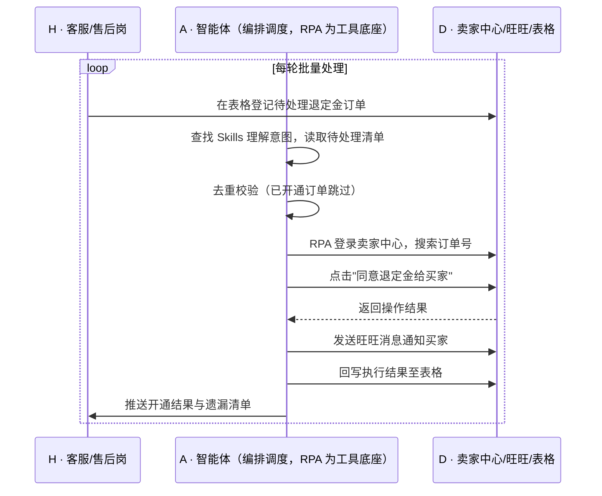

> 大促预售期，买家为锁定优惠先付定金，但临时反悔要退定金的情况不少——为保障商家权益，平台并不会默认给所有订单开退定金通道，客服得一个个手动去后台开通，接待量大时回复不及时，客户等急了直接投诉；一个客服半天只能处理有限订单，0.5 人天的工作量全耗在重复点击上。本方案用智能体调度「八爪鱼 RPA、电商后台（卖家中心）、客服工作台（旺旺）、表格」协同执行：定时批量在卖家中心搜索订单号，自动点击"同意退定金给买家"，并发送旺旺消息通知买家，执行结果回写表格供主管统计。案例口径效率提升 90+%，0.5 人天的工作秒级完成。定时自动执行，全程自动化，无异常不打扰。

> Agent 自动化需开通企业功能
> 点击申请1个月免费权限
> [点击申请 →](https://skieer.feishu.cn/share/base/form/shrcnFwMayykP5iaL38fnZKTbrg)

## 一、用户与需求

核心矛盾：

- 平台为保障商家权益不默认开通退定金通道，需商家逐单手动同意，属强制人工环节
- 大促期退定金请求集中爆发，客服一个个开通，回复不及时直接引发客诉
- 单笔操作要在卖家中心"搜索订单-点开-同意退定金"多步完成，0.5 人天只能处理有限单量
- 开通后还需另行通知买家，人工容易漏通知，客户反复追问
- 处理过程无台账，主管无法核查哪些已开、哪些遗漏

适用客户：大促预售占比较高的电商团队（服饰、美妆、3C、家电等），以及预售定金额度大、退定金请求多的品牌店铺；**已开通预售玩法且客服团队人数有限的客户**，本方案能直接把这块人力省下来；**尚未做预售的客户**，可待玩法上线后再启用。部署后由实施方一次性配置搜索口径与操作路径，客服人员日常不需要写代码，仅需维护待处理清单与查看结果。

### 1.1 不同模式卖家

| 类型 | 选择 | 建议 |
|-|-|-|
| 大促预售型卖家（定金玩法） | 首选 | 强烈推荐——退定金属平台强制人工环节，自动化收益最直接 |
| 多店铺品牌（客服团队大） | 首选 | 强烈推荐——店铺越多、订单越分散，人工开通越容易漏 |
| 日常货架电商（无预售） | 不做 | 无定金场景，方案不适用 |
| 小卖家（预售量极小） | 次选 | 一般推荐——单量少时可人工，规模化后再启用 |

### 1.2 不同类目卖家

| 类目 | 最关注维度 | 核心逻辑 |
|-|-|-|
| 服饰/鞋包 | 退定金高频 | 决策周期短、反悔率高，退定金请求最集中 |
| 美妆/个护 | 大促囤货冲动 | 冲动下单后反悔多，需快速响应避免投诉 |
| 3C/家电 | 定额大 | 定金金额高，客户退款意愿强、催得急 |
| 家居/大件 | 决策期长 | 从付定金到付尾款周期长，变数多 |
| 母婴 | 凑单定金 | 常因凑单付定金，事后取消需及时开通 |
| 食品/快消 | 时效敏感 | 客户对响应速度敏感，延迟易引发差评 |

### 1.3 不同角色用户

| 用户 | 需求 | 问题 | 投入时间（估算） |
|-|-|-|-|
| 客服/售后岗 | 快速批量开通退定金 | 逐单手动开通，高峰期处理不完 | 大促期全天 |
| 客服主管 | 掌握开通进度 | 无台账，无法核查遗漏 | 1-2 小时/天核查 |
| 财务 | 定金退款准确、无重复 | 手工操作难免重复或遗漏 | 复核 |
| 老板 | 大促客诉率与体验 | 退定金延迟直接影响大促口碑 | 看报表决策 |

---

## 二、现在的方法与问题

### 2.1 流程步骤与问题总结

| 序号 | 步骤 | 现在的方法 | 问题缺陷 |
|-|-|-|-|
| 1 | 收集退定金诉求 | 客服从会话中逐条记录买家诉求 | 高峰期消息多，易漏 |
| 2 | 打开卖家中心 | 登录后台进入"已卖出的宝贝" | 每次操作都要重新定位 |
| 3 | 搜索订单号 | 逐个输入订单号搜索 | 单量多时输入耗时 |
| 4 | 点击同意退定金 | 人工逐单点击 | 重复点击，0.5 人天只能处理有限单 |
| 5 | 通知买家 | 手工发旺旺消息告知 | 易漏通知，客户反复追问 |
| 6 | 登记结果 | 手工记表 | 台账不规范，难以核查 |

### 2.2 问题分析

| 序号 | 根因 | 具体表现 |
|-|-|-|
| 1 | 平台默认不开通，属强制人工环节 | 每单都必须商家主动同意，无法批量豁免 |
| 2 | 操作路径固定但步骤多 | "搜索-点开-同意"三步重复，无法批量执行 |
| 3 | 请求集中在短时间爆发 | 大促尾款前集中退定金，人力瞬时不足 |
| 4 | 通知与操作分离 | 开通后需另行通知买家，人工易漏 |
| 5 | 无统一台账 | 已开未开无法复核，遗漏在客诉时才暴露 |

---

## 三、解决方案

### 3.1 功能概述

为预售型电商团队打造的"退定金通道自动开通"方案：一句话调度「卖家中心后台 + 客服工作台 + 表格」，定时批量搜索订单号、自动同意退定金、通知买家并回写结果台账。

一句话下达指令（如「把今天这批要退定金的订单开通一下并通知客户」），智能体通过查找 Skills 文档库理解意图、匹配 5 个 RPA 自动化任务（读取待处理清单 → 后台搜索订单 → 同意退定金 → 发送旺旺通知 → 回写结果），经 MCP 调度八爪鱼 RPA 执行，最后生成开通结果与遗漏清单。全程自动化，运行状态实时反馈，跑完推送结果。

### 3.2 系统结合

| 要素 | 说明 |
|-|-|
| 客户现有工具盘点 | 商家通常已使用**电商后台（卖家中心-已卖出的宝贝，承载退定金操作）、客服工作台（旺旺，用于通知买家）、Excel/在线表格**（客服登记待处理与结果）；三者靠人工串起来 |
| 数据/能力来源 | 待处理订单来自**客服登记的表格**（或客服会话中确认后填入）；操作在**卖家中心后台**完成；通知走**旺旺**；结果回写表格 |
| RPA 耦合动作 | 作为 Agent 的工具底座被调度执行：定时读取待处理清单 → 登录卖家中心搜索订单号 → 点击"同意退定金给买家" → 发送旺旺消息通知买家 → 回写执行结果 |
| 耦合出的新价值 | 后台只管操作、旺旺只管通知、表格只管记录——单系统都无法完成"批量开通+通知+留痕"的闭环。本方案交付的是**批量同意、即时通知、结果可核查的退定金处理能力，只推送**开通结果与遗漏清单 |

### 3.3 智能体执行流程

按小时/每日定时触发，大促期可提高频率；入参：待处理订单清单、通知话术、目标店铺。

> Agent 自动化需开通企业功能
> 点击申请1个月免费权限
> [点击申请 →](https://skieer.feishu.cn/share/base/form/shrcnFwMayykP5iaL38fnZKTbrg)

### 3.4 为何这么设计

要同时回答三个问题：**为什么不能只用纯代码 Agent？为什么不能只用纯 RPA？为什么两者要结合？** 本场景的核心是"平台强制在后台逐单操作"——没有任何接口可以豁免这个人工环节，只能靠自动化在界面上完成，且必须保证不漏、不重复。

#### 1）逐项对比

| 对比维度 | 纯代码 Agent（Codex 等） | 纯 RPA（八爪鱼） | 智能体+RPA（MCP 结合） |
|-|-|-|-|
| 实现方式 | 调平台接口批量同意退款 | 可视化配置搜索、点击、发消息流程 | 智能体做去重与话术匹配，RPA 执行界面操作 |
| 多平台登录与取数 | 平台不提供退定金接口，方案不可行 | 平台沉淀卖家中心与旺旺操作模板 | RPA 覆盖登录与操作，智能体负责调度 |
| 风控与多账号隔离 | — | 内置频率控制与多店铺账号隔离 | 沿用平台能力，异常自动降频告警 |
| 清洗与入库 | — | 擅长操作，去重与统计能力弱 | 智能体去重、统计、生成遗漏清单 |
| 使用成本（总拥有成本） | 无订阅费但无法落地 | 订阅费 + 常开电脑/云机成本 | 订阅费 + 一次性配置，话术调整改技能即可 |
| 维护人要求 | — | 业务人员可维护模板 | 业务人员可维护通知话术与处理规则 |

#### 2）优劣势说明

|  | 纯代码 Agent | 纯 RPA | 智能体+RPA |
|-|-|-|-|
| 优势 | 无订阅费、逻辑可定制 | 后台操作模板沉淀、可批量定时执行、操作留痕 | 去重与话术由智能体承担，RPA 只做机械动作，漏单率最低 |
| 劣势 | 无接口则完全不可行 | 缺去重判断，易重复开通或漏通知 | 需一次性配置投入，操作受平台频率限制 |

**特别提醒**：退定金属于**资金相关操作**，本方案仅在商家授权的店铺内、按商家确认的清单执行，不代替商家做"是否该退"的判断；建议保留**操作前清单确认**环节，账号与操作合规责任由使用方承担。

#### 3）结论

| 论点 | 说明 |
|-|-|
| 确定性 vs 生成性 | 搜索订单、点击同意、发送通知是确定性操作，RPA 行为可预期并可留痕；生成式脚本直接操作资金环节风险不可控 |
| 分工而非替代 | "哪些单该退、话术怎么写"由智能体与商家规则决定；"在后台点哪儿"由 RPA 稳定执行 |
| 资产沉淀 | 通知话术、去重规则、异常处置沉淀在技能库是活的，写在脚本里是死的 |
| 不消耗 AI token | 读清单、搜索、点击、回写为规则化流水线，仅话术生成与异常归因调用模型 |
| 合规是底线 | 资金操作保留清单确认与操作留痕，是财税与售后场景不可省的设计 |
| 时间 | 客服要的是"大促期退定金不积压、不投诉"，不是每天手动点几百单 |

### 3.5 功能清单

| 功能 | 系统 | 功能说明（解决问题） |
|-|-|-|
| 会话/定时 | 智能体 | 1. 理解处理意图，编排批量开通任务。   2. 按小时/每日定时触发，大促期可加密。 |
| 待处理清单读取 | 智能体 | 1. 读取表格中登记的退定金订单。   2. 去重校验，已开通订单自动跳过。 |
| 后台批量同意 | RPA | 1. 解决人工逐单"搜索-点开-同意"的重复操作。   2. 作为智能体工具被调度执行（含失败重试）。   3. 登录卖家中心搜索订单号并点击"同意退定金给买家"。 |
| 买家通知 | RPA | 1. 自动发送旺旺消息告知买家已开通。   2. 话术按规则模板填充，不漏通知。 |
| 结果回写与统计 | 智能体 | 1. 执行结果回写表格形成台账。   2. 生成遗漏清单，供人工补处理。 |
| IM 通知 | 智能体 | 1. 处理结果推送客服主管。   2. 登录失效、操作失败即时告警。 |
| 数据资产储存 | 智能体 | 1. 开通台账与话术记录沉淀为数据资产与 Skills。   2. 经验知识库记录平台操作路径与异常处置经验。 |

### 3.6 智能体执行落地过程

通知话术、目标店铺、处理频率、去重口径等均为部署时一次性配置；日常客服只需在表格登记待处理订单，其余自动完成。

**⚠️ 部署前提（不满足则方案无法跑起来）**

① 需部署常开的电脑或云机承载 RPA 运行，并配置漏跑补跑机制；② 卖家中心与旺旺账号需具备合法操作权限，登录态需保持有效，遇验证码需配套人工处理方案；③ 待处理订单清单需由客服确认后登记（系统不代替判断"是否该退"）；④ 操作频率需遵守平台限制，避免高频触发风控；⑤ 首次配置需实施方介入一次，多店铺多平台时工作量相应增加。

#### 1）配置（4 步）

| 步骤 | 操作 | 说明 |
|-|-|-|
| 第 1 步 | 在八爪鱼 RPA 创建 API-Key | 开通平台调用凭证 |
| 第 2 步 | 配置退定金 RPA 应用 | 配置卖家中心搜索路径、同意操作与旺旺通知流程 |
| 第 3 步 | 在智能体侧配置 MCP | 将 RPA 注册为智能体可调用的工具 |
| 第 4 步 | 封装退定金 Skills | 写入待处理清单规则、通知话术、去重与统计口径 |

| 类别 | 说明 |
|-|-|
| 智能体 | 主流智能体 |
| 智能体工具 | 1. 自动化：八爪鱼 RPA，MCP 配置。   2. 去重与话术：智能体自带。   3. 台账表格：Excel/在线表格。   4. IM：飞书/钉钉/企微。 |
| 工作知识 | 1. 店铺与账号清单。   2. 通知话术模板。   3. 去重与处理频率规则。   4. 台账字段规范。 |
| 本地数据库 | 1. 开通台账库。   2. 遗漏与失败记录库。   3. 操作日志库。 |

#### 2）执行

| 任务 | 产出 | 产出物接收人 |
|-|-|-|
| 定时触发处理 | 任务启动记录 | —— |
| 读取并去重待处理清单 | 待开通订单清单 | —— |
| RPA 搜索订单并同意退定金 | 平台操作结果 | —— |
| 发送旺旺通知 | 通知发送记录 | —— |
| 回写执行结果 | 开通台账 | 客服主管 |
| 推送结果与遗漏清单 | 处理结果、遗漏清单 | 客服/售后岗 |

异常处理：

- 登录失效/验证码 → 暂停该店铺任务并告警，等待人工处理；
- 订单号查不到或状态已变更 → 记录并跳过，不误操作其他订单；
- 操作失败 → 自动重试 2 次，仍失败则列入遗漏清单人工处理；
- 通知发送失败 → 重试并记录，避免买家未收到通知；
- 重复订单 → 智能体去重跳过，防止重复开通与重复通知。

#### 3）结果

| 结果 | 说明 |
|-|-|
| 数据资产 | 开通台账（订单、时间、结果、通知状态），支持核查与追溯 |
| 分析报告 | 1. 处理笔数与成功率。   2. 遗漏与失败清单。   3. 处理时效分布。 |
| Skills | 沉淀的退定金批量处理、通知话术与去重预设技能资产 |

> Agent 自动化需开通企业功能
> 点击申请1个月免费权限
> [点击申请 →](https://skieer.feishu.cn/share/base/form/shrcnFwMayykP5iaL38fnZKTbrg)

---

## 四、使用前后预估

> 本方案价值 = **人工逐单开通 → 批量自动处理 → 开通与通知一次完成**。把客服从"搜索-点击-通知"的重复劳动中解放出来，让退定金处理从"看人力够不够"变成"按批次稳定跑完"。

| 指标 | 人工 | 纯代码 Agent | 智能体+自动化工具 |
|-|-|-|-|
| 处理效率 | 0.5 人天完成一批 | 无接口，不可行 | 案例口径：效率提升 90+%，秒级完成 |
| 响应时效 | 高峰期排队，回复不及时 | — | 按小时/定时批量处理，不等人工 |
| 漏单风险 | 靠人工逐条核对，易漏 | — | 去重+遗漏清单，处理情况可核查 |
| 买家通知 | 手工发送，易漏 | — | 自动发送并留痕 |
| 客诉 | 延迟处理引发投诉 | — | 响应提速，减少因等待引发的客诉 |
| 沉淀 | 无台账，经验在人脑 | 代码即资产，人走即失 | 话术+台账+经验知识库三层沉淀 |

说明：数据取自八爪鱼应用案例口径（效率提升 90+%、0.5 人天工作秒级完成），实际效果随订单量、店铺数量与平台限制变化；人工耗时为客服岗位口径估算。操作前保留清单确认，最终退款判断由商家确认。

---

## 六、备注

### 6.1 Agent 支持

本方案不绑定具体智能体，主流 Agent 均可运行（**需支持 MCP 连接、技能/Skills 加载与工具调用**）：

| Agent/智能体 | 说明 |
|-|-|
| Workbuddy | 本方案运行平台，支持技能/Skills 上传加载、定时任务、MCP 工具调用与表格/报告处理 |
| 豆包（国内·字节） | 国内主流个人智能体，支持技能上传、定时任务与工具调用，上手成本低 |
| 通义千问（国内·阿里） | 支持 Agent 编排与插件生态，集成阿里电商数据能力，适合电商场景 |
| DeepSeek（国内） | 推理能力强、成本低，适合规则判断与归因分析类任务 |
| ChatGPT（国外·OpenAI） | 海外主流通用智能体，支持 GPTs/Agent 模式与工具调用 |
| Claude（国外·Anthropic） | 长文本与结构化分析能力强，原生支持 MCP 连接外部工具 |

### 6.2 名词解释

| 术语 | 说明 |
|-|-|
| 定金 | 预售场景中买家为锁定优惠先行支付的款项，付尾款时可抵扣 |
| 退定金通道 | 平台为单笔订单开放的可退还定金的入口，默认不开启，需商家手动同意 |
| 卖家中心 | 电商平台面向商家的后台，退定金操作在"已卖出的宝贝"中完成 |
| 已卖出的宝贝 | 淘宝/天猫卖家中心的订单管理列表 |
| 旺旺 | 淘宝/天猫的买家与商家沟通工具，用于发送通知消息 |
| 待处理清单 | 客服确认后登记的需开通退定金订单集合 |
| 去重 | 对已开通订单跳过处理，避免重复操作与重复通知 |
| 尾款 | 预售中买家在付定金后需补付的剩余货款 |
| 遗漏清单 | 处理失败或未执行的订单集合，供人工补处理 |
| 台账 | 记录操作过程与结果的表册，用于核查与追溯 |
| 客诉 | 客户因服务或商品问题发起的投诉 |
| MCP | 模型上下文协议，让智能体以标准方式调用外部工具（如 RPA）的接口规范 |

> Agent 自动化需开通企业功能
> 点击申请1个月免费权限
> [点击申请 →](https://skieer.feishu.cn/share/base/form/shrcnFwMayykP5iaL38fnZKTbrg)

---

原文：[查看原文](https://skieer.feishu.cn/wiki/SeYUwhCq2i9aYFkAvA1cenzCnnc)
