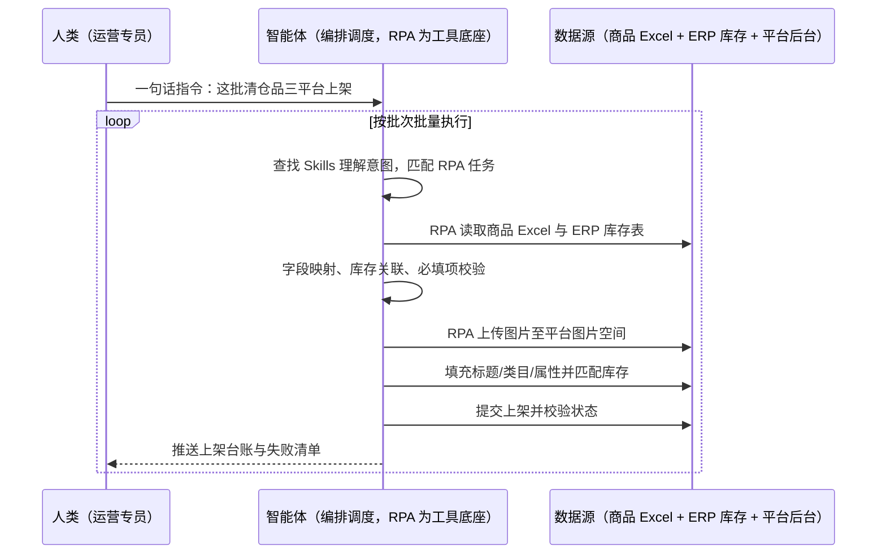

> 为国内电商商家打造的商品批量上架方案。上新与清仓时运营要人工逐条填写标题、价格、类目、图片，耗时数小时/天；信息准确性难保障，价格填错、图文不匹配、库存不同步时有发生；数百款批量上新时人力根本撑不住。本方案由智能体调度多个工具执行 Excel 与 ERP 库存数据自动关联 + 图片批量上传 + 商品信息自动填充 + 上架状态校验，输出批量上架台账与失败商品清单。按批次触发，全程自动化，异常才打扰。

> Agent 自动化需开通企业功能
> 点击申请1个月免费权限
> [点击申请 →](https://skieer.feishu.cn/share/base/form/shrcnFwMayykP5iaL38fnZKTbrg)

## 一、用户与需求

核心矛盾：

- 手动操作低效枯燥：需人工逐条填写商品标题、价格、图片等信息，耗时长达数小时/天（案例口径）
- 信息准确性难保障：易出现价格填错、图文不匹配、库存信息不同步等人为失误（案例口径）
- 规模化能力缺失：批量上新活动（如数百款清仓品）时人力无法支撑（案例口径）
- 多平台重复劳动：同一批商品在多个平台要重填一遍，纯机械复制

适用客户：SKU 数量多、上新/清仓频繁的国内电商商家（运营/商品岗）。已用 ERP 的客户由本方案把 ERP 库存表与上架表自动关联；未购 ERP 的客户用 Excel 库存表兜底；部署后业务人员不需要写代码，一句话下达指令即可执行。

### 1.1 不同规模商家

| 类型 | 选择 | 建议 |
|-|-|-|
| 品牌商家（多平台多店） | 首选 | 强烈推荐（同一批货多平台重复上架，收益最直接） |
| 腰部商家 | 首选 | 强烈推荐（大促上新量大，人工填表易错） |
| 小型商家 | 次选 | 一般推荐（单平台少量上新价值有限） |

### 1.2 不同类目商家

| 类目 | 最关注维度 | 核心逻辑 |
|-|-|-|
| 服装鞋帽 | 多规格多色 | 单款多 SKU，规格与图片对应关系最易错 |
| 3C 数码 | 类目与属性 | 类目属性必填项多，填错影响搜索与活动 |
| 家居家具 | 图文一致性 | 大件看重尺寸参数与图片匹配 |
| 食品生鲜 | 资质与效期 | 资质字段与效期信息必须准确 |
| 美妆个护 | 备案信息 | 备案号等字段错填即违规 |
| 百货饰品 | 海量长尾 | SKU 极多，人力批量上新不可行 |

### 1.3 不同角色用户

| 用户 | 需求 | 问题 | 投入时间（估算） |
|-|-|-|-|
| 运营专员 | 批量上新 | 逐条填表数小时/天 | 3-5 小时/上新日 |
| 商品主管 | 信息准确率 | 价格/图文错漏需返工 | 每日校对 1-2 小时 |
| 供应链/仓配 | 库存同步 | 库存不同步导致超卖 | 大促期间每日盯 |

---

## 二、现在的方法与问题

### 2.1 流程步骤与问题总结

| 序号 | 步骤 | 现在的方法 | 问题缺陷 |
|-|-|-|-|
| 1 | 整理商品资料 | 运营手工整理 Excel（标题/价格/图路径） | 字段不统一，易漏填 |
| 2 | 关联库存 | 人工对照 ERP 库存表 | 抄录易错，超卖风险 |
| 3 | 上传图片 | 逐张上传到图片空间 | 重复劳动，易漏图 |
| 4 | 填写信息 | 逐条填标题/类目/属性 | 数字段多，耗时长 |
| 5 | 提交上架 | 逐条提交并检查状态 | 失败不自知 |
| 6 | 多平台复制 | 另一个平台再重复一遍 | 纯机械重复 |

### 2.2 问题分析

人工方式根因

| 序号 | 根因 | 具体表现 |
|-|-|-|
| 1 | 逐条手工填表 | 单商品耗时长，批量上新人力不够 |
| 2 | 无自动校验 | 价格/图文/库存错误靠事后发现 |
| 3 | 信息源分散 | Excel、ERP、图片目录三处对不上 |

系统/工具方式根因

| 序号 | 根因 | 具体表现 |
|-|-|-|
| 1 | 平台工具只管本平台 | 多平台仍要各填一遍 |
| 2 | 与 ERP 未拉通 | 库存数据靠人工搬运 |
| 3 | 失败无台账 | 上架失败商品没人追 |

---

## 三、解决方案

### 3.1 功能概述

为国内电商商家打造的商品批量上架方案，一句话调度数据关联 + 图片上传 + 信息填充 + 状态校验，输出批量上架台账与失败清单。

一句话下达指令（如「把这批清仓品在三个平台都上架，有问题的报我」），智能体通过查找 Skills 文档库理解意图、匹配 N 个 RPA 自动化任务（读表→关联库存→传图→填信息→提交→校验），经 MCP 调度八爪鱼 RPA 读取运营整理好的 Excel，登录电商后台循环操作：定位图片文件并上传至指定位置、填充商品基础信息（标题/类目/属性）、自动匹配库存数据（避免超卖/无货上架）、提交上架并校验状态。全程自动化，运行状态实时反馈，跑完推送结果。

### 3.2 系统结合

| 要素 | 说明 |
|-|-|
| 系统组成 | 智能体（WorkBuddy，任务编排 + 校验规则）+ MCP 协议层 + 八爪鱼 RPA（后台操作）+ ERP/库存表（数据源） |
| 数据/能力来源 | 运营维护的商品 Excel（SKU/标题/价格/图片路径等字段）、ERP 导出的库存信息表、平台图片空间与商品后台（官方后台操作） |
| RPA 耦合动作 | 作为 Agent 的工具底座被调度执行：①解决逐条填表与传图的机械动作；②被智能体调度读取 Excel 与库存表并关联；③登录平台后台完成传图、填信息、提交与状态校验 |
| 耦合出的新价值 | 单系统给不了的端到端结论：表进、货上、库存对齐，**只推送上架失败与信息冲突的商品** |

### 3.3 智能体执行流程

一句话下达指令，智能体自动调度；入参（平台、类目模板、字段映射、校验规则）部署时一次配置：

> Agent 自动化需开通企业功能
> 点击申请1个月免费权限
> [点击申请 →](https://skieer.feishu.cn/share/base/form/shrcnFwMayykP5iaL38fnZKTbrg)

### 3.4 为何这么设计

要同时回答三个问题：**为什么不能只用纯代码 Agent？为什么不能只用纯 RPA？为什么两者要结合？** 本场景的核心是"批量稳定跑、平台后台操作可靠、信息校验前置"。

#### 1）逐项对比

| 对比维度 | 纯代码 Agent（Codex 等） | 纯 RPA（八爪鱼） | 智能体+RPA（MCP 结合） |
|-|-|-|-|
| 实现方式 | 调平台开放接口批量发布 | 录制后台操作流程批量执行 | 智能体做校验编排 + RPA 执行 |
| 多平台登录与取数 | 依赖接口开放范围与权限申请 | 直接登录后台，多平台一视同仁 | RPA 走后台，智能体统一调度 |
| 风控与多账号隔离 | 接口无风控但受限多 | 可配指纹浏览器隔离多店铺 | 沿用隔离能力，操作留痕 |
| 清洗与入库 | 强，字段映射灵活 | 弱，需逐平台定制 | 智能体统一映射 + RPA 落库 |
| 使用成本（总拥有成本） | 开发维护自担，接口变动风险高 | 平台订阅一次多流程复用 | 一份订阅跑多流程，边际成本 ≈ 0 |
| 维护人要求 | 需开发，平台改版即返工 | 业务可自维护流程 | 业务改规则、技术兜底 |

技术栈速览：纯代码路线需 Python 对接各平台商品发布接口，但类目属性、图片上传、活动字段等接口覆盖不全，多店铺授权与限流也要自行处理。

#### 2）优劣势说明

|  | 纯代码 Agent（Codex 等） | 纯 RPA（八爪鱼） | 智能体+RPA（MCP 结合） |
|-|-|-|-|
| 优势 | 无订阅费；       批量逻辑可定制 | 不依赖接口，覆盖类目属性与传图；       多平台可重复操作 | 校验前置 + 批量执行 + 台账闭环 |
| 劣势 | 接口覆盖不全，字段变动需改代码 | 智能校验弱，数据错也照填 | 本地电脑运行需保持开机；       依赖平台后台结构稳定 |

**特别提醒**：上架涉及价格与库存，本方案执行前做必填与数值校验、执行后核对状态，但**价格与活动字段的最终合规仍需运营抽检确认**；平台类目与资质规则变更时需更新映射表。

#### 3）结论

| 论点 | 说明 |
|-|-|
| 确定性 vs 生成性 | 填表、传图、提交是确定性动作，RPA 行为可预期 |
| 资产沉淀 | 字段映射表、校验规则、类目模板沉淀在平台，换人接手成立 |
| 一个底座跑多流程 | 客户购买 RPA 平台是跑多个流程（上架/出图/取数），本方案只是其中一个，订阅费被摊薄 |
| 不消耗 AI token | 批量上架是规则化流水线，不经大模型对话，token 消耗极低 |
| 效率与准确率 | 案例口径：系统校验信息准确率 100%，原单商品耗时 3 分钟、效率提升 20 倍+ |
| 时间 | 运营要的是"表交上来货就上好了"，不是"逐条填几百次表单" |

### 3.5 功能清单

| 功能 | 系统 | 功能说明（解决问题） |
|-|-|-|
| 会话/一句话指令 | 智能体 | 1. 理解自然语言意图，查找 Skills 文档库。       2. 匹配对应 RPA 自动化任务、编排多任务。 |
| 表格与库存关联 | 智能体 | 1. 解决信息源分散问题。       2. 读取商品 Excel，关联 ERP 库存表。       3. 字段映射与必填项校验，冲突前置拦截。 |
| 图片批量上传 | RPA | 1. 解决逐张传图问题。       2. 作为工具被调度执行，按 SKU 定位图片文件。       3. 上传至平台图片空间指定位置。 |
| 商品信息填充 | RPA | 自动填充标题/类目/属性并按库存匹配，解决手工填表耗时与超卖问题。 |
| 提交与状态校验 | RPA、智能体 | 提交上架并校验状态，失败商品自动登记，解决失败不自知问题。 |
| 多平台重复上架 | RPA | 同一批商品按平台模板重复执行，解决多平台重复劳动问题。 |
| 上架台账 | 智能体 | 上架结果/失败原因/时间结构化登记，支撑复盘。 |
| 数据资产储存 | 本地电脑、云储存 | 1. Skills 资产：批量上架技能。       2. 数据储存：商品表与上架结果库。       3. 经验知识库：类目属性模板与失败案例回填。 |

### 3.6 智能体执行落地过程

部署时一次性配置入参（平台清单、字段映射、类目模板、校验规则），会话中一句话即可触发，无需重复输入。

**⚠️ 部署前提（不满足则方案无法跑起来）**：①RPA 需部署在**常开电脑/云机**上，并配置漏跑补跑机制；②平台后台**登录态**需维护，多店铺建议配指纹浏览器隔离；③商品 Excel 字段与平台字段映射需与运营确认一次；④类目与资质规则需一次性核对；⑤首次配置（映射、模板、校验）需服务方/技术人员介入一次，属实施成本。

#### 1）配置（五步）

| 步骤 | 操作 | 说明 |
|-|-|-|
| 第一步 | 下载八爪鱼 RPA，导入电商运营自动化模板 | 官网免费下载客户端；MCP 工具→添加应用 |
| 第二步 | 开启八爪鱼 RPA 的 MCP 服务端口 | 客户端→API-K→创建 API（名称自定义） |
| 第三步 | 在智能体中添加 MCP Server 连接 | 复制连接配置→智能体连接器→自定义连接器→配置 MCP→粘贴保存 |
| 第四步 | 验证工具列表 | 确认工具全部启用（即八爪鱼客户端内工具） |
| 第五步 | 测试运行效果 | 输入一句话指令，验证批量上架与失败清单 |

| 类别 | 说明 |
|-|-|
| 智能体 | 主流智能体（支持 MCP 连接、Skills 加载、定时任务）。 |
| 智能体工具 | 1. **执行通道**：读表关联 + 传图 + 填表 + 提交校验。       2. 数据取数与自动化执行：八爪鱼 RPA（MCP 协议接入）。       3. 数据分析：智能体自带。       4. IM：企业微信（MCP 或 webhook 配置）。 |
| 工作知识 | 1. 商品 Excel 字段与平台字段映射。       2. 类目属性模板。       3. 校验规则（价格区间/必填/图片规格）。       4. 目标店铺与图片空间路径。 |
| 本地数据库 | 1. 商品资料库地址。       2. 上架结果库地址。       3. 失败清单存档地址。 |

#### 2）执行

| 任务 | 产出 | 产出物接收人 |
|-|-|-|
| 接收一句话指令，匹配 RPA 任务 | 任务启动记录 | —— |
| 调用已预设 Skills，编排任务流程 | 任务编排方案 | —— |
| 经 MCP 向八爪鱼 RPA 下发上架任务 | 自动化任务指令 | —— |
| 读取 Excel 与库存表并校验 | 待上架数据 | —— |
| 图片批量上传 | 图片空间素材 | —— |
| 信息填充与提交上架 | 已上架商品 | 运营 |
| 状态校验与台账登记 | 上架台账 | 运营/商品主管 |
| 推送失败清单 | 群消息 | 运营 |

异常处理：

必填项缺失 → 该商品跳过并列入失败清单，不强行上架；

图片缺失/规格不符 → 标记推送补图，不占用上架批次；

库存为 0 → 按规则转预售或跳过，避免超卖；

登录失效 → 自动重试 2 次，仍失败告警推 IM；提交失败 → 记录断点，恢复后续跑不重提。

#### 3）结果

| 结果 | 说明 |
|-|-|
| 数据资产 | 商品资料库 + 上架结果库 + 失败清单，可审计可追溯。 |
| 分析报告 | 上架日报：成功量/失败量/失败原因分布。 |
| Skills | 智能体 Skills：批量上架技能，类目模板按月迭代。 |

> Agent 自动化需开通企业功能
> 点击申请1个月免费权限
> [点击申请 →](https://skieer.feishu.cn/share/base/form/shrcnFwMayykP5iaL38fnZKTbrg)

---

## 四、使用前后预估

> 本方案价值 = **表进 → 图传 → 信息自动填 → 状态自动校**。把运营从逐条填表的机械活中解放出来，批量上新不再受人手限制。

| 指标 | 人工 | 纯代码 Agent | 智能体+自动化工具 |
|-|-|-|-|
| 单商品耗时 | 数分钟起（案例口径） | 取决于接口与限流 | 案例口径：原单商品 3 分钟 |
| 批量效率 | 数百款上新人力撑不住 | 接口允许时较快 | 案例口径：效率提升 20 倍+ |
| 信息准确率 | 价格/图文错漏时有发生 | 取决于代码质量 | 案例口径：系统校验准确率 100% |
| 库存同步 | 人工对照 ERP | 可对接但需自建 | 自动关联库存，避免超卖 |
| 多平台操作 | 每个平台重填一遍 | 各平台接口分别对接 | 一套流程多平台重复执行 |
| 方法论 | 在运营手里 | 在代码里 | Skills 映射与模板资产沉淀 |

**说明**：案例数字来自八爪鱼客户实践（案例口径：商品批量上架管理，利用系统校验信息准确率 100%，原单商品耗时 3 分钟，批量并发让效率提升 20 倍+，且可多平台重复操作）；本方案为按同口径复刻的实施路径，具体数值随平台数量与字段复杂度而异（估算）。

---

## 五、效果证明

> Agent 自动化需开通企业功能
> 点击申请1个月免费权限
> [点击申请 →](https://skieer.feishu.cn/share/base/form/shrcnFwMayykP5iaL38fnZKTbrg)

### 5.1 客户案例

**《RPA＋AI 爆款图批量自动生成》**

> 电商商品图片质量成为影响购买决策的关键因素，传统专业拍摄成本高、耗时长，面对海量 SKU 难以满足营销需求。RPA 自动上传原图、操作 AI 模型并回传平台。

| 效果 | 说明 |
|-|-|
| 提效 | 出图效率提升约 20 倍。原本日处理约 10 张（套模板 + 逐张替换），现在日处理 200+ 张，原图上传、模型调用与成品回传全自动。 |
| 降本 | 减少美工投入 3 人。原本需美工逐张处理与替换，现在由 RPA 自动调度 AI 模型完成；需求沟通成本降低 80%，节约人力用于视觉策划、品牌调性与大促素材规划等重点工作。 |
| 任务 | AI 自动识别商品主体轮廓，商品 100% 不变形（沿用客户实证口径）。 |
| 任务 | 自动生成办公室、户外、休闲等场景图，用于辅图与广告素材，提升转化。 |

案例详情：[生图|RPA＋AI爆款图批量自动生成](https://skieer.feishu.cn/wiki/IxeGwIQHuirgOFkkUNpcqWImnCf)

---

## 六、备注

### 6.1 Agent 支持

本方案不绑定具体智能体，主流 Agent 均可运行（需支持 MCP 连接、技能/Skills 加载与工具调用）：

| Agent/智能体 | 说明 |
|-|-|
| Workbuddy | 本方案运行平台，支持技能/Skills 上传加载、定时任务、MCP 工具调用与表格/报告处理 |
| 豆包（国内·字节） | 国内主流个人智能体，支持技能上传、定时任务与工具调用，上手成本低 |
| 通义千问（国内·阿里） | 支持 Agent 编排与插件生态，集成阿里电商数据能力，适合电商场景 |
| DeepSeek（国内） | 推理能力强、成本低，适合规则打分与归因分析类任务 |
| ChatGPT（国外·OpenAI） | 海外主流通用智能体，支持 GPTs/Agent 模式与工具调用 |
| Claude（国外·Anthropic） | 长文本与结构化分析能力，原生支持 MCP 连接外部工具 |

### 6.2 名词解释

| 术语 | 说明 |
|-|-|
| 批量上架 | 一次性把多款商品按统一模板发布到平台 |
| SKU | 库存单元，同一商品的不同规格组合 |
| 类目属性 | 平台按类目要求的必填属性（材质/尺码/功率等） |
| 图片空间 | 平台图片托管空间，商品图从此处引用 |
| 图文匹配 | 商品图与所填规格、标题的一致性 |
| 超卖 | 库存已售完但仍可下单产生的违约与赔付 |
| 字段映射 | 商品 Excel 字段与平台后台字段的对应关系 |
| 必填项校验 | 上架前检查平台要求字段是否齐全 |
| 上架台账 | 记录上架结果、失败原因与时间的结果表 |
| 失败清单 | 因字段缺失或规格不符未上架的商品列表 |
| ERP 库存表 | 从 ERP 导出的可用库存数据，用于匹配上架库存 |
| 指纹浏览器 | 隔离 Cookie/浏览器指纹的工具，多店铺防关联 |
| MCP | Model Context Protocol，智能体连接外部工具的标准化通道 |
| 一句话指令 | 用自然语言描述任务，智能体自动翻译为自动化流程 |
| Skills | 智能体可加载的预设技能资产，含流程与知识 |

> Agent 自动化需开通企业功能
> 点击申请1个月免费权限
> [点击申请 →](https://skieer.feishu.cn/share/base/form/shrcnFwMayykP5iaL38fnZKTbrg)

---

原文：[查看原文](https://skieer.feishu.cn/wiki/NDmWwSzTFiQ1oNkQgShcRTfmnUh)
