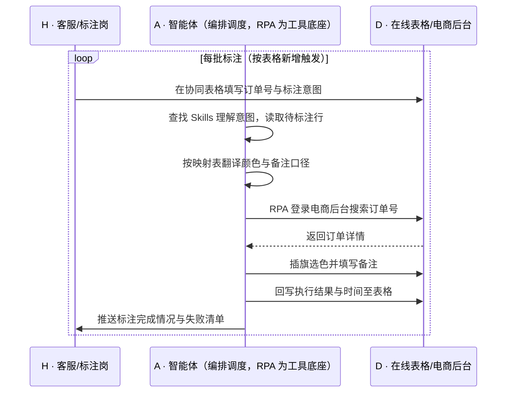

> 电商后台用不同颜色的旗子标记订单需求（买家秀、物流、改颜色、定制单、加赠品……），但每个商家对颜色的定义都不一样，客服每天要对着几百上千笔订单手动插旗、写备注——耗时不说，订单量大时还容易漏标、错标，后面仓储、客服、运营全靠这面旗子协同，标错了就是一连串返工。本方案用智能体调度「八爪鱼 RPA、各电商后台、在线表格」协同执行：客服在表格里填好订单号与标注意图…

> Agent 自动化需开通企业功能
> 点击申请1个月免费权限
> [点击申请 →](https://skieer.feishu.cn/share/base/form/shrcnFwMayykP5iaL38fnZKTbrg)

## 一、用户与需求

核心矛盾：

- 各商家对旗帜颜色定义不统一，新人上手要背"颜色表"，交接成本高
- 客服每天手动对数百上千笔订单插旗备注，单笔要"搜索-点旗-选色-写备注"四步，耗时过长
- 订单量大时漏标、错标频发，仓储与客服按错标信息执行，造成二次返工
- 多平台（后台操作路径不同，客服需在多个系统间切换
- 插旗结果无统一台账，谁标了、标没标、标得对不对，主管无法核查

适用客户：日均订单量在数百单以上、依赖旗帜做内部协同的电商团队，涵盖服饰、美妆、3C、家居等类目；**已用在线表格做订单协同的客户**，本方案直接在现有协同表上加一列"标注意图"即可跑起来；**尚未建协同表的客户**，可用本方案随附的表格模板起步。部署后由实施方一次性配置各平台操作路径与颜色映射，客服人员日常不需要写代码，只需在表格里写清楚要标什么。

### 1.1 不同模式卖家

| 类型 | 选择 | 建议 |
|-|-|-|
| 多平台多店铺卖家 | 首选 | 强烈推荐——平台越多、店铺越多，重复操作量越大 |
| 单平台中大卖家（日单数百以上） | 首选 | 强烈推荐——订单量大，漏标错标风险最高 |
| 单平台小卖家（日单百单内） | 次选 | 一般推荐——量小可人工，但可作为规范化的起点 |
| 纯代发/无内部协同需求 | 不做 | 无仓储与客服的旗标协同场景 |

### 1.2 不同类目卖家

| 类目 | 最关注维度 | 核心逻辑 |
|-|-|-|
| 服饰/鞋包 | 改色改码 | 买家改规格需求多，需标给仓储优先处理 |
| 美妆/个护 | 加赠品 | 赠品与主品搭配出错率高，需明确标示 |
| 3C/数码 | 定制与刻字 | 定制单需单独标识，避免按标准品发货 |
| 家居/大件 | 物流特殊要求 | 需标"送货上门/预约配送"等物流要求 |
| 母婴 | 买家秀邀约 | 需筛选优质订单做买家秀与口碑运营 |
| 食品/快消 | 大促熔断 | 大促期需按优先级标识订单，保障时效 |

### 1.3 不同角色用户

| 用户 | 需求 | 问题 | 投入时间（估算） |
|-|-|-|-|
| 客服/订单标注岗 | 快速完成插旗备注 | 逐单四步操作，量大时手不停 | 2-4 小时/天 |
| 仓储/发货岗 | 拿到标注准确的订单 | 标错就得返工，影响发货时效 | 依赖上游准确性 |
| 客服主管 | 核查标注是否到位 | 无台账，只能抽查 | 1 小时/天抽查 |
| 运营 | 按旗标筛选订单做运营 | 标注缺失导致筛选结果不全 | 按需 |

---

## 二、现在的方法与问题

### 2.1 流程步骤与问题总结

| 序号 | 步骤 | 现在的方法 | 问题缺陷 |
|-|-|-|-|
| 1 | 汇总待标注订单 | 客服从群消息、表格、聊天记录里收集 | 信息分散，漏单 |
| 2 | 打开后台搜索订单 | 逐个在电商后台搜索订单号 | 单量大时搜索耗时长 |
| 3 | 插旗选色 | 人工点击旗帜并选择颜色 | 颜色定义易记混，错标 |
| 4 | 填写备注 | 手工输入或复制粘贴备注 | 备注口径不一，仓储理解偏差 |
| 5 | 反馈结果 | 口头或在群里说一声 | 无台账，无法核查完整率 |

### 2.2 问题分析

| 序号 | 根因 | 具体表现 |
|-|-|-|
| 1 | 颜色定义因人而异、无统一标准 | 新人靠记忆或口口相传，错标率高 |
| 2 | 操作路径深且重复 | 每单"搜索-点旗-选色-写备注"四步，无法批量 |
| 3 | 多平台操作方式不统一 | 淘宝/京东后台结构不同，切换成本高 |
| 4 | 标注需求来源分散 | 需求来自群、表格、聊天多处，汇总易漏 |
| 5 | 无结果留痕 | 是否标完、标得对不对，主管无法核查 |

## 三、解决方案

### 3.1 功能概述

为多平台电商团队打造的"订单自动插旗备注"方案：一句话调度「在线表格 + 各电商后台」，按表格中的标注意图，自动完成多平台订单的插旗、选色与备注填写，并把执行结果回写表格形成台账。

一句话下达指令（如「把今天表里这批订单按标注列插旗备注」），智能体通过查找 Skills 文档库理解意图、匹配 5 个 RPA 自动化任务（读取表格标注需求 → 登录各平台搜索订单 → 插旗选色 → 填写备注 → 回写执行结果），经 MCP 调度八爪鱼 RPA 执行，最后生成标注完成情况报告。全程自动化，运行状态实时反馈，跑完推送结果。

### 3.2 系统结合

| 要素 | 说明 |
|-|-|
| 客户现有工具盘点 | 商家通常已使用电商后台（淘宝/京东等，承载订单与旗帜功能）、在线表格（订单协同与分工）；表格里有人工填写的需求，后台里是操作动作，两者之间靠客服搬运 |
| 数据/能力来源 | 标注需求来自**协同表格**（客服填写）；订单与旗标操作在**各电商后台**完成；执行结果回写表格；颜色与备注口径由商家统一的映射表定义 |
| RPA 耦合动作 | 作为 Agent 的工具底座被调度执行：读取表格标注需求 → 登录各平台后台搜索订单号 → 点击旗帜按映射选色 → 填写备注 → 回写执行结果与时间 |
| 耦合出的新价值 | 表格只管记录、电商后台只管操作——单系统都无法完成"需求到执行再到留痕"的闭环。本方案交付的是**标注口径统一、执行零遗漏、结果可核查的插旗能力，只推送**标注完成情况与失败清单 |

### 3.3 智能体执行流程

支持按批次触发（客服整理好表格即跑一次），也可定时轮询表格新增行；入参：协同表格、颜色映射表、目标平台与店铺。

> Agent 自动化需开通企业功能
> 点击申请1个月免费权限
> [点击申请 →](https://skieer.feishu.cn/share/base/form/shrcnFwMayykP5iaL38fnZKTbrg)

### 3.4 为何这么设计

要同时回答三个问题：**为什么不能只用纯代码 Agent？为什么不能只用纯 RPA？为什么两者要结合？** 本场景的核心是"多平台后台的重复界面操作"——插旗、选色、写备注本质上必须在电商后台完成，且各平台结构不同、量大且高频。

#### 1）逐项对比

| 对比维度 | 纯代码 Agent（Codex 等） | 纯 RPA（八爪鱼） | 智能体+RPA（MCP 结合） |
|-|-|-|-|
| 实现方式 | 调平台开放接口批量打标 | 可视化配置各平台插旗流程 | 智能体读取需求与口径，RPA 执行界面操作 |
| 多平台登录与取数 | 需平台开放打标接口，多数不提供 | 平台沉淀淘宝/京东等操作模板 | RPA 覆盖多平台操作，智能体负责调度 |
| 风控与多账号隔离 | 自建频次与账号风控 | 内置频率控制与多店铺账号隔离 | 沿用平台能力，异常自动降频 |
| 清洗与入库 | 自写需求解析与结果统计 | 擅长操作，需求解析能力弱 | 智能体解析表格需求、统一口径、统计结果 |
| 使用成本（总拥有成本） | 无订阅费，但接口不开放则不可行 | 订阅费 + 常开电脑/云机成本 | 订阅费 + 一次性配置，颜色映射调整改技能即可 |
| 维护人要求 | 需开发能力，平台改版需改码 | 业务人员可维护模板 | 业务人员可维护映射表与备注模板 |

#### 2）优劣势说明

|  | 纯代码 Agent | 纯 RPA | 智能体+RPA |
|-|-|-|-|
| 优势 | 无订阅费、批量打标逻辑可定制 | 多平台操作模板沉淀、执行稳定、可定时 | 需求解析与口径统一由智能体承担，RPA 只做机械动作，错误率最低 |
| 劣势 | 平台无打标接口，方案难落地 | 缺需求解析能力，需人工把需求整理成固定格式 | 需一次性配置投入，颜色映射需与业务确认清楚 |

**特别提醒**：插旗与备注属于在电商后台的**写入操作**，本方案仅在商家授权的自有店铺内执行，且按平台频率限制运行；备注内容由商家统一口径维护，账号与操作合规责任由使用方承担。另需注意：各平台对"旗帜/标记"功能支持程度不同（如淘宝、京东为旗帜，部分平台为订单备注标记），落地时以各平台实际功能为准。

#### 3）结论

| 论点 | 说明 |
|-|-|
| 确定性 vs 生成性 | 搜索订单、点旗、选色、写备注是确定性操作，RPA 行为可预期；生成式脚本一次性跑通不等于长期稳定 |
| 分工而非替代 | "表格里的需求是什么、该用什么颜色和备注"属判断（智能体强）；"在后台点哪儿"属操作（RPA 强） |
| 资产沉淀 | 颜色映射、备注模板、平台操作路径沉淀在技能库是活的，写在脚本里是死的 |
| 不消耗 AI token | 读表、插旗、回写为规则化流水线、不调用模型；仅表格需求解析调用模型，可用规则模板兜底控制用量 |
| 风险无豁免 | 各平台对自动化操作均有风控，方案价值在于按规则稳定执行，而非绕过限制 |
| 时间 | 客服要的是"表填完就自动标好"，不是每天手动标几百单 |

### 3.5 功能清单

| 功能 | 系统 | 功能说明（解决问题） |
|-|-|-|
| 会话/定时 | 智能体 | 1. 理解标注意图，编排多平台任务。   2. 支持按批次触发或定时轮询表格。 |
| 需求读取与解析 | 智能体 | 1. 读取协同表格中的订单号与标注意图。   2. 按映射表翻译为具体颜色与备注话术。 |
| 多平台插旗操作 | RPA | 1. 解决人工逐单"搜索-点旗-选色-写备注"的重复劳动。   2. 作为智能体工具被调度执行（含失败重试）。   3. 登录淘宝/京东等后台完成插旗与备注（以各平台实际提供的标记功能为准）。 |
| 结果回写 | RPA/智能体 | 1. 执行结果与时间回写表格。   2. 失败项标注原因，便于人工补标。 |
| 完成度核查 | 智能体 | 1. 统计标注完成率与失败清单。   2. 超时未标注订单自动提醒。 |
| IM 通知 | 智能体 | 1. 标注完成推送。   2. 登录失效、订单查不到等异常告警。 |
| 数据资产储存 | 智能体 | 1. 标注台账沉淀为数据资产与 Skills。   2. 经验知识库记录各平台操作路径与颜色口径。 |

### 3.6 智能体执行落地过程

颜色映射、备注话术、目标平台与店铺、表格结构等均为部署时一次性配置；日常客服只需往表格里填需求，其余自动完成。

**⚠️ 部署前提（不满足则方案无法跑起来）**

① 需部署常开的电脑或云机承载 RPA 运行，并配置漏跑补跑机制；② 各平台店铺账号需具备合法操作权限，登录态需保持有效，遇验证码需配套人工处理方案；③ 商家需先统一"颜色—需求"映射表与备注话术口径，否则自动化只会把混乱固化；④ 协同表格需提前建好并授权，字段与客服分工对齐；⑤ 首次配置需实施方介入一次，涉及多平台多店铺时工作量相应增加。

#### 1）配置（4 步）

| 步骤 | 操作 | 说明 |
|-|-|-|
| 第 1 步 | 在八爪鱼 RPA 创建 API-Key | 开通平台调用凭证 |
| 第 2 步 | 配置插旗备注 RPA 应用 | 按平台配置搜索路径、旗帜操作与备注填写 |
| 第 3 步 | 在智能体侧配置 MCP | 将 RPA 注册为智能体可调用的工具 |
| 第 4 步 | 封装标注 Skills | 写入颜色映射表、备注模板、店铺清单与核查口径 |

| 类别 | 说明 |
|-|-|
| 智能体 | 主流智能体 |
| 智能体工具 | 1. 自动化：八爪鱼 RPA，MCP 配置。   2. 需求解析：智能体自带。   3. 协同表格：在线表格。   4. IM：飞书/钉钉/企微。 |
| 工作知识 | 1. 店铺与账号清单。   2. 颜色—需求映射表。   3. 备注话术模板。   4. 核查与异常处理规则。 |
| 本地数据库 | 1. 标注台账库。   2. 失败与补标记录库。   3. 操作日志库。 |

#### 2）执行

| 任务 | 产出 | 产出物接收人 |
|-|-|-|
| 读取表格标注需求 | 待标注订单清单 | —— |
| 需求解析与口径翻译 | 颜色+备注执行指令 | —— |
| RPA 登录后台搜索订单 | 订单定位结果 | —— |
| 插旗选色并填写备注 | 平台操作结果 | —— |
| 回写执行结果 | 标注台账 | 客服主管 |
| 推送完成情况 | 完成率与失败清单 | 客服/标注岗 |

异常处理：

- 登录失效/验证码 → 暂停该店铺任务并告警，等待人工处理；
- 订单号查不到 → 记录并标注原因，不误标其他订单；
- 旗帜颜色与映射表不符 → 按映射表执行并记录差异，提示维护映射表；
- 备注写入失败 → 重试 2 次，仍失败则列入补标清单；
- 同一订单重复标注 → 智能体按去重规则跳过，避免覆盖已有备注。

#### 3）结果

| 结果 | 说明 |
|-|-|
| 数据资产 | 标注台账（订单、需求、颜色、备注、执行时间、结果） |
| 分析报告 | 1. 标注完成率。   2. 失败与补标清单。   3. 各平台处理时效。 |
| Skills | 沉淀的颜色映射、备注模板与多平台操作预设技能资产 |

> Agent 自动化需开通企业功能
> 点击申请1个月免费权限
> [点击申请 →](https://skieer.feishu.cn/share/base/form/shrcnFwMayykP5iaL38fnZKTbrg)

---

## 四、使用前后预估

> 本方案价值 = **人工逐单插旗 → 表格填完自动执行 → 口径统一零遗漏**。把客服从"搜索-点旗-选色-写备注"的重复操作中解放出来，让订单标注从"看人仔细不仔细"变成"按映射表稳定执行"。

| 指标 | 人工 | 纯代码 Agent | 智能体+自动化工具 |
|-|-|-|-|
| 处理速度 | 2-4 小时/天，单笔四步 | 无打标接口则不可行 | 案例口径：速度提升 95+% |
| 标注准确性 | 靠人记忆颜色，易错标 | — | 按映射表执行（案例口径：标注/备注 0 误差） |
| 平台覆盖 | 需在多平台间切换，效率低 | — | 覆盖淘宝/京东等主流平台 |
| 需求汇总 | 来自群、表格、聊天，易漏 | — | 统一从协同表格读取，不漏单 |
| 结果核查 | 无台账，只能抽查 | 需自建日志 | 台账齐全，完成率可核查 |
| 沉淀 | 颜色表在人脑里 | 代码即资产，人走即失 | 映射表+模板+台账三层沉淀 |

说明：数据取自八爪鱼应用案例口径（标注/备注 0 误差、速度提升 95+%、支持主流电商平台），实际效果随订单量、平台数量与映射表规范程度变化；人工耗时为客服岗位口径估算。

---

## 六、备注

### 6.1 Agent 支持

本方案不绑定具体智能体，主流 Agent 均可运行（**需支持 MCP 连接、技能/Skills 加载与工具调用**）：

| Agent/智能体 | 说明 |
|-|-|
| Workbuddy | 本方案运行平台，支持技能/Skills 上传加载、定时任务、MCP 工具调用与表格/报告处理 |
| 豆包（国内·字节） | 国内主流个人智能体，支持技能上传、定时任务与工具调用，上手成本低 |
| 通义千问（国内·阿里） | 支持 Agent 编排与插件生态，集成阿里电商数据能力，适合电商场景 |
| DeepSeek（国内） | 推理能力强、成本低，适合规则判断与归因分析类任务 |
| ChatGPT（国外·OpenAI） | 海外主流通用智能体，支持 GPTs/Agent 模式与工具调用 |
| Claude（国外·Anthropic） | 长文本与结构化分析能力强，原生支持 MCP 连接外部工具 |

### 6.2 名词解释

| 术语 | 说明 |
|-|-|
| 插旗 | 电商后台用彩色旗帜标记订单状态的通用功能，是内部协同的信号 |
| 颜色映射表 | 商家自定义的"旗帜颜色—业务需求"对应关系，如红旗=加急、蓝旗=买家秀 |
| 备注 | 在订单上填写的文字说明，供仓储与客服执行时参考 |
| 订单号 | 平台内定位订单的唯一编号，是执行标注的必要参数 |
| 协同表格 | 客服与仓储共同维护的在线表格，承载需求分发与结果记录 |
| 回写 | 将执行结果写回来源表格的动作，形成台账 |
| 补标清单 | 执行失败、需人工补做的订单集合 |
| 去重 | 对已标注订单不再重复操作，避免覆盖已有备注 |
| 定制单 | 需要刻字、改色、改尺寸等个性化处理的订单 |
| 熔断 | 大促期按优先级临时调整订单处理顺序的机制 |
| 买家秀 | 买家收到商品后发布的实拍内容，是店铺口碑运营的素材来源 |
| MCP | 模型上下文协议，让智能体以标准方式调用外部工具（如 RPA）的接口规范 |

> Agent 自动化需开通企业功能
> 点击申请1个月免费权限
> [点击申请 →](https://skieer.feishu.cn/share/base/form/shrcnFwMayykP5iaL38fnZKTbrg)

---

原文：[查看原文](https://skieer.feishu.cn/wiki/XdgawvMx7iQ8zVk3gKlcbCtwnRM)
