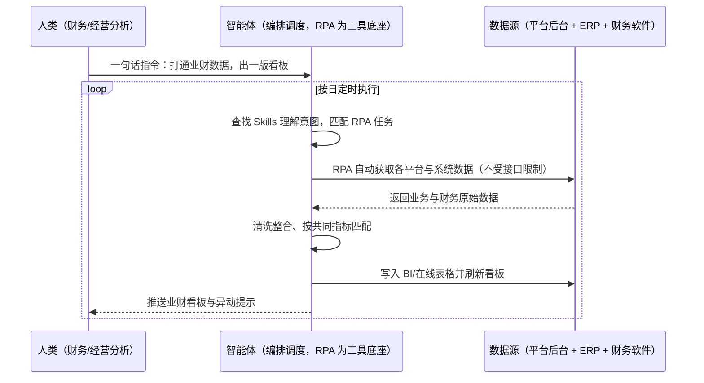

> 为电商企业打造的业财一体化 BI 看板方案。电商平台多、系统多，很多平台与软件没有开放数据接口，全域数据整合不了，业务数据与财务数据各行其道，形成业财分离，老板想看经营真相要等人工汇总。本方案由智能体调度多个工具执行多平台多系统数据自动获取（不受接口限制）+ 共同指标匹配与清洗整合 + 自动传输至可视化系统，输出业财一体化 BI 看板与经营指标日报。按日定时执行，全程自动化，无异常不打扰。

> Agent 自动化需开通企业功能
> 点击申请1个月免费权限
> [点击申请 →](https://skieer.feishu.cn/share/base/form/shrcnFwMayykP5iaL38fnZKTbrg)

## 一、用户与需求

核心矛盾：

- 接口缺失整合不了：很多平台/软件没有开放数据接口，无法做到全域数据整合（案例口径）
- 业财两张皮：业务数据（订单/销量/流量）与财务数据（资金/成本/利润）分散在不同系统，口径不通
- 老板要数据靠人等：想看 GMV、退款、利润等核心指标，只能等人工汇总（案例口径）
- 人工整合易失真：手工拼表口径不一，数据滞后且信息失真

适用客户：多平台多系统经营、需要业财一体化看板的电商企业（财务/经营分析/管理层）。已用 BI 工具的客户由本方案补数据接入与指标匹配；无 BI 的客户可先用在线表格承接；部署后业务人员不需要写代码，一句话下达指令即可执行。

### 1.1 不同规模商家

| 类型 | 选择 | 建议 |
|-|-|-|
| 品牌企业（多平台多系统） | 首选 | 强烈推荐（系统越多，整合价值越大） |
| 成长型商家 | 首选 | 强烈推荐（无数据团队，最需要一体化看板） |
| 单平台商家 | 次选 | 一般推荐（先跑财务核心指标看板） |

### 1.2 不同类目商家

| 类目 | 最关注维度 | 核心逻辑 |
|-|-|-|
| 美妆个护 | 渠道利润 | 渠道多、费用杂，要看单渠道真实盈利 |
| 3C 数码 | 资金周转 | 备货占资金大，现金流与库存周转强相关 |
| 家居家具 | 大额应收应付 | 大件结算周期长，应收应付要盯紧 |
| 食品生鲜 | 履约成本 | 履约与损耗成本影响净利 |
| 服装鞋帽 | 库存占用 | 季末库存占资金，需与利润联动看 |
| 小家电 | 多主体税务 | 多平台多主体，税负与经营要一起看 |

### 1.3 不同角色用户

| 用户 | 需求 | 问题 | 投入时间（估算） |
|-|-|-|-|
| 老板/管理层 | 经营真相 | 数据分散，看不到公司维度指标 | 每次要看数都得催 |
| 财务专员 | 数据整合 | 逐系统导出整合，费时易错 | 每日 2-3 小时 |
| 经营分析 | 口径统一 | 业务与财务口径不一致 | 每次分析前先对口径 |

---

## 二、现在的方法与问题

### 2.1 流程步骤与问题总结

| 序号 | 步骤 | 现在的方法 | 问题缺陷 |
|-|-|-|-|
| 1 | 逐个系统取数 | 人工登录各平台与系统导出 | 系统多、无接口，只能手工 |
| 2 | 整理业务数据 | 手工合并订单/销量/流量表 | 表头口径不一，易错 |
| 3 | 整理财务数据 | 人工导出资金/成本/费用 | 与业务数据对不上 |
| 4 | 指标匹配 | 人工按合同号/日期/店铺匹配 | 匹配规则靠人脑 |
| 5 | 制作看板 | 手工做图表 | 每次重做，时效滞后 |
| 6 | 汇报决策 | 会上看滞后数据 | 决策滞后且不可追溯 |

### 2.2 问题分析

人工方式根因

| 序号 | 根因 | 具体表现 |
|-|-|-|
| 1 | 无接口可用 | 平台不开放接口，只能人工搬数据 |
| 2 | 业务财务两张表 | 口径不通，指标对不上 |
| 3 | 无统一主键 | 匹配靠人工判断，易错 |

**系统工具方式根因**

| 序号 | 根因 | 具体表现 |
|-|-|-|
| 1 | BI 只管展示 | 数据从哪来、谁来洗仍靠人工 |
| 2 | 接口覆盖有限 | 长尾平台与老系统取不到数 |
| 3 | 指标口径不沉淀 | 换人对口径，看板随时变样 |

---

## 三、解决方案

### 3.1 功能概述

为电商企业打造的业财一体化 BI 看板方案，一句话调度多平台数据获取 + 业务财务指标匹配 + 自动入可视化系统，输出业财一体 BI 看板与核心指标日报。

一句话下达指令（如「把业务和财务数据打通，出一版业财看板」），智能体通过查找 Skills 文档库理解意图、匹配 N 个 RPA 自动化任务（取数→清洗→匹配→入看板→推送），经 MCP 调度八爪鱼 RPA 不受接口限制，自动获取所有平台、所有系统数据并自动清洗整合，自动进行共同指标匹配，打通业务数据和财务数据，自动传输到可视化系统中形成业财一体化 BI 看板。全程自动化，运行状态实时反馈，跑完推送结果。

### 3.2 系统结合

| 要素 | 说明 |
|-|-|
| 客户现有工具盘点 | **未购 SaaS 客户**：各平台后台 + 财务软件 + Excel。       **已购 SaaS 客户**（主流）：ERP（领星/旺店通等）+ 财务软件（慧经营/金蝶等）+ BI 或在线表格 + 企业微信/飞书（通知） |
| 数据/能力来源 | 业务侧：平台后台订单/销量/流量/推广数据；财务侧：资金明细/钱包/成本/费用/税务数据；以合同号/日期/店铺/订单编号为共同匹配键（案例口径） |
| RPA 耦合动作 | 作为 Agent 的工具底座被调度执行：①解决无接口系统的取数；②被智能体调度执行清洗整合与共同指标匹配；③把结果写入 BI/在线表格并定时刷新看板 |
| 耦合出的新价值 | 单系统给不了的端到端结论：业务+财务跨源整合 + 指标口径统一 + 看板自动更新，**只推送指标异动与取数缺口** |

### 3.3 智能体执行流程

一句话下达指令，智能体自动调度；入参（平台清单、指标口径、匹配键、刷新频率）部署时一次配置：

> Agent 自动化需开通企业功能
> 点击申请1个月免费权限
> [点击申请 →](https://skieer.feishu.cn/share/base/form/shrcnFwMayykP5iaL38fnZKTbrg)

### 3.4 为何这么设计

要同时回答三个问题：**为什么不能只用纯代码 Agent？为什么不能只用纯 RPA？为什么两者要结合？** 本场景的核心是"无接口也能取数、口径能统一、看板每天自动更新"。

#### 1）逐项对比

| 对比维度 | 纯代码 Agent（Codex 等） | 纯 RPA（八爪鱼） | 智能体+RPA（MCP 结合） |
|-|-|-|-|
| 实现方式 | 调平台/财务系统接口 | 模拟人工在后台取数 | 智能体做口径匹配 + RPA 取数 |
| 多平台登录与取数 | 无接口的平台取不到 | 不受接口限制，登录即可取 | RPA 取数，智能体统一调度 |
| 风控与多账号隔离 | 接口限流与授权繁琐 | 多主体多账号需环境隔离 | 沿用隔离能力，操作留痕 |
| 清洗与入库 | 强，匹配逻辑灵活 | 弱，需定制 | 智能体统一清洗入库 |
| 使用成本（总拥有成本） | 开发维护自担 | 平台订阅一次多流程复用 | 一份订阅跑多流程，边际成本 ≈ 0 |
| 维护人要求 | 需开发，接口变动返工 | 业务可自维护流程 | 业务改口径、技术兜底 |

技术栈速览：纯代码路线需 Python 对接各平台与财务系统接口、处理授权限流、实现指标映射与看板写入；无接口的平台整条链路走不通。

#### 2）优劣势说明

|  | 纯代码 Agent（Codex 等） | 纯 RPA（八爪鱼） | 智能体+RPA（MCP 结合） |
|-|-|-|-|
| 优势 | 取数快；       计算逻辑可定制 | 不限接口、不限平台；       贴近人工操作 | 跨源整合 + 指标匹配 + 看板自动刷新 |
| 劣势 | 无接口平台取不到；       维护自担 | 口径匹配弱，需配置 | 本地电脑运行需保持开机；       后台改版需更新流程 |

**特别提醒**：看板数据用于经营决策，**财务口径（收入确认、成本归集）需与财务负责人确认一次**；本方案负责取数与匹配，不替代会计判断；涉及资金动作的结论保留人工复核。

#### 3）结论

| 论点 | 说明 |
|-|-|
| 确定性 vs 生成性 | 取数与指标计算是确定性流水线，RPA 行为可预期 |
| 资产沉淀 | 指标口径、匹配键、看板配置沉淀在平台是活的，换人接手成立 |
| 一个底座跑多流程 | 客户购买 RPA 平台是跑多个流程（看板/报表/对账），本方案只是其中一个，订阅费被摊薄 |
| 不消耗 AI token | 取数与匹配是规则化流水线，不经大模型对话，token 消耗极低 |
| 整合规模 | 案例口径：实现 10+ 平台/系统整合、自动匹配 50+ 业财报表 |
| 时间 | 老板要的是"打开就看经营真相"，不是"每次开会先催数据" |

### 3.5 功能清单

| 功能 | 系统 | 功能说明（解决问题） |
|-|-|-|
| 会话/一句话指令 | 智能体 | 1. 理解自然语言意图，查找 Skills 文档库。       2. 匹配对应 RPA 自动化任务、编排多任务。 |
| 多平台多系统取数 | RPA | 1. 解决无接口系统取数问题。       2. 作为工具被调度执行，自动获取所有平台、所有系统数据。       3. 覆盖 10+ 平台/系统。 |
| 清洗与整合 | 智能体 | 自动清洗整合数据，解决口径不一问题。 |
| 共同指标匹配 | 智能体 | 按合同号/日期/店铺/订单编号等匹配键打通业务与财务数据，解决两张皮问题。 |
| BI 看板输出 | 智能体、BI | 自动传输至可视化系统形成业财一体 BI 看板，解决手工做图表问题。 |
| 指标异动推送 | 智能体、企微 | 核心指标异动与取数缺口推送责任人，解决发现滞后问题。 |
| 数据资产储存 | 本地电脑、云储存 | 1. Skills 资产：业财看板技能。       2. 数据储存：业务库、财务库与指标库。       3. 经验知识库：口径定义与异动处置回填。 |

### 3.6 智能体执行落地过程

部署时一次性配置入参（平台清单、指标口径、匹配键、看板地址），会话中一句话即可触发，无需重复输入。

**⚠️ 部署前提（不满足则方案无法跑起来）**：①RPA 需部署在**常开电脑/云机**上，并配置漏跑补跑机制；②各平台与财务系统**登录态**需维护，多主体建议环境隔离；③指标口径与匹配键需与财务确认一次（属实施成本）；④BI/在线表格需建好数据结构并授权；⑤首次配置（口径、匹配、看板）需服务方/技术人员介入一次，属实施成本。

#### 1）配置（五步）

| 步骤 | 操作 | 说明 |
|-|-|-|
| 第一步 | 下载八爪鱼 RPA，导入电商业财自动化模板 | 官网免费下载客户端；MCP 工具→添加应用 |
| 第二步 | 开启八爪鱼 RPA 的 MCP 服务端口 | 客户端→API-K→创建 API（名称自定义） |
| 第三步 | 在智能体中添加 MCP Server 连接 | 复制连接配置→智能体连接器→自定义连接器→配置 MCP→粘贴保存 |
| 第四步 | 验证工具列表 | 确认工具全部启用（即八爪鱼客户端内工具） |
| 第五步 | 测试运行效果 | 输入一句话指令，验证取数、匹配与看板刷新 |

| 类别 | 说明 |
|-|-|
| 智能体 | 主流智能体（支持 MCP 连接、Skills 加载、定时任务）。 |
| 智能体工具 | 1. **执行通道**：多平台取数 + 清洗整合 + 匹配 + 看板写入。       2. 数据取数与自动化执行：八爪鱼 RPA（MCP 协议接入）。       3. 数据分析：智能体自带 / BI 工具。       4. IM：企业微信/飞书（MCP 或 webhook 配置）。 |
| 工作知识 | 1. 平台与系统清单。       2. 指标口径与匹配键。       3. 看板结构与刷新频率。       4. 推送对象。 |
| 本地数据库 | 1. 业务数据库地址。       2. 财务数据库地址。       3. 看板与报表存档地址。 |

#### 2）执行

| 任务 | 产出 | 产出物接收人 |
|-|-|-|
| 接收一句话指令，匹配 RPA 任务 | 任务启动记录 | —— |
| 调用已预设 Skills，编排任务流程 | 任务编排方案 | —— |
| 经 MCP 向八爪鱼 RPA 下发取数任务 | 自动化任务指令 | —— |
| 获取业务与财务数据 | 原始数据批次 | —— |
| 清洗整合与指标匹配 | 业财一体数据 | 财务/经营分析 |
| 写入 BI 并刷新看板 | 业财看板 | 管理层/财务 |
| 推送异动与缺口提示 | 群消息 | 财务/经营分析 |

异常处理：

某系统取数失败 → 跳过并记录，下轮补采，不输出半量结论；

匹配键缺失 → 该行标注"未匹配"，不计入指标；

指标跳变超阈值 → 提示复核，不直接进看板结论；

登录失效 → 自动重试 2 次，仍失败告警推 IM。

#### 3）结果

| 结果 | 说明 |
|-|-|
| 数据资产 | 业务库 + 财务库 + 指标库（含口径定义），可审计可追溯。 |
| 分析报告 | 业财一体化看板 + 核心指标日报（GMV/退款/利润/资金/库存周转）。 |
| Skills | 智能体 Skills：业财看板技能，口径按月迭代。 |

> Agent 自动化需开通企业功能
> 点击申请1个月免费权限
> [点击申请 →](https://skieer.feishu.cn/share/base/form/shrcnFwMayykP5iaL38fnZKTbrg)

---

## 四、使用前后预估

> 本方案价值 = **多源自动取数 → 业务财务口径打通 → 看板自动刷新**。把财务从逐系统搬数据中解放出来，经营真相打开就看。

| 指标 | 人工 | 纯代码 Agent | 智能体+自动化工具 |
|-|-|-|-|
| 数据整合 | 逐系统导出手工拼 | 有接口的能取，长尾取不到 | 不限接口，全量取数 |
| 口径统一 | 每次对口径 | 需自建映射维护 | 匹配键与口径统一沉淀 |
| 看板更新 | 手工做图表 | 需自建 | 自动刷新 |
| 数据时效 | 滞后数天 | 取决于调度 | 按日/按小时自动 |
| 整合规模 | 人工有限 | 取决于接口 | 案例口径：10+ 平台/系统、50+ 报表 |
| 决策方式 | 开会看滞后数据 | —— | 打开即看，异动主动提示 |

**说明**：案例数字来自八爪鱼客户实践（案例口径：不受接口限制自动获取所有平台、所有系统数据并清洗整合，自动进行共同指标匹配，打通业务与财务数据后传输至可视化系统，实现 10+ 平台/系统整合与 50+ 业财报表自动匹配；多平台核心指标监控可提升效率 80%+、数据准确性 100%）；本方案为按同口径复刻的实施路径，具体数值随系统数量与指标规模而异（估算）。

---

## 五、效果证明

> Agent 自动化需开通企业功能
> 点击申请1个月免费权限
> [点击申请 →](https://skieer.feishu.cn/share/base/form/shrcnFwMayykP5iaL38fnZKTbrg)

### 5.1 客户案例

**《小天鹅：7 平台 16 账号库存数据自动化，年省成本 50 万》**

> 美的集团旗下小天鹅事业部，7 个电商平台、16 个账号、每日 86 张报表原需专员逐个登录导出 7 小时/天。八爪鱼 RPA 替代全部人工采集，7 大系统、25 类报表自动采集入库。

| 效果 | 说明 |
|-|-|
| 提效 | 多平台报表采集效率提升约 85%。原本 7 个平台 16 个账号、86 张报表需逐个登录导出，每天耗 7 小时，现在全自动采集入库；数据时效由 T+2 提升至 T+1，部分平台已 T+0。 |
| 降本 | 减少数据专员 2 人（原文：2 名全职数据专员的「搬数据」工作被完全替代，年节省人力成本 50 万元）。原本需 2 人全职导表，现在 0 人；2 名专员转岗至数据分析岗，投入库存分析、周转率优化、滞销品预警等高价值工作。 |
| 任务 | 7 个电商平台 16 个账号、25 类报表自动采集入库；错误率降至 0.1%。 |
| 任务 | 天猫指纹浏览器、苏宁每 2 小时定时抓取、京东按事业部隔离账号，多平台差异化策略稳定运行。 |

案例详情：[小天鹅：百亿级洗衣机巨头的多平台库存数据自动化实践](https://skieer.feishu.cn/wiki/Q6Qjw2FtDiNFgWkOVHacEFJ0nlh)

**《大疆：十余平台 × 7 大类营销与客服数据自动采集》**

> 十余个国内外电商平台与社媒渠道，直播、评论、客服会话、搜索等非结构化数据原需大量人力处理。RPA 完成十余个系统、7 大类核心数据自动采集入库。

| 效果 | 说明 |
|-|-|
| 提效 | 跨平台营销与客服数据采集效率显著提升。原本十余个平台与社媒渠道、7 大类数据需每日 5-6 小时人工导表，现在全自动采集入库，数据时效提升至 T+1。 |
| 降本 | 免除专职导表的人力投入，节约人力用于数据建模、投放复盘与客服策略分析等重点工作。 |
| 任务 | 覆盖十余个国内外电商平台与社媒渠道，含直播、评论、客服会话、搜索等 7 大类非结构化数据。 |
| 任务 | 形成全渠道统一数据底座，跨平台口径一致，供分析团队直接取用。 |

案例详情：[客服：全球无人机巨头跨平台电商与客服数据自动化采集](https://skieer.feishu.cn/wiki/OmO7wGX3yiASCBkqRsfcWPUMnOe)

---

## 六、备注

### 6.1 Agent 支持

本方案不绑定具体智能体，主流 Agent 均可运行（需支持 MCP 连接、技能/Skills 加载与工具调用）：

| Agent/智能体 | 说明 |
|-|-|
| Workbuddy | 本方案运行平台，支持技能/Skills 上传加载、定时任务、MCP 工具调用与表格/报告处理 |
| 豆包（国内·字节） | 国内主流个人智能体，支持技能上传、定时任务与工具调用，上手成本低 |
| 通义千问（国内·阿里） | 支持 Agent 编排与插件生态，集成阿里电商数据能力，适合电商场景 |
| DeepSeek（国内） | 推理能力强、成本低，适合规则打分与归因分析类任务 |
| ChatGPT（国外·OpenAI） | 海外主流通用智能体，支持 GPTs/Agent 模式与工具调用 |
| Claude（国外·Anthropic） | 长文本与结构化分析能力，原生支持 MCP 连接外部工具 |

### 6.2 名词解释

| 术语 | 说明 |
|-|-|
| 业财一体 | 业务数据与财务数据打通、口径统一、共同支撑经营决策 |
| BI 看板 | 可视化数据看板，集中呈现核心经营指标 |
| 数据孤岛 | 数据分散在各系统、彼此不通的状态 |
| 共同指标 | 业务与财务都需要且口径一致的指标（如 GMV、净利） |
| 匹配键 | 用于跨系统关联数据的字段（合同号/日期/店铺/订单编号） |
| 业财分离 | 业务与财务各管一段、数据不通、结论不一致 |
| 数据清洗 | 统一格式、去重、补全的处理过程 |
| 资金归集 | 把分散在各平台的资金统一统计与调度 |
| 库存资金占用 | 库存对应的资金沉淀规模 |
| 低频只读 | 控制访问频率、只读取不修改，降低平台风控风险 |
| MCP | Model Context Protocol，智能体连接外部工具的标准化通道 |
| Skills | 智能体可加载的预设技能资产，含流程与知识 |

> Agent 自动化需开通企业功能
> 点击申请1个月免费权限
> [点击申请 →](https://skieer.feishu.cn/share/base/form/shrcnFwMayykP5iaL38fnZKTbrg)

---

原文：[查看原文](https://skieer.feishu.cn/wiki/NcVBwmzAziBpoqkxlNIcrGz2nRh)
