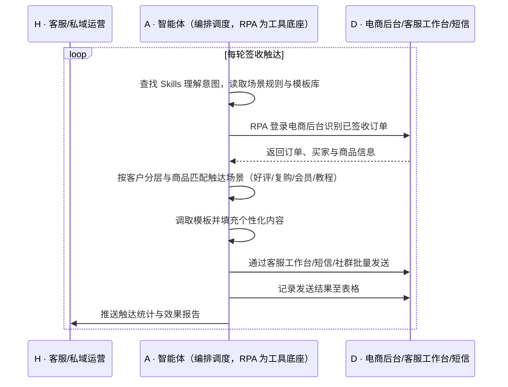

> 买家签收之后，本来是做营销最自然的窗口——邀请好评、引导复购、拉进会员、推送使用教程，但平台自带模板场景有限、覆盖不全，客服只能一条条手动跟进，一天下来发不了几条，大促后更是顾不过来；该说的没说，该邀的没邀，回头客就在沉默里流失了。本方案用智能体调度「八爪鱼 RPA、电商后台、客服工作台、短信/社群」协同执行：自动识别已签收订单，按场景调用预设模板库动态填充个性化内容（促销、会员邀请、好评邀约、使用教程等），批量触达买家并自动记录发送结果。案例口径消息送达准确率 100%、推动复购率提升 15%。定时自动执行，全程自动化，无异常不打扰。

> Agent 自动化需开通企业功能
> 点击申请1个月免费权限
> [点击申请 →](https://skieer.feishu.cn/share/base/form/shrcnFwMayykP5iaL38fnZKTbrg)

## 一、用户与需求

核心矛盾：

- 签收后是营销与口碑运营的黄金窗口，但客服精力都在处理问题，主动触达无暇顾及
- 平台自带消息模板场景有限，无法覆盖促销、会员、好评、教程等多样化需求
- 客服需逐个找到订单、复制买家信息、挑选话术再发送，一条消息多步操作
- 触达场景多（工单状态、关键词回复、物流同步、安装教程），人工难以全覆盖
- 是否发送、发送给谁、效果如何，无统一记录，运营动作无法评估

适用客户：有复购属性、重视口碑与会员运营的电商品牌，涵盖美妆、母婴、食品、3C、家居等类目；**已用客服工作台做售后回访的客户**，本方案把回访从抽样式变成全量式；**一次性消费品、无复购诉求的客户**，可只启用"好评邀约 + 使用教程"两类场景。部署后由实施方一次性配置场景与模板，客服人员日常不需要写代码，只需维护话术库与查看发送结果。

### 1.1 不同模式卖家

| 类型 | 选择 | 建议 |
|-|-|-|
| 复购型品牌（美妆/母婴/食品） | 首选 | 强烈推荐——复购与口碑直接决定长期价值 |
| 高客单耐用品（3C/家电） | 首选 | 强烈推荐——使用教程与好评邀约显著降低退货与差评 |
| 大促型卖家 | 首选 | 强烈推荐——大促后签收高峰，人工完全覆盖不了 |
| 一次性消费品卖家 | 次选 | 一般推荐——可只启用好评与教程类场景 |

### 1.2 不同类目卖家

| 类目 | 最关注维度 | 核心逻辑 |
|-|-|-|
| 美妆/个护 | 复购引导 | 消耗品复购周期短，签收后触达直接带动二次购买 |
| 母婴 | 使用指导 | 新手父母对使用方法敏感，教程触达降低退货与差评 |
| 3C/数码 | 好评与配件 | 高客单需好评背书，配件复购机会大 |
| 家居/家电 | 安装教程 | 安装不当易引发差评，主动推送教程价值高 |
| 食品/快消 | 促销触达 | 消耗快、复购频，适合周期性促销提醒 |
| 服饰/鞋包 | 会员入会 | 通过入会沉淀客户，提升复购与客单 |

### 1.3 不同角色用户

| 用户 | 需求 | 问题 | 投入时间（估算） |
|-|-|-|-|
| 客服/私域运营 | 全量触达签收客户 | 逐个发送，量大时只能抽样 | 2-3 小时/天 |
| 会员运营 | 拉新入会与复购引导 | 缺少自动化触达手段 | 1-2 小时/天 |
| 客服主管 | 评估触达效果 | 无发送记录与效果数据 | 1 小时/天复盘 |
| 老板 | 复购率与好评率 | 口碑增长靠自然发生 | 看报表决策 |

---

## 二、现在的方法与问题

### 2.1 流程步骤与问题总结

| 序号 | 步骤 | 现在的方法 | 问题缺陷 |
|-|-|-|-|
| 1 | 找出已签收订单 | 人工按物流状态筛选订单 | 逐页翻找耗时，覆盖不全 |
| 2 | 匹配触达场景 | 人工判断该发什么 | 场景多易混，遗漏高频 |
| 3 | 选择/改写话术 | 手工复制模板再逐个修改 | 效率低，文案质量参差 |
| 4 | 发送消息 | 在客服工作台逐条发送 | 一条多步操作，忙时顾不上 |
| 5 | 记录结果 | 手工登记或不记 | 无台账，效果无法评估 |
| 6 | 效果复盘 | 凭感觉判断有没有用 | 无法沉淀有效话术 |

### 2.2 问题分析

| 序号 | 根因 | 具体表现 |
|-|-|-|
| 1 | 平台模板场景有限 | 无法覆盖促销、会员、教程等个性化需求 |
| 2 | 触达动作无法批量 | 每单都要"找订单-挑话术-发送"三步 |
| 3 | 场景判断依赖人工 | 什么客户该发什么内容，靠人记忆 |
| 4 | 无统一记录 | 发送情况与效果无数据支撑 |
| 5 | 精力被售后问题挤占 | 主动运营永远排在被动响应之后 |

---

## 三、解决方案

### 3.1 功能概述

为电商品牌打造的"签收后自动关怀消息"方案：一句话调度「电商后台 + 客服工作台 + 短信/社群」，自动识别签收订单并按场景批量推送个性化内容，覆盖好评邀约、复购引导、会员邀请、使用教程等场景。

一句话下达指令（如「给昨晚签收的订单发好评邀约和安装教程」），智能体通过查找 Skills 文档库理解意图、匹配 6 个 RPA 自动化任务（识别签收订单 → 匹配触达场景 → 调取模板并个性化填充 → 批量发送 → 记录发送结果 → 生成触达统计），经 MCP 调度八爪鱼 RPA 执行，最后生成触达效果报告。全程自动化，运行状态实时反馈，跑完推送结果。

### 3.2 系统结合

| 要素 | 说明 |
|-|-|
| 客户现有工具盘点 | 商家通常已使用**电商后台（订单与签收状态）、客服工作台（旺旺/飞鸽等触达入口）、短信/社群渠道**（私域触达）；模板库多为平台自带且场景有限 |
| 数据/能力来源 | 签收状态取自**电商后台**；触达走**客服工作台与短信/社群**；话术来自商家维护的**模板库**；发送结果回写表格；场景规则由运营定义 |
| RPA 耦合动作 | 作为 Agent 的工具底座被调度执行：识别已签收订单 → 按客户与商品匹配触达场景 → 调取模板并个性化填充 → 多渠道批量发送 → 记录发送结果 |
| 耦合出的新价值 | 后台只管订单状态、平台模板只管有限场景——单系统都无法完成"识别-匹配-个性化-全量触达-留痕"的闭环。本方案交付的是**签收即触达、场景全覆盖、结果可评估的关怀能力，只推送**触达结果与效果统计 |

### 3.3 智能体执行流程

每日定时触发，可按签收时间分批；入参：签收时间段、场景规则、模板库、触达渠道。

> Agent 自动化需开通企业功能
> 点击申请1个月免费权限
> [点击申请 →](https://skieer.feishu.cn/share/base/form/shrcnFwMayykP5iaL38fnZKTbrg)

### 3.4 为何这么设计

要同时回答三个问题：**为什么不能只用纯代码 Agent？为什么不能只用纯 RPA？为什么两者要结合？** 本场景的核心是"场景判断 + 全量批量触达"，判断需要理解客户与商品，触达必须在平台会话界面上完成。

#### 1）逐项对比

| 对比维度 | 纯代码 Agent（Codex 等） | 纯 RPA（八爪鱼） | 智能体+RPA（MCP 结合） |
|-|-|-|-|
| 实现方式 | 调平台消息接口批量发送 | 可视化配置筛选订单与发送流程 | 智能体做场景匹配与内容生成，RPA 执行发送 |
| 多平台登录与取数 | 需平台开放消息与订单接口 | 平台沉淀电商后台与客服工作台模板 | RPA 覆盖取数与发送，智能体负责调度 |
| 风控与多账号隔离 | 自建频次与账号管理 | 内置频率控制与多账号隔离 | 沿用平台能力，异常降频告警 |
| 清洗与入库 | 自写场景规则与效果统计 | 擅长操作，场景判断能力弱 | 智能体做客户分层、场景匹配与效果统计 |
| 使用成本（总拥有成本） | 无订阅费，但接口不开放则不可行 | 订阅费 + 常开电脑/云机成本 | 订阅费 + 一次性配置，话术调整改技能即可 |
| 维护人要求 | 需开发能力，话术变更需改码 | 业务人员可维护模板 | 运营可自行维护话术库与场景规则 |

#### 2）优劣势说明

|  | 纯代码 Agent | 纯 RPA | 智能体+RPA |
|-|-|-|-|
| 优势 | 无订阅费、批量逻辑可深度定制 | 覆盖多平台会话入口、可定时批量、发送留痕 | 场景匹配与个性化由智能体承担，RPA 负责触达，覆盖面与效率最高 |
| 劣势 | 多数平台消息接口未开放 | 缺场景判断，容易对所有客户发同一套话术 | 需一次性配置投入，触达受平台频次与内容规范约束 |

**特别提醒**：签收后触达属于**主动服务与营销消息**，需遵守平台对频次与内容的规范，避免骚扰式群发；短信渠道涉及费用与合规，买家联系方式的使用需获得授权。话术应由运营审核，账号与合规责任由使用方承担。

#### 3）结论

| 论点 | 说明 |
|-|-|
| 确定性 vs 生成性 | 筛选订单、调用模板、发送消息是确定性操作，RPA 可预期可留痕；生成式脚本难以长期稳定覆盖多平台入口 |
| 分工而非替代 | "该给谁发、发什么"属判断（智能体强）；"在会话窗口发出去"属操作（RPA 强） |
| 资产沉淀 | 场景规则、话术模板、客户分层策略沉淀在技能库是活的，写在脚本里是死的 |
| 不消耗 AI token | 筛选、匹配、发送为规则化流水线、不调用模型；仅个性化内容生成调用模型，可用模板变量+批量生成控制用量 |
| 风险无豁免 | 平台对主动消息有频次与内容限制，方案价值是在规则内把触达做全做准 |
| 时间 | 运营要的是"签收即触达、场景不漏"，不是每天手动发几十条 |

### 3.5 功能清单

| 功能 | 系统 | 功能说明（解决问题） |
|-|-|-|
| 会话/定时 | 智能体 | 1. 理解触达意图，编排识别-匹配-发送任务。  
2. 每日定时触发，可按签收时间分批。 |
| 签收订单识别 | RPA | 1. 解决人工按物流状态筛选订单的问题。  
2. 作为智能体工具被调度执行（含失败重试）。  
3. 登录电商后台识别已签收订单与买家信息。 |
| 场景匹配 | 智能体 | 1. 按客户分层与商品类型匹配触达场景（好评邀约/复购引导/会员邀请/使用教程/物流告知）。  
2. 避免同一客户短期内重复打扰。 |
| 模板库与个性化 | 智能体 | 1. 调用预设模板库并动态填充个性化内容（昵称、商品、优惠、教程链接）。  
2. 覆盖平台模板无法覆盖的场景。 |
| 多渠道触达 | RPA | 1. 解决逐条手工发送的效率问题。  
2. 通过客服工作台、短信、社群批量发送。 |
| 发送结果记录 | 智能体 | 1. 记录发送结果与时间，确保不遗漏。  
2. 失败项列入补发清单。 |
| IM 通知 | 智能体 | 1. 触达统计推送运营主管。  
2. 登录失效、发送异常告警。 |
| 数据资产储存 | 智能体 | 1. 触达台账与话术效果沉淀为数据资产与 Skills。  
2. 经验知识库记录有效话术与场景策略。 |

### 3.6 智能体执行落地过程

场景规则、话术库、客户分层、触达渠道与频次等均为部署时一次性配置；日常自动触发，无需重复输入，只需维护话术与查看效果。

**⚠️ 部署前提（不满足则方案无法跑起来）**

① 需部署常开的电脑或云机承载 RPA 运行，并配置漏跑补跑机制；② 电商后台与客服工作台账号需具备合法操作权限，登录态需保持有效；③ 话术库需由运营维护并审核，符合平台内容规范；④ 短信渠道需符合通信合规要求，买家联系方式使用需获得授权；⑤ 首次配置需实施方介入一次，场景与渠道越多工作量相应增加。

#### 1）配置（4 步）

| 步骤 | 操作 | 说明 |
|-|-|-|
| 第 1 步 | 在八爪鱼 RPA 创建 API-Key | 开通平台调用凭证 |
| 第 2 步 | 配置签收触达 RPA 应用 | 配置订单筛选、工作台发送、短信与社群触达流程 |
| 第 3 步 | 在智能体侧配置 MCP | 将 RPA 注册为智能体可调用的工具 |
| 第 4 步 | 封装关怀 Skills | 写入场景规则、话术库、客户分层与频次控制口径 |

| 类别 | 说明 |
|-|-|
| 智能体 | 主流智能体 |
| 智能体工具 | 1. 自动化：八爪鱼 RPA，MCP 配置。  
2. 场景匹配与内容生成：智能体自带。  
3. 触达：客服工作台/短信/社群。  
4. 台账：Excel/在线表格。 |
| 工作知识 | 1. 店铺与账号清单。  
2. 场景匹配规则与客户分层。  
3. 话术模板库。  
4. 发送频次与静默规则。 |
| 本地数据库 | 1. 触达台账库。  
2. 话术效果统计库。  
3. 失败补发记录库。 |

#### 2）执行

| 任务 | 产出 | 产出物接收人 |
|-|-|-|
| 定时触发触达 | 任务启动记录 | —— |
| RPA 识别签收订单 | 签收订单清单 | —— |
| 场景匹配与内容生成 | 触达内容清单 | —— |
| 批量发送 | 发送结果记录 | 买家 |
| 记录发送结果 | 触达台账 | 客服/运营主管 |
| 推送效果统计 | 触达与效果报告 | 运营/管理层 |

异常处理：

- 登录失效/验证码 → 暂停任务并告警，等待人工处理；
- 发送失败（限流/号码无效）→ 自动降频重试或切换渠道，仍失败列入补发清单；
- 同一个客户短期重复命中多场景 → 按优先级只发一条，避免骚扰；
- 买家已退款/投诉中 → 跳过营销类内容，避免激化矛盾；
- 教程链接失效 → 记录并告警，改用备用链接。

#### 3）结果

| 结果 | 说明 |
|-|-|
| 数据资产 | 触达台账（订单、客户、场景、话术、渠道、结果），支持效果分析 |
| 分析报告 | 1. 触达覆盖率与送达率。  
2. 各场景效果对比。  
3. 复购与好评转化情况。 |
| Skills | 沉淀的场景匹配、话术库与渠道策略预设技能资产 |

> Agent 自动化需开通企业功能
> 点击申请1个月免费权限
> [点击申请 →](https://skieer.feishu.cn/share/base/form/shrcnFwMayykP5iaL38fnZKTbrg)

---

## 四、使用前后预估

> 本方案价值 = **被动等问题、偶尔手动回访 → 签收即全量触达 → 复购与口碑自动经营**。把客服从"找订单、挑话术、逐条发"的重复劳动中解放出来，让售后触达从"顾不上"变成"每单都到位"。

| 指标 | 人工 | 纯代码 Agent | 智能体+自动化工具 |
|-|-|-|-|
| 触达覆盖 | 2-3 小时/天，只能抽样 | 需平台开放消息接口 | 签收订单全量自动触达 |
| 场景覆盖 | 受平台模板限制 | 需逐个场景编码 | 案例口径：覆盖全部触达场景需求 |
| 送达准确 | 人工复制易错对象 | 依赖脚本逻辑 | 案例口径：消息送达准确率 100%（受渠道可达性影响） |
| 复购提升 | 无主动经营 | — | 案例口径：推动复购率提升 15% |
| 发送留痕 | 无台账 | 需自建日志 | 台账齐全，效果可评估 |
| 沉淀 | 好话术留在个人手里 | 代码即资产，人走即失 | 话术库+分层策略+台账三层沉淀 |

说明：数据取自八爪鱼应用案例口径（消息送达准确率 100%、推动复购率提升 15%），实际效果随类目复购属性、话术质量与触达频次变化；人工耗时为运营岗位口径估算。

---

## 六、备注

### 6.1 Agent 支持

本方案不绑定具体智能体，主流 Agent 均可运行（**需支持 MCP 连接、技能/Skills 加载与工具调用**）：

| Agent/智能体 | 说明 |
|-|-|
| Workbuddy | 本方案运行平台，支持技能/Skills 上传加载、定时任务、MCP 工具调用与表格/报告处理 |
| 豆包（国内·字节） | 国内主流个人智能体，支持技能上传、定时任务与工具调用，上手成本低 |
| 通义千问（国内·阿里） | 支持 Agent 编排与插件生态，集成阿里电商数据能力，适合电商场景 |
| DeepSeek（国内） | 推理能力强、成本低，适合规则判断与归因分析类任务 |
| ChatGPT（国外·OpenAI） | 海外主流通用智能体，支持 GPTs/Agent 模式与工具调用 |
| Claude（国外·Anthropic） | 长文本与结构化分析能力强，原生支持 MCP 连接外部工具 |

### 6.2 名词解释

| 术语 | 说明 |
|-|-|
| 签收 | 买家确认收到包裹的状态，是售后营销窗口的起点 |
| 触达场景 | 针对不同客户与商品状态设置的沟通目的（好评、复购、会员、教程等） |
| 模板库 | 商家维护的话术集合，按场景分类存放并支持变量填充 |
| 个性化填充 | 将昵称、商品名、优惠信息等变量写入模板，使话术因人而异 |
| 客户分层 | 按购买频次、客单价、会员状态等将客户分组，以匹配不同话术 |
| 会员邀请 | 引导买家加入品牌会员体系的消息 |
| 好评邀约 | 邀请满意客户发布评价或买家秀的消息 |
| 使用教程 | 商品安装与使用的指导内容，常以图文或视频形式推送 |
| 送达率 | 成功送达到买家渠道的消息占比 |
| 频次控制 | 限制同一客户在单位时间内接收消息数量的规则 |
| 静默规则 | 特定时间或特定客户状态下不发送消息的策略 |
| MCP | 模型上下文协议，让智能体以标准方式调用外部工具（如 RPA）的接口规范 |

> Agent 自动化需开通企业功能
> 点击申请1个月免费权限
> [点击申请 →](https://skieer.feishu.cn/share/base/form/shrcnFwMayykP5iaL38fnZKTbrg)

---

原文：[查看原文](https://skieer.feishu.cn/wiki/FOE4wMGpViiO2BkjfQ9cwx6Tndh)
