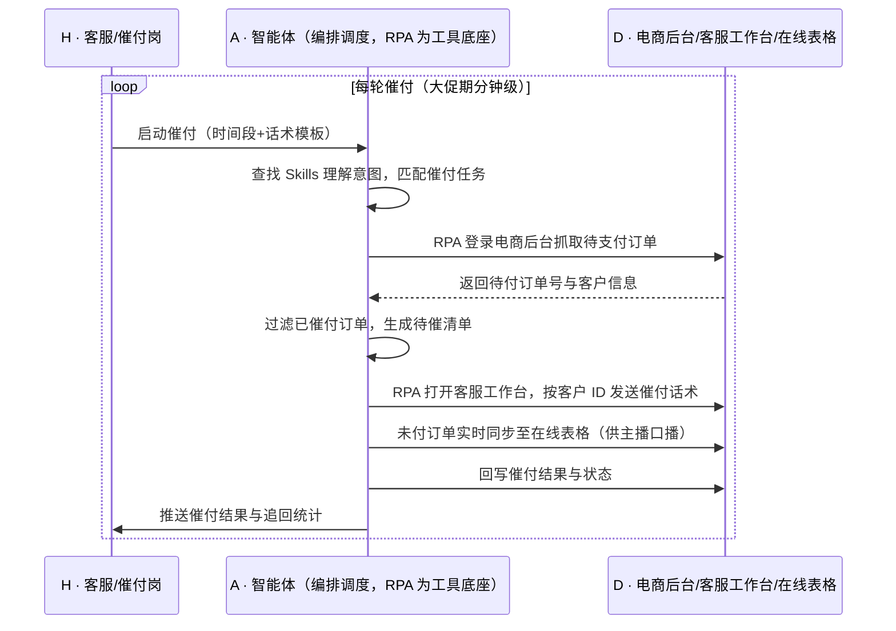

> 大促或直播期间，客户为了锁定优惠大量下单却不马上付款，后台堆着一批"卡单客户"——离成交只差临门一脚，但流量高峰时客服人手有限，做不到 1V1 跟进催付，高意向客户就这么流失了；三五个人的团队，几分钟内要追几十上百单，人工根本追不过来。本方案用智能体调度「八爪鱼 RPA、电商后台、客服工作台（飞鸽）、在线表格」协同执行：自动抓取待支付订单，跳转客服工作台按客户 ID 批量发送催付话术，同时把未付订单实时同步到在线表格供主播口播催付。案例口径下付款率提升 30+%、5 分钟追回 63 单，人工逐个点开催付的动作全部省掉。定时自动执行，全程自动化，无异常不打扰。

> Agent 自动化需开通企业功能
> 点击申请1个月免费权限
> [点击申请 →](https://skieer.feishu.cn/share/base/form/shrcnFwMayykP5iaL38fnZKTbrg)

## 一、用户与需求

核心矛盾：

- 大促/直播期客户锁优惠大量下单不付款，卡单客户堆积，离成交只差临门一脚
- 流量高峰客服人手有限，做不到 1V1 跟进，高意向客户随之流失
- 待支付订单散落在电商后台，客服要逐个点开、复制客户 ID 再发话术，5 分钟只能处理十几单
- 主播在直播间只能凭感觉喊"记得付款"，看不到实时未付订单清单，口播催付缺乏依据
- 催付结果无记录，追回多少、谁追回的、话术效果如何，事后无法复盘

适用客户：大促/直播带货占比较高的电商团队，涵盖 3C、美妆、服饰、食品等类目；**已用客服工作台（如飞鸽、千牛）的客户**，本方案在其上叠加批量催付；**只做货架电商、无直播的客户**，同样可用于大促前预售与日常待付款订单的定时催付。部署后由实施方一次性配置订单抓取路径与话术模板，客服人员日常不需要写代码，仅需维护话术与查看催付结果。

### 1.1 不同模式卖家

| 类型 | 选择 | 建议 |
|-|-|-|
| 直播电商（大促/日播高频） | 首选 | 强烈推荐——卡单量大、时效要求高，人工完全追不过来 |
| 平台大促型卖家（618/双11） | 首选 | 强烈推荐——预售与大促期卡单集中爆发，收益最明显 |
| 日常货架电商 | 次选 | 一般推荐——日常待付款订单量中等，可作为常规催付手段 |
| 纯批发/大客户定制 | 不做 | 订单笔数少、金额大，适合销售 1V1 跟进 |

### 1.2 不同类目卖家

| 类目 | 最关注维度 | 核心逻辑 |
|-|-|-|
| 3C/数码 | 高客单卡单 | 单价高，单笔流失损失大，催付优先级最高 |
| 美妆/个护 | 大促囤货卡单 | 大促期间集中下单，付款犹豫期短，需即时触达 |
| 服饰/鞋包 | 尺码比价犹豫 | 客户常在多店比价，先触达者赢 |
| 食品/快消 | 复购型卡单 | 决策快，催付话术以"优惠即将失效"最有效 |
| 母婴 | 凑单型卡单 | 常因凑满减而卡单，话术需提示凑单进度 |
| 家居/家电 | 大件犹豫期长 | 决策周期长，需多轮温和触达而非单次催促 |

### 1.3 不同角色用户

| 用户 | 需求 | 问题 | 投入时间（估算） |
|-|-|-|-|
| 客服/催付岗 | 批量触达卡单客户 | 逐个点开订单、复制 ID、粘贴话术 | 大促期全天跟进仍追不完 |
| 主播/助播 | 拿到实时未付清单做口播 | 只能凭感觉喊，无数据支撑 | 直播全程 |
| 客服主管 | 掌握催付效果 | 无统一记录，效果无法量化 | 1-2 小时/天复盘 |
| 老板 | 大促 GMV 与付款率 | 卡单流失看不见，损失难归因 | 看报表决策 |

---

## 二、现在的方法与问题

### 2.1 流程步骤与问题总结

| 序号 | 步骤 | 现在的方法 | 问题缺陷 |
|-|-|-|-|
| 1 | 找卡单客户 | 客服在后台逐页翻看待支付订单 | 单量大时翻页耗时长，容易漏 |
| 2 | 获取客户 ID | 点开订单复制客户 ID | 复制粘贴重复劳动，效率极低 |
| 3 | 发送催付话术 | 在客服工作台逐个搜索客户并发送 | 高峰期限流，发送速度赶不上卡单增长速度 |
| 4 | 通知主播口播 | 口头告知或群里发截图 | 信息滞后，主播口播缺乏实时清单 |
| 5 | 记录催付结果 | 手工登记或干脆不记 | 效果无法量化，话术无法迭代 |

### 2.2 问题分析

| 序号 | 根因 | 具体表现 |
|-|-|-|
| 1 | 订单与客服工作台两套系统分离 | 待付订单在电商后台、会话在客服工作台，客服来回切换 |
| 2 | 催付动作高度重复但不可批量 | 每单都要"点开-复制-搜索-粘贴-发送"五步，无法批量执行 |
| 3 | 大促峰值远超人力上限 | 高峰 5 分钟涌入上百单，人工仅能处理十几单 |
| 4 | 缺乏实时数据同步机制 | 主播拿不到实时未付清单，口播无从下手 |
| 5 | 无统一记录台账 | 催付动作与结果不留痕，效果无法复盘 |

---

## 三、解决方案

### 3.1 功能概述

为直播与大促型电商团队打造的"加购未付订单自动催付"方案：一句话调度「电商后台 + 客服工作台 + 在线表格」，自动抓取待支付订单，按客户 ID 批量发送催付话术，并把未付订单实时同步给主播用于口播催付。

一句话下达指令（如「把当前所有待支付订单催一遍，并把清单同步到直播间的表里」），智能体通过查找 Skills 文档库理解意图、匹配 5 个 RPA 自动化任务（抓取待支付订单 → 提取客户 ID → 发送催付话术 → 同步在线表格 → 回写催付结果），经 MCP 调度八爪鱼 RPA 执行，最后生成催付结果与追回情况报告。全程自动化，运行状态实时反馈，跑完推送结果。

### 3.2 系统结合

| 要素 | 说明 |
|-|-|
| 客户现有工具盘点 | 商家通常已使用**电商后台（订单与交易数据）、客服工作台（如飞鸽/千牛，承载客服会话）、在线表格**（直播团队协同）；   三者数据互不相通，靠客服人工搬运 |
| 数据/能力来源 | 订单数据取自**电商后台**（页面/导出）；   会话触达走**客服工作台**；   协同清单走**在线表格**；   发送频次按平台规则控制，话术模板由商家维护 |
| RPA 耦合动作 | 作为 Agent 的工具底座被调度执行：定时抓取待支付订单 → 提取客户 ID → 打开客服工作台搜索客户并发送催付话术 → 将未付订单同步至在线表格 → 回写催付结果 |
| 耦合出的新价值 | 电商后台只管订单、客服工作台只管会话、表格只管协同——单系统都无法完成"发现卡单→触达客户→同步主播→回写结果"的闭环。   本方案交付的是**卡单实时被发现、批量被触达、效果可量化的催付能力，只推送**催付结果与追回统计 |

### 3.3 智能体执行流程

大促/直播期间按分钟级定时触发，日常按小时触发；入参：订单时间段、催付话术模板、同步表格。

> Agent 自动化需开通企业功能
> 点击申请1个月免费权限
> [点击申请 →](https://skieer.feishu.cn/share/base/form/shrcnFwMayykP5iaL38fnZKTbrg)

### 3.4 为何这么设计

要同时回答三个问题：**为什么不能只用纯代码 Agent？为什么不能只用纯 RPA？为什么两者要结合？** 本场景的核心是"两套系统间的批量重复操作 + 时效要求"——必须在分钟级完成"取数-触达-同步-回写"，且全程符合平台规则。

#### 1）逐项对比

| 对比维度 | 纯代码 Agent（Codex 等） | 纯 RPA（八爪鱼） | 智能体+RPA（MCP 结合） |
|-|-|-|-|
| 实现方式 | 调开放接口批量发消息 | 可视化配置抓单、切窗口、发送流程 | 智能体编排与去重判断，RPA 执行系统操作 |
| 多平台登录与取数 | 需平台开放消息接口，多数平台不提供 | 平台沉淀各电商后台与客服工作台操作模板 | RPA 负责登录取数与发送，智能体负责调度 |
| 风控与多账号隔离 | 自行处理频次限制与账号风控 | 内置频率控制与多账号隔离机制 | 沿用平台能力，智能体按失败情况动态降频 |
| 清洗与入库 | 自写去重与结果统计逻辑 | 擅长操作，去重与统计能力弱 | 智能体做去重、话术匹配与结果统计 |
| 使用成本（总拥有成本） | 无订阅费，但接口不开放则方案不可行 | 订阅费 + 常开电脑/云机成本 | 订阅费 + 一次性配置，话术调整改技能即可 |
| 维护人要求 | 需开发能力，平台改版需改码 | 业务人员可维护模板 | 业务人员可维护话术与规则 |

#### 2）优劣势说明

|  | 纯代码 Agent | 纯 RPA | 智能体+RPA |
|-|-|-|-|
| 优势 | 无订阅费、批量发送逻辑可深度定制 | 覆盖各平台后台操作、时效稳定、可分钟级定时 | 去重判断与话术匹配由智能体承担，RPA 只做机械动作，重复催付可控 |
| 劣势 | 多数平台无消息接口，方案难以落地 | 缺去重与判断能力，易重复催付、话术固定 | 需一次性配置投入，发送频次受平台规则约束 |

**特别提醒**：批量消息触达受平台频次与内容规则约束，**本方案不做绕过风控的发送**。话术需符合平台规范（避免诱导性、骚扰性表述），发送频率可按平台限制配置；账号与合规责任由使用方承担。

#### 3）结论

| 论点 | 说明 |
|-|-|
| 确定性 vs 生成性 | 抓单、搜索客户、发送话术是确定性操作，RPA 行为可预期；生成式脚本能跑通一次 ≠ 大促峰值下稳定跑 |
| 分工而非替代 | "该催谁、催过没有、用什么话术"属判断（智能体强）；"打开后台、搜索客户、点发送"属操作（RPA 强） |
| 资产沉淀 | 催付话术、去重规则、发送时段策略沉淀在技能库是活的，写在脚本里是死的 |
| 不消耗 AI token | 抓单、发送、回写为规则化流水线、不调用模型；仅话术个性化需调用模型，可用模板变量+批量生成控制用量 |
| 风险无豁免 | 平台对批量营销消息有频次与内容限制，方案价值是在规则内把触达做到位 |
| 时间 | 大促期客服要的是"5 分钟内把卡单催一遍"，不是当天写一版催付脚本 |

### 3.5 功能清单

| 功能 | 系统 | 功能说明（解决问题） |
|-|-|-|
| 会话/定时 | 智能体 | 1. 理解催付意图，编排抓单-发送-同步任务。   2. 大促期分钟级触发，日常按小时触发。 |
| 待支付订单抓取 | RPA | 1. 解决人工逐页翻找卡单客户的问题。   2. 作为智能体工具被调度执行（含失败重试）。   3. 登录电商后台按时间段抓取待支付订单与客户信息。 |
| 客户 ID 提取与发送 | RPA | 1. 解决"点开-复制-搜索-粘贴"五步重复劳动。   2. 打开客服工作台按客户 ID 批量发送催付话术。 |
| 去重与话术匹配 | 智能体 | 1. 过滤已催付订单，避免重复骚扰。   2. 按订单类型/客户分层匹配话术模板。 |
| 主播清单同步 | RPA/智能体 | 1. 未付订单实时同步至在线表格。   2. 供主播在直播间口播催付。 |
| 结果回写与统计 | 智能体 | 1. 回写催付状态与时间。   2. 统计追回订单数与金额。 |
| IM 通知 | 智能体 | 1. 催付结果推送客服主管。   2. 发送异常（限流/登录失效）即时告警。 |
| 数据资产储存 | 智能体 | 1. 催付台账与话术效果数据沉淀为数据资产与 Skills。   2. 经验知识库记录各平台发送限制与有效话术。 |

### 3.6 智能体执行落地过程

订单时间段、话术模板、同步表格、发送频率等均为部署时一次性配置；日常自动触发，无需重复输入，只需关注异常通知。

**⚠️ 部署前提（不满足则方案无法跑起来）**

① 需部署常开的电脑或云机承载 RPA 运行，并配置漏跑补跑机制；② 电商后台与客服工作台账号需具备合法操作权限，登录态需保持有效，遇验证码需配套人工处理方案；③ 批量消息发送需遵守平台频次与内容规范，话术需提前审核；④ 在线表格需提前建好并授权，字段与直播团队对齐；⑤ 首次配置需实施方介入一次，涉及多店铺多平台时工作量相应增加。

#### 1）配置（4 步）

| 步骤 | 操作 | 说明 |
|-|-|-|
| 第 1 步 | 在八爪鱼 RPA 创建 API-Key | 开通平台调用凭证 |
| 第 2 步 | 配置催付 RPA 应用 | 配置订单抓取路径、客服工作台操作流程与表格写入 |
| 第 3 步 | 在智能体侧配置 MCP | 将 RPA 注册为智能体可调用的工具 |
| 第 4 步 | 封装催付 Skills | 写入话术模板、去重规则、发送频率与统计口径 |

| 类别 | 说明 |
|-|-|
| 智能体 | 主流智能体 |
| 智能体工具 | 1. 自动化：八爪鱼 RPA，MCP 配置。   2. 话术与判断：智能体自带。   3. 协同表格：在线表格。   4. IM：飞书/钉钉/企微。 |
| 工作知识 | 1. 店铺与账号清单。   2. 催付话术模板与分层规则。   3. 去重与发送频率规则。   4. 同步表格字段规范。 |
| 本地数据库 | 1. 催付台账库。   2. 话术效果统计库。   3. 异常记录库。 |

#### 2）执行

| 任务 | 产出 | 产出物接收人 |
|-|-|-|
| 定时触发催付 | 任务启动记录 | —— |
| RPA 抓取待支付订单 | 待付款订单清单 | —— |
| 去重并生成待催清单 | 待催付客户清单 | —— |
| RPA 发送催付话术 | 发送结果记录 | —— |
| 同步未付订单至表格 | 实时未付清单 | 主播/助播 |
| 回写催付结果 | 催付台账 | —— |
| 推送催付统计 | 催付结果与追回统计 | 客服主管 |

异常处理：

- 登录失效/验证码 → 暂停该店铺任务并告警，等待人工处理；
- 发送被限流 → 自动降频并错峰重试，仍失败则记录待补；
- 订单数据为空 → 跳过本轮并记录，不误发催付；
- 客户已付款/已催付 → 自动过滤，不重复打扰；
- 表格同步失败 → 重试 2 次，仍失败则告警并用备用表格。

#### 3）结果

| 结果 | 说明 |
|-|-|
| 数据资产 | 催付台账（订单、客户、话术、时间、结果），支持话术效果分析 |
| 分析报告 | 1. 催付笔数与追回笔数。   2. 追回金额。   3. 付款率变化。   4. 限流与失败清单。 |
| Skills | 沉淀的催付话术模板、去重与发送策略预设技能资产 |

> Agent 自动化需开通企业功能
> 点击申请1个月免费权限
> [点击申请 →](https://skieer.feishu.cn/share/base/form/shrcnFwMayykP5iaL38fnZKTbrg)

---

## 四、使用前后预估

> 本方案价值 = **人工逐个催付 → 批量自动触达 → 卡单实时追回**。把客服从"点开、复制、搜索、粘贴"的重复劳动中解放出来，让催付从"能追多少算多少"变成"每轮全量触达、效果可量化"。

| 指标 | 人工 | 纯代码 Agent | 智能体+自动化工具 |
|-|-|-|-|
| 催付时效 | 5 分钟仅能处理十几单 | 无开放接口则不可行 | 每轮批量触达，分钟级完成全量 |
| 付款率 | 依赖人工覆盖度 | — | 案例口径：提升 30+% |
| 触达规模 | 受人力限制，只能抓重点 | — | 全量待付订单逐轮触达 |
| 直播协同 | 口头告知，信息滞后 | — | 未付清单实时同步，主播可即时口播 |
| 重复骚扰 | 人工易重复催同一客户 | 需自写去重逻辑 | 智能体去重，不重复打扰 |
| 沉淀 | 无台账，效果不可量化 | 代码即资产，人走即失 | 话术模板+催付台账+经验知识库三层沉淀 |

说明：数据取自八爪鱼应用案例口径（提升 30+% 付款率、5 分钟追回 63 单、累计追回 GMV 100w+），实际效果随类目、客单价、大促力度与话术质量变化；人工耗时为客服岗位口径估算。

---

## 六、备注

### 6.1 Agent 支持

本方案不绑定具体智能体，主流 Agent 均可运行（**需支持 MCP 连接、技能/Skills 加载与工具调用**）：

| Agent/智能体 | 说明 |
|-|-|
| Workbuddy | 本方案运行平台，支持技能/Skills 上传加载、定时任务、MCP 工具调用与表格/报告处理 |
| 豆包（国内·字节） | 国内主流个人智能体，支持技能上传、定时任务与工具调用，上手成本低 |
| 通义千问（国内·阿里） | 支持 Agent 编排与插件生态，集成阿里电商数据能力，适合电商场景 |
| DeepSeek（国内） | 推理能力强、成本低，适合规则判断与归因分析类任务 |
| ChatGPT（国外·OpenAI） | 海外主流通用智能体，支持 GPTs/Agent 模式与工具调用 |
| Claude（国外·Anthropic） | 长文本与结构化分析能力强，原生支持 MCP 连接外部工具 |

### 6.2 名词解释

| 术语 | 说明 |
|-|-|
| 卡单 | 客户已下单但长时间未付款的订单，处于"离成交只差一步"的状态 |
| 催拍催付 | 提醒客户尽快下单（催拍）与尽快付款（催付）的动作合称 |
| 待支付订单 | 已生成订单但尚未完成付款的交易记录 |
| 客服工作台 | 承载客服会话的系统， |
| 旺旺 | 淘宝/天猫的买家与商家沟通工具 |
| 客户 ID | 平台内用于定位买家的唯一标识，是发送消息的必要参数 |
| 话术模板 | 预设的催付文案，可按订单类型与客户分层匹配 |
| 去重 | 对已催付订单不再重复发送，避免打扰客户 |
| 限流 | 平台对单位时间消息发送量的限制 |
| 口播催付 | 主播在直播间口头提醒未付款客户尽快付款 |
| 追回 GMV | 通过催付成功让客户完成付款所对应的成交金额 |
| MCP | 模型上下文协议，让智能体以标准方式调用外部工具（如 RPA）的接口规范 |

> Agent 自动化需开通企业功能
> 点击申请1个月免费权限
> [点击申请 →](https://skieer.feishu.cn/share/base/form/shrcnFwMayykP5iaL38fnZKTbrg)

---

原文：[查看原文](https://skieer.feishu.cn/wiki/BBDPwnxJ7idkEOkqzgMc2XT6nNh)
