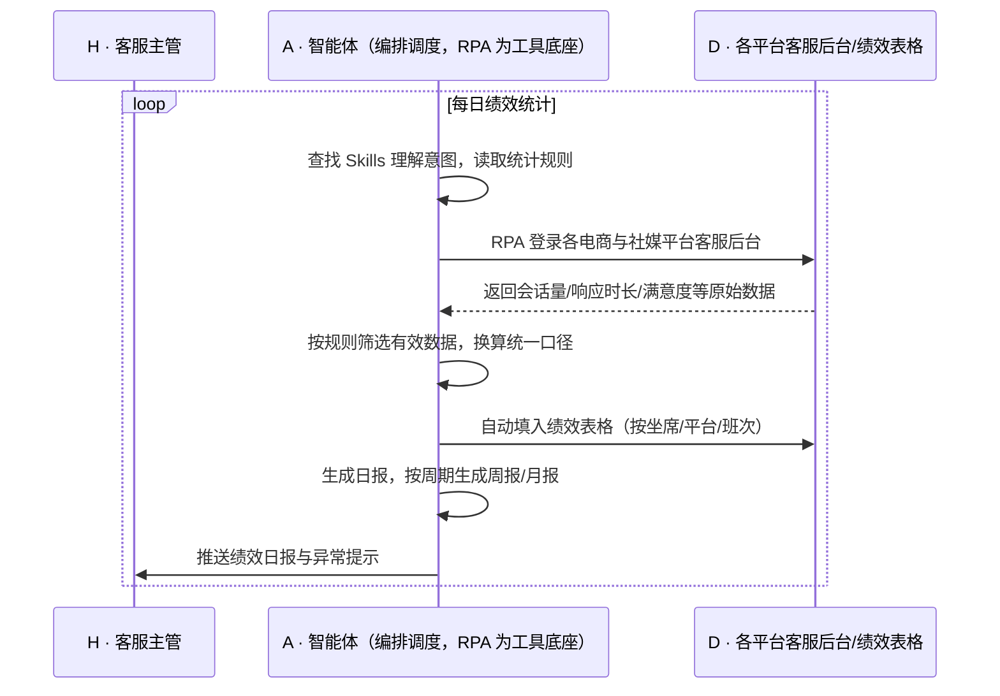

> 客服团队越铺越大，服务范围覆盖多个电商与社媒平台，问题也随之而来——各平台的客服数据口径不同、绩效统计方式各异，每天要靠 2 名专员手工把数据从各平台导出来、按不同规则筛选、再逐项填进绩效表，一天下来只能出一份滞后的日报，坐席表现按周甚至按月才能看清，策略调整永远慢半拍。本方案用智能体调度「八爪鱼 RPA、各电商与社媒平台后台、绩效表格、IM」协同执行：自动采集多平台绩效数据，按统一规则筛选有效数据，自动填入绩效表格并生成日报/周报/月报，坐席与团队表现当天可见。案例口径人力节省 80%，策略优化周期从按月缩短到按天。定时自动执行，全程自动化，无异常不打扰。

> Agent 自动化需开通企业功能
> 点击申请1个月免费权限
> [点击申请 →](https://skieer.feishu.cn/share/base/form/shrcnFwMayykP5iaL38fnZKTbrg)

## 一、用户与需求

核心矛盾：

- 客服数据分散在多个电商与社媒平台，各有各的后台与导出方式
- 各平台、各坐席的绩效统计规则不一致，人工统一口径极易出错
- 每天需 2 名专员专门整合数据，人力被重复劳动长期占用
- 日报出得晚、周报更晚，坐席表现反馈滞后，激励与辅导无从下手
- 数据滞后导致策略被动，排班、话术优化只能等月度复盘

适用客户：客服团队规模在 10 人以上、服务覆盖多平台的电商企业，涵盖 3C、服饰、美妆、家电等类目；**已用表格做绩效统计的客户**，本方案在现有绩效表上实现自动填充；**已有客服系统但数据不全的客户**，可用 RPA 把各平台缺失的数据补齐。部署后由实施方一次性配置平台与统计规则，客服主管日常不需要写代码，只需查看日报与调整规则。

### 1.1 不同模式卖家

| 类型 | 选择 | 建议 |
|-|-|-|
| 多平台多店铺品牌（客服 10 人以上） | 首选 | 强烈推荐——平台越多、坐席越多，手工统计成本越高 |
| 客服外包/共享服务中心 | 首选 | 强烈推荐——按客户与坐席计费，准确统计直接关系结算 |
| 单平台小团队 | 次选 | 一般推荐——人数少时人工尚可覆盖，可作为规范化起点 |
| 无独立客服团队 | 不做 | 无绩效统计场景 |

### 1.2 不同类目卖家

| 类目 | 最关注维度 | 核心逻辑 |
|-|-|-|
| 3C/数码 | 咨询量与转化 | 咨询量大、转化链路长，需按坐席统计转化贡献 |
| 服饰/鞋包 | 售前响应时效 | 大促期咨询爆发，响应时长直接影响成交 |
| 美妆/个护 | 售后处理时效 | 退换货多，售后处理速度影响体验 |
| 家电/家居 | 工单闭环率 | 安装与故障工单需按时闭环 |
| 食品/快消 | 大促峰值承接 | 咨询高峰集中，需按小时监控坐席承接 |
| 母婴 | 咨询质量 | 专业解答影响信任与复购 |

### 1.3 不同角色用户

| 用户 | 需求 | 问题 | 投入时间（估算） |
|-|-|-|-|
| 客服主管 | 每天掌握坐席表现 | 数据要人工整合，日报滞后 | 2-3 小时/天统计 |
| 客服专员（被统计方） | 绩效数据准确透明 | 口径不清，结算时易有争议 | 按周期核对 |
| 运营/HR | 绩效与激励依据 | 数据滞后，激励发放被动 | 按周期 |
| 老板 | 服务质量与人力效率 | 只能看月度汇总，问题发现晚 | 看报表决策 |

---

## 二、现在的方法与问题

### 2.1 流程步骤与问题总结

| 序号 | 步骤 | 现在的方法 | 问题缺陷 |
|-|-|-|-|
| 1 | 采集各平台数据 | 人工逐个平台登录导出 | 平台多、耗时长，2 人/天 |
| 2 | 统一统计口径 | 人工按各平台规则换算 | 口径不一，易出错 |
| 3 | 筛选有效数据 | 人工剔除无效会话与异常记录 | 靠经验判断，标准不统一 |
| 4 | 填入绩效表 | 手工复制粘贴到表格 | 重复劳动，易错位 |
| 5 | 生成日报 | 手工汇总写日报 | 出得晚，时效性差 |
| 6 | 周月复盘 | 人工再做周报月报 | 重复劳动，数据滞后策略被动 |

### 2.2 问题分析

| 序号 | 根因 | 具体表现 |
|-|-|-|
| 1 | 数据分散在多平台 | 各平台后台独立，导出方式与字段不同 |
| 2 | 绩效统计规则异构 | 坐席、平台、班次维度不同，口径难统一 |
| 3 | 有效数据判定依赖人工经验 | 无效会话、重复咨询的剔除标准不一致 |
| 4 | 统计动作高度重复 | 每天重复导出、换算、填表，无法沉淀 |
| 5 | 无自动触发机制 | 报表靠人推动，主管忙时就断更 |

---

## 三、解决方案

### 3.1 功能概述

为多平台电商客服团队打造的"客服绩效日报自动生成"方案：一句话调度「各电商与社媒平台 + 绩效表格 + IM」，自动采集绩效数据、按统一规则筛选有效数据、填入绩效表并生成日报/周报/月报。

一句话下达指令（如「把昨天的客服绩效跑出来，按坐席汇总发我」），智能体通过查找 Skills 文档库理解意图、匹配 5 个 RPA 自动化任务（采集多平台数据 → 筛选有效数据 → 填充绩效表 → 生成报表 → 推送结果），经 MCP 调度八爪鱼 RPA 执行，最后生成坐席绩效日报与趋势分析。全程自动化，运行状态实时反馈，跑完推送结果。

### 3.2 系统结合

| 要素 | 说明 |
|-|-|
| 客户现有工具盘点 | 商家通常已使用**多个电商与社媒平台后台（客服会话与工作量数据）、绩效表格（Excel/在线表格）、IM**（报表分发）；平台侧只提供原始数据，统计口径与汇总靠人工 |
| 数据/能力来源 | 绩效原始数据取自**各平台客服后台**（会话量、响应时长、满意度、转化等）；有效数据筛选与口径换算由**统计规则**定义；结果落入**绩效表格**并推送 IM |
| RPA 耦合动作 | 作为 Agent 的工具底座被调度执行：登录各平台采集绩效数据 → 按规则筛选有效数据 → 换算统一口径 → 填入绩效表格 → 生成日报/周报/月报并推送 |
| 耦合出的新价值 | 各平台只提供自家后台数据、表格只负责记录——单系统都无法完成"跨平台采集-统一口径-自动成表-按日推送"的闭环。本方案交付的是**口径统一、当天可见、可追溯的客服绩效体系，只推送**坐席日报与异常提示 |

### 3.3 智能体执行流程

每日定时触发（如次日早班前），周报/月报按周期触发；入参：平台清单、统计规则、绩效表结构、推送对象。

> Agent 自动化需开通企业功能
> 点击申请1个月免费权限
> [点击申请 →](https://skieer.feishu.cn/share/base/form/shrcnFwMayykP5iaL38fnZKTbrg)

### 3.4 为何这么设计

要同时回答三个问题：**为什么不能只用纯代码 Agent？为什么不能只用纯 RPA？为什么两者要结合？** 本场景的核心是"多平台取数 + 口径统一 + 自动成表"，难点在于各平台数据口径不同、有效数据判定需要规则与理解。

#### 1）逐项对比

| 对比维度 | 纯代码 Agent（Codex 等） | 纯 RPA（八爪鱼） | 智能体+RPA（MCP 结合） |
|-|-|-|-|
| 实现方式 | 调各平台客服数据接口 | 可视化配置各平台数据导出与填表流程 | 智能体做口径换算与有效数据判定，RPA 负责取数与写入 |
| 多平台登录与取数 | 需平台开放客服数据接口 | 平台沉淀各平台后台操作模板 | RPA 覆盖多平台取数，智能体统一口径 |
| 风控与多账号隔离 | 自建频次与账号管理 | 内置频率控制与多账号隔离 | 沿用平台能力，异常降频告警 |
| 清洗与入库 | 自写口径换算与筛选逻辑 | 擅长操作，口径判断能力弱 | 智能体做有效数据筛选、口径换算与异常识别 |
| 使用成本（总拥有成本） | 无订阅费，但接口不通则落地受限 | 订阅费 + 常开电脑/云机成本 | 订阅费 + 一次性配置，统计规则调整改技能即可 |
| 维护人要求 | 需开发能力，规则变更需改码 | 业务人员可维护模板 | 客服主管可自行维护统计规则与表结构 |

#### 2）优劣势说明

|  | 纯代码 Agent | 纯 RPA | 智能体+RPA |
|-|-|-|-|
| 优势 | 无订阅费、统计逻辑可深度定制 | 覆盖多平台取数、每日定时稳定、过程留痕 | 口径换算与有效数据判定由智能体承担，RPA 负责取数与填表，准确且可维护 |
| 劣势 | 平台接口不开放时取不到数据 | 缺口径判断能力，规则变更需重配流程 | 需一次性配置投入，规则需与业务确认清楚 |

**特别提醒**：绩效数据涉及**员工考核与结算**，本方案负责数据采集与计算口径的自动化，**统计规则需由企业人力资源与管理层确认**；数据使用需遵守个人信息保护相关规定，仅限授权范围内使用。账号与合规责任由使用方承担。

#### 3）结论

| 论点 | 说明 |
|-|-|
| 确定性 vs 生成性 | 取数、换算、填表是确定性操作，RPA 可预期可复核；生成式脚本在跨平台长期运行中稳定性不足 |
| 分工而非替代 | "哪些数据有效、口径怎么换算"属规则判断（智能体强）；"打开平台导出、写入表格"属操作（RPA 强） |
| 资产沉淀 | 统计规则、口径映射、表结构沉淀在技能库是活的，写在脚本里是死的 |
| 不消耗 AI token | 取数、换算、填表为规则化流水线，仅异常识别与趋势摘要调用模型 |
| 合规是底线 | 绩效数据涉及员工权益，规则需透明可追溯，数据使用限定授权范围 |
| 时间 | 主管要的是"早上就看到昨天的数据"，不是下午才收到人工整理的日报 |

### 3.5 功能清单

| 功能 | 系统 | 功能说明（解决问题） |
|-|-|-|
| 会话/定时 | 智能体 | 1. 理解统计意图，编排多平台采集任务。  
2. 每日定时触发，周报/月报按周期生成。 |
| 多平台绩效采集 | RPA | 1. 解决 2 名专员每日手工导数据的问题。  
2. 作为智能体工具被调度执行（含失败重试）。  
3. 登录各电商与社媒平台客服后台采集会话量、响应时长、满意度等数据。 |
| 有效数据筛选 | 智能体 | 1. 按规则剔除无效会话与重复咨询。  
2. 异常数据标记并回传清单。 |
| 口径换算与统一 | 智能体 | 1. 将各平台不同统计口径换算为统一标准。  
2. 按坐席/平台/班次维度汇总。 |
| 绩效表自动填充 | RPA/智能体 | 1. 自动填入绩效表格，避免手工错位。  
2. 保留历史数据支持趋势对比。 |
| 报表生成 | 智能体 | 1. 生成日报/周报/月报。  
2. 输出坐席排名、异常坐席与趋势变化。 |
| IM 通知 | 智能体 | 1. 报表按周期推送主管与相关岗位。  
2. 采集失败、口径异常即时告警。 |
| 数据资产储存 | 智能体 | 1. 绩效历史库与口径规则沉淀为数据资产与 Skills。  
2. 经验知识库记录各平台数据特性与异常处理经验。 |

### 3.6 智能体执行落地过程

平台清单、统计规则、绩效表结构、推送对象等均为部署时一次性配置；日常自动触发，无需重复输入，只需查看日报。

**⚠️ 部署前提（不满足则方案无法跑起来）**

① 需部署常开的电脑或云机承载 RPA 运行，并配置漏跑补跑机制；② 各平台客服后台账号需具备合法查看权限，登录态需保持有效；③ 统计规则与有效数据判定标准需由业务方确认并书面固化；④ 绩效表结构需提前确定，字段与历史数据衔接；⑤ 首次配置需实施方介入一次，平台越多、规则越复杂工作量相应增加。

#### 1）配置（4 步）

| 步骤 | 操作 | 说明 |
|-|-|-|
| 第 1 步 | 在八爪鱼 RPA 创建 API-Key | 开通平台调用凭证 |
| 第 2 步 | 配置绩效采集 RPA 应用 | 按平台配置数据导出路径与填表流程 |
| 第 3 步 | 在智能体侧配置 MCP | 将 RPA 注册为智能体可调用的工具 |
| 第 4 步 | 封装绩效 Skills | 写入统计规则、口径映射、表结构与推送模板 |

| 类别 | 说明 |
|-|-|
| 智能体 | 主流智能体 |
| 智能体工具 | 1. 自动化：八爪鱼 RPA，MCP 配置。  
2. 计算与统计：智能体自带。  
3. 表格：Excel/在线表格。  
4. IM：飞书/钉钉/企微。 |
| 工作知识 | 1. 平台与账号清单。  
2. 各平台数据字段与口径映射。  
3. 有效数据筛选规则。  
4. 报表模板与推送对象。 |
| 本地数据库 | 1. 绩效历史库。  
2. 口径规则库。  
3. 异常与失败记录库。 |

#### 2）执行

| 任务 | 产出 | 产出物接收人 |
|-|-|-|
| 定时触发统计 | 任务启动记录 | —— |
| RPA 采集各平台数据 | 原始绩效数据 | —— |
| 筛选有效数据 | 有效数据集 | —— |
| 口径换算与汇总 | 统一口径绩效数据 | —— |
| 填入绩效表 | 绩效表更新 | —— |
| 生成并推送报表 | 日报/周报/月报 | 客服主管/运营 |
| 异常提示 | 异常坐席与数据缺失清单 | 客服主管 |

异常处理：

- 登录失效/验证码 → 暂停该平台任务并告警，等待人工处理；
- 某平台数据缺失 → 报表中标注缺口并提示，不用估算值填充；
- 口径规则变更 → 技能文档更新后自动适配，更新前跳过对应用户提示；
- 数据异常波动（如会话量骤降）→ 标记异常并推送核查提示；
- 表格写入失败 → 重试 2 次，仍失败则输出独立文件并告警。

#### 3）结果

| 结果 | 说明 |
|-|-|
| 数据资产 | 绩效历史库（坐席/平台/班次/日维度），支持趋势与排名分析 |
| 分析报告 | 1. 日报/周报/月报。  
2. 坐席排名与异常清单。  
3. 服务时效与满意度趋势。 |
| Skills | 沉淀的绩效统计、口径映射与报表生成预设技能资产 |

> Agent 自动化需开通企业功能
> 点击申请1个月免费权限
> [点击申请 →](https://skieer.feishu.cn/share/base/form/shrcnFwMayykP5iaL38fnZKTbrg)

---

## 四、使用前后预估

> 本方案价值 = **2 名专员每日手工整合 → 自动采集统一口径 → 当天可见、可按天优化**。把客服主管与专员从"导数、换算、填表"的重复劳动中解放出来，让绩效管理从"事后统计"转向"动态提效"。

| 指标 | 人工 | 纯代码 Agent | 智能体+自动化工具 |
|-|-|-|-|
| 人力投入 | 2 名专员/天整合数据 | 需平台开放接口，否则取不到数 | 案例口径：人力节省 80% |
| 报表时效 | 次日人工汇总，常滞后 | 取决于脚本是否跑通 | 日报/周报/月报自动生成，当天可见 |
| 口径一致性 | 各坐席统计方式各异，易出错 | 规则写死，变更需改码 | 口径沉淀在技能库，全员统一 |
| 统计错误 | 人工换算与粘贴易错 | 依赖脚本健壮性 | 自动换算与校验，异常自动标记 |
| 优化节奏 | 案例口径：策略按月复盘 | — | 案例口径：策略优化周期从按月缩短至按天 |
| 沉淀 | 表格散落各处 | 代码即资产，人走即失 | 口径规则+历史库+经验知识库三层沉淀 |

说明：数据取自八爪鱼应用案例口径（人力节省 80%、策略优化周期从按月缩短至按天），实际效果随平台数量、坐席规模与规则复杂度变化；人工耗时为客服管理岗位口径估算。绩效规则需由企业人力资源与管理层确认。

---

## 五、效果证明

> Agent 自动化需开通企业功能
> 点击申请1个月免费权限
> [点击申请 →](https://skieer.feishu.cn/share/base/form/shrcnFwMayykP5iaL38fnZKTbrg)

### 5.1 客户案例

**《安克创新：多平台客服绩效自动采集与排班核算》**

> 5 个专属 RPA 流程替代人工完成多店铺跨页面数据抓取、飞书表格写入与排班日均数据核算，实现周/月度团队与每日个人数据 T+1 自动沉淀。

| 效果 | 说明 |
|-|-|
| 提效 | 客服绩效统计大幅提速。原本每天由一线客服各花 5-10 分钟手工复制数据，现在 5 个专属 RPA 流程自动抓取，单次统计耗时压缩至 10 分钟以内，周/月度团队数据与每日个人数据 T+1 自动沉淀。 |
| 降本 | 减少隐性人力成本 20 万元/年以上（原文：每年节省超 20 万隐性人力成本，约合 1.7 人·年，按 12 万元/人年折算）。原本数据统计下放给每位客服分摊，现在由机器人承担，客服专注接待与服务提升。 |
| 任务 | 多店铺跨页面数据自动抓取并写入飞书表格，数据 100% 准确。 |
| 任务 | 绩效核算与排班日均数据自动生成，考核时效由滞后统计变为 T+1。 |

案例详情：[客服：跨境电商巨头多平台客服绩效自动化采集与排班核算](https://skieer.feishu.cn/wiki/B3sawnYyTi5Iuck6Eavc86Sjntg)

---

## 六、备注

### 6.1 Agent 支持

本方案不绑定具体智能体，主流 Agent 均可运行（**需支持 MCP 连接、技能/Skills 加载与工具调用**）：

| Agent/智能体 | 说明 |
|-|-|
| Workbuddy | 本方案运行平台，支持技能/Skills 上传加载、定时任务、MCP 工具调用与表格/报告处理 |
| 豆包（国内·字节） | 国内主流个人智能体，支持技能上传、定时任务与工具调用，上手成本低 |
| 通义千问（国内·阿里） | 支持 Agent 编排与插件生态，集成阿里电商数据能力，适合电商场景 |
| DeepSeek（国内） | 推理能力强、成本低，适合规则判断与归因分析类任务 |
| ChatGPT（国外·OpenAI） | 海外主流通用智能体，支持 GPTs/Agent 模式与工具调用 |
| Claude（国外·Anthropic） | 长文本与结构化分析能力强，原生支持 MCP 连接外部工具 |

### 6.2 名词解释

| 术语 | 说明 |
|-|-|
| 客服绩效 | 衡量客服工作产出的指标体系，含会话量、响应时长、满意度、转化等 |
| 有效数据 | 剔除无效会话、重复咨询、测试单后的可用于统计的记录 |
| 统计口径 | 指标的定义与计算规则，如"响应时长"从何时起算、如何取平均 |
| 坐席 | 客服席位，通常对应一名客服人员 |
| 会话量 | 客服承接的咨询会话数量 |
| 首次响应时长 | 客户发起咨询到客服首次回复的时间间隔，是核心时效指标 |
| 满意度 | 客户对服务的评价得分 |
| 转化贡献 | 通过客服接待促成的订单金额或数量 |
| 排班 | 按咨询量高峰分布安排客服班次的计划 |
| 报表周期 | 日报、周报、月报的统计时间跨度 |
| 异常波动 | 指标显著偏离历史区间的状态，通常需要人工核查 |
| 工单闭环率 | 售后工单在规定时间内处理完成并关闭的比例 |
| MCP | 模型上下文协议，让智能体以标准方式调用外部工具（如 RPA）的接口规范 |

> Agent 自动化需开通企业功能
> 点击申请1个月免费权限
> [点击申请 →](https://skieer.feishu.cn/share/base/form/shrcnFwMayykP5iaL38fnZKTbrg)

---

原文：[查看原文](https://skieer.feishu.cn/wiki/W7QGw2TjRimkoUkbXX4cf9AznPi)
