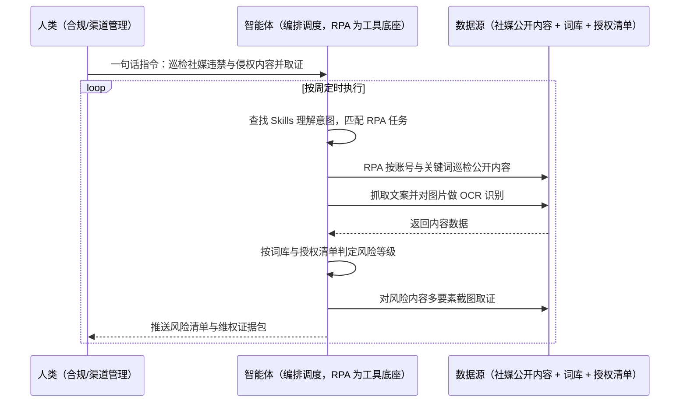

> 为品牌商家打造的社媒违禁词监控与维权方案。品牌在社媒平台上的内容风险来自两端：自家账号与达人合作内容可能含违禁表述（极限用语、功效宣称等），一旦被举报就面临处罚；同时大量非授权商家、经销商在社媒发布违规宣传与侵权内容，靠人工搜索几乎发现不了。本方案由智能体调度多个工具执行社媒内容批量巡检 + 图文违禁词识别 + 侵权内容取证与清单化，输出风险内容清单与维权证据包。按周定时执行，全程自动化，有风险才打扰；投诉与维权动作保留人工执行。

> Agent 自动化需开通企业功能
> 点击申请1个月免费权限
> [点击申请 →](https://skieer.feishu.cn/share/base/form/shrcnFwMayykP5iaL38fnZKTbrg)

## 一、用户与需求

核心矛盾：

- 内容风险不可控：自家与达人内容中的违禁表述靠人工抽查，漏检高（案例口径）
- 侵权内容发现难：非授权商家与经销商的违规宣传散落各平台，人工搜不到（案例口径）
- 取证不规范：截图缺时间戳与页面要素，维权时证据不被认可（案例口径）
- 整改无闭环：发现问题后跟踪靠人，改没改不知道

适用客户：有社媒投放、达人合作与授权分销体系的品牌商家（合规/法务/市场岗）。已用舆情或合规工具的客户由本方案补巡检与取证；无工具的客户可从重点平台起步；部署后业务人员不需要写代码，一句话下达指令即可执行。

### 1.1 不同规模商家

| 类型 | 选择 | 建议 |
|-|-|-|
| 品牌商家（达人合作多） | 首选 | 强烈推荐（内容量大、合规风险集中） |
| 分销体系商家 | 首选 | 强烈推荐（经销商违规宣传高发） |
| 中小商家 | 次选 | 一般推荐（先盯自发内容与重点竞品账号） |

### 1.2 不同关注维度

| 维度 | 最关注 | 核心逻辑 |
|-|-|-|
| 极限用语 | 绝对化表述 | 最容易触发处罚与打假 |
| 功效宣称 | 医疗与功效 | 涉功效表述监管最严 |
| 价格宣传 | 虚假促销 | 原价与折扣表述需可举证 |
| 商标与形象 | 侵权使用 | 未授权使用品牌素材 |
| 授权范围 | 越权宣传 | 非授权商家冒充授权 |
| 整改跟踪 | 闭环状态 | 发现问题要跟到改完 |

### 1.3 不同角色用户

| 用户 | 需求 | 问题 | 投入时间（估算） |
|-|-|-|-|
| 合规/法务 | 风险前置 | 抽查覆盖有限 | 每周 3-5 小时 |
| 市场/达人运营 | 内容审核 | 达人内容审核靠人看 | 每次合作 1-2 小时 |
| 渠道管理 | 维权取证 | 取证不全难维权 | 单次 1-2 天 |

---

## 二、现在的方法与问题

### 2.1 流程步骤与问题总结

| 序号 | 步骤 | 现在的方法 | 问题缺陷 |
|-|-|-|-|
| 1 | 制定词表 | 人工整理违禁词 | 更新滞后 |
| 2 | 巡检内容 | 人工搜索账号与关键词 | 覆盖窄、耗时长 |
| 3 | 人眼判断 | 凭经验判断是否违规 | 标准不统一 |
| 4 | 截图取证 | 手工截图归档 | 缺要素，证据不成链 |
| 5 | 通知整改 | 私信/邮件通知 | 无跟踪状态 |
| 6 | 维权提交 | 人工整理材料 | 材料零散，效率低 |

### 2.2 问题分析

**人工方式根因**

| 序号 | 根因 | 具体表现 |
|-|-|-|
| 1 | 巡检靠人工 | 内容量大，搜不全 |
| 2 | 词表不统一 | 各人各标准，漏检多 |
| 3 | 取证不规范 | 证据不成链，维权受阻 |

**系统工具方式根因**

| 序号 | 根因 | 具体表现 |
|-|-|-|
| 1 | 工具只覆盖单一平台 | 跨平台内容需分别处理 |
| 2 | 图文识别弱 | 图片与视频中的文字难覆盖 |
| 3 | 无闭环台账 | 整改与维权状态不沉淀 |

---

## 三、解决方案

### 3.1 功能概述

为品牌商家打造的社媒违禁词监控与维权方案，一句话调度内容巡检 + 违禁词识别 + 取证清单化，输出风险内容清单与维权证据包。

一句话下达指令（如「把这个月社媒上的违规内容和侵权内容都扫一遍并取证」），智能体通过查找 Skills 文档库理解意图、匹配 N 个 RPA 自动化任务（巡检→推送），经 MCP 调度八爪鱼 RPA 按账号与关键词批量获取社媒公开内容，智能体进行巡检，按违禁词库与授权清单判定风险，对风险内容完成多要素截图取证，生成风险清单与维权证据包并推送责任人跟踪整改。全程自动化，运行状态实时反馈，有风险才推送。

### 3.2 系统结合

| 要素 | 说明 |
|-|-|
| 系统组成 | 智能体（WorkBuddy，任务编排 + 判定规则）+ MCP 协议层 + 八爪鱼 RPA采集搜集内容与链接+ 违禁词库与授权清单 |
| 数据/能力来源 | 社媒公开内容（低频只读）、品牌授权店/经销商清单、违禁词库（按平台与行业）、历史风险台账 |
| RPA 耦合动作 | 作为 Agent 的工具底座被调度执行：①解决逐账号逐关键词巡检的机械动作；②被智能体调度执行；③完成多要素截图取证与清单生成 |
| 耦合出的新价值 | 单系统给不了的端到端结论：自家内容 + 他人侵权内容统一巡检 + 证据链自动成型，**只推送命中风险的内容** |

### 3.3 智能体执行流程

一句话下达指令，智能体自动调度；入参（巡检账号与关键词、词库、授权清单、接收人）部署时一次配置：

> Agent 自动化需开通企业功能
> 点击申请1个月免费权限
> [点击申请 →](https://skieer.feishu.cn/share/base/form/shrcnFwMayykP5iaL38fnZKTbrg)

### 3.4 为何这么设计

要同时回答三个问题：**为什么不能只用纯代码 Agent？为什么不能只用纯 RPA？为什么两者要结合？** 本场景的核心是"多平台巡得全、图文都能判、证据成链"。

#### 1）逐项对比

| 对比维度 | 纯代码 Agent（Codex 等） | 纯 RPA（八爪鱼） | 智能体+RPA（MCP 结合） |
|-|-|-|-|
| 实现方式 | 爬取社媒公开内容 | 登录/访问前端巡检 | 智能体判规则 + RPA 巡检取证 |
| 多平台登录与取数 | 反爬对抗成本高 | 前端访问，平台可扩 | RPA 取数，智能体统一调度 |
| 风控与多账号隔离 | 高频抓取易被封 | 低频只读 + 环境隔离 | 沿用隔离能力，频率可控 |
| 清洗与入库 | 强，判定逻辑可定制 | 弱，需定制 | 智能体统一判定与台账 |
| 使用成本（总拥有成本） | 开发维护自担 | 平台订阅一次多流程复用 | 一份订阅跑多流程，边际成本 ≈ 0 |
| 维护人要求 | 需开发，页面改版返工 | 业务可自维护词库 | 业务改词库、技术兜底 |

技术栈速览：纯智能体路线需 Python（爬虫/OCR/NLP）等自行实现多平台采集、图文识别、判定与取证归档，反爬与页面变化维护成本高。

#### 2）优劣势说明

|  | 纯代码 Agent（Codex 等） | 纯 RPA（八爪鱼） | 智能体+RPA（MCP 结合） |
|-|-|-|-|
| 优势 | 无订阅费；       文本判定灵活 | 多平台覆盖广；       可截图取证 | 图文双通道巡检 + 证据链自动成型 |
| 劣势 | 反爬与 OCR 自建；       图片内容易漏 | 判定规则配置较弱 | 本地电脑运行需保持开机；       词库需定期维护 |

**特别提醒**：巡检结果**为风险提示，不构成法律意见**；投诉举报与维权动作**由法务/合规复核后执行**，方案只提供证据链与清单；采集限于公开内容，遵守平台规则与相关法律。

#### 3）结论

| 论点 | 说明 |
|-|-|
| 确定性 vs 生成性 | 巡检、识别、取证是确定性动作，RPA 行为可预期；判定依据词库与授权清单 |
| 资产沉淀 | 词库、授权清单、证据包归档沉淀在平台是活的 |
| 一个底座跑多流程 | 客户购买 RPA 平台是跑多个流程（巡检/取证/采集），本方案只是其中一个，订阅费被摊薄 |
| 不消耗 AI token | 词库比对是规则化流水线；仅图片 OCR 与疑难判定调用 AI |
| 覆盖 | 从人工抽查变为全量巡检，自家内容与侵权内容一并覆盖 |
| 时间 | 合规要的是"风险自己冒出来还带证据"，不是"人工搜一遍靠运气" |

### 3.5 功能清单

| 功能 | 系统 | 功能说明（解决问题） |
|-|-|-|
| 会话/一句话指令 | 智能体 | 1. 理解自然语言意图，查找 Skills 文档库。       2. 匹配对应 RPA 自动化任务、编排多任务。 |
| 内容巡检 | RPA | 1. 解决人工搜索覆盖窄问题。       2. 作为工具被调度执行，按账号与关键词巡检社媒公开内容。       3. 覆盖多平台与多账号。 |
| 图文识别 | RPA、OCR | 抓取文案并对图片/封面做 OCR，解决图片内容漏检问题。 |
| 风险判定 | 智能体 | 按违禁词库与授权清单判定风险等级，解决标准不统一问题。 |
| 多要素取证 | RPA、智能体 | 对风险内容截图取证（页面/文案/账号/时间），解决证据不成链问题。 |
| 风险清单与推送 | 智能体、企微 | 清单推送责任人与整改跟踪，解决无闭环问题。 |
| 数据资产储存 | 本地电脑、云储存 | 1. Skills 资产：社媒巡检技能。       2. 数据储存：风险库与证据包。       3. 经验知识库：处置结果回填。 |

### 3.6 智能体执行落地过程

部署时一次性配置入参（巡检账号与关键词、词库、授权清单、接收人），会话中一句话即可触发，无需重复输入。

**⚠️ 部署前提（不满足则方案无法跑起来）**：①RPA 需部署在**常开电脑/云机**上；②巡检频率需控制为低频只读；③词库与授权清单需合规/法务确认一次（属实施成本）；④取证规范（截图要素、时间戳、归档路径）需与法务确认；⑤维权与投诉动作保留人工复核；⑥首次配置（词库、清单、取证规则）需服务方/技术人员介入一次，属实施成本。

#### 1）配置（五步）

| 步骤 | 操作 | 说明 |
|-|-|-|
| 第一步 | 下载八爪鱼 RPA，导入电商运营自动化模板 | 官网免费下载客户端；MCP 工具→添加应用 |
| 第二步 | 开启八爪鱼 RPA 的 MCP 服务端口 | 客户端→API-K→创建 API（名称自定义） |
| 第三步 | 在智能体中添加 MCP Server 连接 | 复制连接配置→智能体连接器→自定义连接器→配置 MCP→粘贴保存 |
| 第四步 | 验证工具列表 | 确认工具全部启用（即八爪鱼客户端内工具） |
| 第五步 | 测试运行效果 | 输入一句话指令，验证巡检、判定与取证 |

| 类别 | 说明 |
|-|-|
| 智能体 | 主流智能体（支持 MCP 连接、Skills 加载、定时任务）。 |
| 智能体工具 | 1. **执行通道**：巡检 + OCR + 判定 + 取证 + 清单。       2. 数据取数与自动化执行：八爪鱼 RPA（MCP 协议接入）。       3. 识别能力：OCR+AI。       4. IM：企业微信/飞书（MCP 或 webhook 配置）。 |
| 工作知识 | 1. 巡检账号与关键词。       2. 违禁词库与分级规则。       3. 授权店/经销商清单。       4. 取证规范与接收人。 |
| 本地数据库 | 1. 风险库地址。       2. 证据包目录。       3. 整改台账存档地址。 |

#### 2）执行

| 任务 | 产出 | 产出物接收人 |
|-|-|-|
| 接收一句话指令，匹配 RPA 任务 | 任务启动记录 | —— |
| 调用已预设 Skills，编排任务流程 | 任务编排方案 | —— |
| 经 MCP 向八爪鱼 RPA 下发巡检任务 | 自动化任务指令 | —— |
| 巡检公开内容并抓取文案 | 内容快照 | —— |
| OCR 与风险判定 | 风险命中清单 | 合规/法务 |
| 多要素截图取证 | 证据包 | 法务/渠道管理 |
| 推送清单并跟踪整改 | 群消息与台账 | 市场/渠道 |

异常处理：

巡检被限制 → 降频重试，连续失败暂停并告警；

OCR 置信度低 → 标注"待人工确认"，不计入正式清单；

页面结构变化 → 该项标注"待适配"，不影响其他项；

证据要素不全 → 不放入正式证据包，标注缺项。

#### 3）结果

| 结果 | 说明 |
|-|-|
| 数据资产 | 风险库（账号/内容/风险类型/等级/时间）+ 证据包，可审计可追溯。 |
| 分析报告 | 社媒合规周报：风险量/类型分布/整改闭环情况。 |
| Skills | 智能体 Skills：社媒巡检技能，词库按月迭代。 |

> Agent 自动化需开通企业功能
> 点击申请1个月免费权限
> [点击申请 →](https://skieer.feishu.cn/share/base/form/shrcnFwMayykP5iaL38fnZKTbrg)

---

## 四、使用前后预估

> 本方案价值 = **多平台自动巡检 → 图文一起判 → 证据自动成链**。把合规从人工抽查中解放出来，风险前置、维权有据。

| 指标 | 人工 | 纯代码 Agent | 智能体+自动化工具 |
|-|-|-|-|
| 巡检覆盖 | 人工抽查有限 | 反爬限制 | 多平台多账号全量 |
| 图文识别 | 只看文案 | 图片易漏 | 文案 + OCR 双通道 |
| 判定标准 | 凭经验 | 需自建 | 词库 + 授权清单统一 |
| 取证 | 手工截图零散 | 需自建 | 多要素自动成链 |
| 整改闭环 | 靠人跟踪 | 无状态管理 | 清单 + 状态跟踪 |
| 风险时效 | 发现滞后 | 取决于调度 | 按周自动巡检 |

**说明**：本方案口径参考八爪鱼违禁词扫描类客户实践（RPA 遍历内容并做文案与图片 OCR 识别、登录违禁词查询平台逐条比对），并结合社媒侵权取证需求设计；具体数值随平台数量与内容规模而异（估算），实施前需按客户平台清单与法务要求确认取证规范。

---

## 六、备注

### 6.1 Agent 支持

本方案不绑定具体智能体，主流 Agent 均可运行（需支持 MCP 连接、技能/Skills 加载与工具调用）：

| Agent/智能体 | 说明 |
|-|-|
| Workbuddy | 本方案运行平台，支持技能/Skills 上传加载、定时任务、MCP 工具调用与表格/报告处理 |
| 豆包（国内·字节） | 国内主流个人智能体，支持技能上传、定时任务与工具调用，上手成本低 |
| 通义千问（国内·阿里） | 支持 Agent 编排与插件生态，集成阿里电商数据能力，适合电商场景 |
| DeepSeek（国内） | 推理能力强、成本低，适合规则打分与归因分析类任务 |
| ChatGPT（国外·OpenAI） | 海外主流通用智能体，支持 GPTs/Agent 模式与工具调用 |
| Claude（国外·Anthropic） | 长文本与结构化分析能力，原生支持 MCP 连接外部工具 |

### 6.2 名词解释

| 术语 | 说明 |
|-|-|
| 社媒违禁词 | 社媒内容中违反广告法与平台规则禁止的表述 |
| 极限用语 | "最/第一/顶级"等绝对化表述 |
| 功效宣称 | 涉及功效或医疗效果的表述，监管最严 |
| 授权店 | 经品牌授权可销售与宣传的店铺 |
| 越权宣传 | 超出授权范围的宣传行为 |
| 取证 | 对风险内容截屏并记录要素，形成可举证的证据 |
| 证据链 | 页面、文案、账号、时间等要素齐全的证据集合 |
| 侵权内容 | 未经授权使用品牌素材或商标的内容 |
| 风险分级 | 按违规类型与影响划分的风险等级 |
| 低频只读 | 控制访问频率、只读取不修改，降低平台风控风险 |
| 整改台账 | 跟踪风险内容整改状态的结果表 |
| 合规复核 | 由合规/法务对结果做最终判断的环节 |
| MCP | Model Context Protocol，智能体连接外部工具的标准化通道 |
| Skills | 智能体可加载的预设技能资产，含流程与知识 |

> Agent 自动化需开通企业功能
> 点击申请1个月免费权限
> [点击申请 →](https://skieer.feishu.cn/share/base/form/shrcnFwMayykP5iaL38fnZKTbrg)

---

原文：[查看原文](https://skieer.feishu.cn/wiki/ZPunwM0uoiPddxkSyjncANWqnth)
