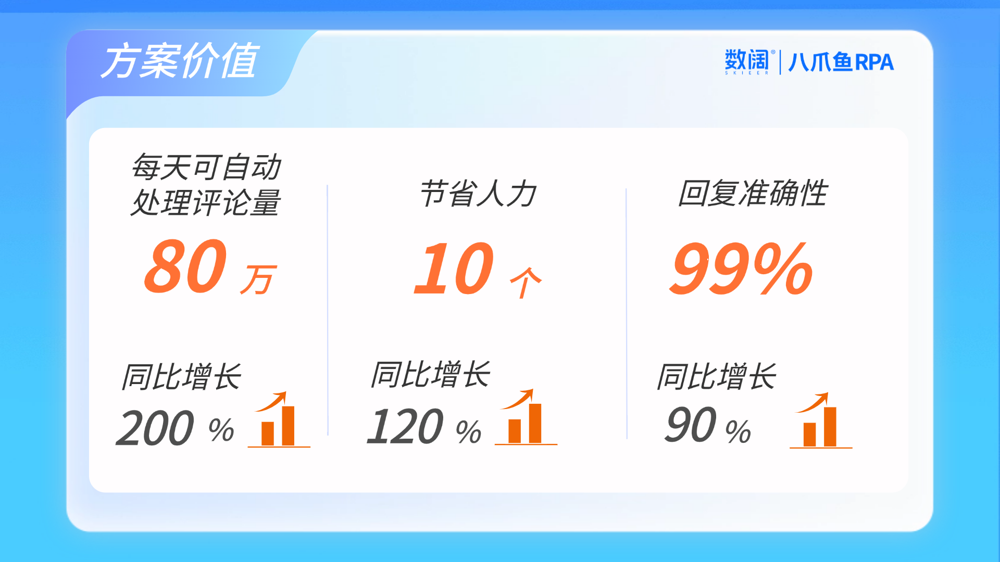
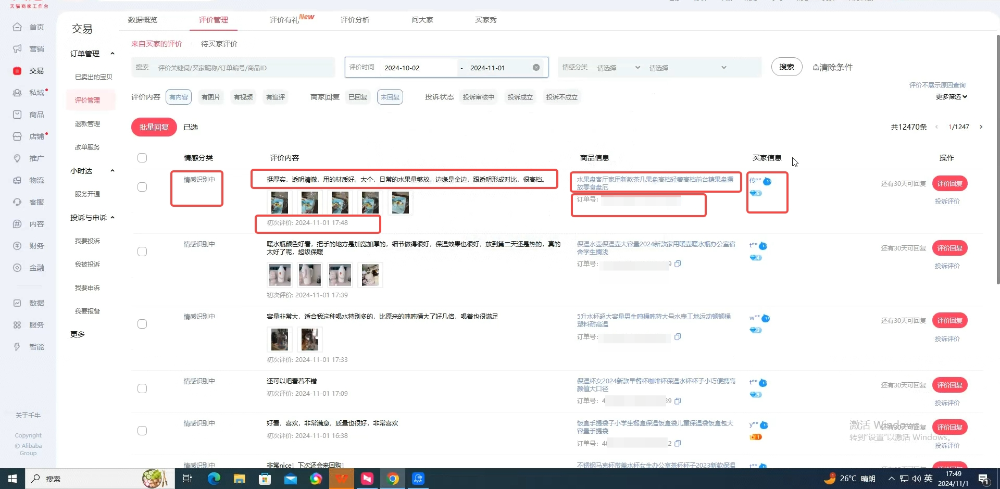
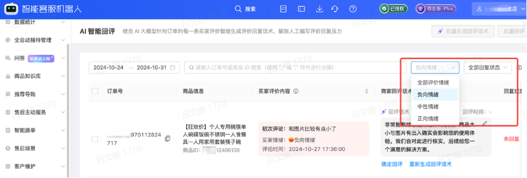
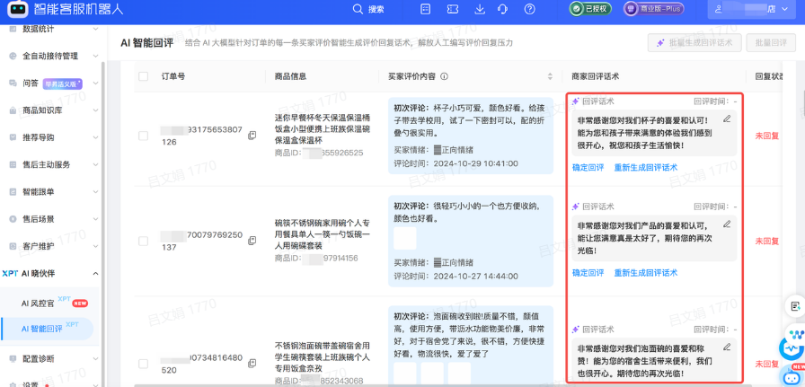
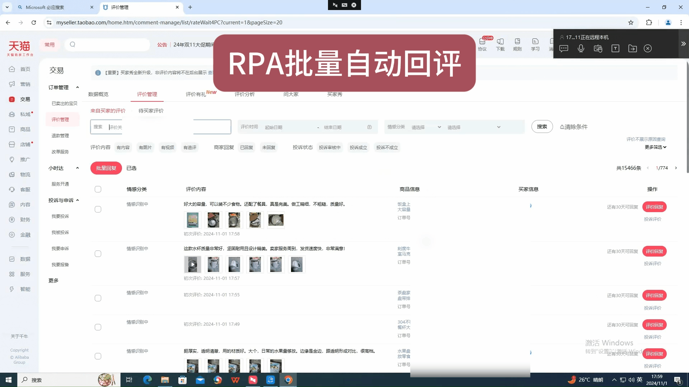
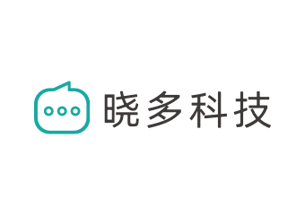
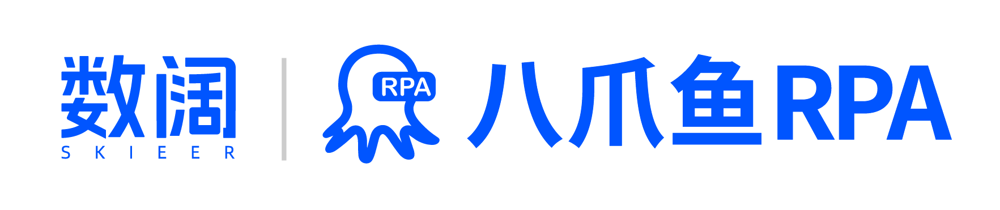

> # 全面提效天猫客服回评，晓多AI 驱动业务增长

在电商平台中，尤其是像天猫这样的大型综合性购物平台，消费者对商品和服务的评价，决定了店铺DSR评分的高低，而DSR评分不仅能够提升搜索排名，增加自然流量，还能提高消费者的信任感和购买意愿，促进转化率的提升。因此，及时有效地管理和回应消费者的评价，成为了商家提升用户体验、提高店铺DSR和促进销售增长的关键策略之一。
八爪鱼RPA和晓多AI智能客服机器人，针对天猫店铺的品牌商家们，共同推出了一套AI智能回评的自动化应用方案，理解评论语义，“五星差评”轻松拿捏。各种评论文本自动处理，精准回复，及时反馈，快速提升店铺整体运营效率，打造更好的客户体验，驱动整个业务增长。

# 🎯当前痛点：

- **店铺多人力成本高**

  - 客服团队庞大：往往一个品牌商家有多个店铺运营，需要雇佣大量的客服人员，不仅增加了人力成本，还导致管理难度加大
  - 培训成本高：客服人员往往需要培训才能上岗，培训成本、培训时间和培训效果都难以掌控
- **服务响应慢，评价监测不及时**

  - 响应不及时：海量订单评价仅依靠人工回复非常耗时且降低员工的积极性，同时，对于中差评的监测不够及时极易错失最佳的处理时间
  - 夜间服务缺失：客户评价的监控和回应往往需要全天候投入，特别是促销节点时，人力有限顾不过来
- **服务质量不稳定**

  - 人工客服服务标准不一：面对负面评价或投诉时，客服人员的情绪管理能力参差不齐，容易引发顾客不满
  - 个性化不足：固定的模板回复缺乏温度，无法针对性解决客户问题

# ✨方案价值：

1. **提升店铺DSR和客户满意度**：个性化的回复话术和高效的客户服务，可以显著提升顾客满意度，进而增加复购率和口碑传播，帮助店家提升店铺的DSR评分和客户满意度
2. **提高客服响应速度和服务质量**：商家可以实现24/7的即时响应，确保每一位消费者都能在最短时间内得到回复，大大提升了服务的及时性和满意度，提高服务质量
3. **优化运营效率，减少人力成本：** 自动回复可以显著减少客服团队的工作量，降低人力成本，同时提高服务质量和效率

---

# 💯实现效果：

[查看原视频](https://skieer.feishu.cn/wiki/Xrg6wWsNYiUDNrk7Gs5cTYLpnof)

\*该方案的前置条件是具备晓多机器人的天猫店铺

> ## **流程图**

[查看原白板](https://skieer.feishu.cn/wiki/Xrg6wWsNYiUDNrk7Gs5cTYLpnof)

## 🌐店铺后台评价抓取

八爪鱼RPA机器人能够**每天定时自动登录天猫店铺后台，进入评价板块，筛选指定时间段的评价信息，全面采集评价的商品名称、文字内容、时间等数据**，还可以设置只采集新增的评价信息，避免重复采集，采集完毕后可导出评价列表，确保卖家第一时间了解顾客的反馈情况，及时维护评价。

还支持自动切换登录多个店铺后台，自动获取不同店铺的评价内容，减少人工手动收集时频繁切换店铺、采集大量评论的负担，同时，批量数据的采集便于卖家更快速的分析和总结，让数据发挥出更大价值。

## 🗯个性化AI话术生成

晓多AI智能客服机器人基于XPT大模型，**对抓取到订单评价进行智能分析，预测用户的评价情绪，快速区分好评与差评，并为每条评价生成针对性的回复话术，单次可生成100条评价话术，**不仅能提高回复的专业度和温度，也有助于建立良好的品牌形象。

## 🆙RPA批量自动回复

八爪鱼RPA机器人可以**24小时实时监控后台评价**，对于正面评价，可以设置自动感谢顾客的支持与认可，而对于负面评价，则可以通过晓多AI生成的个性化话术，**自动进行批量的初步处理**，并将复杂问题转交至人工客服，既保证了对所有评价的及时响应，又减轻了客服团队的工作量。

---

# 💌部分客户案例

[查看原表格](https://skieer.feishu.cn/wiki/Xrg6wWsNYiUDNrk7Gs5cTYLpnof)

# 🐙关于我们

晓多科技是以智能对话为核心的认知智能 SaaS 产品和行业数智化解决方案服务商。致力于人工智能自然语言处理技术研发与数字化应用，已成为国内发展最快、最具活力的新经济代表企业之一。
公司核心产品：智能客服机器人，具有高精度意图识别、多轮对话、内置行业知识易上手易维护等特点， 业务从纵向深耕电商行业到目前已横向拓展到电信、政务、高校、教育等行业，目前晓多业务遍布全国 50 多个城市， 累计服务 38000+ 客户。
晓多坚持以客户为中心，旨在用人工智能技术创造更好的沟通和服务，帮助企业实现降本增效。晓多将打造更多业务 场景下的”认知智能”产品矩阵，让先进的产品助力组织持续创造增量。

八爪鱼RPA是一款高效的自动化软件，源于八爪鱼采集器，有10年丰富的网页自动操作经验沉淀，能够高效地处理数据抓取和自动化任务，致力于简化和自动化重复性、规则性强的工作流程。
八爪鱼RPA为用户提供了[全域电商取数](https://rpa.bazhuayu.com/solutions/ecommerce)、[社媒营销自动化](https://rpa.bazhuayu.com/solutions/social)、[跨境自动化](https://rpa.bazhuayu.com/solutions/automation)、[AI智能回评](https://rpa.bazhuayu.com/solutions/ai)、[跨平台数据连接](https://rpa.bazhuayu.com/solutions/data)等一站式自动化解决方案。官网上还提供了免费的应用市场，为用户提供了一个丰富的资源库，用户可以根据自己的需求，轻松下载和部署各种自动化应用，覆盖电商、社交媒体、办公自动化等多个领域。
欢迎前往八爪鱼RPA官网了解更多
八爪鱼RPA官网：https://rpa.bazhuayu.com/
八爪鱼RPA应用市场：https://rpa.bazhuayu.com/appstore

---

> # 获取更多自动化解决方案

## **免费❗千行百业自动化解决方案免费领取❗❗❗**

八爪鱼RPA自动化解决方案限时免费领取

无论你是电商、跨境、零售业、医药还是互联网

从运营到客户服务，从市场营销到财务管理

都能拥有适合自己的自动化方案

👇添加小助手免费领取👇

> Agent 自动化需开通企业功能
> 点击申请1个月免费权限
> [点击申请 →](https://skieer.feishu.cn/share/base/form/shrcnFwMayykP5iaL38fnZKTbrg)

---

原文：[查看原文](https://skieer.feishu.cn/wiki/Xrg6wWsNYiUDNrk7Gs5cTYLpnof)
