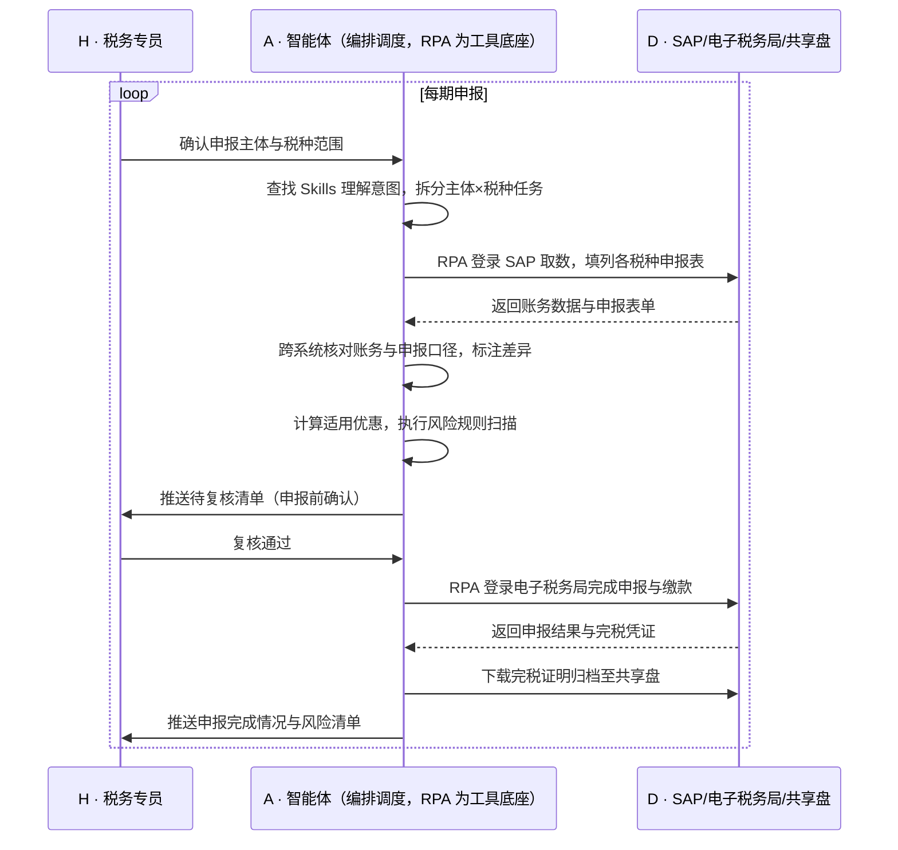

> 多主体经营的电商集团，财务共享中心每到申报期就要面对"主体数×税种数"的手工填表——从 SAP 逐个主体导数据、逐张表填列、逐个主体登录电子税务局申报缴款，一期下来数天时间，遇到主体多、期限不一，漏报迟报的风险始终悬着；优惠条件复杂，人工还容易漏享或错享。本方案用智能体调度「八爪鱼 RPA、SAP、电子税务局、共享盘、企业微信」协同执行：自动按主体×税种拆分任务，完成取数、申报表填列、跨系统核对、优惠计算、风险扫描、申报缴款与完税证明下载归档全链路。申报由数天缩短到小时级，人工只保留申报前复核这一道关键确认。定时自动执行，全程自动化，无异常不打扰。

> Agent 自动化需开通企业功能
> 点击申请1个月免费权限
> [点击申请 →](https://skieer.feishu.cn/share/base/form/shrcnFwMayykP5iaL38fnZKTbrg)

## 一、用户与需求

核心矛盾：

- 主体数×税种数让申报表数量成倍增加，逐张手工填列，一期耗时数天
- 各税种申报周期、计税依据、表式不同，需在多个系统间反复切换，口径易出错
- 各主体申报期限与属地税务机关要求不一，漏报迟报风险高
- 优惠资格条件复杂，人工判断易漏享或错享，且难以系统化复算
- 手工填表与归档缺少系统化留痕，复核与审计成本高

适用客户：分公司/子公司多主体经营、多店铺跨区域运营的电商集团，以及财务共享中心承接多主体申报业务的财税服务机构；**已用 SAP 等 ERP 的客户**，本方案直接取数；**ERP 尚未打通申报环节的客户**，本方案用 RPA 在电子税务局完成操作侧动作，不需要税务局开放接口。部署后由实施方完成主体、税种与规则配置，财务人员日常不需要写代码。

### 1.1 不同模式卖家

| 类型 | 选择 | 建议 |
|-|-|-|
| 多主体集团（分/子公司运营店铺） | 首选 | 强烈推荐——主体越多，人工填表的边际成本越高，收益越明显 |
| 多店铺单一主体 | 次选 | 一般推荐——多税种申报同样受益，但主体少则收益有限 |
| 财务共享中心/代账机构 | 首选 | 强烈推荐——承接多客户多主体申报，标准化收益最大 |
| 单主体小卖家 | 不做 | 税种少、金额小，人工处理即可 |

### 1.2 不同类目卖家

| 类目 | 最关注维度 | 核心逻辑 |
|-|-|-|
| 家电/3C | 多主体增值税 | 一般纳税人与小规模并存，计税口径需按主体分别处理 |
| 食品/快消 | 申报期限 | 主体多、期限交错，漏报迟报风险最高 |
| 服饰 | 跨区域经营 | 属地税务机关要求不一，需按属地规则填报 |
| 家居 | 印花税/附加税 | 合同与业务类型差异影响税目认定 |
| 美妆 | 优惠资格 | 小微企业与行业优惠需按条件逐条判断适用 |
| 母婴 | 进项抵扣 | 进项发票类型多，抵扣口径需与账务核对一致 |

### 1.3 不同角色用户

| 用户 | 需求 | 问题 | 投入时间（估算） |
|-|-|-|-|
| 财务共享中心 | 按期完成多主体申报 | 逐主体逐税种手工填表，重复劳动大 | 数天/期 |
| 税务专员 | 口径准确、不漏报 | 申报期限与属地要求不一，易错漏 | 3-5 小时/天 |
| 财务负责人 | 合规无风险、可追溯 | 风险扫描靠人工经验，难系统化 | 复核为主 |
| 老板/管理层 | 申报结果与税负可视 | 申报进度不透明，临近期限才暴露问题 | 看报表决策 |

---

## 二、现在的方法与问题

### 2.1 流程步骤与问题总结

| 序号 | 步骤 | 现在的方法 | 问题缺陷 |
|-|-|-|-|
| 1 | 取数 | 人工从 SAP 导出各主体财务数据 | 重复导出，效率低、质量不稳 |
| 2 | 填列申报表 | 逐主体逐税种手工填表 | 税种与表式不同，耗时且易错 |
| 3 | 跨系统核对 | 人工比对申报表与账务数据 | 口径不一，差异难定位 |
| 4 | 优惠计算 | 手工计算适用优惠 | 条件复杂，易漏享或错享 |
| 5 | 风险检查 | 靠人工经验判断 | 无法系统化扫描，依赖个人经验 |
| 6 | 申报缴款 | 逐个主体登录电子税务局操作 | 主体多、期限不一，易漏报迟报 |
| 7 | 凭证归档 | 手工下载完税证明并归档 | 归档不规范，追溯困难 |

### 2.2 问题分析

| 序号 | 根因 | 具体表现 |
|-|-|-|
| 1 | 主体数量多、各自独立申报 | 申报表数量随主体成倍增加，重复劳动无法摊薄 |
| 2 | 税种规则异构 | 各税种周期、计税依据、表式不同，切换成本高 |
| 3 | 期限与属地要求不一 | 靠人工台账跟期限，临近才发现漏项 |
| 4 | 优惠判断依赖人工经验 | 条件组合复杂，漏享错享难以自检 |
| 5 | 缺系统化留痕 | 填表过程与凭证归档无结构记录，复核审计成本高 |

---

## 三、解决方案

### 3.1 功能概述

为多主体电商集团打造的"多税种多主体财务自动申报"方案：一句话调度「SAP + 电子税务局 + 共享盘 + 企业微信」，自动完成取数、申报表填列、跨系统核对、优惠计算、风险扫描、申报缴款与完税证明归档全流程，智能体负责规则判断、异常识别与通知。

一句话下达指令（如「把本月 12 个主体的增值税、企业所得税和个人所得税申报做一遍」），智能体通过查找 Skills 文档库理解意图、匹配 8 个 RPA 自动化任务（SAP 取数 → 报表填列 → 跨系统核对 → 优惠计算 → 风险扫描 → 电子税务局申报 → 缴款 → 完税证明下载归档），经 MCP 调度八爪鱼 RPA 执行，最后生成申报完成情况与风险清单报告。全程自动化，运行状态实时反馈，跑完推送结果。

### 3.2 系统结合

| 要素 | 说明 |
|-|-|
| 客户现有工具盘点 | 集团财务通常已使用 **SAP 等 ERP**（总账、应收、发票数据）、**电子税务局（各主体申报入口）、共享盘（报表归档）、企业微信**（协同通知）；部分企业另有财务中台承接工单流转。ERP 解决账务，电子税务局解决申报操作，两者之间靠人工搬运 |
| 数据/能力来源 | 账务数据取自 **SAP**（导出/接口）；申报操作在 **电子税务局**页面完成；归档走**共享盘**；通知走**企业微信**。所有数据以财务账务口径为准，申报口径按税种规则映射 |
| RPA 耦合动作 | 作为 Agent 的工具底座被调度执行：按主体×税种拆分任务 → 从 SAP 取数 → 填列申报表 → 跨系统核对差异 → 计算优惠 → 执行风险规则扫描 → 登录电子税务局申报缴款 → 下载完税证明归档 |
| 耦合出的新价值 | SAP 只负责账务、电子税务局只负责申报操作——单系统都无法完成"多主体多税种的取数-填表-核对-申报-归档"闭环。本方案交付的是**一次触发、批量完成、全程留痕的申报流水线，只推送**申报完成情况、差异清单与风险提示，申报前保留人工复核 |

### 3.3 智能体执行流程

按申报期定时触发（可按主体分批错峰）；入参：主体清单、税种清单、申报期。

> Agent 自动化需开通企业功能
> 点击申请1个月免费权限
> [点击申请 →](https://skieer.feishu.cn/share/base/form/shrcnFwMayykP5iaL38fnZKTbrg)

### 3.4 为何这么设计

要同时回答三个问题：**为什么不能只用纯代码 Agent？为什么不能只用纯 RPA？为什么两者要结合？** 本场景的核心是"多主体多税种的规则判断 + 电子税务局的操作执行"——既要有判断，也必须稳定完成法定操作并留痕。

#### 1）逐项对比

| 对比维度 | 纯代码 Agent（Codex 等） | 纯 RPA（八爪鱼） | 智能体+RPA（MCP 结合） |
|-|-|-|-|
| 实现方式 | 写脚本直连数据库与接口生成报表 | 可视化配置各税种填表与申报流程 | 智能体负责规则判断与编排，RPA 负责填表与申报操作 |
| 多平台登录与取数 | 需 ERP 开放接口，SAP 侧改造周期长 | 平台沉淀 ERP 与电子税务局登录经验，配置即用 | RPA 取数与操作，智能体负责口径映射 |
| 风控与多账号隔离 | 电子税务局无开放接口，纯代码无法完成申报操作 | 内置多主体账号隔离与操作留痕机制 | 沿用平台能力，智能体按主体状态动态调度 |
| 清洗与入库 | 自写差异核对与优惠计算逻辑，规则变更即改码 | 擅长操作，规则判断能力弱 | 智能体做差异核对、优惠判断与风险扫描 |
| 使用成本（总拥有成本） | 无订阅费，但接口改造与规则维护人力成本高 | 订阅费 + 常开电脑/云机成本 | 订阅费 + 一次性配置，规则调整改技能文档即可 |
| 维护人要求 | 需开发能力，税种规则调整需改代码 | 业务人员可维护模板 | 财务/税务人员可维护规则，异常由智能体归因 |

#### 2）优劣势说明

|  | 纯代码 Agent | 纯 RPA | 智能体+RPA |
|-|-|-|-|
| 优势 | 无订阅费、计算逻辑可深度定制、适合纯报表生成 | 多主体账号与申报流程沉淀、操作留痕完整、7×24 定时 | 判断与执行分工清晰，规则可配置，全流程留痕 |
| 劣势 | 电子税务局无接口则操作环节无法完成；规则变更需改码 | 缺规则判断与差异定位能力，异常需人工介入 | 需一次性配置投入，申报前需保留人工复核环节 |

**特别提醒**：本方案执行的是**申报与缴款的自动化操作**，不改变企业的纳税义务与法律责任。方案在申报前保留**人工复核确认**环节，风险扫描结果仅作为提示，最终申报口径与缴款决定仍由企业财务负责人确认；账号权限与操作合规责任由使用方承担。

#### 3）结论

| 论点 | 说明 |
|-|-|
| 确定性 vs 生成性 | 填表、申报、缴款是法定确定性操作，RPA 行为可预期、可留痕；生成式脚本直接操作申报与资金环节风险不可控 |
| 分工而非替代 | 差异核对、优惠判断、风险扫描属规则判断（智能体强）；表单填列与电子税务局操作属确定性动作（RPA 强） |
| 资产沉淀 | 税种表式、计税规则、属地差异沉淀在技能库是活的，写在脚本里是死的 |
| 不消耗 AI token | 取数、填表、申报为规则化流水线，仅差异归因与风险摘要调用模型，日常 token 消耗极低 |
| 合规是底线 | 申报前人工复核、全程留痕与凭证归档，是财税场景不可省的设计，而非可选项 |
| 时间 | 财务要的是"申报期按时完成、不留漏报风险"，不是每期重新核对脚本是否还能跑 |

### 3.5 功能清单

| 功能 | 系统 | 功能说明（解决问题） |
|-|-|-|
| 会话/定时 | 智能体 | 1. 理解申报意图，编排主体×税种任务。   2. 按申报期定时触发，支持分批错峰。 |
| ERP 取数 | RPA | 1. 解决人工逐主体从 SAP 导数的重复劳动。   2. 作为智能体工具被调度执行（含失败重试）。   3. 登录 SAP 导出总账、应收、发票等账务数据。 |
| 申报表填列 | RPA | 1. 按税种表式自动填列，减少手工错误。   2. 多主体批量处理，效率随主体数摊薄。 |
| 跨系统核对 | 智能体 | 1. 比对账务数据与申报口径，定位差异。   2. 差异清单回传，供人工确认。 |
| 优惠计算与风险扫描 | 智能体 | 1. 按条件判断适用优惠，避免漏享错享。   2. 执行风险规则扫描（异常波动、逻辑冲突）。 |
| 电子税务局申报 | RPA | 1. 解决逐主体登录申报、期限不一易漏报的问题。   2. 完成申报表提交与缴款操作，全程留痕。 |
| 完税凭证归档 | RPA | 1. 自动下载完税证明并按主体/税种/期间归档至共享盘。 |
| 数据资产储存 | 智能体 | 1. 申报记录、差异台账、凭证归档索引沉淀为数据资产与 Skills。   2. 经验知识库记录属地差异与异常处置经验。 |

### 3.6 智能体执行落地过程

主体清单、税种范围、申报表式、优惠规则等均为部署时一次性配置；日常按申报期自动触发，无需重复输入，只需在申报前完成复核确认。

**⚠️ 部署前提（不满足则方案无法跑起来）**

① 需部署常开的电脑或云机承载 RPA 运行，并配置漏跑补跑机制；② 各主体电子税务局账号需具备合法操作权限，登录态与数字证书需由企业按合规方式管理；③ 申报表式与属地规则需在配置时核对准确，税种规则变动需同步更新技能文档；④ 本地数据库与共享盘归档目录需提前就绪，差异与凭证命名规范需确定；⑤ 首次配置需实施方与财务方共同介入，主体与税种越多实施工作量越大。

#### 1）配置（4 步）

| 步骤 | 操作 | 说明 |
|-|-|-|
| 第 1 步 | 在八爪鱼 RPA 创建 API-Key | 开通平台调用凭证 |
| 第 2 步 | 配置各税种 RPA 申报应用 | 按税种配置取数路径、表式字段与申报流程 |
| 第 3 步 | 在智能体侧配置 MCP | 将 RPA 注册为智能体可调用的工具 |
| 第 4 步 | 封装税务申报 Skills | 写入主体清单、税种规则、优惠条件、风险规则与归档规范 |

| 类别 | 说明 |
|-|-|
| 智能体 | 主流智能体 |
| 智能体工具 | 1. 自动化：八爪鱼 RPA，MCP 配置。   2. 规则判断：智能体自带。   3. 归档：共享盘。   4. IM：企业微信/飞书/钉钉。 |
| 工作知识 | 1. 主体与账号清单。   2. 各税种表式与计税口径。   3. 优惠适用条件。   4. 风险扫描规则。   5. 凭证归档命名规范。 |
| 本地数据库 | 1. 申报记录库。   2. 差异台账。   3. 凭证归档索引库。 |

#### 2）执行

| 任务 | 产出 | 产出物接收人 |
|-|-|-|
| 定时触发申报任务 | 任务启动记录 | —— |
| RPA 登录 SAP 取数 | 各主体账务数据 | —— |
| 填列各税种申报表 | 申报表草稿 | —— |
| 跨系统核对 | 差异清单 | —— |
| 优惠计算与风险扫描 | 优惠计算结果、风险提示 | —— |
| 推送待复核清单 | 复核清单 | 税务专员 |
| RPA 申报与缴款 | 申报与缴款结果 | —— |
| 下载完税证明并归档 | 完税凭证与归档索引 | 财务负责人 |

异常处理：

- 登录失效/证书异常 → 停止该主体任务并告警，等待人工处理；
- 取数失败或数据缺失 → 自动重试 2 次，仍失败则跳过该主体并记录待补；
- 申报表校验不通过 → 保留草稿与报错信息，转人工排查，不重复提交；
- 差异超阈值 → 暂停申报并推送差异清单，等待人工确认；
- 缴款失败 → 记录状态并即时告警，避免重复扣款；
- 属地规则变更 → 技能文档更新后自动适配，更新前跳过对应主体并告警。

#### 3）结果

| 结果 | 说明 |
|-|-|
| 数据资产 | 申报记录、差异台账、凭证归档索引（按主体/税种/期间），支持追溯 |
| 分析报告 | 1. 申报完成情况。   2. 差异清单。   3. 风险提示与税负变化。 |
| Skills | 沉淀的税务申报、优惠判断与风险扫描预设技能资产 |

> Agent 自动化需开通企业功能
> 点击申请1个月免费权限
> [点击申请 →](https://skieer.feishu.cn/share/base/form/shrcnFwMayykP5iaL38fnZKTbrg)

---

## 四、使用前后预估

> 本方案价值 = **逐主体逐税种手工填表 → 一次触发批量完成 → 申报全程留痕可追溯**。把财务共享中心从"导数、填表、逐个登录申报"的重复劳动中解放出来，让税务申报从"赶期限"变成"按期自动跑完、人工只做复核"。

| 指标 | 人工 | 纯代码 Agent | 智能体+自动化工具 |
|-|-|-|-|
| 申报耗时 | 数天/期（主体与税种成正比） | 报表生成快，但申报操作环节仍需人工 | 小时级完成全流程，主体越多优势越明显 |
| 漏报风险 | 靠人工台账跟期限，易漏 | 无法覆盖无接口的申报环节 | 按主体×税种自动排期，遗漏自动提示 |
| 口径一致性 | 手工填列，主体间口径易不一致 | 逻辑固定但规则变更需改码 | 口径沉淀在技能库，全主体统一 |
| 优惠享受 | 依赖个人经验，易漏享错享 | 需逐条编码实现 | 按条件自动判断并留痕 |
| 风险扫描 | 无法系统化，靠经验 | 需自建规则引擎 | 规则化扫描并输出提示清单 |
| 留痕与审计 | 手工归档，追溯困难 | 日志需自建 | 全程留痕，凭证自动归档 |

说明：数据取自八爪鱼应用案例口径（7 类资金对账、多税种多主体申报），实际效果随主体数量、税种复杂度与属地规则差异变化；申报耗时为财务岗位口径估算。申报与缴款前保留人工复核，最终口径与责任由企业承担。

---

## 五、效果证明

> Agent 自动化需开通企业功能
> 点击申请1个月免费权限
> [点击申请 →](https://skieer.feishu.cn/share/base/form/shrcnFwMayykP5iaL38fnZKTbrg)

### 5.1 客户案例

**《高端小家电龙头：多税种、多平台、多主体申报与对账自动化》**

> 国内小家电龙头，天猫旗舰店粉丝 160 万 +，线上渠道贡献绝大部分营收。RPA 自动完成数据导出、规则整理、核对表与差异表生成、差异归因，并支持企业微信通知与中台工单闭环。

| 效果 | 说明 |
|-|-|
| 提效 | 多主体、多税种申报与多平台对账全流程自动化。原本财务需为每个分公司主体分别申报、逐税种重复填表，并从 SAP 手工下载处理数据，现在由机器人自动导出、整理、生成核对表与差异表并完成申报流转。 |
| 降本 | 免除逐主体重复填报与人工核对的人力投入，财务与共享中心投入转向资金分析、税务筹划等重点工作。 |
| 任务 | 覆盖天猫、京东、官网、视频号等渠道及京东/菜鸟仓出入库全场景数据核对。 |
| 任务 | 差异自动归因并生成差异表，支持企业微信通知与中台工单创建、提交、审核到验货完结闭环。 |

案例详情：[财务|报税&对账：高端小家电龙头借助八爪鱼，搞定多税种、多平台、多主体对账&申报](https://skieer.feishu.cn/wiki/U4SXwL6Zvix6RrkYud8caE3enze)

---

## 六、备注

### 6.1 Agent 支持

本方案不绑定具体智能体，主流 Agent 均可运行（**需支持 MCP 连接、技能/Skills 加载与工具调用**）：

| Agent/智能体 | 说明 |
|-|-|
| Workbuddy | 本方案运行平台，支持技能/Skills 上传加载、定时任务、MCP 工具调用与表格/报告处理 |
| 豆包（国内·字节） | 国内主流个人智能体，支持技能上传、定时任务与工具调用，上手成本低 |
| 通义千问（国内·阿里） | 支持 Agent 编排与插件生态，集成阿里电商数据能力，适合电商场景 |
| DeepSeek（国内） | 推理能力强、成本低，适合规则判断与归因分析类任务 |
| ChatGPT（国外·OpenAI） | 海外主流通用智能体，支持 GPTs/Agent 模式与工具调用 |
| Claude（国外·Anthropic） | 长文本与结构化分析能力强，原生支持 MCP 连接外部工具 |

### 6.2 名词解释

| 术语 | 说明 |
|-|-|
| 多主体申报 | 集团下分公司/子公司各自作为独立纳税主体，分别向属地税务机关申报 |
| 电子税务局 | 国家税务总局及各地区税务局的线上办税平台，承载申报、缴款、凭证下载等操作 |
| SAP | 企业级 ERP 系统，本例中承载总账、应收与发票等账务数据 |
| 申报表式 | 各税种对应的申报表格与字段结构，不同税种表式差异较大 |
| 计税依据 | 计算应纳税额的基础数据（如销售额、利润额、合同金额） |
| 跨系统核对 | 将 ERP 账务数据与申报表口径进行比对，定位差异的过程 |
| 优惠资格 | 小微企业、行业性税收优惠等的适用条件，需按主体逐条判断 |
| 风险扫描 | 按预设规则检查申报数据中的异常（如波动过大、逻辑冲突） |
| 完税证明 | 申报缴款完成后由税务机关出具的凭证，需归档留存备查 |
| 属地规则 | 各地方税务机关在申报期限、附报资料等方面的差异性要求 |
| 分批错峰 | 将不同主体的申报任务分散到不同时间执行，降低并发压力与失败率 |
| MCP | 模型上下文协议，让智能体以标准方式调用外部工具（如 RPA）的接口规范 |

> Agent 自动化需开通企业功能
> 点击申请1个月免费权限
> [点击申请 →](https://skieer.feishu.cn/share/base/form/shrcnFwMayykP5iaL38fnZKTbrg)

---

原文：[查看原文](https://skieer.feishu.cn/wiki/OFk9wKKymier7Zkn4rjcz2zvnbh)
