# **RPA＋AI：电商爆款图批量自动生成**

> 商品详情页&主图自动生图

> 八爪鱼RPA通过AI自动化技术与电商场景深度结合，为电商卖家打造商品详情页&主图AI批量智能生图方案：支持高清场景图裂变、竞品风格解析生成爆款图、智能模特多场景套图生成，覆盖抠图修图全流程。
> 解决摄影成本高、美工效率低、AI失真等痛点，助力降本增效与流量增长。

[查看原白板](https://skieer.feishu.cn/wiki/IxeGwIQHuirgOFkkUNpcqWImnCf)

> # 场景画像
> ### **客户画像：**
> 电商客户（包括跨境电商和国内电商）
> ### **场景背景：**
> 如今线上购物成主流，商品在各平台（淘宝/直播间）都像超市货架般陈列。要让海量商品中脱颖而出，图片必须做到：封面瞬间抓人眼球→场景图让人有代入感→详情页看得明白（关键！）。
> 场景图粗糙、数量不够的话，不仅没人点，还会让顾客觉得不靠谱直接划走，最后销量也上不去。
> 这就要求运营和美工必须不断优化图片——抄爆款套路、测试不同版本、更新当季流行元素。

# **为什么卖家需要批量生成场景图？**

> ### **详情页图片需求大**
> 从主图到详情页图，从不同配色款式的展示到各种使用场景的呈现，往往需要数十张甚至上百张不同的图片。

> ### **实景拍摄成本高**
> 场地租赁/搭建、相机、灯光、模特、人工……需要投入大量资金，成本居高不下，是一笔不菲的开支。

> ### **美工作图效率低**
> 美工需要花费大量时间去构思创意，根据不同商品的特点和营销需求设计，且容易出现创意瓶颈，构思阶段耗时良久。

> ### **AI生图质量失控**
> 市面上很多AI工具生成的图脱离实际、且会改变商品细节，不可控制，美工需要大量修改，不能直接用。

# 八爪鱼RPA解决方案

[查看原视频](https://skieer.feishu.cn/wiki/IxeGwIQHuirgOFkkUNpcqWImnCf)

## 场景1：AI批量换场景图

> ### **不改变产品本身，场景图快速裂变，一键霸屏铺货**

[八爪鱼RPA|AI换场景说明文档](https://skieer.feishu.cn/docx/KkCkdt5EDovXQgx1uYWcNdnSnWe)

[查看原白板](https://skieer.feishu.cn/wiki/IxeGwIQHuirgOFkkUNpcqWImnCf)

### **生图质量，媲美商拍**
直接生成能上架的高清图，不用租摄影棚也能出专业级图片
### **产品不变，生成即用**
AI自动识别商品主体轮廓，商品100%不变形，换背景/加场景都不会改变产品本身   
### **效果可控，成片率高**
专业AI导师前期辅助配置参数，光线明暗、场景复杂度自由调整，闭眼生成都好用
### **AI生成，无版权担忧**
所有背景均为AI生成，拒绝搬运网络图片，从源头杜绝侵权风险

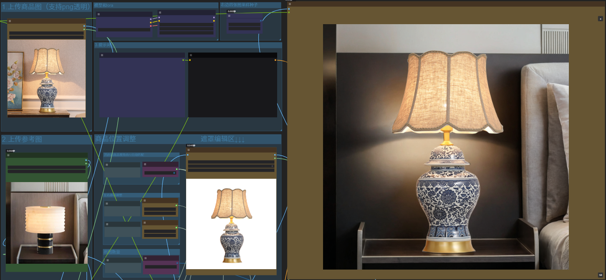
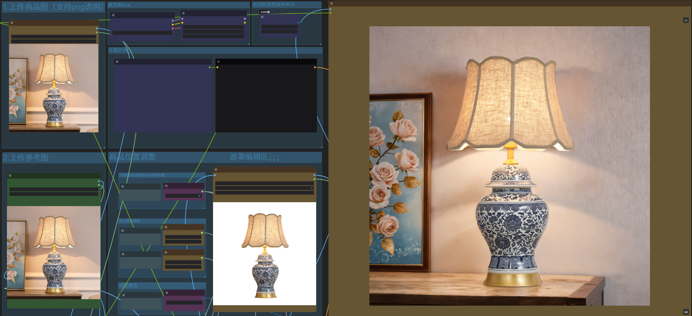

## 场景2：AI批量生成参考图

> ### **高转化/竞品风格一键模仿，批量复制爆款**

[查看原白板](https://skieer.feishu.cn/wiki/IxeGwIQHuirgOFkkUNpcqWImnCf)

### 高转化商品，批量复制
自动拆解高转化图片流量密码，爆款基因快速移植，海量铺货
### 竞品风格，一键模仿
AI一键破解竞品商品图风格/排版，相似风格但完全原创，抢流量不违规
### 需求沟通，简洁高效
打破需求来回拉扯效率瓶颈，需求直观图片展示，沟通成本降低80%
### 美工灵感，不再枯竭
海量参考图批量生成，给美工大量参考，节省素材寻找时间，灵感如泉涌

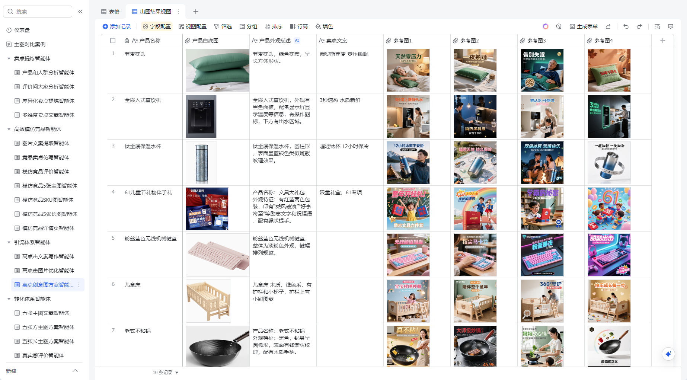

## 场景3：AI批量生成模特图

> ### **商品套图一键生成，无需棚拍模特**

[查看原白板](https://skieer.feishu.cn/wiki/IxeGwIQHuirgOFkkUNpcqWImnCf)

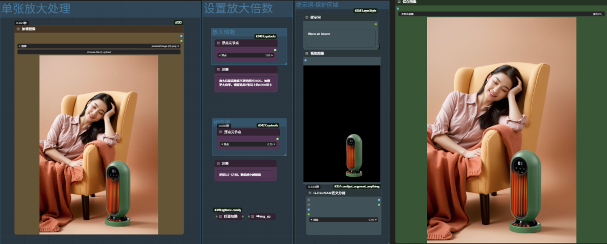

### **模特交互图，海量生成**
手拿、手提、躺、坐……模特与产品各种交互，自动生成。
### 多场景适配，转化翻倍
自动生成办公室、户外、休闲等场景，吸引消费者，提升转化。
### **不用专业摄影，一张图就够**
不用纠结模特姿势对不对、场景透视准不准，省掉影棚拍摄钱。  
### **商品自动美颜，上架0返工**
AI自动调光补色，生成图片自带精修效果，产品颜值up up up！

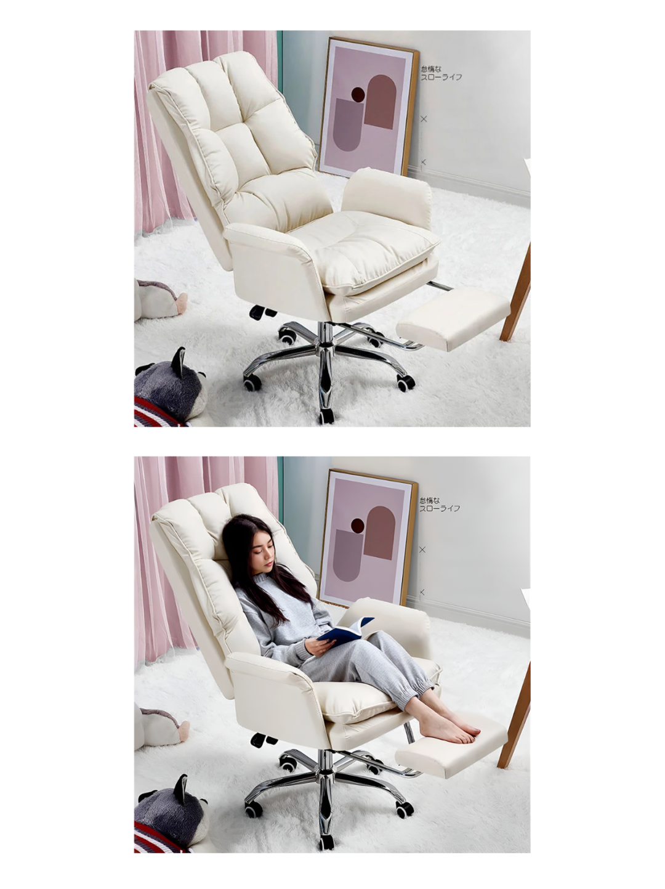

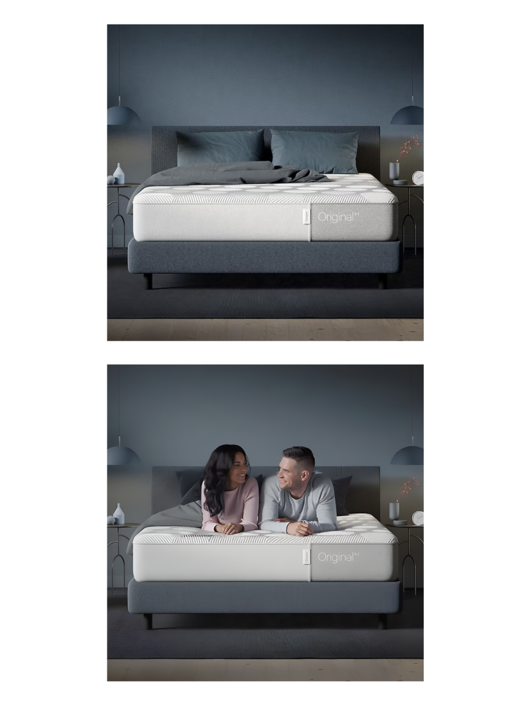

> # 更多AI批量作图场景

批量抠图

智能移除

图片拓展

局部重绘

放大尺寸

融合场景

细节打光

真实优化

生成素材图

生成参考图

文字生图

以图生图

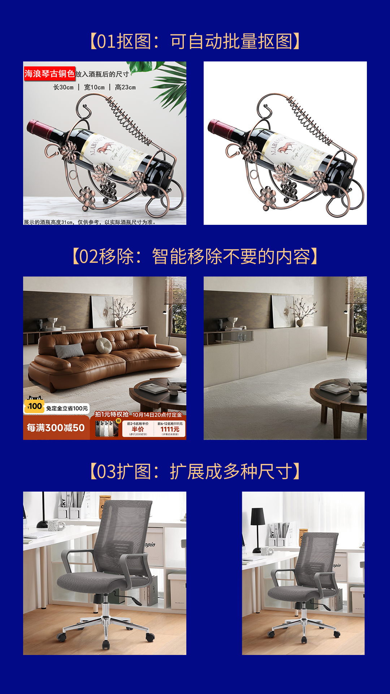

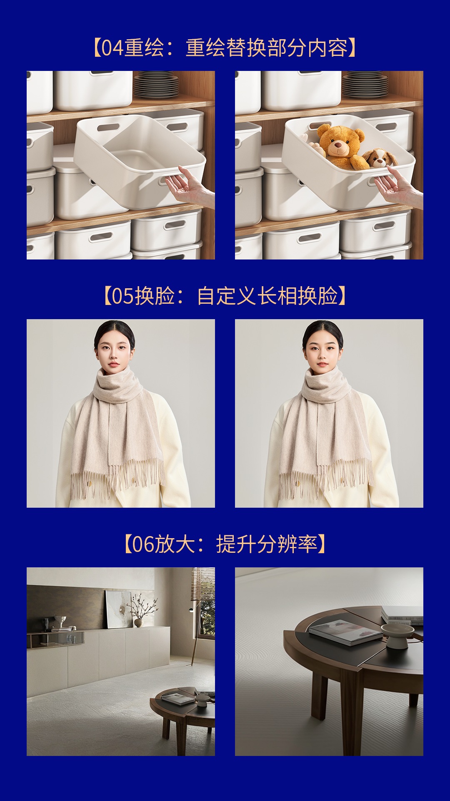

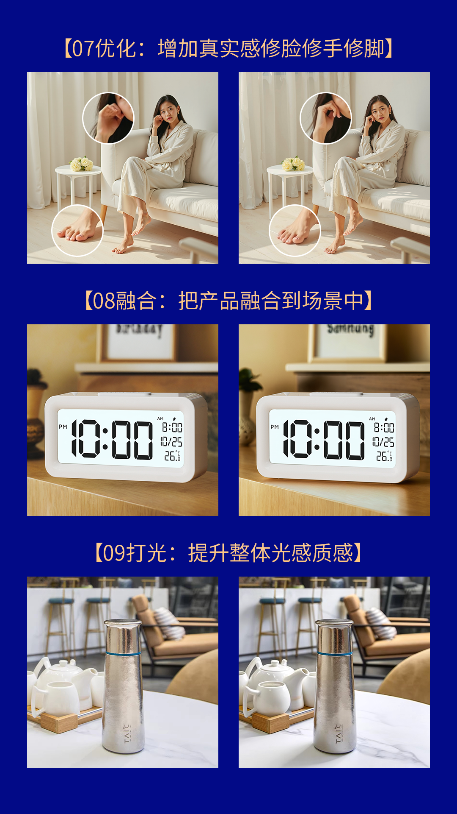

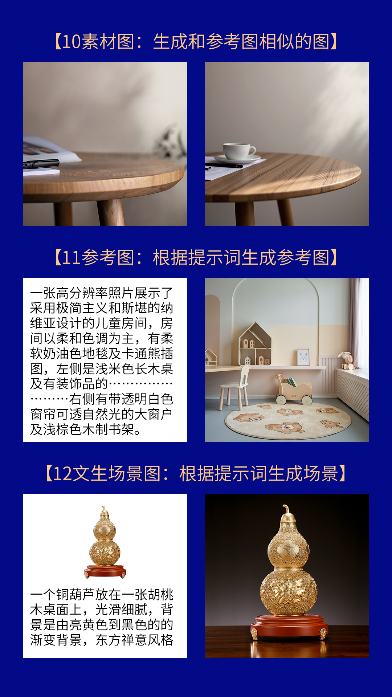

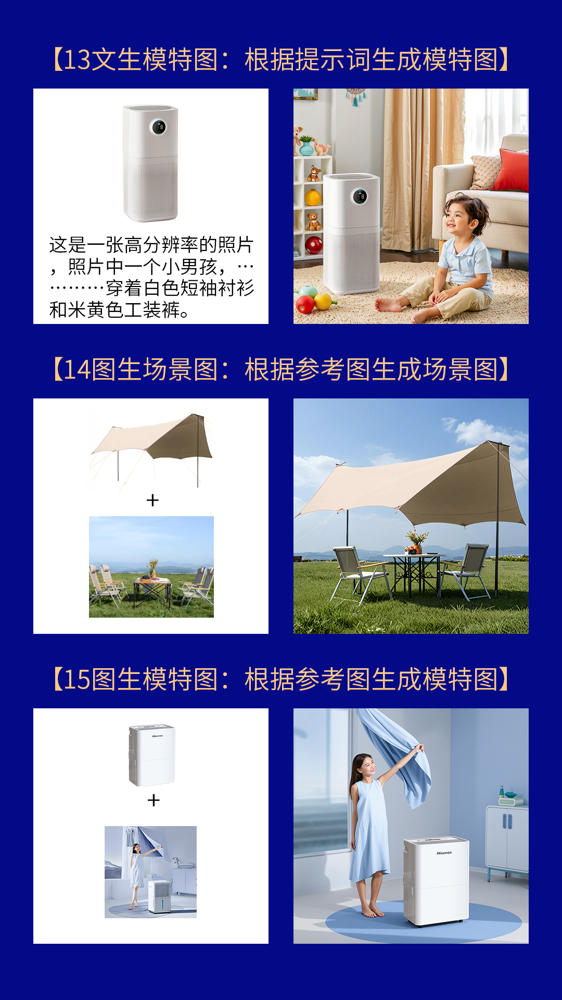

---

原文：[查看原文](https://skieer.feishu.cn/wiki/IxeGwIQHuirgOFkkUNpcqWImnCf)
