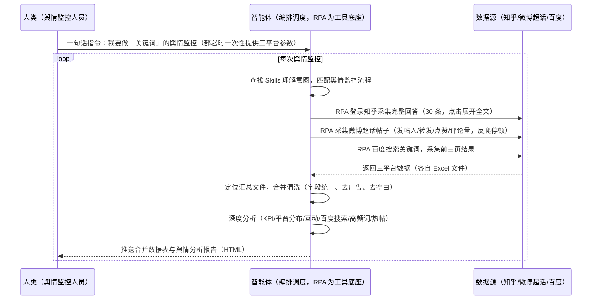

> 为需要全网舆情监控的团队打造（自媒体博主、内容策划、舆情分析）。手动在知乎/微博/百度多平台来回切换搜索导出费时费力、各平台字段格式不一合并易错漏、分析报告门槛高。本方案由智能体调度多个工具执行多平台舆情数据采集（知乎回答/微博超话/百度搜索）+ 自动清洗合并 + 深度分析，输出舆情分析报告。一句话下达指令，全程自动化，无异常不打扰。

> Agent 自动化需开通企业功能
> 点击申请1个月免费权限
> [点击申请 →](https://skieer.feishu.cn/share/base/form/shrcnFwMayykP5iaL38fnZKTbrg)

## 一、用户与需求

核心矛盾：一轮多平台舆情调研平均要花半天时间；知乎/微博/百度字段格式不一，手动合并易错漏；分析报告门槛高、排版耗时间——标准四步流程（多平台采集→清洗合并→数据分析→生成报告）每一环都是重复机械操作。

适用客户：有全网舆情监控需求的团队——自媒体博主（盯口碑）、内容策划（找选题/热点）、舆情分析人员（品牌监控/竞品跟踪）。本方案一句话下达指令即可执行，不需要写代码，新手可跟操作。

### 1.1 不同角色用户

| 用户 | 需求 | 问题 | 投入时间（估算） |
|-|-|-|-|
| 自媒体博主 | 盯口碑 | 多平台来回切换搜索 | 半天/轮 |
| 内容策划 | 找热点选题 | 手动翻帖看数据 | 2-3 小时/轮 |
| 舆情分析 | 出报告 | 分析门槛高、排版耗时 | 半天/轮 |
| 品牌方 | 品牌监控 | 负面发现滞后 | 1 天/轮 |

### 1.2 不同监控对象

| 对象 | 最关注维度 | 核心逻辑 |
|-|-|-|
| 产品口碑（如华为 Mate70） | 用户评价+热度 | 高频关键词/负面预警 |
| 品牌舆情 | 互动数据+广告占比 | 平台分布/声量趋势 |
| 竞品动态 | 新帖/新回答 | 早发现早应对 |
| 热点事件 | 传播速度 | 热帖 Top 榜单 |

### 1.3 不同平台数据

| 平台 | 采集内容 | 特点 |
|-|-|-|
| 知乎 | 问题回答全文（点击展开完整回答） | 需登录，回答长、信息密度高 |
| 微博超话 | 帖子信息（发帖人/转发/点赞/评论量） | PC 端无法直接进入，链接需手机端获取，反爬需停顿 |
| 百度 | 搜索结果前三页 | 需循环翻页，含广告占比分析 |

---

## 二、现在的方法与问题

### 2.1 流程步骤与问题总结

| 序号 | 步骤 | 现在的方法 | 问题缺陷 |
|-|-|-|-|
| 1 | 采数据 | 打开知乎/微博/百度，搜索关键词循环翻页/滚动加载，手动复制点赞评论 | 数据采集时间人力成本高，平台越多关键词越多，半天耗在重复操作 |
| 2 | 清洗合并 | 手动区分广告、剔除空白无效数据、拼成一张总表 | 多元数据格式杂乱，人工整合耗时易错、易遗漏造成统计错误 |
| 3 | 分析 | 自己梳理分析逻辑、搭建统计公式 | 缺少标准化分析逻辑 |
| 4 | 出报告 | 手动排版成可读文档 | 写报告排版耗时间，输出调理不清晰 |

### 2.2 问题分析

| 序号 | 根因 | 具体表现 |
|-|-|-|
| 1 | 采集费人力 | 多平台来回切换、反复翻页，半天耗在重复操作 |
| 2 | 整合易出错 | 知乎/微博/百度字段名称、时间格式、互动数据全不一致，无法直接合并 |
| 3 | 报告门槛高 | 缺少标准化分析逻辑，排版耗时，内容调理不清晰 |
| 4 | 数据易虚构 | 纯 AI 采集时可能只读少量真实数据，剩余海量数据虚构（实锤反馈） |

---

## 三、解决方案

### 3.1 功能概述

为舆情监控场景打造的智能体驱动方案，一句话调度多平台数据采集 + 自动清洗合并 + 深度分析，输出舆情分析报告。

一句话下达指令（如「我要做华为 Mate70 的舆情监控」），智能体通过查找 Skills 文档库理解意图、匹配对应流程，经 MCP 调度八爪鱼 RPA 依次执行知乎（采集 30 条完整回答）、微博超话（帖子信息/互动数据）、百度（前三页搜索结果）三个采集应用，自动合并清洗（15 个字段统一）、按六大板块生成 HTML 舆情分析报告。全程自动化，运行状态实时反馈，跑完推送结果。

### 3.2 系统结合

| 要素 | 说明 |
|-|-|
| 系统组成 | 智能体（WorkBuddy，自然语言理解+任务编排）+ MCP 协议层（连接工具、传递指令、同步状态）+ 八爪鱼 RPA（浏览器操作、数据采集、文件处理） |
| 数据/能力来源 | 知乎（问题回答全文，需登录）+ 微博超话（帖子信息/互动数据，PC 端无法直接进入，链接需手机端获取）+ 百度搜索（搜索结果前三页） |
| RPA 耦合动作 | 作为 Agent 的工具底座被调度执行：知乎采集完整回答（点击展开→收起→下一条）、微博超话采集帖子（滚动停顿 2 秒反爬）、百度搜索翻页采集前三页，自动保存为 Excel 文件，统一流转给智能体 |
| 耦合出的新价值 | 单工具给不了的端到端结论：三平台采集一次跑完 → 自动合并清洗 → 六大板块分析报告（KPI 总览/平台分布/互动分析/百度搜索分析/高频关键词词云/热帖 Top 榜），**只推送合并数据表与分析报告** |

### 3.3 智能体执行流程

一句话下达指令，智能体自动调度：

> Agent 自动化需开通企业功能
> 点击申请1个月免费权限
> [点击申请 →](https://skieer.feishu.cn/share/base/form/shrcnFwMayykP5iaL38fnZKTbrg)

### 3.4 为何这么设计

要同时回答三个问题：**为什么不能只用纯代码 Agent？为什么不能只用纯 RPA？为什么两者要结合？** 本场景的核心是"一句话调度、多平台采集、自动合并分析、挂了有人管"。

#### 1）逐项对比

| 对比维度 | 纯代码 Agent（Codex/Cloud Code 等） | 纯 RPA（八爪鱼） | 智能体+RPA（MCP 结合） |
|-|-|-|-|
| 实现方式 | 用 Skills 写代码/调 API 完成自动化 | 模拟人手动操作网页和桌面软件，拖拽/自然语言搭建 | 智能体理解需求编排任务 + RPA 执行采集清洗 |
| 网页采集 | 接口型获取快，但网页模拟操作难（点击展开/反爬难适配） | 完美处理翻页/点击展开/滚动加载，解决基础反爬 | 复杂网页操作交给 RPA，数据获取稳 |
| 数据真实性 | 可能只读少量真实数据，剩余虚构（实锤反馈） | 真实采集，RPA 抓完整回答 | RPA 真实采集，AI 只做分析不虚构数据 |
| 使用成本（总拥有成本） | 每次执行收 tokens 费，接口改版脚本失效，维护成本高 | 模板搭建后免费反复使用，维护不用代码 | RPA 模板调用不消耗 AI token，长期成本更低 |
| 维护人要求 | 需懂代码，普通业务人员难驾驭 | 非技术人员可上手 | 业务人员一句话调度，运维门槛低 |

#### 2）优劣势说明

|  | 纯代码 Agent | 纯 RPA | 智能体+RPA（MCP 结合） |
|-|-|-|-|
| 优势 | 接口型数据获取快；    
复杂数据清洗处理；    
能思考复杂问题 | 贴合采集场景；    
处理翻页/展开/滚动；    
解决基础反爬 | 智能体听懂自然语言、拆解流程；    
RPA 稳定执行；    
模板组件化自由组合 |
| 劣势 | 上手门槛高；    
网页模拟难适配；    
执行路径不固定；    
tokens 成本高 | 缺少 AI 深度理解；    
自主编排智能分析能力弱 | 需先配置 MCP 连接；    
本地电脑需保持开机 |

#### 3）结论

| 论点 | 说明 |
|-|-|
| 补齐 Agent 短板 | 网页批量采集、多平台数据互通等复杂操作，纯 Agent 做不了，用 RPA 开发对应应用接入（实锤：知乎展开全文、微博反爬停顿） |
| MCP 串联全链路 | MCP 加持后 Agent 能串联多个 RPA 插件，完成采集→清洗→分析全链路复杂流程 |
| 不消耗 AI token | 所有 RPA 模板类似组件化插件，可自由组合调度，调用过程中不消耗 AI token，长期成本更低 |
| 专属应用市场 | 可搭建专属自动化应用市场，按需调用单个采集应用或组合整套舆情全流程，灵活适配自媒体/中小企业 |
| 时间 | 舆情要的是"一句话拿到合并数据表+分析报告"，不是"在多平台来回搬数据" |

### 3.5 功能清单

| 功能 | 系统 | 功能说明（解决问题） |
|-|-|-|
| 会话/一句话指令 | 智能体 | 1. 理解自然语言意图，查找 Skills 文档库。    
2. 匹配对应舆情监控流程、编排多任务。 |
| 多平台数据采集 | RPA | 1. 解决多平台来回切换、手动翻页滚动问题。    
2. 作为智能体工具底座被调度执行，知乎采集完整回答（30 条）、微博超话采集帖子（反爬停顿 2 秒）、百度采集前三页，失败重试。 |
| 数据清洗合并 | 智能体 | 三个 Excel 合并，相同含义字段合并成一个（15 个字段），个性化保留，去广告、去空白，解决多元数据格式杂乱问题。 |
| 数据分析与报告 | 智能体 | 六大板块：KPI 总览（总数/评论点赞转发总量）/平台分布（可视化图表）/互动数据分析（知乎微博对比）/百度搜索分析（广告占比+排名分布）/高频关键词词云（全平台 TOP40 热词）/热门内容 Top 榜（知乎高赞+微博高互动各 TOP5）。 |
| 报告输出 | 智能体 | HTML 格式输出到指定文件夹存档，报告维度可按业务调整。 |
| IM通知 | 飞书、钉钉、企微等 | 解决结果交付滞后问题。采集结果摘要、分析报告自动推送。 |
| 数据资产储存 | 本地电脑、云储存 | 1. Skills 资产：舆情监控与分析技能（Skill 文档可分享复用）。    
2. 数据储存：合并数据表与分析报告统一写入本地指定文件夹。    
3. 经验知识库：报告维度回填迭代。 |

### 3.6 智能体执行落地过程

部署时一次性配置入参（三平台参数、采集数量、保存路径、报告输出文件夹），会话中一句话即可触发，无需重复输入。

**⚠️ 部署前提（不满足则方案无法跑起来）**：①RPA 需部署在**常开电脑/云机**上，并配置漏跑补跑机制；②**需知乎登录态**（知乎采集需登录账号）；③微博超话 PC 端无法直接进入，链接需从手机端获取；④首次配置（API-Key、RPA 应用、MCP 连接、Skill 封装）需服务方/技术人员介入一次，属实施成本。

#### 1）配置（五步）

| 步骤 | 操作 | 说明 |
|-|-|-|
| 第一步 | 八爪鱼 RPA 创建 API-Key | 打开客户端→API-Key→创建（命名自定义）→复制保存到安全位置（关闭后无法再次查看完整内容） |
| 第二步 | 配置 RPA 应用 | 客户端内添加知乎/微博超话/百度三个采集应用，填名称描述（可 AI 一键生成），选择执行器机器人 |
| 第三步 | 登录 RPA 机器人 | 应用运行在机器人上，需登录八爪鱼 RPA 机器人（客户端版本需 2.7 以上） |
| 第四步 | 智能体配置 MCP 连接 | 智能体→专家→连接器→自定义连接器→配置 MCP→粘贴八爪鱼准备好的配置文件→填 API-Key→保存→信任 MCP 服务→六个工具启用（运行搜索/获取应用详情/运行状态/可用极线列表/停止应用） |
| 第五步 | 调试并封装 Skill | 与智能体对话逐应用测试（查参数→运行→查状态），清洗合并、生成报告，最后封装为固定 Skill 文档（说「我要做 XX 舆情监控」即触发全流程） |

| 类别 | 说明 |
|-|-|
| 智能体 | 主流智能体（支持 MCP 连接、Skills 加载）。 |
| 智能体工具 | 1. 数据采集与自动化执行：八爪鱼 RPA（MCP 协议接入，六个通用工具），MCP 配置完成。    
2. 数据分析与报告：智能体自带。    
3. 数据合并清洗：智能体自带（读取 Excel、字段合并）。    
4. IM：企业办公 IM（飞书/钉钉/企微），MCP 或 webhook 配置。 |
| 工作知识 | 1. 监控关键词/对象。    
2. 三平台参数（知乎采集网页/数量/保存路径、微博超话链接、百度关键词/页数）。    
3. 字段合并规则。    
4. 报告维度（六大板块，可按业务调整）。 |
| 本地数据库 | 1. 采集数据文件路径。    
2. 合并数据表路径。    
3. 分析报告输出文件夹。 |

#### 2）执行

| 任务 | 产出 | 产出物接收人 |
|-|-|-|
| 接收一句话指令，匹配 Skill 流程 | 任务启动记录 | —— |
| 一次性收集三平台参数 | 参数确认 | —— |
| 经 MCP 向八爪鱼 RPA 下发采集任务 | 自动化任务指令 | —— |
| 依次执行知乎/微博超话/百度采集（智能体监控状态） | 三份 Excel 数据 | —— |
| 定位汇总文件，合并清洗（15 字段统一） | 合并数据表 | 舆情分析 |
| 深度分析（六大板块） | 舆情分析报告（HTML） | 舆情分析/老板 |
| 推送结果摘要与分析报告 | 群消息 | 舆情分析/老板 |

异常处理：

登录失效 → 告警人工介入后断点续跑；

采集失败 → 自动重试；

微博链接失效 → 提示从手机端重新获取超话链接；

文件未找到 → 核对桌面真实路径（自定义路径时告知智能体详细路径）；

采集数据不全 → 降级说明本次覆盖率；

分析置信度低 → 转人工复核，不输出硬结论。

#### 3）结果

| 结果 | 说明 |
|-|-|
| 数据资产 | 合并数据结构化存储（三平台字段统一，15 个字段），可审计可追溯。 |
| 分析报告 | 舆情分析报告（HTML）：KPI 总览/平台分布/互动数据分析/百度搜索分析/高频关键词词云（TOP40 热词）/热门内容 Top 榜（各 TOP5）。 |
| Skills | 智能体 Skills：舆情监控与分析技能（Skill 文档可分享，RPA 流程一致即可在不同智能体执行）。 |

> Agent 自动化需开通企业功能
> 点击申请1个月免费权限
> [点击申请 →](https://skieer.feishu.cn/share/base/form/shrcnFwMayykP5iaL38fnZKTbrg)

---

## 四、使用前后预估

> 本方案价值 = **一句话下达指令 → 多平台自动采集 → 自动合并清洗 → 六大板块分析报告**。把舆情人员从半天的机械搬数据中解放出来，省去 90% 手动干活时间。

| 指标 | 人工 | 纯代码 Agent | 智能体+自动化工具 |
|-|-|-|-|
| 数据采集 | 半天/轮 | 可能虚构数据 | 一句话调度，RPA 真实采集 |
| 多平台整合 | 手动复制粘贴 | 脚本难适配反爬 | 自动合并清洗成表 |
| 分析报告 | 门槛高、排版耗时 | 能生成但成本高 | 六大板块自动生成 |
| 数据真实性 | 靠人工核对 | 可能虚构（实锤） | RPA 真实采集可追溯 |
| 方法论 | 无，换人标准不同 | 无沉淀 | 可复用的 Skills 与数据表 |

**说明**：标准四步流程（采集→清洗→分析→报告）每一环都是重复机械操作（实锤）；知乎需登录、微博超话 PC 端无法直接进入（链接需手机端获取）、百度需翻页；RPA 模板调用不消耗 AI token（实锤）；整体省去 90% 手动干活时间。

---

## 五、效果证明

> Agent 自动化需开通企业功能
> 点击申请1个月免费权限
> [点击申请 →](https://skieer.feishu.cn/share/base/form/shrcnFwMayykP5iaL38fnZKTbrg)

### 5.1 实操课程教程

[查看原视频](https://player.bilibili.com/player.html?bvid=1GxMb6tErw)

### 5.2 客户案例

**《春田纪：生鲜即时零售多店铺客服数据采集与舆情告警》**

> 生鲜即时零售品牌，旗下运营多家店铺，覆盖小时达与传统电商。原靠专人盯各店铺，售后、差评、客服、舆情、品退 5 块数据难以汇总。

| 效果 | 说明 |
|-|-|
| 提效 | 多店铺客服数据采集由「专人盯店」变为自动取数。原本售后、差评、客服、舆情、品退 5 大类数据需人工逐店铺登录导出，现在自动采集、T+1 入库，分析团队可直接使用。 |
| 降本 | 免除专人盯店的人力投入，客服与管理团队投入转向异常处理与店铺运营等重点工作。 |
| 任务 | 覆盖多家店铺，5 大数据维度自动采集，多店铺自动切换登录。 |
| 任务 | 舆情每 2 小时自动扫描客服会话（4:00-22:00），命中监控词即时推送飞书群告警。 |

案例详情：[客服：生鲜即时零售全链路客服后台数据自动化](https://skieer.feishu.cn/wiki/MxvzwkQrHiEkFHknzSqcBDHTnhd)

**《社媒违禁词监控：日均处理 300+ 违规帖》**

> 面向多账号多平台的价格体系与舆情治理，自动巡检违规帖与违禁词内容，锁定低价倾销与负面信息并留证。

| 效果 | 说明 |
|-|-|
| 提效 | 违规内容处理由人工逐页排查变为日均 300+ 条自动处理。原本需监控上百个电商链接与全网社媒内容、逐条人工审阅，现在 7×24 自动采集与识别。 |
| 降本 | 免除市场与法务人工逐条筛查的重复投入，投入转向维权处置与渠道治理等重点工作。 |
| 任务 | 覆盖电商链接价格合规、社媒违规内容与新闻舆情三类风险场景，全渠道统一监控。 |
| 任务 | 违规内容自动留证，为维权与渠道沟通提供证据链。 |

案例详情：[维权|违禁词监控：八爪鱼RPA日均处理300+违规帖，守牢价格体系，扼杀负面舆情](https://skieer.feishu.cn/wiki/VBfdwmbNbiSVHhkMt1tc528Tn0d)

---

## 六、备注

### 6.1 Agent 支持

本方案不绑定具体智能体，主流 Agent 均可运行（需支持 MCP 连接、技能/Skills 加载与工具调用）：

| Agent/智能体 | 说明 |
|-|-|
| Workbuddy | 本方案运行平台，支持技能/Skills 上传加载、定时任务、MCP 工具调用与表格/报告处理 |
| 豆包（国内·字节） | 国内主流个人智能体，支持技能上传、定时任务与工具调用，上手成本低 |
| 通义千问（国内·阿里） | 支持 Agent 编排与插件生态，集成阿里电商数据能力，适合电商场景 |
| DeepSeek（国内） | 推理能力强、成本低，适合规则打分与归因分析类任务 |
| ChatGPT（国外·OpenAI） | 海外主流通用智能体，支持 GPTs/Agent 模式与工具调用 |
| Claude（国外·Anthropic） | 长文本与结构化分析能力强，原生支持 MCP 连接外部工具 |

### 6.2 名词解释

| 术语 | 说明 |
|-|-|
| 舆情监控 | 对多平台用户口碑/内容进行系统性采集与分析 |
| 知乎 | 问答社区平台，采集问题回答全文（需登录） |
| 微博超话 | 微博话题社区，采集帖子信息/互动数据（PC 端无法直接进入，链接需手机端获取） |
| 百度搜索 | 搜索引擎，采集搜索结果前三页（含广告占比分析） |
| MCP | Model Context Protocol，智能体连接外部工具的标准化通道 |
| API-Key | 八爪鱼 RPA 身份凭证，WorkBuddy 进入 RPA 身份验证的专属钥匙（版本需 2.7 以上） |
| RPA | 机器人流程自动化，模拟真人操作网页和桌面软件 |
| Skill 文档 | 把调试好的流程封装成智能体可识别的固定技能文档 |
| 一句话指令 | 用自然语言描述任务，智能体自动翻译为自动化流程 |
| 反爬 | 平台的反爬虫机制，RPA 通过滚动停顿等方式规避 |
| 指纹浏览器 | 隔离 Cookie/浏览器指纹的工具，多账号防关联 |

> Agent 自动化需开通企业功能
> 点击申请1个月免费权限
> [点击申请 →](https://skieer.feishu.cn/share/base/form/shrcnFwMayykP5iaL38fnZKTbrg)

---

原文：[查看原文](https://skieer.feishu.cn/wiki/H0hew2sJRiGlyAkbjvZcxWRjnoh)
