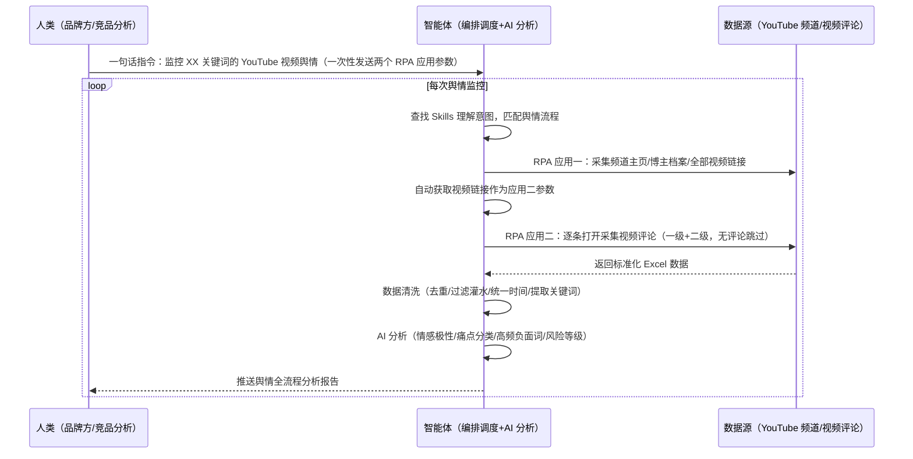

> 为做海外市场的品牌团队打造（品牌方、竞品分析专员）。YouTube 热门视频下大几千甚至上万条评论人工翻看眼花看不完、分类统计提炼观点靠人肉、二级评论层级丢失、品牌反馈发现滞后。本方案由智能体调度多个工具执行 YouTube 频道与评论数据采集 + 数据清洗 + AI 舆情分析（情感/痛点/风险）+ 报告生成，输出舆情全流程分析报告。一句话下达指令，全程自动化，无异常不打扰。

> Agent 自动化需开通企业功能
> 点击申请1个月免费权限
> [点击申请 →](https://skieer.feishu.cn/share/base/form/shrcnFwMayykP5iaL38fnZKTbrg)

## 一、用户与需求

核心矛盾：一个热门视频下可能有大几千甚至上万条评论，人工一条条看眼花看不完，更别说分类、统计、提炼观点；视频评论需下滑加载、二级评论需点击展开，人工操作易丢失层级；品牌负面反馈发现滞后，无法持续追踪海外用户需求——标准四步流程（采集→清洗→分析→输出）每一环都是重复机械操作。

适用客户：有海外品牌舆情监控需求的团队——海外品牌方（持续追踪用户反馈）、竞品分析专员（盯竞品与行业热点）、产品部门（获取改进依据）。本方案一句话下达指令即可执行，不需要写代码，新手可跟操作。

### 1.1 不同角色用户

| 用户 | 需求 | 问题 | 投入时间（估算） |
|-|-|-|-|
| 品牌方 | 持续追踪反馈 | 人工翻评论看不完 | 1 天/轮 |
| 竞品分析专员 | 盯竞品热点 | 多平台人工采集 | 半天/轮 |
| 产品部门 | 改进依据 | 痛点挖掘无方法 | 2-3 小时/轮 |

### 1.2 不同监控对象

| 对象 | 最关注维度 | 核心逻辑 |
|-|-|-|
| 自有品牌 | 负面预警+情感 | 风险等级/情感极性 |
| 竞品品牌 | 竞品对比 | 高频负面词/痛点分类 |
| 行业热点 | 趋势追踪 | 互动分析/活跃用户 |

### 1.3 不同数据层级

| 层级 | 内容 | 特点 |
|-|-|-|
| 频道数据 | 博主档案/全部视频链接 | 批量采集 |
| 一级评论 | 视频直接评论 | 含评论人/内容/点赞/时间 |
| 二级评论 | 评论的回复 | 需点击展开，父子层级保留 |

---

## 二、现在的方法与问题

### 2.1 流程步骤与问题总结

| 序号 | 步骤 | 现在的方法 | 问题缺陷 |
|-|-|-|-|
| 1 | 采集 | 人工翻 YouTube 评论，一条条看 | 大几千上万条看不完，人工采集低效 |
| 2 | 整理 | 人工分类统计提炼观点 | 层级丢失、批量监控难 |
| 3 | 分析 | 凭经验判断 | 无情感/痛点/风险标准化分析 |
| 4 | 输出 | 手动整理报告 | 反馈发现滞后，无法持续追踪 |

### 2.2 问题分析

| 序号 | 根因 | 具体表现 |
|-|-|-|
| 1 | 采集低效 | 人工翻几千条评论，眼睛看花 |
| 2 | 层级丢失 | 二级评论需点击展开，人工易漏 |
| 3 | 无分析模型 | 情感/痛点/风险靠人工判断 |
| 4 | 反馈滞后 | 负面发现不及时，无法持续追踪 |

---

## 三、解决方案

### 3.1 功能概述

为海外品牌舆情监控场景打造的智能体驱动方案，一句话调度 YouTube 数据采集 + 数据清洗 + AI 舆情分析，输出舆情全流程分析报告。

一句话下达指令（如「监控 YouTube 视频舆情信息」+ 一次性发送两个 RPA 应用启动参数），智能体通过查找 Skills 理解意图，经 MCP 调度八爪鱼 RPA 先执行频道数据抓取（批量采集频道主页/博主档案/全部视频链接），再自动获取第一步结果中的视频链接作为第二应用参数，逐条打开采集视频评论（含二级评论，无评论自动跳过），最后生成完整舆情全流程分析报告。全程自动化，运行状态实时反馈，跑完推送结果。

### 3.2 系统结合

| 要素 | 说明 |
|-|-|
| 系统组成 | 智能体（WorkBuddy，数据清洗+AI 分析）+ MCP 协议层（连接工具、传递指令、同步状态）+ 八爪鱼 RPA（浏览器操作、频道/评论采集） |
| 数据/能力来源 | YouTube 频道主页（博主档案/视频链接）+ YouTube 视频评论（一级/二级评论，需下滑加载、点击展开）+ 本地报告（舆情分析结果） |
| RPA 耦合动作 | 作为 Agent 的工具底座被调度执行：应用一采集频道数据（博主档案+全部视频链接）→ 自动获取结果中的视频链接作为应用二参数 → 应用二逐条采集评论（含二级评论、父子层级保留、无评论自动跳过），导出标准化 Excel（视频基础信息/评论人/评论内容/点赞数/时间），统一流转给智能体 |
| 耦合出的新价值 | 单工具给不了的端到端结论：采集→清洗→情感分析→痛点识别→风险预警→报告一次跑完，**只推送舆情全流程分析报告** |

### 3.3 智能体执行流程

一句话下达指令，智能体自动调度：

> Agent 自动化需开通企业功能
> 点击申请1个月免费权限
> [点击申请 →](https://skieer.feishu.cn/share/base/form/shrcnFwMayykP5iaL38fnZKTbrg)

### 3.4 为何这么设计

要同时回答三个问题：**为什么不能只用纯代码 Agent？为什么不能只用纯 RPA？为什么两者要结合？** 本场景的核心是"一句话调度、自动采集、AI 分析、挂了有人管"。

#### 1）逐项对比

| 对比维度 | 纯代码 Agent（Codex 等） | 纯 RPA（八爪鱼） | 智能体+RPA（MCP 结合） |
|-|-|-|-|
| 实现方式 | 用 AI 写代码方式实现自动化，灵活智能 | 低代码方式实现自动化，固定稳定执行 | 智能体理解需求 AI 分析 + RPA 执行采集 |
| 数据采集 | 评论需下滑加载/二级需点击展开，API 有限制易被封 | 模拟人操作，下滑加载/点击展开/父子层级保留 | 复杂采集交给 RPA，稳定不漏 |
| 数据清洗分析 | 清洗处理能力强 | 只能采集不能分析 | AI 清洗+情感/痛点/风险分析一步到位 |
| 使用成本（总拥有成本） | 维护成本极高、技术门槛高 | 模板搭建后免费反复使用 | RPA 任务本地执行不消耗 token（仅分析需 AI），长期成本更低 |
| 维护人要求 | 需懂代码 | 业务人员可上手 | 业务人员一句话调度 |

#### 2）优劣势说明

|  | 纯代码 Agent | 纯 RPA | 智能体+RPA（MCP 结合） |
|-|-|-|-|
| 优势 | 接口型数据获取快；     复杂数据清洗处理能力强 | 操作网页稳定；     登录/点击/滚动/输入天生擅长；     业务人员可上手 | 智能体擅长思考编排；     RPA 擅长执行操作；     模板组件化自由组合 |
| 劣势 | 维护成本高；     技术门槛高；     企业交付不够产品化；     浏览器能力需额外拓展 | 缺 AI 深度理解与分析能力 | 需先配置 MCP 连接；     本地电脑需保持开机 |

#### 3）结论

| 论点 | 说明 |
|-|-|
| 先理解业务 | 先清晰定义问题（品牌舆情监控），再选工具——工具是为解决问题服务的 |
| 补齐 Agent 短板 | 评论下滑加载/二级展开/YouTube 反爬限频，Agent 调用 API 拿不到完整数据，需 RPA 补位 |
| 1+1>2 | 采集和分析各司其职又无缝衔接：RPA 采集 → AI 分析 → 报告输出 → 持续迭代，完整舆情监控闭环 |
| 不消耗 AI token | RPA 任务本地执行不占用 Agent 的 token 额度（实锤） |
| 专属应用市场 | Agent 缺少什么自动化能力，就用 RPA 开发什么，相当于给 Agent 开了一个可自定义的应用商店 |
| 时间 | 舆情要的是"一句话拿到全流程分析报告"，不是"人工翻几千条评论" |

### 3.5 功能清单

| 功能 | 系统 | 功能说明（解决问题） |
|-|-|-|
| 会话/一句话指令 | 智能体 | 1. 理解自然语言意图，查找 Skills 文档库。     2. 匹配对应舆情流程、编排多任务（未发送参数会主动询问）。 |
| 频道数据采集 | RPA | 1. 解决人工采集低效问题。     2. 作为智能体工具底座被调度执行，批量采集频道主页/博主档案/全部视频链接。 |
| 评论采集 | RPA | 自动获取视频链接作为参数，逐条采集视频评论（含二级评论、父子层级保留、无评论自动跳过），导出标准化 Excel（视频信息/评论人/内容/点赞/时间）。 |
| 数据清洗 | 智能体 | 去重、过滤无意义灌水评论、统一时间格式、提取品牌和竞品关键词，把脏数据变干净。 |
| AI 舆情分析 | 智能体 | 情感极性判断（正面/中性/负面）、痛点分类（类别/次数/占比）、高频负面词提取（Top15）、风险等级（指标+处置建议）。 |
| 报告生成 | 智能体 | 舆情全流程分析报告：数据清洗摘要/风险等级/情感分布/痛点分类/高频负面词/互动分析/活跃用户/热门评论/全部评论数据/总体总结。 |
| 预警推送 | 智能体 | 舆情日报/风险预警自动推送（可按需配置，如负面评论超阈值自动邮件预警）。 |
| IM通知 | 飞书、钉钉、企微等 | 解决舆情发现滞后问题。分析报告自动推送。 |
| 数据资产储存 | 本地电脑、云储存 | 1. Skills 资产：海外舆情监控技能。     2. 数据储存：采集原始数据/分析报告统一写入本地。     3. 经验知识库：风险规则回填迭代。 |

### 3.6 智能体执行落地过程

部署时一次性配置入参（监控关键词、频道名单、RPA 应用参数），会话中一句话即可触发，无需重复输入。

**⚠️ 部署前提（不满足则方案无法跑起来）**：①RPA 需部署在**常开电脑/云机**上，并配置漏跑补跑机制；②**需 YouTube 登录态**（登录失效自动告警）；③YouTube 有反爬限频机制（访问频率受限，RPA 需按合理频率采集）；④首次配置（API-Key、RPA 应用、MCP 连接、Skill 封装）需服务方/技术人员介入一次，属实施成本。

#### 1）配置（四步）

| 步骤 | 操作 | 说明 |
|-|-|-|
| 第一步 | 八爪鱼 RPA 创建 API-Key | 打开客户端→API-Key→创建（命名自定义）→复制保存 |
| 第二步 | 配置 RPA 应用 | MCP 工具→接入指引→MCP 平台对接设置→其他→选择 API-Key→复制 JSON 配置；添加应用（频道抓取/评论抓取，AI 一键生成名称描述）→确定 |
| 第三步 | 智能体配置 MCP 连接 | 智能体→专家技能连接器→连接器→自定义连接器→配置 MCP→粘贴 JSON→保存→刷新重连→六个自动化工具启用 |
| 第四步 | 调试并封装 Skill | 与智能体对话测试（查参数→执行→查状态），调试完成后封装为固定 Skill（说「监控 XX 舆情」即触发全流程） |

| 类别 | 说明 |
|-|-|
| 智能体 | 主流智能体（支持 MCP 连接、Skills 加载）。 |
| 智能体工具 | 1. 数据采集与自动化：八爪鱼 RPA（MCP 协议接入，六个通用工具：运行搜索/获取应用详情/运行状态/可用极线列表/停止应用等），MCP 配置完成。     2. 数据清洗与 AI 分析：智能体自带。     3. 报告生成：智能体自带。     4. IM：企业办公 IM（飞书/钉钉/企微），MCP 或 webhook 配置。 |
| 工作知识 | 1. 监控关键词/频道名单。     2. 两个 RPA 应用参数（频道抓取/评论抓取）。     3. 情感/痛点/风险分析规则。     4. 报告维度（十一模块）。 |
| 本地数据库 | 1. 采集原始数据路径。     2. 分析报告输出路径。     3. 经验库地址。 |

#### 2）执行

| 任务 | 产出 | 产出物接收人 |
|-|-|-|
| 接收一句话指令，匹配 Skill 流程 | 任务启动记录 | —— |
| RPA 应用一：采集频道数据（博主档案+视频链接） | 频道数据 | —— |
| 自动获取视频链接作为应用二参数 | 参数传递 | —— |
| RPA 应用二：逐条采集视频评论（含二级，无评论跳过） | 评论数据 Excel | —— |
| 数据清洗（去重/过滤灌水/统一时间/提取关键词） | 干净数据 | —— |
| AI 分析（情感/痛点/高频负面词/风险等级） | 分析结果 | 品牌方/产品 |
| 生成舆情全流程分析报告 | 分析报告 | 品牌方/竞品分析 |
| 推送报告 | 群消息 | 品牌方/竞品分析/产品 |

异常处理：

登录失效 → 告警人工介入后断点续跑；

视频无评论 → 自动跳过；

评论加载不全 → 下滑加载重试；

采集失败 → 自动重试；

YouTube 限频 → 降速重试；

分析置信度低 → 转人工复核，不输出硬结论。

#### 3）结果

| 结果 | 说明 |
|-|-|
| 数据资产 | 采集原始数据标准化存储（视频基础信息/评论人/评论内容/点赞数/时间/父子层级），可审计可追溯。 |
| 分析报告 | 舆情全流程分析报告（十一模块）：数据清洗摘要（原始/去重/灌水过滤/有效评论数）/风险等级（指标+处置建议）/情感极性（正/中/负分布+可视化图表）/痛点分类（类别/次数/占比）/高频负面词（Top15 词云）/互动分析（点赞/评论长度分布）/Top10 活跃用户/Top15 热门评论（情感类型+痛点）/全部评论数据/总体总结（情感态势/倾向/核心痛点/品牌关键词）。 |
| Skills | 智能体 Skills：海外舆情监控技能（每日增量更新/日报周报/风险预警可自定义配置）。 |

> Agent 自动化需开通企业功能
> 点击申请1个月免费权限
> [点击申请 →](https://skieer.feishu.cn/share/base/form/shrcnFwMayykP5iaL38fnZKTbrg)

---

## 四、使用前后预估

> 本方案价值 = **一句话下达指令 → YouTube 频道+评论自动采集 → 数据清洗 → AI 舆情分析 → 全流程报告**。把品牌方从人工翻几千条评论中解放出来，实现海外用户需求持续追踪。

| 指标 | 人工 | 纯代码 Agent | 智能体+自动化工具 |
|-|-|-|-|
| 评论采集 | 几千上万条看不完 | API 有限制易被封 | RPA 稳定采集含二级评论 |
| 层级保留 | 人工易丢失 | API 难拿全 | 父子层级保留 |
| 情感/痛点分析 | 凭经验 | 能分析但采集不稳 | AI 标准化分析 |
| 风险预警 | 发现滞后 | 无闭环 | 日报/预警可配置 |
| 方法论 | 无，换人标准不同 | 无沉淀 | 可复用的 Skills 与报告模板 |

**说明**：热门视频下大几千甚至上万条评论（实锤）；评论需下滑加载、二级评论需点击展开（实锤）；YouTube 有反爬限频机制（实锤）；RPA 任务本地执行不消耗 token（实锤）；采集→清洗→分析→报告→迭代四层闭环（实锤）。

---

## 五、效果证明

> Agent 自动化需开通企业功能
> 点击申请1个月免费权限
> [点击申请 →](https://skieer.feishu.cn/share/base/form/shrcnFwMayykP5iaL38fnZKTbrg)

### 5.1 实操课程教程

[查看原视频](https://player.bilibili.com/player.html?bvid=1pNhN6PE59)

### 5.2 客户案例

**《春田纪：生鲜即时零售多店铺客服数据采集与舆情告警》**

> 生鲜即时零售品牌，旗下运营多家店铺，覆盖小时达与传统电商。原靠专人盯各店铺，售后、差评、客服、舆情、品退 5 块数据难以汇总。

| 效果 | 说明 |
|-|-|
| 提效 | 多店铺客服数据采集由「专人盯店」变为自动取数。原本售后、差评、客服、舆情、品退 5 大类数据需人工逐店铺登录导出，现在自动采集、T+1 入库，分析团队可直接使用。 |
| 降本 | 免除专人盯店的人力投入，客服与管理团队投入转向异常处理与店铺运营等重点工作。 |
| 任务 | 覆盖多家店铺，5 大数据维度自动采集，多店铺自动切换登录。 |
| 任务 | 舆情每 2 小时自动扫描客服会话（4:00-22:00），命中监控词即时推送飞书群告警。 |

案例详情：[客服：生鲜即时零售全链路客服后台数据自动化](https://skieer.feishu.cn/wiki/MxvzwkQrHiEkFHknzSqcBDHTnhd)

---

## 六、备注

### 6.1 Agent 支持

本方案不绑定具体智能体，主流 Agent 均可运行（需支持 MCP 连接、技能/Skills 加载与工具调用）：

| Agent/智能体 | 说明 |
|-|-|
| Workbuddy | 本方案运行平台，支持技能/Skills 上传加载、定时任务、MCP 工具调用与表格/报告处理 |
| 豆包（国内·字节） | 国内主流个人智能体，支持技能上传、定时任务与工具调用，上手成本低 |
| 通义千问（国内·阿里） | 支持 Agent 编排与插件生态，集成阿里电商数据能力，适合电商场景 |
| DeepSeek（国内） | 推理能力强、成本低，适合规则打分与归因分析类任务 |
| ChatGPT（国外·OpenAI） | 海外主流通用智能体，支持 GPTs/Agent 模式与工具调用 |
| Claude（国外·Anthropic） | 长文本与结构化分析能力强，原生支持 MCP 连接外部工具 |

### 6.2 名词解释

| 术语 | 说明 |
|-|-|
| YouTube | 海外视频平台，品牌舆情监控数据源 |
| 频道数据 | 博主档案/全部视频链接（应用一采集） |
| 一级/二级评论 | 视频直接评论与其回复，父子层级保留（应用二采集） |
| 情感极性 | 评论正面/中性/负面判断 |
| 痛点分类 | 用户吐槽方面分类统计（类别/次数/占比） |
| 风险等级 | 舆情风险指标+处置建议 |
| 灌水评论 | 无意义刷屏评论，清洗时过滤 |
| MCP | Model Context Protocol，智能体连接外部工具的标准化通道 |
| API-Key | 八爪鱼 RPA 身份凭证，智能体进入 RPA 身份验证的专属钥匙 |
| RPA | 机器人流程自动化，模拟真人操作网页和桌面软件 |
| Skill 文档 | 把调试好的流程封装成智能体可识别的固定技能文档 |
| 一句话指令 | 用自然语言描述任务，智能体自动翻译为自动化流程 |
| 指纹浏览器 | 隔离 Cookie/浏览器指纹的工具，多账号防关联 |

> Agent 自动化需开通企业功能
> 点击申请1个月免费权限
> [点击申请 →](https://skieer.feishu.cn/share/base/form/shrcnFwMayykP5iaL38fnZKTbrg)

---

原文：[查看原文](https://skieer.feishu.cn/wiki/NeoHweo7liB64ckEhR9cBlcCneh)
