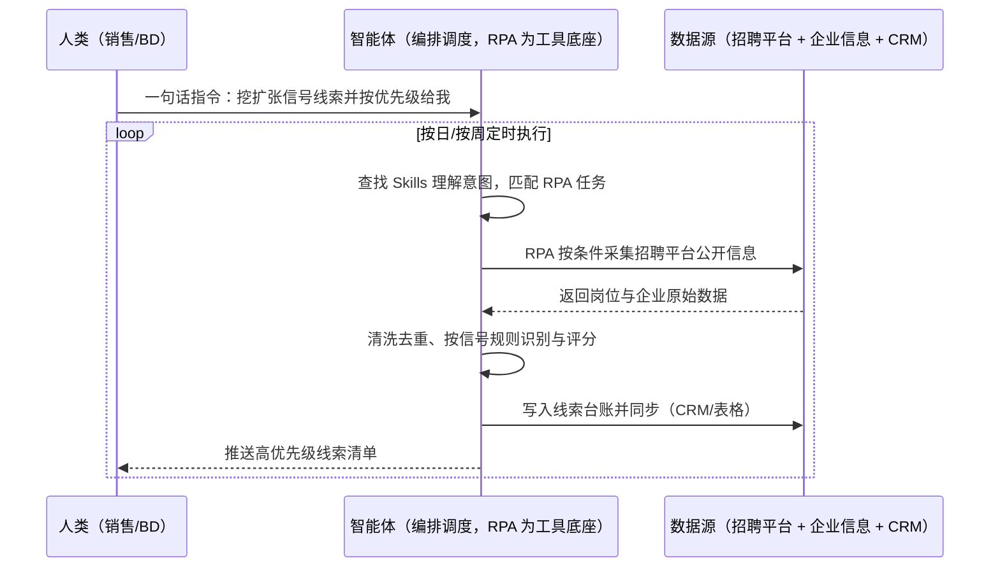

> 为企业打造的招聘信号挖掘线索获取方案。企业在招聘平台上发布的岗位信息，本身就是经营信号——大规模招某类岗位往往意味着业务扩张、新项目启动或服务采购需求，但这类公开信号分散在各个招聘平台，人工逐条筛选效率极低，销售团队拿不到、也用不上。本方案由智能体调度多个工具执行招聘信息批量采集 + 信号规则识别 + 线索自动入库与分配，输出企业线索清单与信号分析报告。按日/按周定时执行，全程自动化，无异常不打扰；联系与商务动作保留人工执行。

> Agent 自动化需开通企业功能
> 点击申请1个月免费权限
> [点击申请 →](https://skieer.feishu.cn/share/base/form/shrcnFwMayykP5iaL38fnZKTbrg)

## 一、用户与需求

核心矛盾：

- 信号分散：招聘信息分散在多平台，人工逐条翻看效率极低（案例口径）
- 信号没被用：招聘规模与岗位结构变化隐含采购与扩张需求，但无人系统化识别
- 线索质量差：手工收集的线索重复、过时，销售不愿用
- 分配不及时：线索收集与分配脱节，错过触达窗口

适用客户：面向企业客户的 B2B 服务商与供应链企业（销售/市场/BD 岗）。已用 CRM 的客户由本方案供线索入库；无 CRM 的客户先落线索台账；部署后业务人员不需要写代码，一句话下达指令即可执行。

### 1.1 不同规模企业

| 类型 | 选择 | 建议 |
|-|-|-|
| B2B 服务商 | 首选 | 强烈推荐（线索是增长命脉） |
| 供应链/制造商 | 首选 | 强烈推荐（可从招聘信号判断客户扩张） |
| 中小服务商 | 次选 | 一般推荐（先盯核心城市与目标行业） |

### 1.2 不同关注维度

| 维度 | 最关注 | 核心逻辑 |
|-|-|-|
| 岗位类型 | 关键岗招聘 | 某些岗位批量招聘=业务扩张信号 |
| 招聘规模 | 数量变化 | 规模突变往往对应项目启动 |
| 招聘时间 | 集中发布 | 集中招聘说明需求紧迫 |
| 企业画像 | 行业与规模 | 决定线索优先级 |
| 城市分布 | 区域扩张 | 新城市招聘=区域布局 |
| 历史对比 | 招聘频次 | 持续招聘说明业务稳定增长 |

### 1.3 不同角色用户

| 用户 | 需求 | 问题 | 投入时间（估算） |
|-|-|-|-|
| 销售/BD | 高质量线索 | 手工收集质量差 | 每周 3-5 小时 |
| 市场负责人 | 线索规模 | 线索量不稳定 | 每周复盘 |
| 销售主管 | 线索分配 | 分配靠人工 | 每日 1 小时 |

---

## 二、现在的方法与问题

### 2.1 流程步骤与问题总结

| 序号 | 步骤 | 现在的方法 | 问题缺陷 |
|-|-|-|-|
| 1 | 找企业名单 | 人工搜索招聘平台 | 效率低，覆盖窄 |
| 2 | 记录信息 | 复制到 Excel | 零散、重复 |
| 3 | 判断信号 | 凭经验判断 | 标准不统一 |
| 4 | 整理线索 | 手工清洗去重 | 耗时，质量差 |
| 5 | 分配跟进 | 群里发名单 | 分配不及时 |
| 6 | 效果回顾 | 无系统回顾 | 无法优化筛选规则 |

### 2.2 问题分析

人工方式根因

| 序号 | 根因 | 具体表现 |
|-|-|-|
| 1 | 采集靠人工 | 逐平台逐条翻看 |
| 2 | 无信号规则 | 判断标准在人脑 |
| 3 | 无台账沉淀 | 线索不留痕，无法复盘 |

**系统工具方式根因**

| 序号 | 根因 | 具体表现 |
|-|-|-|
| 1 | 平台无接口 | 招聘平台多不开放接口 |
| 2 | 与 CRM 脱节 | 线索不能自动入库 |
| 3 | 无评分机制 | 线索优先级靠感觉 |

---

## 三、解决方案

### 3.1 功能概述

为企业打造的招聘信号挖掘方案，一句话调度招聘信息采集 + 信号识别 + 线索入库，输出企业线索清单与信号分析。

一句话下达指令（如「把这个月有扩张信号的线索都挖出来，按优先级给我」），智能体通过查找 Skills 文档库理解意图、匹配 N 个 RPA 自动化任务（采集→清洗→识别→评分→入库→推送），经 MCP 调度八爪鱼 RPA 按关键词与城市条件批量采集招聘平台公开信息，按信号规则识别目标企业，去重后写入线索台账并按优先级推送销售团队。全程自动化，运行状态实时反馈，跑完推送结果。

### 3.2 系统结合

| 要素 | 说明 |
|-|-|
| 客户现有工具盘点 | **未购 SaaS 客户**：招聘平台 + Excel。      
**已购 SaaS 客户**（主流）：CRM（线索承接）+ 招聘平台公开信息 + 企业信息查询工具 + 企业微信/飞书（分配通知） |
| 数据/能力来源 | 招聘平台公开岗位信息（低频只读）、企业工商信息（用于画像）、历史线索与成交记录（用于规则优化） |
| RPA 耦合动作 | 作为 Agent 的工具底座被调度执行：①解决逐平台翻看采集的机械动作；②被智能体调度执行采集与字段规范；③写入线索台账并按规则分派推送 |
| 耦合出的新价值 | 单系统给不了的端到端结论：招聘信号 + 企业画像 + 线索评分统一入库，**只推送高分线索** |

### 3.3 智能体执行流程

一句话下达指令，智能体自动调度；入参（关键词、城市、信号规则、评分口径、接收人）部署时一次配置：

> Agent 自动化需开通企业功能
> 点击申请1个月免费权限
> [点击申请 →](https://skieer.feishu.cn/share/base/form/shrcnFwMayykP5iaL38fnZKTbrg)

### 3.4 为何这么设计

要同时回答三个问题：**为什么不能只用纯代码 Agent？为什么不能只用纯 RPA？为什么两者要结合？** 本场景的核心是"多平台采得到、信号规则可维护、线索能沉淀并分派"。

#### 1）逐项对比

| 对比维度 | 纯代码 Agent（Codex 等） | 纯 RPA（八爪鱼） | 智能体+RPA（MCP 结合） |
|-|-|-|-|
| 实现方式 | 爬取招聘页面与接口 | 登录/访问前台批量采集 | 智能体管规则 + RPA 采集 |
| 多平台登录与取数 | 反爬对抗成本高 | 前台访问，平台可扩 | RPA 取数，智能体统一调度 |
| 风控与多账号隔离 | 高频抓取易被封 | 低频只读 + 环境隔离 | 沿用隔离能力，频率可控 |
| 清洗与入库 | 强，识别评分可定制 | 弱，需定制 | 智能体统一清洗与评分 |
| 使用成本（总拥有成本） | 开发维护自担 | 平台订阅一次多流程复用 | 一份订阅跑多流程，边际成本 ≈ 0 |
| 维护人要求 | 需开发，页面改版返工 | 业务可自维护条件 | 业务改规则、技术兜底 |

技术栈速览：纯智能体路线需 Python（爬虫/去重/评分）等自行实现多平台采集、信号识别与台账写入，页面改版即需维护。

#### 2）优劣势说明

|  | 纯代码 Agent（Codex 等） | 纯 RPA（八爪鱼） | 智能体+RPA（MCP 结合） |
|-|-|-|-|
| 优势 | 无订阅费；      
评分逻辑可定制 | 多平台覆盖广，反爬压力小 | 采集+识别+评分+入库闭环 |
| 劣势 | 反爬与维护自担 | 评分规则配置较弱 | 本地电脑运行需保持开机；      
平台改版需更新流程 |

**特别提醒**：采集须限于**公开可访问信息并遵守平台规则与个人信息保护相关法律，不得采集与使用个人隐私数据**；线索联系与商务动作由人工执行，方案不做自动触达。

#### 3）结论

| 论点 | 说明 |
|-|-|
| 确定性 vs 生成性 | 采集、去重、评分是规则化流水线，RPA 行为可预期 |
| 资产沉淀 | 信号规则、评分口径、线索台账沉淀在平台是活的 |
| 一个底座跑多流程 | 客户购买 RPA 平台是跑多个流程（线索/采集/监测），本方案只是其中一个，订阅费被摊薄 |
| 不消耗 AI token | 采集与评分是规则化流水线，不经大模型对话，token 消耗极低 |
| 线索质量 | 按信号规则筛选 + 评分排序，替代人工凭感觉挑名单 |
| 时间 | 销售要的是"高质量线索自己送上门"，不是"每周手工翻招聘平台" |

### 3.5 功能清单

| 功能 | 系统 | 功能说明（解决问题） |
|-|-|-|
| 会话/一句话指令 | 智能体 | 1. 理解自然语言意图，查找 Skills 文档库。      
2. 匹配对应 RPA 自动化任务、编排多任务。 |
| 招聘信息采集 | RPA | 1. 解决逐平台翻看问题。      
2. 作为工具被调度执行，按关键词与城市批量采集公开岗位信息。      
3. 覆盖多招聘平台。 |
| 清洗与去重 | 智能体 | 去重合并同一企业信息，解决线索重复问题。 |
| 信号识别与评分 | 智能体 | 按岗位类型/规模/时间等规则识别扩张信号并评分，解决判断标准不统一问题。 |
| 企业画像补充 | 智能体 | 补充行业与规模信息，用于线索分级。 |
| 线索入库与分派 | 智能体、CRM | 写入台账并按规则推送对应销售，解决分配不及时问题。 |
| 数据资产储存 | 本地电脑、云储存 | 1. Skills 资产：线索挖掘技能。      
2. 数据储存：线索库与信号规则库。      
3. 经验知识库：转化结果回填用于优化评分。 |

### 3.6 智能体执行落地过程

部署时一次性配置入参（关键词、城市、信号规则、评分口径、接收人），会话中一句话即可触发，无需重复输入。

**⚠️ 部署前提（不满足则方案无法跑起来）**：①RPA 需部署在**常开电脑/云机**上，并配置漏跑补跑机制；②采集频率需控制为低频只读，避免触发风控；③信号规则与评分口径需与销售负责人确认一次（属实施成本）；④线索库或 CRM 需就绪并授权；⑤合规口径（仅公开信息、不涉个人隐私）需法务确认；⑥首次配置（规则、评分、台账）需服务方/技术人员介入一次，属实施成本。

#### 1）配置（五步）

| 步骤 | 操作 | 说明 |
|-|-|-|
| 第一步 | 下载八爪鱼 RPA，导入通用自动化模板 | 官网免费下载客户端；MCP 工具→添加应用 |
| 第二步 | 开启八爪鱼 RPA 的 MCP 服务端口 | 客户端→API-K→创建 API（名称自定义） |
| 第三步 | 在智能体中添加 MCP Server 连接 | 复制连接配置→智能体连接器→自定义连接器→配置 MCP→粘贴保存 |
| 第四步 | 验证工具列表 | 确认工具全部启用（即八爪鱼客户端内工具） |
| 第五步 | 测试运行效果 | 输入一句话指令，验证采集与线索输出 |

| 类别 | 说明 |
|-|-|
| 智能体 | 主流智能体（支持 MCP 连接、Skills 加载、定时任务）。 |
| 智能体工具 | 1. **执行通道**：采集 + 清洗去重 + 识别评分 + 入库分派。      
2. 数据取数与自动化执行：八爪鱼 RPA（MCP 协议接入）。      
3. 数据分析：智能体自带。      
4. IM：企业微信/飞书（MCP 或 webhook 配置）。 |
| 工作知识 | 1. 关键词、城市与行业口径。      
2. 信号规则与评分口径。      
3. 分派规则与责任人。      
4. 合规约束。 |
| 本地数据库 | 1. 线索库地址。      
2. 信号规则库地址。      
3. 转化结果存档地址。 |

#### 2）执行

| 任务 | 产出 | 产出物接收人 |
|-|-|-|
| 接收一句话指令，匹配 RPA 任务 | 任务启动记录 | —— |
| 调用已预设 Skills，编排任务流程 | 任务编排方案 | —— |
| 经 MCP 向八爪鱼 RPA 下发采集任务 | 自动化任务指令 | —— |
| 采集招聘平台公开信息 | 原始岗位数据 | —— |
| 清洗去重与识别评分 | 线索清单 | 销售/BD |
| 写入台账并分派 | 线索台账与分派记录 | 销售主管 |
| 推送高优先级线索 | 群消息 | 销售团队 |

异常处理：

采集失败 → 跳过并记录，下轮补采；

信号命中但企业信息缺失 → 标注"待补全"，不降低优先级误判；

线索重复 → 按企业唯一标识去重合并，保留最新信号时间；

评分异常（超出预设区间） → 提示复核规则，不直接推送。

#### 3）结果

| 结果 | 说明 |
|-|-|
| 数据资产 | 线索库（企业/信号/评分/时间）+ 信号规则库，可追溯。 |
| 分析报告 | 线索周报：新增线索量/信号类型分布/高优先级清单。 |
| Skills | 智能体 Skills：线索挖掘技能，评分规则按月迭代。 |

> Agent 自动化需开通企业功能
> 点击申请1个月免费权限
> [点击申请 →](https://skieer.feishu.cn/share/base/form/shrcnFwMayykP5iaL38fnZKTbrg)

---

## 四、使用前后预估

> 本方案价值 = **公开信号自动采集 → 规则化识别评分 → 线索自动分派**。把销售从手工翻招聘平台中解放出来，线索质量与时效同步提升。

| 指标 | 人工 | 纯代码 Agent | 智能体+自动化工具 |
|-|-|-|-|
| 采集方式 | 人工逐平台翻看 | 反爬维护自担 | 多平台自动采集 |
| 线索质量 | 重复过时，靠感觉筛 | 取决于规则自建 | 规则化识别 + 评分排序 |
| 分配时效 | 群里发名单 | 需自建 | 自动分派推送 |
| 覆盖范围 | 人工有限 | 取决于代码 | 多平台、多城市 |
| 台账沉淀 | 个人 Excel | 脚本目录 | 线索库可复盘 |
| 合规 | 人工判断 | —— | 仅公开信息、不涉隐私 |

**说明**：本方案口径参考八爪鱼招聘信息类客户实践（按公开招聘信号识别企业需求并转化为销售线索），具体数值随目标行业与城市范围而异（估算）；实施前需按客户行业确认信号规则与合规边界。

---

## 五、效果证明

> Agent 自动化需开通企业功能
> 点击申请1个月免费权限
> [点击申请 →](https://skieer.feishu.cn/share/base/form/shrcnFwMayykP5iaL38fnZKTbrg)

### 5.1 客户案例

**《招聘信号挖掘：从招聘平台信号到销售线索》**

> 某全球领先商业地产与投资管理公司，销售线索挖掘依赖人工遍历招聘平台、逐公司逐城统计招聘总数，效率低且响应慢。

| 效果 | 说明 |
|-|-|
| 提效 | 销售线索挖掘由人工逐家抄录变为 7×24 自动遍历采集。原本单家公司需人工逐个平台点击抄录招聘总数、耗时 3-5 分钟，面对数千家潜在客户根本跑不动，现在自动遍历公司列表、切换城市采集。 |
| 降本 | 市场人员从繁琐的重复性人工检索中解放，投入转向线索跟进、客户触达与市场策略等重点工作。 |
| 任务 | 跨招聘平台公司遍历、分城市招聘数抓取到数据清洗汇总全流程自动化。 |
| 任务 | 公司名称跨平台自动归一、模糊值（「若干」「不限」）自动清洗，线索可直接派发。 |

案例详情：[招聘|物业公司解码企业招聘信号，精准挖掘销售线索](https://skieer.feishu.cn/wiki/DangwnHtpir6j9k2XPCcdb13nkb)

---

## 六、备注

### 6.1 Agent 支持

本方案不绑定具体智能体，主流 Agent 均可运行（需支持 MCP 连接、技能/Skills 加载与工具调用）：

| Agent/智能体 | 说明 |
|-|-|
| Workbuddy | 本方案运行平台，支持技能/Skills 上传加载、定时任务、MCP 工具调用与表格/报告处理 |
| 豆包（国内·字节） | 国内主流个人智能体，支持技能上传、定时任务与工具调用，上手成本低 |
| 通义千问（国内·阿里） | 支持 Agent 编排与插件生态，集成阿里电商数据能力，适合电商场景 |
| DeepSeek（国内） | 推理能力强、成本低，适合规则打分与归因分析类任务 |
| ChatGPT（国外·OpenAI） | 海外主流通用智能体，支持 GPTs/Agent 模式与工具调用 |
| Claude（国外·Anthropic） | 长文本与结构化分析能力，原生支持 MCP 连接外部工具 |

### 6.2 名词解释

| 术语 | 说明 |
|-|-|
| 招聘信号 | 企业公开招聘行为隐含的经营与需求信息 |
| 线索 | 有潜在合作意向的企业对象 |
| 线索评分 | 按规则给线索打的优先级分数 |
| 企业画像 | 企业的行业、规模、区域等属性集合 |
| 去重合并 | 把同一企业的多条记录合并为一条 |
| 分派 | 把线索分配给对应销售人员 |
| 扩张信号 | 企业业务或区域扩张的迹象 |
| CRM | 客户关系管理系统，用于线索与商机管理 |
| 触达窗口 | 线索价值最高的联系时段 |
| 合规边界 | 采集与使用数据的法律与平台规则限制 |
| 低频只读 | 控制访问频率、只读取不修改，降低平台风控风险 |
| 公开信息 | 无需授权即可访问的信息 |
| MCP | Model Context Protocol，智能体连接外部工具的标准化通道 |
| Skills | 智能体可加载的预设技能资产，含流程与知识 |

> Agent 自动化需开通企业功能
> 点击申请1个月免费权限
> [点击申请 →](https://skieer.feishu.cn/share/base/form/shrcnFwMayykP5iaL38fnZKTbrg)

---

原文：[查看原文](https://skieer.feishu.cn/wiki/NjyewP9XQinlLXkCTY8cEm8lnKb)
