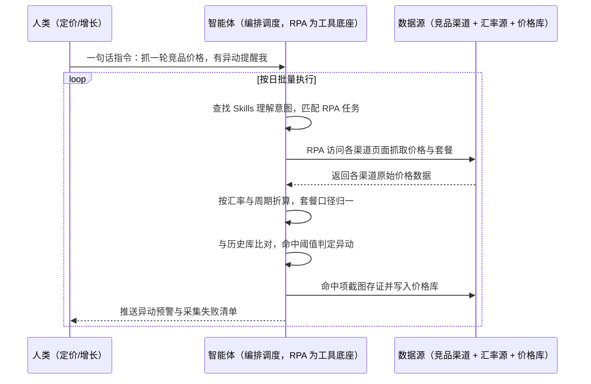

> 为 SaaS / 数字商品厂商构建可对外输出的竞品价格监控能力。人工巡查抓不全也跟不上，定价与促销决策长期滞后。本方案由智能体调度自动化工具，按日全量抓取多个渠道的订阅价格、套餐结构与促销信息，换算归一后按阈值判断异动，输出价格异动预警与结构化价格库；该能力既可自用，也可打包进厂商自有产品，作为面向客户的"价格监控即服务"。按日批量执行，全程自动化，异常才打扰；渠道清单与阈值规则在部署前一次配置。

> Agent 自动化需开通企业功能
> 点击申请1个月免费权限
> [点击申请 →](https://skieer.feishu.cn/share/base/form/shrcnFwMayykP5iaL38fnZKTbrg)

## 一、用户与需求

核心矛盾：

- 渠道多且变价快：软件订阅价格遍布 10 多个渠道与区域站点，变价频繁，人工盯不过来
- 套餐结构复杂：月付/年付/多年、个人版/团队版、加购项交错，价格没法直接比
- 预警不及时：等周会看到价格表，竞品促销窗口早已过去
- 能力难复制：厂商想把这套监控做成产品卖点，人工流程无法规模化交付

适用客户：SaaS / 数字商品厂商（自用价格情报部门），以及希望把监控能力打包给客户的软件服务商；渠道覆盖广、订阅套餐复杂的出海软件品牌优先。自用客户由本方案负责日常巡检与预警；服务化输出客户由本方案负责采集底座按租户隔离，把结果经接口或看板交付给终端客户；部署后业务人员不需要写代码，一句话下达指令即可执行。

### 1.1 不同客户类型

| 类型 | 选择 | 建议 |
|-|-|-|
| SaaS 厂商（渠道 10 个以上） | 首选 | 强烈推荐（自用 + 可服务化输出） |
| 数字商品 / 内容订阅 | 次选 | 一般推荐（渠道略少，价值同样成立） |
| 硬件品牌（仅想抄价格） | 次选 | 一般推荐（建议走品牌价格治理方案） |

### 1.2 不同业务方向

| 方向 | 最关注维度 | 核心逻辑 |
|-|-|-|
| 出海 SaaS | 区域定价与汇率 | 同一产品多区域定价，需归一后才能比 |
| 创意工具 / 生产力软件 | 竞品促销节奏 | 竞品大促与折扣节奏直接决定转化窗口 |
| 数字内容订阅 | 套餐拆解 | 加购项与捆绑包差异大，需按单位价折算 |
| 企业级软件 | 商机型低价 | 低价多为线索获客，需识别意图而非直接跟价 |

### 1.3 不同角色用户

| 用户 | 需求 | 问题 | 投入时间（估算） |
|-|-|-|-|
| 定价 / 增长负责人 | 价格决策有据 | 靠人工零散收集，样本少、更新慢 | 每周数小时 |
| 市场竞争岗 | 竞品动态早发现 | 渠道多、页面结构不一，抓取靠手抄 | 每天 1-2 小时 |
| 产品经理（服务化输出） | 把监控做成产品能力 | 无稳定采集底座，交付靠人力 | 项目制投入 |
| 老板 | 定价体系不被偷袭 | 竞品降价后知后觉 | 只看预警 |

---

## 二、现在的方法与问题

### 2.1 流程步骤与问题总结

| 序号 | 步骤 | 现在的方法 | 问题缺陷 |
|-|-|-|-|
| 1 | 定监控范围 | 市场岗人工圈定竞品与渠道 | 渠道上百个，只能抽几个盯 |
| 2 | 逐渠道查价 | 人工打开各渠道页面记录价格 | 语言、币种、页面结构不同，效率极低 |
| 3 | 套餐拆解 | 人工对比月付/年付与加购项 | 结构不一致，比出来不准 |
| 4 | 异动判断 | 与上次记录手工对比 | 无统一阈值，凭感觉判断 |
| 5 | 预警下发 | 周会上同步或群里发截图 | 滞后数天，错过窗口 |
| 6 | 数据沉淀 | 零散表格存档 | 无结构化库，出不了趋势与月报 |

### 2.2 问题分析

人工方式根因

| 序号 | 根因 | 具体表现 |
|-|-|-|
| 1 | 覆盖面窄 | 渠道多，人工只能抽样，漏价严重 |
| 2 | 口径不齐 | 币种、周期、套餐不同，无法直接比 |
| 3 | 时效差 | 变价到发现往往滞后数天 |
| 4 | 不留痕 | 价格截图零散，事后无法举证 |

**SaaS 方式根因**

| 序号 | 根因 | 具体表现 |
|-|-|-|
| 1 | 只覆盖有接口的渠道 | 多数渠道无开放接口，取不到价 |
| 2 | 只管采集不管判断 | 采回来还要人工比对与判断 |
| 3 | 难服务化交付 | 多租户、多竞品清单无法规模化配置 |

---

## 三、解决方案

### 3.1 功能概述

为 SaaS / 数字商品厂商打造的竞品价格监控服务化方案，一句话调度 10 多个渠道的订阅价格采集、套餐归一与异动预警，输出结构化价格库与预警报表，能力可自用也可打包输出。

一句话下达指令（如「把竞品在 10 个以上渠道的订阅价格抓一遍，有异动就提醒我」），智能体通过查找 Skills 文档库理解意图、匹配 N 个 RPA 自动化任务（采集→归一→比对→存证→预警），经 MCP 调度八爪鱼 RPA 自动访问各渠道页面，抓取订阅价格、套餐结构与促销信息，按当日汇率与周期折算归一后与历史库比对，命中阈值即截图存证并推送预警；同时把结构化结果写入价格库，供趋势分析与对外交付。全程自动化，运行状态实时反馈，跑完推送结果。

### 3.2 系统结合

| 要素 | 说明 |
|-|-|
| 客户现有工具盘点 | **自用客户**：竞品清单表 + Excel 价格表 + 内部 BI。       **服务化输出客户**（主流）：自有 SaaS 产品（数据看板/API）+ 云数据库 + 客户成功系统 |
| 数据/能力来源 | 竞品官方站点与各区域页面（价格/套餐/促销）、应用市场与分销渠道、第三方比价与评测页面、汇率源、自有价格库 |
| RPA 耦合动作 | 作为 Agent 的工具底座被调度执行：①解决 10 多个渠道逐页查看的机械动作；②被智能体调度执行访问、翻页、抓取与截图存证；③把结构化成价格数据写入价格库并推送预警 |
| 耦合出的新价值 | 单系统给不了的端到端结论：渠道价格在一个口径下可比、异动当天可见、存证可追溯，**只推送命中阈值的异动与采集失败清单** |

### 3.3 智能体执行流程

一句话下达指令，智能体自动调度；入参（竞品清单、渠道清单、折算规则、预警阈值、交付对象）部署时一次配置：

> Agent 自动化需开通企业功能
> 点击申请1个月免费权限
> [点击申请 →](https://skieer.feishu.cn/share/base/form/shrcnFwMayykP5iaL38fnZKTbrg)

### 3.4 为何这么设计

要同时回答三个问题：**为什么不能只用纯代码 Agent？为什么不能只用纯 RPA？为什么两者要结合？** 本场景的核心是"多数渠道无接口、口径要归一、结果要能对外交付"。

#### 1）逐项对比

| 对比维度 | SaaS/API 堆叠（比价服务 + 内部 BI） | 纯智能体（智能体写代码） | 智能体+自动化工具（RPA 工具底座） |
|-|-|-|-|
| 实现方式 | 买第三方比价数据 + BI 展示 | 逐渠道写采集脚本 | 采集动作平台级封装，智能体管归一与判断 |
| 渠道覆盖 | 第三方覆盖有限、粒度粗、更新慢 | 无接口渠道走不通 | 前台页面可直接读取，覆盖 10+ 渠道 |
| 风控与稳定性 | 数据源不可控 | 需自建登录态与频控 | 频控可配置，长期稳定运行 |
| 套餐口径归一 | 第三方不给原始结构 | 可代码化但维护靠开发 | 智能体统一归一 + 台账留痕 |
| 使用成本（总拥有成本） | 按数据源订阅，越接越贵 | 开发维护人力，隐性成本高 | 一份平台订阅跑多流程，边际成本 ≈ 0 |
| 服务化交付 | 受第三方条款限制 | 多租户改造工作量大 | 可按租户隔离配置与交付 |

#### 2）优劣势说明

|  | SaaS/API 堆叠（比价服务 + BI） | 纯智能体（智能体写代码） | 智能体+自动化工具（RPA 工具底座） |
|-|-|-|-|
| 优势 | 开箱有数据、省前期投入 | 无订阅费；       口径与判断逻辑可定制 | 渠道覆盖全；       归一口径与存证内建；       可服务化交付 |
| 劣势 | 覆盖与更新受制于供应商；       拿不到原始结构 | 无接口渠道走不通；       渠道改版需开发跟进 | 本地电脑运行需保持开机；       渠道页面改版需更新流程 |

**特别提醒**：采集范围限于公开可见的渠道标价与促销信息；**不采集需登录才可见的客户专属报价，不绕过访问控制**；对外服务化交付时须明确数据来源与更新频率，避免给终端客户造成"实时保证"的误解。

#### 3）结论

| 论点 | 说明 |
|-|-|
| 确定性 vs 生成性 | 访问、翻页、抓价是确定性动作；折算、归因与阈值判断用智能体，各司其职 |
| 资产沉淀 | 渠道模板、折算规则、阈值策略沉淀在平台是活的，多客户复用成立 |
| 一个底座跑多流程 | 客户购买 RPA 平台是跑多个流程（价格监控/取数/客服/对账），本方案只是其中一个，订阅费被摊薄 |
| token 消耗可控 | 抓价走页面与文件流水线，仅归一与判断环节消耗少量 token |
| 时效 | 案例口径：10+ 渠道订阅价格抓取，异动当天可见、0 延迟预警 |
| 时间 | 定价负责人要的是"异动当天就知道"，不是"每周手抄一轮价格表" |

### 3.5 功能清单

| 功能 | 系统 | 功能说明（解决问题） |
|-|-|-|
| 会话/一句话指令 | 智能体 | 1. 理解自然语言意图，查找 Skills 文档库。       2. 匹配对应 RPA 自动化任务、编排多任务。 |
| 多渠道价格采集 | RPA | 1. 解决渠道多、人工抽查漏价问题。       2. 作为工具被调度执行，含失败重试与补采。       3. 访问 10+ 渠道抓取订阅价格、套餐结构与促销信息。 |
| 汇率与周期折算 | 智能体 | 按当日汇率与订阅周期折算为单位价，解决口径不可比问题。 |
| 套餐口径归一 | 智能体 | 拆解月付/年付/加购项，统一为可比结构，解决套餐差异问题。 |
| 异动判断 | 智能体 | 与历史库比对并按阈值判定，命中即标记，解决凭感觉判断问题。 |
| 截图存证 | RPA | 命中项自动截图并归档，解决事后无法举证问题。 |
| 价格库与报表 | 智能体、数据库 | 结构化入库并生成趋势与月报，解决数据不沉淀问题。 |
| 数据资产储存 | 本地电脑、云储存 | 1. Skills 资产：竞品价格监控技能。       2. 数据储存：价格历史库 + 存证图片库。       3. 经验知识库：渠道模板与阈值规则回填。 |

### 3.6 智能体执行落地过程

部署时一次性配置入参（竞品清单、渠道清单、折算规则、预警阈值、交付对象），会话中一句话即可触发，无需重复输入。

**⚠️ 部署前提（不满足则方案无法跑起来）**：①RPA 需部署在**常开电脑/云机**上，并配置漏跑补跑机制；②渠道访问频率需按站点要求设置，避免高频请求被限流；③币种折算基准与汇率源需与财务/业务确认一次；④异动阈值（如变价幅度、持续时长）需与定价负责人确认一次（属实施成本）；⑤服务化输出时，租户隔离与数据归属须书面约定；⑥首次配置（竞品清单、渠道路径、价格库）需服务方/技术人员介入一次，属实施成本。

#### 1）配置（五步）

| 步骤 | 操作 | 说明 |
|-|-|-|
| 第一步 | 下载八爪鱼 RPA，导入跨境电商自动化模板 | 官网免费下载客户端；MCP 工具→添加应用 |
| 第二步 | 开启八爪鱼 RPA 的 MCP 服务端口 | 客户端→API-K→创建 API（名称自定义） |
| 第三步 | 在智能体中添加 MCP Server 连接 | 复制连接配置→智能体连接器→自定义连接器→配置 MCP→粘贴保存 |
| 第四步 | 验证工具列表 | 确认工具全部启用（即八爪鱼客户端内工具） |
| 第五步 | 测试运行效果 | 输入一句话指令，验证抓价、归一与预警是否连通 |

| 类别 | 说明 |
|-|-|
| 智能体 | 主流智能体（支持 MCP 连接、Skills 加载、定时任务）。 |
| 智能体工具 | 1. **执行通道**：采集 + 归一 + 比对 + 存证 + 预警。       2. 数据取数与自动化执行：八爪鱼 RPA（MCP 协议接入）。       3. 数据储存：价格库 / 表格工具 / 云数据库。       4. IM：企业微信/飞书（MCP 或 webhook 配置）。 |
| 工作知识 | 1. 竞品与渠道清单。       2. 套餐折算与汇率基准。       3. 异动阈值规则。       4. 存证归档位置。 |
| 本地数据库 | 1. 价格历史库地址。       2. 存证图片库地址。       3. 预警台账存档地址。 |

#### 2）执行

| 任务 | 产出 | 产出物接收人 |
|-|-|-|
| 接收一句话指令，匹配 RPA 任务 | 任务启动记录 | —— |
| 调用已预设 Skills，编排任务流程 | 任务编排方案 | —— |
| 经 MCP 向八爪鱼 RPA 下发采集任务 | 自动化任务指令 | —— |
| 逐渠道抓取价格与套餐 | 各渠道原始价格数据 | —— |
| 折算归一与历史比对 | 可比价格集 + 异动标记 | 定价/增长 |
| 截图存证与入库 | 存证图片 + 价格库 | 定价/增长 |
| 推送预警与失败清单 | 群消息 | 定价/增长 |

异常处理：

渠道访问失败 → 重试 1 次，仍失败列入失败清单，下轮自动补采；

汇率源不可用 → 沿用上一日汇率并标注，次轮自动恢复；

页面结构变化 → 该渠道跳过并告警，模板更新后恢复；

命中阈值 → 即时推送并自动截图存证。

#### 3）结果

| 结果 | 说明 |
|-|-|
| 数据资产 | 价格历史库 + 存证图片库 + 预警台账，可复用可追溯。 |
| 分析报告 | 价格异动日报 + 月度竞品价格趋势报告。 |
| Skills | 智能体 Skills：竞品价格监控技能，渠道模板与阈值按月迭代。 |

> Agent 自动化需开通企业功能
> 点击申请1个月免费权限
> [点击申请 →](https://skieer.feishu.cn/share/base/form/shrcnFwMayykP5iaL38fnZKTbrg)

---

## 四、使用前后预估

> 本方案价值 = **渠道价格自动抓 → 口径归一 → 异动当天预警**。把定价团队从逐页查看里解放出来，让价格决策有稳定样本。

| 指标 | 人工 | SaaS/API（比价服务 + BI） | 智能体+自动化工具 |
|-|-|-|-|
| 渠道覆盖 | 抽样 3-5 个 | 取决于第三方覆盖范围 | 案例口径：10+ 渠道 |
| 发现时效 | 滞后数天 | 取决于供应商更新频率 | 案例口径：0 延迟预警 |
| 套餐可比性 | 人工折算，易错 | 第三方不给原始结构 | 统一折算，含加购项 |
| 存证能力 | 事后补截图 | 无 | 命中即自动截图归档 |
| 服务化输出 | 无法规模化 | 受供应商条款限制 | 可按租户配置交付 |
| 方法论 | 在市场岗手里 | 在供应商条款里 | Skills 渠道模板与阈值规则资产沉淀 |

**说明**：案例数字来自八爪鱼客户实践（头部 SaaS 厂商借助八爪鱼 RPA 完成竞品价格监控：10+ 渠道订阅价格抓取、0 延迟预警）；本方案为按同口径复刻的实施路径，具体渠道数与预警时效随客户实际情况而异（估算）。

---

## 五、效果证明

> Agent 自动化需开通企业功能
> 点击申请1个月免费权限
> [点击申请 →](https://skieer.feishu.cn/share/base/form/shrcnFwMayykP5iaL38fnZKTbrg)

### 5.1 客户案例

**《万兴科技：十余渠道竞品订阅价格 7×24 监控预警》**

> App Store、Google Play 及全球官网等十余个渠道的竞品订阅价格需以天甚至小时为频率高频监控，人工轮巡耗时且极易遗漏。RPA 构建全天候价格监测与预警体系。

| 效果 | 说明 |
|-|-|
| 提效 | 竞品订阅价格监控由人工轮巡变为 7×24 自动巡检。原本 App Store、Google Play、全球官网等十余个渠道需按天甚至按小时人工巡查，现在全自动抓取，价格变动实时预警。 |
| 降本 | 市场人员从多站点人工轮巡中解放，投入转向定价策略与营销响应等重点工作；跨平台价格底座全自动维护。 |
| 任务 | 穿透复杂订阅层级，将各版本原价、折扣价、不同支付方式结算价分类提取入库，数据 100% 溯源。 |
| 任务 | 十余个渠道、7×24 小时高频巡检，预警邮件自动触发，避免价格异动上报滞后。 |

案例详情：[监控：头部SaaS厂商借助八爪鱼RPA完成竞品价格监控](https://skieer.feishu.cn/wiki/Iz0gwYoqmiofsRk4qdpcIzZFnH7)

**《运动耳机龙头：25 国 162 站价格监控与低价存证》**

> 25 个国家、162 个电商站点语言/币种/平台规则千差万别，人工监控覆盖面不足 10%，大量低价信息被遗漏。RPA 实现全球站点全量巡检、汇率换算、低价判断与截图存证。

| 效果 | 说明 |
|-|-|
| 提效 | 全球价格巡检覆盖率由不足 10% 提升至 25 国 162 站全量每日自动巡检。原本人工翻页比价覆盖面有限、低价信息大量遗漏，现在全站点自动巡检并截图存证。 |
| 降本 | 免除逐站人工翻页比价的重复投入，市场与渠道团队投入转向渠道治理与价格策略等重点工作。 |
| 任务 | 25 个国家、162 个电商站点，语言/币种/平台规则差异全适配；采集稳定率 99%+，低价识别约 30%。 |
| 任务 | 汇率换算 + 低价阈值规则自动判断，命中即截图存证，为渠道治理提供证据链。 |

案例详情：[比价：运动耳机龙头的25国162站电商价格监控实践](https://skieer.feishu.cn/wiki/D6pdwm8lsiQTTAkZimScaSO0n8e)

---

## 六、备注

### 6.1 Agent 支持

本方案不绑定具体智能体，主流 Agent 均可运行（需支持 MCP 连接、技能/Skills 加载与工具调用）：

| Agent/智能体 | 说明 |
|-|-|
| Workbuddy | 本方案运行平台，支持技能/Skills 上传加载、定时任务、MCP 工具调用与表格/报告处理 |
| 豆包（国内·字节） | 国内主流个人智能体，支持技能上传、定时任务与工具调用，上手成本低 |
| 通义千问（国内·阿里） | 支持 Agent 编排与插件生态，集成阿里电商数据能力，适合电商场景 |
| DeepSeek（国内） | 推理能力强、成本低，适合规则打分与归因分析类任务 |
| ChatGPT（国外·OpenAI） | 海外主流通用智能体，支持 GPTs/Agent 模式与工具调用 |
| Claude（国外·Anthropic） | 长文本与结构化分析能力，原生支持 MCP 连接外部工具 |

### 6.2 名词解释

| 术语 | 说明 |
|-|-|
| 价格监控即服务 | 把竞品价格采集与预警能力打包成产品模块，对外交付给终端客户 |
| 订阅价格 | 按月付/年付/多年付等周期计价的产品价格，需按周期折算后才可比 |
| 套餐口径归一 | 把不同渠道的版本与加购项拆解为统一的可比结构 |
| 单位价 | 按周期折算后的等效价格，用于跨套餐、跨渠道对比 |
| 异动阈值 | 判定价格异常的规则，如变价幅度超过设定比例或持续超过设定时长 |
| 截图存证 | 对命中阈值的价格页自动截图归档，供内部核对与对外举证 |
| 租户隔离 | 服务化交付时不同客户的数据与配置相互独立 |
| 汇率源 | 提供当日汇率的数据来源，用于多币种价格归一 |
| 低频只读 | 控制访问频率、只读取不修改，降低站点风控风险 |
| MCP | Model Context Protocol，智能体连接外部工具的标准化通道 |
| Skills | 智能体可加载的预设技能资产，含流程与知识 |

> Agent 自动化需开通企业功能
> 点击申请1个月免费权限
> [点击申请 →](https://skieer.feishu.cn/share/base/form/shrcnFwMayykP5iaL38fnZKTbrg)

---

原文：[查看原文](https://skieer.feishu.cn/wiki/RdLDwFIZlixZdRkT7zwcT1RLnaf)
