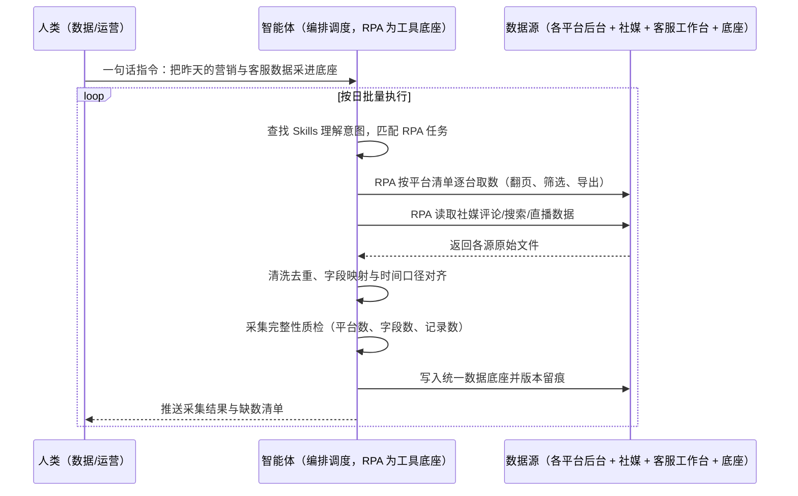

> 为多平台经营的品牌卖家搭建营销与客服数据底座。品牌在十余个电商平台与多个社媒渠道同时经营，直播、评论、客服会话、搜索词等数据分散在各后台，人工按需导出既慢又漏，导致 BI 报表与 VOC 分析长期缺料。本方案由智能体调度自动化工具，把十余平台 + 社媒共 7 大类数据按日自动采集、清洗、统一入库，输出 T+1 可用的数据底座与采集质量台账。按日批量执行，全程自动化，异常才打扰；平台登录态与频控策略在部署前一次配置，敏感数据字段按客户口径保留或脱敏。

> Agent 自动化需开通企业功能
> 点击申请1个月免费权限
> [点击申请 →](https://skieer.feishu.cn/share/base/form/shrcnFwMayykP5iaL38fnZKTbrg)

## 一、用户与需求

核心矛盾：

- 数据分散：十余平台 + 多个社媒渠道，直播/评论/会话/搜索数据各在一处，人工逐台导出
- 口径不一：各平台字段名、时间格式、指标定义不同，汇到一起还要人工对齐
- 时效不够：等人工攒完数据，报表已过期，策略只能事后复盘
- 无底座：BI 与 VOC 分析每次都要重新要数，重复劳动、结论不可比

适用客户：多平台经营（跨境 + 国内）且已建或准备建 BI/VOC 体系的品牌卖家；数据团队人少、业务方取数需求密集的团队。已购 ERP/BI 的客户由本方案负责把数据补齐进底座；无 BI 的客户同样可先落到表格工具形成轻量底座；部署后业务人员不需要写代码，一句话下达指令即可执行。

### 1.1 不同规模客户

| 类型 | 选择 | 建议 |
|-|-|-|
| 品牌卖家（多平台多店铺） | 首选 | 强烈推荐（数据源多、取数需求最密） |
| 精铺卖家（平台 3 个以上） | 次选 | 一般推荐（先接主平台 + 主社媒） |
| 单平台小卖家 | 不做 | 平台自带后台报表已够用 |

### 1.2 不同类目客户

| 类目 | 最关注维度 | 核心逻辑 |
|-|-|-|
| 3C 数码 / 无人机 | 全渠道口碑与客服效率 | 平台多、社媒声量大，客服与会话数据是体验改进主料 |
| 智能清洁 / 家电 | 直播与内容转化 | 直播数据与评论数据需并看才能定位转化问题 |
| 家居 / 大件 | 客服问题归因 | 会话数据里藏着安装、物流、退换的高频问题 |
| 服饰 / 快消 | 搜索词与趋势 | 搜索词数据决定上新与选题方向 |

### 1.3 不同角色用户

| 用户 | 需求 | 问题 | 投入时间（估算） |
|-|-|-|-|
| 数据分析师 | 取数不缺料 | 每次报表都要向各平台对接人要文件 | 每天 2-4 小时取数对齐 |
| 客服负责人 | 会话数据可分析 | 会话散在各平台工作台，导出格式不一 | 每周数小时 |
| 内容 / 市场 | 社媒数据统一看 | 各社媒后台指标口径不同，手工汇总 | 每周数小时 |
| 老板 | 决策有数可依 | 数据滞后，问题发现晚 | 只看结论 |

---

## 二、现在的方法与问题

### 2.1 流程步骤与问题总结

| 序号 | 步骤 | 现在的方法 | 问题缺陷 |
|-|-|-|-|
| 1 | 定需求 | 业务方临时提报表需求 | 需求零散，取数靠人追 |
| 2 | 逐台导出 | 人工登录各平台后台导出数据 | 十余平台逐个导，耗时且易漏 |
| 3 | 社媒采集 | 人工复制评论、搜索、直播数据 | 社媒无导出接口，只能手工抄 |
| 4 | 字段对齐 | 人工统一字段名与时间口径 | 平台改版即返工 |
| 5 | 汇总入库 | 粘贴到表格或 BI 数据源 | 重复劳动，历史版本混乱 |
| 6 | 交付分析 | 发文件给业务方 | 数据滞后，结论不可比 |

### 2.2 问题分析

人工方式根因

| 序号 | 根因 | 具体表现 |
|-|-|-|
| 1 | 平台数量多 | 十余平台后台结构各异，逐台操作无法规模化 |
| 2 | 社媒无接口 | 评论/搜索/直播数据只能靠页面读取 |
| 3 | 口径靠人 | 字段映射与时间对齐全凭个人经验 |
| 4 | 时效被拉长 | 攒数据的时间比分析的时间还长 |

**SaaS 方式根因**

| 序号 | 根因 | 具体表现 |
|-|-|-|
| 1 | 单点工具各管一段 | 客服工具只管客服、社媒工具只管社媒，数据不汇合 |
| 2 | 取数仍靠人 | 工具提供导出按钮，按日报表还得人来点 |
| 3 | 缺质量监控 | 采集断了没人知道，报表出来才发现缺数 |

---

## 三、解决方案

### 3.1 功能概述

为多平台品牌卖家打造的营销与客服数据底座方案，一句话调度十余平台 + 社媒 7 大类数据的采集、清洗与入库，输出 T+1 可用的统一数据底座与采集质量台账。

一句话下达指令（如「把昨天各平台和社媒的营销与客服数据采到数据底座里」），智能体通过查找 Skills 文档库理解意图、匹配 N 个 RPA 自动化任务（取数→清洗→对齐→入库→质检），经 MCP 调度八爪鱼 RPA 自动登录各平台与社媒后台，按预设路径抓取直播、评论、客服会话、搜索词等数据，清洗对齐后写入统一数据底座；同时做采集完整性质检，缺数或断采即告警。全程自动化，运行状态实时反馈，跑完推送结果。

### 3.2 系统结合

| 要素 | 说明 |
|-|-|
| 客户现有工具盘点 | **未建底座客户**：各平台后台 + Excel + 人工汇总。       **已建底座客户**（主流）：BI/数据仓库（或飞书多维表格）+ ERP（领星/旺店通等）+ 客服工作台 + 社媒后台 |
| 数据/能力来源 | 十余电商平台后台（订单/流量/客服/搜索/商品）、社媒渠道（评论/私信/搜索/直播）、客服工作台会话、ERP 商品与订单主数据 |
| RPA 耦合动作 | 作为 Agent 的工具底座被调度执行：①解决多平台多社媒逐台导出的机械动作；②被智能体调度执行取数、翻页、导出与下载；③把原始文件落到统一目录并触发清洗入库 |
| 耦合出的新价值 | 单系统给不了的端到端结论：十余平台 + 社媒数据自动汇总成一份口径统一、可追溯的数据底座，**只推送采集缺数、断采与字段异常的清单** |

### 3.3 智能体执行流程

一句话下达指令，智能体自动调度；入参（数据源清单、采集周期、字段映射、底座地址）部署时一次配置：

> Agent 自动化需开通企业功能
> 点击申请1个月免费权限
> [点击申请 →](https://skieer.feishu.cn/share/base/form/shrcnFwMayykP5iaL38fnZKTbrg)

### 3.4 为何这么设计

要同时回答三个问题：**为什么不能只用纯代码 Agent？为什么不能只用纯 RPA？为什么两者要结合？** 本场景的核心是"数据源多、无接口、口径要统一且天天要跑"。

#### 1）逐项对比

| 对比维度 | SaaS/API 堆叠（各平台开放接口 + BI 工具） | 纯智能体（智能体写代码） | 智能体+自动化工具（RPA 工具底座） |
|-|-|-|-|
| 实现方式 | 有接口的平台接 API，没接口的靠人工导出 | 逐个平台写采集脚本 | 取数动作平台级封装，智能体只管编排与清洗 |
| 多平台登录与取数 | 开放接口覆盖有限，社媒基本没有 | 接口不开放即走不通 | 后台可直接操作，社媒同样覆盖 |
| 风控与多账号隔离 | 接口无风控，但调用频次受限 | 需自建登录态与频控 | 多账号环境隔离，频控可配置 |
| 清洗与入库 | 需人工整理归档 | 可代码化但维护靠开发 | 智能体统一清洗入库 + 台账留痕 |
| 使用成本（总拥有成本） | 一源一工具，每套都要买/学/配 | 开发维护人力，隐性成本高 | 一份平台订阅跑多流程，边际成本 ≈ 0 |
| 维护人要求 | 低（但取数仍靠人） | 平台改版即需开发改脚本 | 可视化流程，业务自己可调字段映射 |

#### 2）优劣势说明

|  | SaaS/API 堆叠（接口 + BI 工具） | 纯智能体（智能体写代码） | 智能体+自动化工具（RPA 工具底座） |
|-|-|-|-|
| 优势 | 接口数据稳定、实时性可做到分钟级 | 无订阅费；       处理逻辑可定制 | 十余平台 + 社媒一次打通；       清洗与质检内建 |
| 劣势 | 覆盖不全，社媒与客服会话拿不到；       一源一工具、成本叠加 | 无接口源走不通；       平台改版需开发跟进 | 本地电脑运行需保持开机；       平台后台改版需更新流程 |

**特别提醒**：客户会话与个人信息属敏感数据，采集范围与留存期限须按客户数据合规口径确认；只采业务必需字段，**涉及个人信息的字段按约定脱敏或仅保留统计口径**。

#### 3）结论

| 论点 | 说明 |
|-|-|
| 确定性 vs 生成性 | 取数、翻页、导出、落库是确定性动作；口径判断与质检用智能体，各司其职 |
| 资产沉淀 | 数据源清单、字段映射、质检规则沉淀在平台是活的，换人接手仍成立 |
| 一个底座跑多流程 | 客户购买 RPA 平台是跑多个流程（取数/客服/广告/对账），本方案只是其中一个，订阅费被摊薄 |
| token 消耗可控 | 取数与落库走文件流水线，仅口径映射与质检环节消耗少量 token |
| 覆盖广度 | 案例口径：十余平台 + 社媒 7 大类数据统一采集入库 |
| 时间 | 数据分析师要的是"早上数据就绪"，不是"每天手动点十几台后台" |

### 3.5 功能清单

| 功能 | 系统 | 功能说明（解决问题） |
|-|-|-|
| 会话/一句话指令 | 智能体 | 1. 理解自然语言意图，查找 Skills 文档库。       2. 匹配对应 RPA 自动化任务、编排多任务。 |
| 多平台数据采集 | RPA | 1. 解决十余平台逐台导出问题。       2. 作为工具被调度执行，含失败重试与补采。       3. 登录各平台后台抓取流量/客服/搜索/商品数据。 |
| 社媒数据采集 | RPA | 覆盖评论、私信、搜索词、直播等社媒数据，解决无接口源取不到的问题。 |
| 清洗与口径对齐 | 智能体 | 统一字段名、时间格式与指标定义，解决各源口径不一问题。 |
| 数据入库 | 智能体、数据底座 | 写入统一底座并版本留痕，解决取数重复劳动问题。 |
| 采集质检 | 智能体 | 按平台数、字段数、记录数做完整性校验，缺数即拦并推送补齐。 |
| 异常告警 | 智能体、企微 | 断采、缺数、字段异常清单推送责任人。 |
| 数据资产储存 | 本地电脑、云储存 | 1. Skills 资产：多源采集技能。       2. 数据储存：原始文件库 + 清洗后底座。       3. 经验知识库：字段映射与质检规则回填。 |

### 3.6 智能体执行落地过程

部署时一次性配置入参（数据源清单、采集周期、字段映射、底座地址），会话中一句话即可触发，无需重复输入。

**⚠️ 部署前提（不满足则方案无法跑起来）**：①RPA 需部署在**常开电脑/云机**上，并配置漏跑补跑机制；②各平台与社媒后台**登录态**需维护，多账号建议环境隔离；③各平台的取数路径与频控策略需先在样本平台验证一轮；④字段映射表需与数据/业务方确认一次（属实施成本）；⑤敏感字段的采集范围与脱敏口径须书面确认；⑥首次配置（数据源、账号、底座连接）需服务方/技术人员介入一次，属实施成本。

#### 1）配置（五步）

| 步骤 | 操作 | 说明 |
|-|-|-|
| 第一步 | 下载八爪鱼 RPA，导入跨境电商自动化模板 | 官网免费下载客户端；MCP 工具→添加应用 |
| 第二步 | 开启八爪鱼 RPA 的 MCP 服务端口 | 客户端→API-K→创建 API（名称自定义） |
| 第三步 | 在智能体中添加 MCP Server 连接 | 复制连接配置→智能体连接器→自定义连接器→配置 MCP→粘贴保存 |
| 第四步 | 验证工具列表 | 确认工具全部启用（即八爪鱼客户端内工具） |
| 第五步 | 测试运行效果 | 输入一句话指令，验证取数、清洗与入库是否连通 |

| 类别 | 说明 |
|-|-|
| 智能体 | 主流智能体（支持 MCP 连接、Skills 加载、定时任务）。 |
| 智能体工具 | 1. **执行通道**：取数 + 清洗 + 入库 + 质检。       2. 数据取数与自动化执行：八爪鱼 RPA（MCP 协议接入）。       3. 数据底座：数据仓库 / 飞书多维表格 / 表格工具。       4. IM：企业微信/飞书（MCP 或 webhook 配置）。 |
| 工作知识 | 1. 数据源清单与账号。       2. 字段映射与指标口径表。       3. 采集频控与错峰规则。       4. 敏感字段脱敏口径。 |
| 本地数据库 | 1. 原始文件库地址。       2. 清洗后底座地址。       3. 采集台账存档地址。 |

#### 2）执行

| 任务 | 产出 | 产出物接收人 |
|-|-|-|
| 接收一句话指令，匹配 RPA 任务 | 任务启动记录 | —— |
| 调用已预设 Skills，编排任务流程 | 任务编排方案 | —— |
| 经 MCP 向八爪鱼 RPA 下发采集任务 | 自动化任务指令 | —— |
| 逐平台/逐渠道取数 | 各源原始文件 | —— |
| 清洗、去重与口径对齐 | 标准数据集 | 数据/运营 |
| 完整性质检与入库 | 数据底座 + 采集台账 | 数据/运营 |
| 推送结果与缺数清单 | 群消息 | 数据/运营 |

异常处理：

取数失败 → 重试 1 次，仍失败列入缺数清单并告警；

字段缺失 → 该源标记异常，保留原始文件待人工确认映射；

登录失效 → 自动重试 2 次，仍失败告警推 IM；

底座写入失败 → 保留清洗结果并告警，人工介入后重传。

#### 3）结果

| 结果 | 说明 |
|-|-|
| 数据资产 | 原始文件库 + 清洗后底座 + 采集台账，可复用可追溯。 |
| 分析报告 | 采集日报：平台覆盖数、记录数、缺数清单、断采次数。 |
| Skills | 智能体 Skills：多源采集技能，字段映射与质检规则按月迭代。 |

> Agent 自动化需开通企业功能
> 点击申请1个月免费权限
> [点击申请 →](https://skieer.feishu.cn/share/base/form/shrcnFwMayykP5iaL38fnZKTbrg)

---

## 四、使用前后预估

> 本方案价值 = **十余平台 + 社媒数据自动进底座**。把分析师从逐台导表里解放出来，让报表与 VOC 分析有稳定的数据供给。

| 指标 | 人工 | SaaS/API（接口 + BI） | 智能体+自动化工具 |
|-|-|-|-|
| 数据源覆盖 | 主平台为主，社媒靠手抄 | 有接口的平台，社媒基本空白 | 十余平台 + 社媒 7 大类 |
| 取数耗时 | 每天 2-4 小时 | 接口需逐个配置 | 按日自动执行 |
| 数据时效 | 攒完才可用 | 分钟级（仅限已接平台） | 案例口径：T+1 数据底座 |
| 口径一致性 | 靠人经验，版本混乱 | 取决于各工具定义 | 映射表统一，可追溯 |
| 缺数发现 | 报错才发现 | 无质检 | 完整性质检，缺数即告警 |
| 方法论 | 在分析师手里 | 在各工具配置里 | Skills 映射与质检规则资产沉淀 |

**说明**：案例口径来自八爪鱼客户实践（全球无人机巨头跨平台电商与客服数据自动化采集：十余平台 + 社媒 7 大类数据自动采集入库，形成 T+1 数据底座）；本方案为按同口径复刻的实施路径，具体覆盖平台数与数据量随客户实际情况而异（估算）。

---

## 五、效果证明

> Agent 自动化需开通企业功能
> 点击申请1个月免费权限
> [点击申请 →](https://skieer.feishu.cn/share/base/form/shrcnFwMayykP5iaL38fnZKTbrg)

### 5.1 客户案例

**《大疆：十余平台 × 7 大类营销与客服数据自动采集》**

> 十余个国内外电商平台与社媒渠道，直播、评论、客服会话、搜索等非结构化数据原需大量人力处理。RPA 完成十余个系统、7 大类核心数据自动采集入库。

| 效果 | 说明 |
|-|-|
| 提效 | 跨平台营销与客服数据采集效率显著提升。原本十余个平台与社媒渠道、7 大类数据需每日 5-6 小时人工导表，现在全自动采集入库，数据时效提升至 T+1。 |
| 降本 | 免除专职导表的人力投入，节约人力用于数据建模、投放复盘与客服策略分析等重点工作。 |
| 任务 | 覆盖十余个国内外电商平台与社媒渠道，含直播、评论、客服会话、搜索等 7 大类非结构化数据。 |
| 任务 | 形成全渠道统一数据底座，跨平台口径一致，供分析团队直接取用。 |

案例详情：[客服：全球无人机巨头跨平台电商与客服数据自动化采集](https://skieer.feishu.cn/wiki/OmO7wGX3yiASCBkqRsfcWPUMnOe)

---

## 六、备注

### 6.1 Agent 支持

本方案不绑定具体智能体，主流 Agent 均可运行（需支持 MCP 连接、技能/Skills 加载与工具调用）：

| Agent/智能体 | 说明 |
|-|-|
| Workbuddy | 本方案运行平台，支持技能/Skills 上传加载、定时任务、MCP 工具调用与表格/报告处理 |
| 豆包（国内·字节） | 国内主流个人智能体，支持技能上传、定时任务与工具调用，上手成本低 |
| 通义千问（国内·阿里） | 支持 Agent 编排与插件生态，集成阿里电商数据能力，适合电商场景 |
| DeepSeek（国内） | 推理能力强、成本低，适合规则打分与归因分析类任务 |
| ChatGPT（国外·OpenAI） | 海外主流通用智能体，支持 GPTs/Agent 模式与工具调用 |
| Claude（国外·Anthropic） | 长文本与结构化分析能力，原生支持 MCP 连接外部工具 |

### 6.2 名词解释

| 术语 | 说明 |
|-|-|
| 数据底座 | 全渠道数据的统一存储与口径层，供 BI 报表与 VOC 分析直接取用 |
| 营销与客服数据 | 直播、评论、客服会话、搜索词、流量与商品数据等业务数据的统称 |
| 字段映射 | 把各平台不同字段名归一到统一口径的对照关系表 |
| 采集完整性质检 | 按平台数、字段数、记录数校验本轮采集是否缺漏 |
| 断采 | 某数据源本轮未产出数据，需查明原因并补采 |
| 增量采集 | 只取上次采集之后的新增数据，降低频控压力 |
| 低频只读 | 控制访问频率、只读取不修改，降低平台风控风险 |
| 多账号隔离 | 不同店铺账号使用独立运行环境，避免相互影响 |
| 脱敏 | 对个人信息字段做遮蔽或仅保留统计口径 |
| MCP | Model Context Protocol，智能体连接外部工具的标准化通道 |
| Skills | 智能体可加载的预设技能资产，含流程与知识 |

> Agent 自动化需开通企业功能
> 点击申请1个月免费权限
> [点击申请 →](https://skieer.feishu.cn/share/base/form/shrcnFwMayykP5iaL38fnZKTbrg)

---

原文：[查看原文](https://skieer.feishu.cn/wiki/CeUCwIIc6igWD4kzEbQcuwcwnUg)
