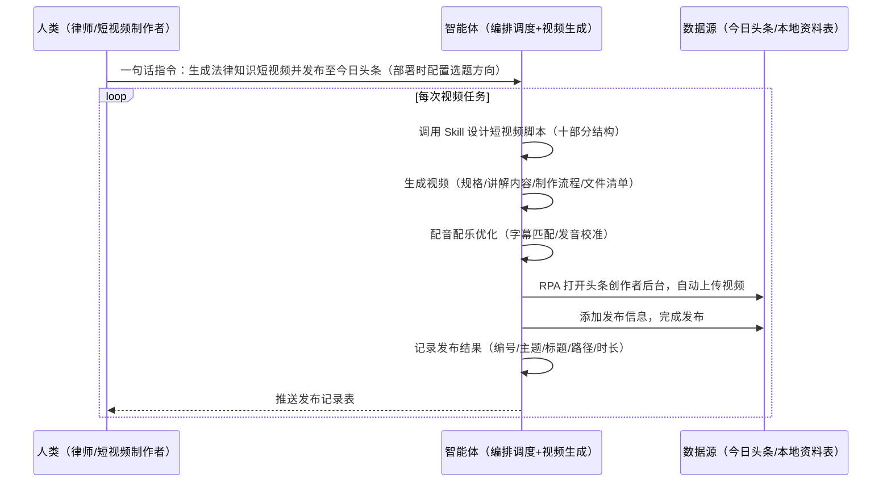

> 为需要批量制作知识科普短视频的团队打造（律师、律所、知识类创作者）。手动整理只是内容、脚本撰写、配音配乐、视频剪辑费时费力、律所缺乏专业视频人员、每日批量上传平台机械枯燥。本方案由智能体调度多个工具执行知识短视频生成（选题脚本+视频生成+配音配乐）+ 自动上传至今日头条 + 结果存档，输出完整发布记录。一句话下达指令，全程自动化，无异常不打扰。

> Agent 自动化需开通企业功能
> 点击申请1个月免费权限
> [点击申请 →](https://skieer.feishu.cn/share/base/form/shrcnFwMayykP5iaL38fnZKTbrg)

## 一、用户与需求

核心矛盾：只是科普视频从选题到发布全链路人工操作——整理、写文案、场景规划、配音配乐、剪辑生成、打开头条后台上传，每一步都耗时；律所很少有专业视频讲解人员，需招聘或兼职增加成本；每日/批量视频发布是机械枯燥的重复动作。

适用客户：有知识科普视频批量制作需求的团队、知识类创作者（内容批量产出）。本方案一句话下达指令即可执行，不需要写代码，新手可跟操作。

### 1.1 不同角色用户

| 用户 | 需求 | 问题 | 投入时间（估算） |
|-|-|-|-|
| 律师 | 法律科普推广 | 整理法条耗时 | 半天/条 |
| 短视频制作者 | 批量出片 | 剪辑配音耗人力 | 2-3 小时/条 |
| 律所运营 | 视频发布 | 每日上传机械重复 | 1 小时/天 |

### 1.2 不同知识方向

| 方向 | 内容特点 | 核心逻辑 |
|-|-|-|
| 法律科普 | 法条+案例+避坑 | 知识产权/劳动法/合同法等 |
| 财经知识 | 概念+数据+风险 | 政策解读/理财常识 |
| 行业科普 | 术语+场景+建议 | 医疗/教育/职场 |

### 1.3 不同发布平台

| 平台 | 动作 | 特点 |
|-|-|-|
| 今日头条 | 创作者后台上传视频 | 需登录，支持批量 |
| DY | 上传视频 | 需登录 |
| 视频号 | 上传视频 | 需登录 |

---

## 二、现在的方法与问题

### 2.1 流程步骤与问题总结

| 序号 | 步骤 | 现在的方法 | 问题缺陷 |
|-|-|-|-|
| 1 | 选题与专业知识 | 定义主题、人工整理法律法条、整理视频讲解文案 | 需花大量时间在法律书籍/网站整理信息 |
| 2 | 视频制作 | 视频场景与时长规划、逐场景排版、调整配音与背景音乐、生成视频 | 律所无专业视频人员，需招聘/兼职增加时间与人工成本 |
| 3 | 视频发布 | 打开头条创作者后台上传视频、添加、发布 | 每日/批量发布是机械且枯燥的重复动作 |

### 2.2 问题分析

| 序号 | 根因 | 具体表现 |
|-|-|-|
| 1 | 信息整理耗时 | 法条/文案靠人工在书籍网站整理 |
| 2 | 制作门槛高 | 需视频讲解专业技能，律所缺人 |
| 3 | 发布机械重复 | 每日上传是枯燥重复动作 |

---

## 三、解决方案

### 3.1 功能概述

为知识科普视频场景打造的智能体驱动方案，一句话生成知识短视频 + 自动发布至社媒平台，输出完整发布记录。

一句话下达指令（如「生成法律知识短视频并发布至今日头条」），智能体调用已封装好的 Skill 完成脚本设计（拍场/引入/科普/避坑/正解/实效/总结/片尾等十部分）、视频生成（规格/讲解内容/制作流程/文件清单）、配音配乐优化，经 MCP 调度八爪鱼 RPA 自动上传视频至今日头条，将发布结果（编号/主题/视频标题/视频路径/发布时长）保存至资料表格。全程自动化，运行状态实时反馈，跑完推送结果。

### 3.2 系统结合

| 要素 | 说明 |
|-|-|
| 系统组成 | 智能体（WorkBuddy，自然语言理解+脚本设计+视频生成）+ MCP 协议层（连接工具、传递指令、同步状态）+ 八爪鱼 RPA（浏览器操作、视频上传） |
| 数据/能力来源 | 智能体视频生成能力（Skill 封装：脚本设计/场景规划/配音配乐/视频生成）+ 今日头条创作者后台（视频上传，需登录）+ 本地资料表（发布记录） |
| RPA 耦合动作 | 作为 Agent 的工具底座被调度执行：打开头条创作者后台→自动上传视频→添加发布信息→发布完成，统一流转给智能体；执行情况逐条罗列（视频规格/时长/发布耗时） |
| 耦合出的新价值 | 单工具给不了的端到端结论：视频生成 → 配音配乐 → 自动发布 → 结果存档一次跑完，**只推送发布记录表** |

### 3.3 智能体执行流程

一句话下达指令，智能体自动调度：

> Agent 自动化需开通企业功能
> 点击申请1个月免费权限
> [点击申请 →](https://skieer.feishu.cn/share/base/form/shrcnFwMayykP5iaL38fnZKTbrg)

### 3.4 为何这么设计

要同时回答三个问题：**为什么不能只用纯代码 Agent？为什么不能只用纯 RPA？为什么两者要结合？** 本场景的核心是"一句话生成视频、自动发布、挂了有人管"。

#### 1）逐项对比

| 对比维度 | 纯代码 Agent（Codex 等） | 纯 RPA（八爪鱼） | 智能体+RPA（MCP 结合） |
|-|-|-|-|
| 实现方式 | 生成和运行代码完成自动化 | 模拟人操作软件和网页 | 智能体理解需求生成视频 + RPA 执行上传 |
| 视频生成 | 能设计脚本，但生成不稳定 | 无视频生成能力 | AI 生成脚本/视频/配音，一次到位 |
| 网页上传 | 网页模拟操作难（上传/填表单） | 完美模拟人上传操作 | 复杂上传动作交给 RPA |
| 使用成本（总拥有成本） | 每次执行收 tokens 费 | 模板搭建后免费反复使用 | RPA 模板调用不消耗 AI token（仅视频生成需 AI），长期成本更低 |
| 维护人要求 | 需懂代码 | 非技术人员可上手 | 业务人员一句话调度 |

#### 2）优劣势说明

|  | 纯代码 Agent | 纯 RPA | 智能体+RPA（MCP 结合） |
|-|-|-|-|
| 优势 | 脚本设计能力强；     能处理复杂内容 | 模拟人操作稳定；     适合批量上传 | 智能体听懂自然语言、生成视频；     RPA 稳定上传；     模板组件化自由组合 |
| 劣势 | 网页上传难适配；     tokens 成本高 | 缺 AI 深度理解与内容生成能力 | 需先配置 MCP 连接；     本地电脑需保持开机 |

#### 3）结论

| 论点 | 说明 |
|-|-|
| 补齐 Agent 短板 | 网页批量采集、数据填报、人工上传等复杂操作，纯 Agent 做不了，用 RPA 开发对应应用接入 |
| MCP 串联全链路 | MCP 加持后 Agent 串联多个 RPA 应用，完成视频生成→发布全链路复杂流程 |
| 不消耗 AI token | RPA 模板组件化调度不消耗 token，仅视频生成环节需 AI（实锤） |
| 专属应用市场 | 可搭建专属自动化应用市场，按需调用单个应用或组合视频全流程 |
| 时间 | 视频要的是"一句话生成+发布+存档"，不是"人工剪辑再手动上传" |

### 3.5 功能清单

| 功能 | 系统 | 功能说明（解决问题） |
|-|-|-|
| 会话/一句话指令 | 智能体 | 1. 理解自然语言意图，查找 Skills 文档库。     2. 匹配对应视频生成流程、编排多任务。 |
| 脚本设计 | 智能体 | 短视频脚本十部分设计（拍场/引入/科普/坑一坑二坑三/正解/实效/总结/片尾）+ 设计要素（法律教验等）。 |
| 视频生成 | 智能体 | 生成视频规格/讲解内容/制作流程/文件清单，配音配乐优化（字幕匹配、发音校准）。 |
| 自动上传 | RPA | 1. 解决每日批量上传机械重复问题。     2. 作为智能体工具底座被调度执行，打开头条创作者后台自动上传视频、添加发布信息，失败重试。 |
| 结果存档 | 智能体 | 发布结果保存至资料表：编号/主题/视频标题/视频路径/发布时长。 |
| IM通知 | 飞书、钉钉、企微等 | 解决发布进度滞后问题。发布记录自动推送。 |
| 数据资产储存 | 本地电脑、云储存 | 1. Skills 资产：知识视频生成技能。     2. 数据储存：发布记录表统一写入本地。     3. 经验知识库：脚本模板回填迭代。 |

### 3.6 智能体执行落地过程

部署时一次性配置入参（选题方向、视频规格、发布平台），会话中一句话即可触发，无需重复输入。

**⚠️ 部署前提（不满足则方案无法跑起来）**：①RPA 需部署在**常开电脑/云机**上，并配置漏跑补跑机制；②**需今日头条创作者后台登录态**（登录失效自动告警）；③首次配置（API-Key、RPA 应用、MCP 连接、Skill 封装）需服务方/技术人员介入一次，属实施成本。

#### 1）配置（四步）

| 步骤 | 操作 | 说明 |
|-|-|-|
| 第一步 | 八爪鱼 RPA 创建 API-Key | 打开客户端→创建 API-Key→复制保存 |
| 第二步 | 配置 RPA 应用 | MCP 工具→添加应用→选择头条上传应用→AI 一键生成名称描述→确定 |
| 第三步 | 智能体配置 MCP 连接 | 八爪鱼 RPA 接入指引→复制配置→智能体专家技能连接器→自定义连接器→配置 MCP→粘贴→填 API-Key→保存→启用→六个工具启用 |
| 第四步 | 调试并封装 Skill | 与智能体对话：先让其设计短视频脚本（十部分），再按脚本生成视频（规格/内容/制作流程），优化配音配乐，最后封装为固定 Skill（说「生成 XX 知识视频并发布」即触发全流程） |

| 类别 | 说明 |
|-|-|
| 智能体 | 主流智能体（支持 MCP 连接、Skills 加载）。 |
| 智能体工具 | 1. 视频生成与脚本设计：智能体自带（Skill 封装）。     2. 视频上传与自动化：八爪鱼 RPA（MCP 协议接入，六个通用工具），MCP 配置完成。     3. 结果存档：智能体自带。     4. IM：企业办公 IM（飞书/钉钉/企微），MCP 或 webhook 配置。 |
| 工作知识 | 1. 选题方向/知识领域。     2. 视频规格（时长/分辨率）。     3. 脚本结构（十部分）。     4. 发布平台与账号。 |
| 本地数据库 | 1. 视频文件路径。     2. 发布记录表路径。     3. 经验库地址。 |

#### 2）执行

| 任务 | 产出 | 产出物接收人 |
|-|-|-|
| 接收一句话指令，匹配 Skill 流程 | 任务启动记录 | —— |
| 设计短视频脚本（十部分） | 脚本文档 | —— |
| 生成视频（规格/内容/制作流程/文件清单） | 视频文件 | —— |
| 配音配乐优化（字幕匹配/发音校准） | 成品视频 | —— |
| RPA 打开头条创作者后台自动上传（智能体监控状态） | 发布状态 | 运营 |
| 记录发布结果至资料表 | 发布记录表 | 运营/律师 |
| 推送发布记录 | 群消息 | 运营/律师 |

异常处理：

登录失效 → 告警人工介入后断点续跑；

视频生成失败 → 重新生成并告警；

上传失败 → 自动重试；

发音不准确 → 优化配音重跑（如「款」被识别为「海」）；

字幕不匹配 → 重新匹配后重跑；

记录缺失 → 补录并核对。

#### 3）结果

| 结果 | 说明 |
|-|-|
| 数据资产 | 发布记录结构化存储（编号/主题/视频标题/视频路径/发布时长），可审计可追溯。 |
| 分析报告 | 视频任务执行情况逐条罗列：视频生成规格/时长/监控状态/发布耗时。 |
| Skills | 智能体 Skills：知识视频生成技能（脚本模板可复用，迭代优化）。 |

> Agent 自动化需开通企业功能
> 点击申请1个月免费权限
> [点击申请 →](https://skieer.feishu.cn/share/base/form/shrcnFwMayykP5iaL38fnZKTbrg)

---

## 四、使用前后预估

> 本方案价值 = **一句话下达指令 → 知识短视频生成 → 自动发布 → 结果存档**。把律师/创作者从人工剪辑和机械上传中解放出来，视频生成+发布全程约 8 分钟（实锤）。

| 指标 | 人工 | 纯代码 Agent | 智能体+自动化工具 |
|-|-|-|-|
| 视频生成 | 剪辑配音 2-3 小时/条 | 生成不稳定 | 一句话生成（约 8 分钟全流程） |
| 视频上传 | 每日手动上传 | 网页模拟难适配 | RPA 自动上传 |
| 法条整理 | 书籍网站手工查 | 能整理但成本高 | Skill 脚本一次设计复用 |
| 方法论 | 无，换人标准不同 | 无沉淀 | 可复用的 Skills 与脚本模板 |

**说明**：视频生成+发布全流程约 8 分钟（实锤）；脚本十部分结构（拍场/引入/科普/坑一坑二坑三/正解/实效/总结/片尾，实锤）；RPA 模板调用不消耗 AI token，仅视频生成需 AI（实锤）。

---

## 五、效果证明

> Agent 自动化需开通企业功能
> 点击申请1个月免费权限
> [点击申请 →](https://skieer.feishu.cn/share/base/form/shrcnFwMayykP5iaL38fnZKTbrg)

### 5.1 实操课程教程

[查看原视频](https://player.bilibili.com/player.html?bvid=1jqMD6bEvH)

### 5.2 客户案例

**《厨电巨头：6 大社媒 90 账号矩阵自动发帖与 AI 回评》**

> 6 大社媒、90 个账号的矩阵运营原靠人工编文案、手动发帖、逐条回复。RPA+AI 后运营从机械执行转向策略，业务人员用 Excel 即可调整发帖节奏与互动风控。

| 效果 | 说明 |
|-|-|
| 提效 | 6 大社媒 90 个账号自动发帖与 AI 回评。原本需人工编文案、手动发帖、逐条回复，现在全自动执行，数据 T+1 自动回流、100% 留档。 |
| 降本 | 营销人员从重复发帖与回评中解放，投入转向提示词调优、人设 IP 深化与营销策略制定等重点工作。 |
| 任务 | 覆盖 6 大社媒平台、90 个账号矩阵，帖文与互动数据统一回流。 |
| 任务 | Excel 配置即可调整发帖节奏与互动风控阈值，无需开发。 |

案例详情：[社媒：厨电巨头全矩阵社媒营销自动化与智能口碑运营](https://skieer.feishu.cn/wiki/EWvPwpBu0iVZQkkcAmrcuTTIn8u)

---

## 六、备注

### 6.1 Agent 支持

本方案不绑定具体智能体，主流 Agent 均可运行（需支持 MCP 连接、技能/Skills 加载与工具调用）：

| Agent/智能体 | 说明 |
|-|-|
| Workbuddy | 本方案运行平台，支持技能/Skills 上传加载、定时任务、MCP 工具调用与表格/报告处理 |
| 豆包（国内·字节） | 国内主流个人智能体，支持技能上传、定时任务与工具调用，上手成本低 |
| 通义千问（国内·阿里） | 支持 Agent 编排与插件生态，集成阿里电商数据能力，适合电商场景 |
| DeepSeek（国内） | 推理能力强、成本低，适合规则打分与归因分析类任务 |
| ChatGPT（国外·OpenAI） | 海外主流通用智能体，支持 GPTs/Agent 模式与工具调用 |
| Claude（国外·Anthropic） | 长文本与结构化分析能力强，原生支持 MCP 连接外部工具 |

### 6.2 名词解释

| 术语 | 说明 |
|-|-|
| 今日头条 | 内容平台，创作者后台支持视频上传 |
| Skill 文档 | 把调试好的流程封装成智能体可识别的固定技能文档 |
| 脚本结构 | 拍场/引入/科普/坑一坑二坑三/正解/实效/总结/片尾十部分 |
| 配音配乐 | 视频解说音频与背景音乐，可优化校准发音 |
| MCP | Model Context Protocol，智能体连接外部工具的标准化通道 |
| API-Key | 八爪鱼 RPA 身份凭证，智能体进入 RPA 身份验证的专属钥匙 |
| RPA | 机器人流程自动化，模拟真人操作网页和桌面软件 |
| 一句话指令 | 用自然语言描述任务，智能体自动翻译为自动化流程 |
| 指纹浏览器 | 隔离 Cookie/浏览器指纹的工具，多账号防关联 |

> Agent 自动化需开通企业功能
> 点击申请1个月免费权限
> [点击申请 →](https://skieer.feishu.cn/share/base/form/shrcnFwMayykP5iaL38fnZKTbrg)

---

原文：[查看原文](https://skieer.feishu.cn/wiki/WGJewWMr9i28ApkSmEncPdgznoc)
