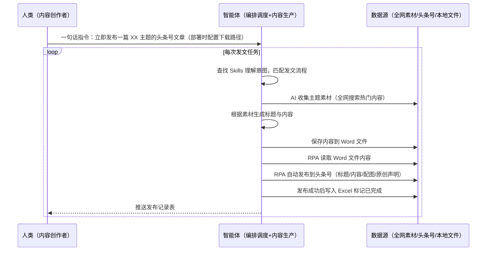

> 为需要批量内容生产的团队打造（内容创作者、自媒体运营、新媒体小编）。选题难（盯着热搜不知道写什么）、写作慢（一篇至少一小时）、发布繁琐（打开浏览器登录后台新建复制粘贴配图点发布）。本方案由智能体调度多个工具执行热点选题发现 + 全网素材收集 + 文章生成 + 自动发布至头条号 + 发布记录存档，输出完整发布记录。一句话下达指令，全程自动化，无异常不打扰。

> Agent 自动化需开通企业功能
> 点击申请1个月免费权限
> [点击申请 →](https://skieer.feishu.cn/share/base/form/shrcnFwMayykP5iaL38fnZKTbrg)

## 一、用户与需求

核心矛盾：内容创作卡在三个环节——选题难（每天盯着不知道写什么，脑子空了半小时随便挑标题，质量高不了）、写作慢（查资料搭框架写初稿改排版，一篇文章至少一小时，一天三篇大半天没了）、发布烦（打开浏览器登录后台新建文章复制粘贴配图勾原创声明点发布，一天三遍纯体力活）。

适用客户：有批量内容生产需求的团队——内容创作者、自媒体运营、新媒体小编、企业新媒体部门。本方案一句话下达指令即可执行，不需要写代码，新手可跟操作。

### 1.1 不同角色用户

| 用户 | 需求 | 问题 | 投入时间（估算） |
|-|-|-|-|
| 内容创作者 | 批量出文 | 选题难写作慢 | 2-3 小时/篇 |
| 自媒体运营 | 日更内容 | 发布繁琐 | 1 小时/天 |
| 新媒体小编 | 热点跟进 | 追热点慢 | 半天/篇 |

### 1.2 不同内容方向

| 方向 | 内容特点 | 核心逻辑 |
|-|-|-|
| 科技/AI | 热点解读 | 热搜话题+AI 素材 |
| 财经 | 政策解读 | 数据+分析 |
| 泛资讯 | 热点快讯 | 时效性优先 |

### 1.3 不同发布平台

| 平台 | 动作 | 特点 |
|-|-|-|
| 头条号 | 发布文章 | 需登录，支持原创声明 |
| 公众号 | 发布文章 | 需登录 |
| 百家号 | 发布文章 | 需登录 |

---

## 二、现在的方法与问题

### 2.1 流程步骤与问题总结

| 序号 | 步骤 | 现在的方法 | 问题缺陷 |
|-|-|-|-|
| 1 | 选题 | 盯着热搜，脑子空了半小时，随便挑标题 | 选题难，质量高不了还浪费精力 |
| 2 | 写作 | 查资料、搭框架、写初稿、改排版 | 一篇文章至少一小时，一天三篇大半天没了 |
| 3 | 发布 | 打开浏览器、登录后台、新建文章、复制粘贴、配图、勾原创声明、点发布 | 一天三遍纯体力活 |

### 2.2 问题分析

| 序号 | 根因 | 具体表现 |
|-|-|-|
| 1 | 选题无方法 | 靠灵感，脑子空时随便发 |
| 2 | 写作无沉淀 | 查资料搭框架重复劳动 |
| 3 | 发布无自动化 | 手动操作繁琐重复 |

---

## 三、解决方案

### 3.1 功能概述

为内容创作场景打造的智能体驱动方案，一句话发现热点 + 生成爆文 + 自动发布 + 记录存档，输出完整发布记录。

一句话下达指令（如「我要立即发布一篇关于 AI 科技主题的头条号文章，下载路径某某位置」），智能体通过查找 Skills 理解意图，AI 自动收集主题素材→生成文章→存放 Word 文件→调用八爪鱼 RPA 读取文章发布到头条号→将已发布标题存档保存到 Excel（并标记已完成）。全程自动化，运行状态实时反馈，跑完推送结果。

### 3.2 系统结合

| 要素 | 说明 |
|-|-|
| 系统组成 | 智能体（WorkBuddy，自然语言理解+内容生产）+ MCP 协议层（连接工具、传递指令、同步状态）+ 八爪鱼 RPA（浏览器操作、文章发布） |
| 数据/能力来源 | 全网热门素材（AI 搜索收集）+ 头条号后台（文章发布，需登录）+ 本地 Word（文章存储）/Excel（发布记录） |
| RPA 耦合动作 | 作为 Agent 的工具底座被调度执行：打开浏览器→进入头条号页面→读取 Word 文章→自动发布（标题/内容/配图/原创声明），统一流转给智能体；发布结果写入 Excel 标记已完成 |
| 耦合出的新价值 | 单工具给不了的端到端结论：选题→素材→写文→发布→记录一次跑完，**只推送发布记录表** |

### 3.3 智能体执行流程

一句话下达指令，智能体自动调度：

> Agent 自动化需开通企业功能
> 点击申请1个月免费权限
> [点击申请 →](https://skieer.feishu.cn/share/base/form/shrcnFwMayykP5iaL38fnZKTbrg)

### 3.4 为何这么设计

要同时回答三个问题：**为什么不能只用纯代码 Agent？为什么不能只用纯 RPA？为什么两者要结合？** 本场景的核心是"一句话发文、自动发布、挂了有人管"。

#### 1）逐项对比

| 对比维度 | 纯代码 Agent（Codex 等） | 纯 RPA（八爪鱼） | 智能体+RPA（MCP 结合） |
|-|-|-|-|
| 实现方式 | 生成和运行代码完成自动化 | 低代码方式写出自动化，固定稳定执行 | 智能体理解需求内容生产 + RPA 执行发布 |
| 内容生产 | AI 擅长思考创作 | 无内容生成能力 | AI 选题/素材/写文一次到位 |
| 网页发布 | 需额外浏览器能力支持（Chrome 插件） | 围绕像人一样操作网页设计 | 复杂发布动作交给 RPA |
| 数据采集 | 知乎回答展开/微博防采难适配 | 完美处理展开/防采 | 复杂采集交给 RPA |
| 使用成本（总拥有成本） | 每次执行收 tokens 费 | 模板搭建后免费反复使用 | RPA 模板调用不消耗 token（仅内容生成需 AI），长期成本更低 |
| 维护人要求 | 需懂代码 | 非技术人员可上手 | 业务人员一句话调度 |

#### 2）优劣势说明

|  | 纯代码 Agent | 纯 RPA | 智能体+RPA（MCP 结合） |
|-|-|-|-|
| 优势 | AI 思考创作能力强；     灵活弹性 | 操作网页稳定；     固定稳定执行；     非技术人员可上手 | 智能体理解意图编排调度；     RPA 稳定发布；     模板组件化自由组合 |
| 劣势 | 网页操作难适配；     tokens 成本高 | 缺 AI 深度理解与内容生成 | 需先配置 MCP 连接；     本地电脑需保持开机 |

#### 3）结论

| 论点 | 说明 |
|-|-|
| 补齐 AI 短板 | AI 擅长思考创作，但不擅长操作网页、登录后台、传图片——缺什么就用 RPA 补（实锤） |
| MCP 串联全链路 | MCP 加持后 AI 串联内容生产全链路：从选题发现→文章转写→发布运营，端到端流程 |
| 不消耗 AI token | RPA 模板组件化调度不消耗 token，仅内容生成需 AI（实锤） |
| 专属应用市场 | 可搭建专属自动化应用市场，按需调用单个环节（如只用 AI 写文章）或组合整套全流程 |
| 时间 | 内容要的是"一句话发文+发布+记录"，不是"一小时写文再手动发布" |

### 3.5 功能清单

| 功能 | 系统 | 功能说明（解决问题） |
|-|-|-|
| 会话/一句话指令 | 智能体 | 1. 理解自然语言意图，查找 Skills 文档库。     2. 匹配对应发文流程、编排多任务。 |
| 热点选题 | 智能体 | 热搜话题发现，解决选题难问题。 |
| 素材收集 | 智能体 | AI 全网搜索收集主题素材，解决查资料耗时问题。 |
| 文章生成 | 智能体 | 根据素材生成标题与内容，保存到 Word 文件（指定下载路径）。 |
| 自动发布 | RPA | 1. 解决发布繁琐重复问题。     2. 作为智能体工具底座被调度执行，读取 Word 文章→打开头条号→自动发布（标题/内容/配图/原创声明），失败重试。 |
| 发布记录 | 智能体 | 发布成功后写入 Excel 标记已完成，检查是否重复发布过。 |
| IM通知 | 飞书、钉钉、企微等 | 解决发文进度滞后问题。发布记录自动推送。 |
| 数据资产储存 | 本地电脑、云储存 | 1. Skills 资产：爆文生成与发布技能。     2. 数据储存：文章 Word/发布记录 Excel 统一写入本地。     3. 经验知识库：发文规则回填迭代。 |

### 3.6 智能体执行落地过程

部署时一次性配置入参（内容主题、下载路径、发布平台），会话中一句话即可触发，无需重复输入。

**⚠️ 部署前提（不满足则方案无法跑起来）**：①RPA 需部署在**常开电脑/云机**上，并配置漏跑补跑机制；②**需头条号后台登录态**（登录失效自动告警）；③首次配置（API-Key、RPA 应用、MCP 连接、Skill 封装）需服务方/技术人员介入一次，属实施成本。

#### 1）配置（四步）

| 步骤 | 操作 | 说明 |
|-|-|-|
| 第一步 | 八爪鱼 RPA 创建 API-Key | 打开客户端→API-Key→创建（如「头条号发布」）→复制保存 |
| 第二步 | 配置 RPA 应用 | MCP 工具→接入指引→MCP 平台对接设置→其他→API-Key→复制 JSON 配置 |
| 第三步 | 智能体配置 MCP 连接 | 智能体→专家→连接器→自定义连接器→贴入 JSON 配置→保存→信任 MCP 服务→绿色表示连接成功；回到 RPA MCP 工具添加应用（AI 生成名称描述）→确定 |
| 第四步 | 调试并封装 Skill | 与智能体对话创建 Skill：①找素材 ②按素材生成文章 ③存 Word 到指定路径 ④调用 RPA 发布到头条号 ⑤发布成功后记录 Excel ⑥每次发布检查是否已发布过——封装为固定 Skill（说「立即发布 XX 主题文章」即触发全流程） |

| 类别 | 说明 |
|-|-|
| 智能体 | 主流智能体（支持 MCP 连接、Skills 加载）。 |
| 智能体工具 | 1. 内容生产：智能体自带（素材收集/文章生成）。     2. 文章发布与自动化：八爪鱼 RPA（MCP 协议接入，六个通用工具），MCP 配置完成。     3. 文件处理：Word 读取/Excel 记录，智能体自带。     4. IM：企业办公 IM（飞书/钉钉/企微），MCP 或 webhook 配置。 |
| 工作知识 | 1. 内容主题/方向。     2. 文章下载路径（Word 格式）。     3. 发布平台与账号。     4. 发布记录 Excel 路径。     5. 去重检查规则。 |
| 本地数据库 | 1. 文章 Word 路径。     2. 发布记录 Excel 路径。     3. 经验库地址。 |

#### 2）执行

| 任务 | 产出 | 产出物接收人 |
|-|-|-|
| 接收一句话指令，匹配 Skill 流程 | 任务启动记录 | —— |
| AI 收集主题素材 | 素材库 | —— |
| 生成文章并存放 Word | 文章文件 | —— |
| RPA 读取 Word 文章，自动发布到头条号（智能体监控状态） | 发布状态 | 运营 |
| 发布成功后记录 Excel 标记已完成 | 发布记录 | 运营 |
| 推送发布记录 | 群消息 | 运营/创作者 |

异常处理：

登录失效 → 告警人工介入后断点续跑；

素材不足 → 扩大搜索范围重跑；

文章生成失败 → 重新生成并告警；

发布失败 → 自动重试；

重复发布检查 → 已发布则跳过并提示；

记录缺失 → 补录并核对。

#### 3）结果

| 结果 | 说明 |
|-|-|
| 数据资产 | 发布记录结构化存储（已发布标题/时间/平台），可审计可追溯，去重防重复发布。 |
| 分析报告 | 发文任务执行情况逐条罗列：素材/文章/发布状态/存档结果。 |
| Skills | 智能体 Skills：爆文生成与发布技能（工作流六步可复用）。 |

> Agent 自动化需开通企业功能
> 点击申请1个月免费权限
> [点击申请 →](https://skieer.feishu.cn/share/base/form/shrcnFwMayykP5iaL38fnZKTbrg)

---

## 四、使用前后预估

> 本方案价值 = **一句话下达指令 → 热点选题 + 素材收集 + 文章生成 → RPA 自动发布 → 记录存档**。把创作者从一小时写文和繁琐发布中解放出来，从选题到发布全程不用动手。

| 指标 | 人工 | 纯代码 Agent | 智能体+自动化工具 |
|-|-|-|-|
| 选题 | 脑子空半小时 | 能建议但无闭环 | AI 热点发现 |
| 写作 | 一篇至少一小时 | 生成不稳定 | AI 素材+写文一次到位 |
| 发布 | 一天三遍体力活 | 需额外浏览器能力 | RPA 自动发布 |
| 记录 | 无记录 | 无沉淀 | Excel 存档可追溯 |
| 方法论 | 无，换人标准不同 | 无沉淀 | 可复用的 Skills 与发文规则 |

**说明**：内容创作卡在选题难/写作慢/发布烦三个环节（实锤）；三层架构：AI 内容生产层→RPA 自动发布层→AI 结果记录层（实锤）；RPA 模板调用不消耗 AI token，仅内容生成需 AI（实锤）。

---

## 五、效果证明

> Agent 自动化需开通企业功能
> 点击申请1个月免费权限
> [点击申请 →](https://skieer.feishu.cn/share/base/form/shrcnFwMayykP5iaL38fnZKTbrg)

### 5.1 实操课程教程

[查看原视频](https://player.bilibili.com/player.html?bvid=162ud6DE3d)

### 5.2 客户案例

**《厨电巨头：6 大社媒 90 账号矩阵自动发帖与 AI 回评》**

> 6 大社媒、90 个账号的矩阵运营原靠人工编文案、手动发帖、逐条回复。RPA+AI 后运营从机械执行转向策略，业务人员用 Excel 即可调整发帖节奏与互动风控。

| 效果 | 说明 |
|-|-|
| 提效 | 6 大社媒 90 个账号自动发帖与 AI 回评。原本需人工编文案、手动发帖、逐条回复，现在全自动执行，数据 T+1 自动回流、100% 留档。 |
| 降本 | 营销人员从重复发帖与回评中解放，投入转向提示词调优、人设 IP 深化与营销策略制定等重点工作。 |
| 任务 | 覆盖 6 大社媒平台、90 个账号矩阵，帖文与互动数据统一回流。 |
| 任务 | Excel 配置即可调整发帖节奏与互动风控阈值，无需开发。 |

案例详情：[社媒：厨电巨头全矩阵社媒营销自动化与智能口碑运营](https://skieer.feishu.cn/wiki/EWvPwpBu0iVZQkkcAmrcuTTIn8u)

---

## 六、备注

### 6.1 Agent 支持

本方案不绑定具体智能体，主流 Agent 均可运行（需支持 MCP 连接、技能/Skills 加载与工具调用）：

| Agent/智能体 | 说明 |
|-|-|
| Workbuddy | 本方案运行平台，支持技能/Skills 上传加载、定时任务、MCP 工具调用与表格/报告处理 |
| 豆包（国内·字节） | 国内主流个人智能体，支持技能上传、定时任务与工具调用，上手成本低 |
| 通义千问（国内·阿里） | 支持 Agent 编排与插件生态，集成阿里电商数据能力，适合电商场景 |
| DeepSeek（国内） | 推理能力强、成本低，适合规则打分与归因分析类任务 |
| ChatGPT（国外·OpenAI） | 海外主流通用智能体，支持 GPTs/Agent 模式与工具调用 |
| Claude（国外·Anthropic） | 长文本与结构化分析能力强，原生支持 MCP 连接外部工具 |

### 6.2 名词解释

| 术语 | 说明 |
|-|-|
| 头条号 | 今日头条创作者平台，支持文章发布 |
| 热点爆文 | 基于热搜话题生成的高传播文章 |
| Skill 文档 | 把调试好的流程封装成智能体可识别的固定技能文档 |
| 三层架构 | AI 内容生产层→RPA 自动发布层→AI 结果记录层 |
| MCP | Model Context Protocol，智能体连接外部工具的标准化通道 |
| API-Key | 八爪鱼 RPA 身份凭证，智能体进入 RPA 身份验证的专属钥匙 |
| RPA | 机器人流程自动化，模拟真人操作网页和桌面软件 |
| 一句话指令 | 用自然语言描述任务，智能体自动翻译为自动化流程 |
| 指纹浏览器 | 隔离 Cookie/浏览器指纹的工具，多账号防关联 |

> Agent 自动化需开通企业功能
> 点击申请1个月免费权限
> [点击申请 →](https://skieer.feishu.cn/share/base/form/shrcnFwMayykP5iaL38fnZKTbrg)

---

原文：[查看原文](https://skieer.feishu.cn/wiki/DwlswboUHiODKAk8nZQcHFlxntc)
