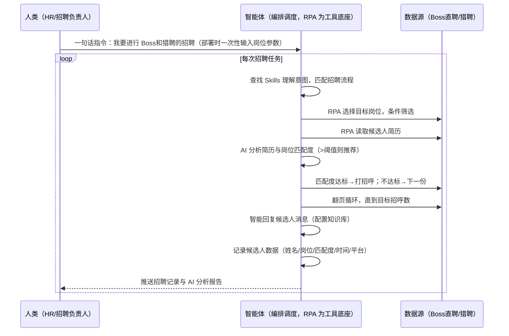

> 为需要批量招聘的团队打造（企业 HR、招聘负责人、猎头、RPA 团队）。手动在招聘平台反复刷简历、逐份筛选、海量打招呼回复费时费力、筛选标准不一易漏人、无过程记录。本方案由智能体调度多个工具执行主流招聘平台自动化（Boss直聘/猎聘双平台筛选+简历AI匹配+打招呼+智能回复）+ 自动记录 + 分析报告，输出完整招聘分析文档。一句话下达指令，全程自动化，无异常不打扰。

> Agent 自动化需开通企业功能
> 点击申请1个月免费权限
> [点击申请 →](https://skieer.feishu.cn/share/base/form/shrcnFwMayykP5iaL38fnZKTbrg)

## 一、用户与需求

核心矛盾：一天内要反复打开招聘平台、录入筛选条件、逐份简历匹配、打招呼回复，极其耗费人工；人工筛选标准前后不一易漏人；招聘过程无记录，年中总结无法评估各平台效果——完整招聘流程（树立岗位条件→匹配简历打招呼→数据记录→AI 分析报告）每一环都是重复操作。

适用客户：有批量招聘需求的团队——企业 HR（找候选人）、招聘负责人（盯招聘效果）、猎头（多平台找人）、RPA 团队（自动化落地）。本方案一句话下达指令即可执行，不需要写代码，新手可跟操作。

### 1.1 不同角色用户

| 用户 | 需求 | 问题 | 投入时间（估算） |
|-|-|-|-|
| 企业 HR | 找合适候选人 | 每天重复刷简历打招呼 | 2-4 小时/天 |
| 招聘负责人 | 招聘效果 | 无数据支撑资源倾斜 | 1 小时/周 |
| 猎头 | 多平台找人 | 多平台来回切换 | 半天/轮 |
| RPA 团队 | 自动化落地 | 流程搭建门槛 | 部署期一次性 |

### 1.2 不同岗位场景

| 场景 | 匹配度阈值 | 核心逻辑 |
|-|-|-|
| 高端岗 | 90%+ | 严格按岗位要求筛选，只有高度合适才推荐 |
| 常规岗 | 60%-70% | 要求较低可放宽匹配度，扩大候选人池 |
| 批量岗 | 70%-80% | 平衡数量与质量 |

### 1.3 不同招聘平台

| 平台 | 动作 | 特点 |
|-|-|-|
| Boss直聘 | 条件筛选/简历匹配/打招呼/智能回复 | 需登录，聊天式招聘 |
| 猎聘 | 条件筛选/简历匹配/打招呼 | 需登录，中高端人才为主 |

---

## 二、现在的方法与问题

### 2.1 流程步骤与问题总结

| 序号 | 步骤 | 现在的方法 | 问题缺陷 |
|-|-|-|-|
| 1 | 树立岗位条件 | 每天重复打开招聘平台、录入筛选条件 | 重复执行前置招聘动作，时间人力成本高 |
| 2 | 匹配简历打招呼 | 人工设定模糊标准、逐份读简历、判断匹配度、满足则打招呼 | 极其耗费人工，筛选标准前后不一致易漏人 |
| 3 | 数据记录 | 依赖平台自带记录，多数平台没有 | 年中总结无数据支撑，无法评估平台效果 |
| 4 | 生成报告 | 手动整理 | 无标准化分析，资源倾斜无依据 |

### 2.2 问题分析

| 序号 | 根因 | 具体表现 |
|-|-|-|
| 1 | 采集费人力 | 每天重复刷简历、打招呼，半天耗在重复操作 |
| 2 | 标准不一 | 人工筛选标准前后不一致，容易漏掉合适候选人 |
| 3 | 无过程记录 | 招聘过程无记录，无法追溯与复盘 |
| 4 | 分析无依据 | 平台效果无对比，下一年度资源倾斜无支撑 |

---

## 三、解决方案

### 3.1 功能概述

为招聘场景打造的智能体驱动方案，一句话调度多平台招聘自动化 + 简历 AI 匹配 + 自动记录分析，输出完整招聘分析报告。

一句话下达指令（如「我要进行 Boss 直聘和猎聘的招聘」+ 一次性输入岗位参数），智能体通过查找 Skills 理解意图、匹配对应流程，经 MCP 调度八爪鱼 RPA 依次执行 Boss直聘（条件筛选→简历 AI 匹配→匹配度达标打招呼→翻页循环）与猎聘（同样流程）双平台招聘动作，自动记录每个候选人（姓名/岗位/AI 分析/匹配度/是否推荐/运行时间/平台），最后生成 AI 招聘分析报告（数据来源对比+平台对比）。

全程自动化，运行状态实时反馈，跑完推送结果。

### 3.2 系统结合

| 要素 | 说明 |
|-|-|
| 系统组成 | 智能体（WorkBuddy，自然语言理解+任务编排）+ MCP 协议层（连接工具、传递指令、同步状态）+ 八爪鱼 RPA（浏览器操作、简历读取、打招呼执行） |
| 数据/能力来源 | Boss直聘（候选人列表/简历/聊天消息，需登录）+ 猎聘（候选人列表/简历，需登录）+ 本地表格（招聘记录） |
| RPA 耦合动作 | 作为 Agent 的工具底座被调度执行：Boss直聘条件筛选→读取简历→AI 匹配（匹配度>阈值则打招呼）→翻页循环直到目标招呼数；猎聘同样流程；智能回复候选人消息；自动写入招聘记录表 |
| 耦合出的新价值 | 单工具给不了的端到端结论：双平台招聘一次跑完 → 简历 AI 匹配 → 自动打招呼 → 数据记录 → 分析报告（数据来源对比+平台对比），**只推送招聘记录与分析报告** |

### 3.3 智能体执行流程

一句话下达指令，智能体自动调度：

> Agent 自动化需开通企业功能
> 点击申请1个月免费权限
> [点击申请 →](https://skieer.feishu.cn/share/base/form/shrcnFwMayykP5iaL38fnZKTbrg)

### 3.4 为何这么设计

要同时回答三个问题：**为什么不能只用纯代码 Agent？为什么不能只用纯 RPA？为什么两者要结合？** 本场景的核心是"一句话调度、双平台招聘、简历 AI 匹配、挂了有人管"。

#### 1）逐项对比

| 对比维度 | 纯代码 Agent（Codex 等） | 纯 RPA（八爪鱼） | 智能体+RPA（MCP 结合） |
|-|-|-|-|
| 实现方式 | 生成和运行采集代码，调试脚本处理异常 | 模拟人操作软件和网页，拖拽/自然语言搭建流程 | 智能体理解需求编排任务 + RPA 执行招聘动作 |
| 简历读取 | 网页模拟操作难（选择岗位/读简历/打招呼） | 完美模拟人招聘操作 | 复杂网页操作交给 RPA，AI 专注匹配分析 |
| 匹配判断 | 能思考复杂问题，但执行不稳 | 缺 AI 深度理解能力 | AI 按匹配度阈值精准判断（可调 60%-90%） |
| 使用成本（总拥有成本） | 每次执行收 tokens 费，接口改版脚本失效 | 模板搭建后免费反复使用，维护不用代码 | RPA 模板调用不消耗 AI token（仅简历分析需 AI），长期成本更低 |
| 维护人要求 | 需懂代码，适合开发者/技术团队 | 一线业务人员（HR）可自己用模板 | HR 一句话调度，运维门槛低 |

#### 2）优劣势说明

|  | 纯代码 Agent | 纯 RPA | 智能体+RPA（MCP 结合） |
|-|-|-|-|
| 优势 | 代码能力出色；    
接口型数据获取快 | 模拟人操作稳定；    
适合一线业务人员；    
模板化可复用 | 智能体听懂自然语言、编排多平台；    
RPA 稳定执行招聘动作；    
模板组件化自由组合 |
| 劣势 | 上手门槛高；    
网页模拟难适配；    
企业级任务稳定性差；    
tokens 成本高 | 缺少 AI 深度理解与匹配判断 | 需先配置 MCP 连接；    
本地电脑需保持开机 |

#### 3）结论

| 论点 | 说明 |
|-|-|
| 补齐 Agent 短板 | 选择目标岗位、读取简历、打招呼等执行动作，很多 Skill 无法稳定运行，需 RPA 补充结合 |
| MCP 串联全链路 | MCP 加持后 Agent 串联多个 RPA 插件，完成多平台招聘全链路，无需人一样操作 |
| 匹配可调阈值 | AI 匹配度阈值可调：高端岗 90%+、常规岗 60%-70%，按岗位要求灵活设置 |
| 不消耗 AI token | RPA 模板组件化调用不消耗 token，仅简历分析环节需 AI（实锤） |
| 专属应用市场 | 可搭建专属自动化应用市场，按需调用或组合招聘流程，灵活适配 C 端招聘需求 |
| 时间 | 招聘要的是"一句话完成双平台招聘+记录+分析报告"，不是"每天重复刷简历" |

### 3.5 功能清单

| 功能 | 系统 | 功能说明（解决问题） |
|-|-|-|
| 会话/一句话指令 | 智能体 | 1. 理解自然语言意图，查找 Skills 文档库。    
2. 匹配对应招聘流程、编排多任务。 |
| 双平台招聘 | RPA | 1. 解决每天重复刷简历、打招呼问题。    
2. 作为智能体工具底座被调度执行，Boss直聘/猎聘条件筛选、翻页循环、打招呼动作，失败重试。 |
| 简历 AI 匹配 | 智能体 | 读取候选人简历与岗位要求匹配，匹配度阈值可调（60%-90%），符合则推荐并打招呼，不符合继续下一份。 |
| 智能回复 | 智能体 | 配置知识库后自动分析候选人消息并回复（Boss直聘聊天式招聘）。 |
| 数据记录 | 智能体 | 自动记录每个候选人：姓名/岗位/AI 分析/匹配度/是否推荐/运行时间/平台。 |
| 数据分析与报告 | 智能体 | 招聘分析报告：数据来源对比+平台对比，为后续资源倾斜提供数据支撑。 |
| IM通知 | 飞书、钉钉、企微等 | 解决招聘进度滞后问题。招聘记录、分析报告自动推送。 |
| 数据资产储存 | 本地电脑、云储存 | 1. Skills 资产：招聘自动化技能。    
2. 数据储存：招聘记录表统一写入本地。    
3. 经验知识库：岗位参数回填迭代。 |

### 3.6 智能体执行落地过程

部署时一次性配置入参（岗位参数、匹配度阈值、目标招呼数、数据通道），会话中一句话即可触发，无需重复输入；不同岗位参数可随时记录修改，记忆后二次运行只需说「按设定参数运行某岗位」。

**⚠️ 部署前提（不满足则方案无法跑起来）**：①RPA 需部署在**常开电脑/云机**上，并配置漏跑补跑机制；②**需 Boss直聘/猎聘登录态**（登录失效自动告警）；③首次配置（API-Key、RPA 应用、MCP 连接、岗位参数、知识库）需服务方/技术人员介入一次，属实施成本。

#### 1）配置（四步）

| 步骤 | 操作 | 说明 |
|-|-|-|
| 第一步 | 八爪鱼 RPA 创建 API-Key | 打开客户端→开放能力→API-Key→创建→复制保存（关闭后无法再次查看完整内容） |
| 第二步 | 配置 RPA 应用 | MCP 工具→可被搜索的应用→添加 Boss直聘/猎聘应用→AI 一键生成名称描述→确定，配置给机器人 |
| 第三步 | 智能体配置 MCP 连接 | 八爪鱼 RPA 接入指引→选择「其他」→方式二（JSON 配置通用格式）→复制→智能体专家技能连接器→自定义连接器→配置 MCP→粘贴→填 API-Key→保存→信任 MCP 服务→六个工具启用 |
| 第四步 | 调试并封装 Skill | 与智能体对话查参数→按参数执行→调试完成后封装为固定 Skill（说「我要进行 Boss 和猎聘的招聘」即触发全流程） |

| 类别 | 说明 |
|-|-|
| 智能体 | 主流智能体（支持 MCP 连接、Skills 加载）。 |
| 智能体工具 | 1. 招聘执行与自动化：八爪鱼 RPA（MCP 协议接入，六个通用工具），MCP 配置完成。    
2. 简历 AI 匹配与智能回复：智能体自带（知识库配置）。    
3. 数据记录与分析：智能体自带。    
4. IM：企业办公 IM（飞书/钉钉/企微），MCP 或 webhook 配置。 |
| 工作知识 | 1. 岗位参数（岗位名称/筛选条件）。    
2. 匹配度阈值（按岗位设定 60%-90%）。    
3. 目标招呼数。    
4. 候选人回复话术知识库。 |
| 本地数据库 | 1. 招聘记录表路径。    
2. 分析报告输出路径。    
3. 经验库地址。 |

#### 2）执行

| 任务 | 产出 | 产出物接收人 |
|-|-|-|
| 接收一句话指令，匹配 Skill 流程 | 任务启动记录 | —— |
| 一次性输入岗位参数 | 参数确认 | —— |
| 经 MCP 向八爪鱼 RPA 下发招聘任务 | 自动化任务指令 | —— |
| Boss直聘：条件筛选→简历匹配→打招呼→翻页循环（智能体监控状态） | Boss直聘招聘记录 | HR |
| 猎聘：条件筛选→简历匹配→打招呼（智能体监控状态） | 猎聘招聘记录 | HR |
| Boss直聘智能回复候选人消息 | 回复记录 | HR |
| 生成招聘分析报告（数据来源对比+平台对比） | 分析报告 | 招聘负责人 |
| 推送招聘记录与分析报告 | 群消息 | HR/招聘负责人 |

异常处理：

登录失效 → 告警人工介入后断点续跑；

采集失败 → 自动重试；

打招呼失败 → 记录并继续下一份简历；

匹配度置信度低 → 转人工复核；

平台风控限制 → 降速重试。

#### 3）结果

| 结果 | 说明 |
|-|-|
| 数据资产 | 招聘记录结构化存储（姓名/岗位/AI 分析/匹配度/是否推荐/时间/平台），可审计可追溯。 |
| 分析报告 | 招聘分析报告：数据来源对比+平台对比，为后续资源倾斜提供数据支撑。 |
| Skills | 智能体 Skills：招聘自动化技能（岗位参数可记忆，二次运行只需说岗位名）。 |

> Agent 自动化需开通企业功能
> 点击申请1个月免费权限
> [点击申请 →](https://skieer.feishu.cn/share/base/form/shrcnFwMayykP5iaL38fnZKTbrg)

---

## 四、使用前后预估

> 本方案价值 = **一句话下达指令 → 双平台招聘自动化 → 简历 AI 匹配 + 打招呼 → 自动记录 + 分析报告**。把 HR 从每天重复刷简历中解放出来，省去 90% 手动干活时间。

| 指标 | 人工 | 纯代码 Agent | 智能体+自动化工具 |
|-|-|-|-|
| 招聘执行 | 每天重复刷简历打招呼 | 网页模拟难适配 | 一句话调度，双平台自动跑 |
| 简历匹配 | 人工标准不一 | 能判断但执行不稳 | AI 按阈值精准匹配（可调） |
| 数据记录 | 多数平台没有记录 | 无沉淀 | 自动记录可追溯 |
| 分析报告 | 无标准化分析 | 成本高 | 数据来源+平台对比 |
| 方法论 | 无，换人标准不同 | 无沉淀 | 可复用的 Skills 与记录表 |

**说明**：完整招聘流程（树立岗位条件→匹配简历打招呼→数据记录→AI 分析报告）每一环都是重复操作（实锤）；匹配度阈值可调 60%-90%（实锤）；RPA 模板调用不消耗 AI token，仅简历分析需 AI（实锤）；整体省去 90% 手动干活时间。

---

## 五、效果证明

> Agent 自动化需开通企业功能
> 点击申请1个月免费权限
> [点击申请 →](https://skieer.feishu.cn/share/base/form/shrcnFwMayykP5iaL38fnZKTbrg)

### 5.1 实操课程教程

[查看原视频](https://player.bilibili.com/player.html?bvid=1PXgf6MEQJ)

### 5.2 客户案例

**《万人级制造企业：RPA＋AI 简历初筛，准确率 98%、重复性工作量降 85%》**

> 某大型制造业上市公司（员工约万人，产品覆盖新能源、电子、化工等领域），招聘旺季每位 HR 每月需处理 500\~1000 份简历，来源覆盖公司官网、主流招聘平台、内部推荐与公共邮箱。原流程需人工逐渠道登录下载、逐份阅读分类、手工提取关键信息录入 Excel 并主观打分。引入 RPA＋AI 后，实现简历自动批量下载解析、关键信息结构化录入、统一标准智能打分排序与合格名单自动推送。

| 效果 | 说明 |
|-|-|
| 提效 | 简历处理效率提升 85%。原本人工每天约 4 小时逐份登录、下载、阅读简历并手工录入信息，现在全自动完成，人工只需复核打分结果。 |
| 降本 | 重复性人力投入减少约 0.4 人（按每人每天 8 小时折算）。原本简历收集与信息录入每天占用近 4 小时，现在不足 1 小时；节约出来的人力用于候选人沟通、面试安排、招聘策略与组织优化等重点工作。 |
| 任务 | 简历初筛与信息提取准确率提升至 98% 以上，有效规避人工漏审中的信息遗漏、误读与录入偏差。 |
| 任务 | 首次系统化沉淀全渠道候选人数据资产，形成统一规范的人才数据库，支撑后续人才画像与招聘策略。 |

案例详情：[HR ｜ 简历筛选：RPA+AI 驱动的高效招聘新范式](https://skieer.feishu.cn/wiki/W6uRwzQI5iOe0xkbSI6ch2Lbnfd)

---

## 六、备注

### 6.1 Agent 支持

本方案不绑定具体智能体，主流 Agent 均可运行（需支持 MCP 连接、技能/Skills 加载与工具调用）：

| Agent/智能体 | 说明 |
|-|-|
| Workbuddy | 本方案运行平台，支持技能/Skills 上传加载、定时任务、MCP 工具调用与表格/报告处理 |
| 豆包（国内·字节） | 国内主流个人智能体，支持技能上传、定时任务与工具调用，上手成本低 |
| 通义千问（国内·阿里） | 支持 Agent 编排与插件生态，集成阿里电商数据能力，适合电商场景 |
| DeepSeek（国内） | 推理能力强、成本低，适合规则打分与归因分析类任务 |
| ChatGPT（国外·OpenAI） | 海外主流通用智能体，支持 GPTs/Agent 模式与工具调用 |
| Claude（国外·Anthropic） | 长文本与结构化分析能力强，原生支持 MCP 连接外部工具 |

### 6.2 名词解释

| 术语 | 说明 |
|-|-|
| Boss直聘 | 主流招聘平台，聊天式招聘，需登录 |
| 猎聘 | 主流招聘平台，中高端人才为主，需登录 |
| 匹配度阈值 | AI 判断简历与岗位匹配的分数线，可调（60%-90%） |
| 打招呼 | 招聘平台中主动联系候选人的动作 |
| 智能回复 | 配置知识库后自动分析候选人消息并回复 |
| MCP | Model Context Protocol，智能体连接外部工具的标准化通道 |
| API-Key | 八爪鱼 RPA 身份凭证，智能体进入 RPA 身份验证的专属钥匙 |
| RPA | 机器人流程自动化，模拟真人操作网页和桌面软件 |
| Skill 文档 | 把调试好的流程封装成智能体可识别的固定技能文档 |
| 一句话指令 | 用自然语言描述任务，智能体自动翻译为自动化流程 |
| 指纹浏览器 | 隔离 Cookie/浏览器指纹的工具，多账号防关联 |

> Agent 自动化需开通企业功能
> 点击申请1个月免费权限
> [点击申请 →](https://skieer.feishu.cn/share/base/form/shrcnFwMayykP5iaL38fnZKTbrg)

---

原文：[查看原文](https://skieer.feishu.cn/wiki/BUw3wTErPiGn03kiYgMc5xCCnvd)
