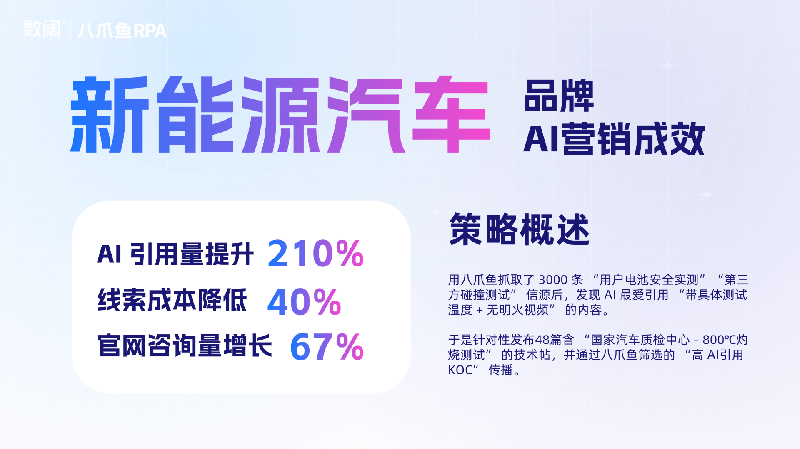

## 从“广告响”到“AI说”：品牌获客逻辑变了

如今，品牌传播获客的竞争焦点已从“广告做得响”转向“让AI替你说话”。

越来越多用户了解行业信息，做出消费决策时，不再依赖关键词搜索，而是直接向AI提问。

例如客户想买电车时，会特别关注电池的安全性和耐用性：  

他们会问AI：

- “哪个锂电池品牌好？”
- “电车电池哪家最耐用最安全？”
- “哪家锂电池更不会被冻坏？”

……

AI给出的答案会推荐品牌，还会引用具体测评数据和真实用户分享。**当某个品牌被AI反复提及，很可能影响消费者决策。**

### GEO时代的核心：竞争焦点转向“被引用权”

这正是营销进入“GEO时代”（生成式引擎优化）的核心变化：**品牌竞争不再是“抢排名”，而是“抢被引用权”**。

AI不会列10条链接让你选，而是直接生成“权威答案”——答案的构成，取决于它抓取了哪些内容、信任哪些来源。**决定答案来源的，不再是广告投放，而是AI是否愿意调取你的内容。**

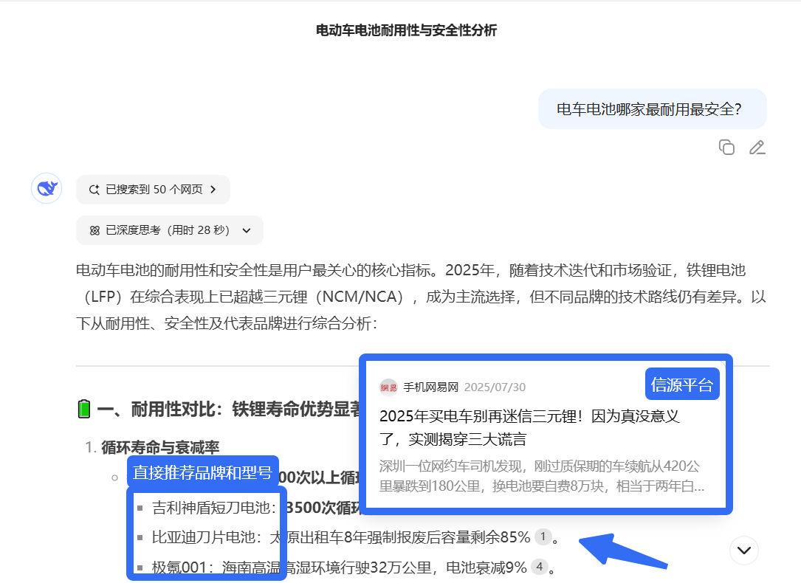

## 想让AI“替你说话”？先理清GEO的玩法与卡点

那么，如何让AI在用户提问时“替你说话”？

### ①GEO的特殊性：规则模糊，信源偏好差异大

先看核心逻辑：GEO不像SEO有明确规则可追溯，甚至同一个问题问同一个AI，答案都不同；且不同AI偏好的信源平台也不一样。

例如deepseek喜欢偏向搜狐、网易等门户信息，而腾讯元宝大多是公众号信息。

### ②实操思路：以终为始，紧扣AI引用逻辑和用户需求

以“让AI在用户决策关键提问中优先关联品牌”为核心目标，倒推全链路动作：

以终为始：先梳理消费者决策前常问的问题，分别向不同AI提问，分析AI参考的信源细节（如平台、发布者、粉丝量等），再针对性优化内容、联系KOL，并持续训练AI……

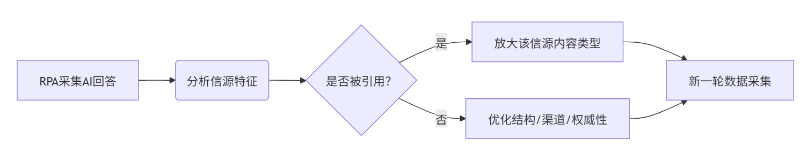

1. **先列用户常问的问题**
把消费者做决策前最关心的问题列出来（比如“锂电池冬天续航掉多少”“哪家电池安全事故少”），这些问题就是AI需要回答的，也是我们要瞄准的方向。
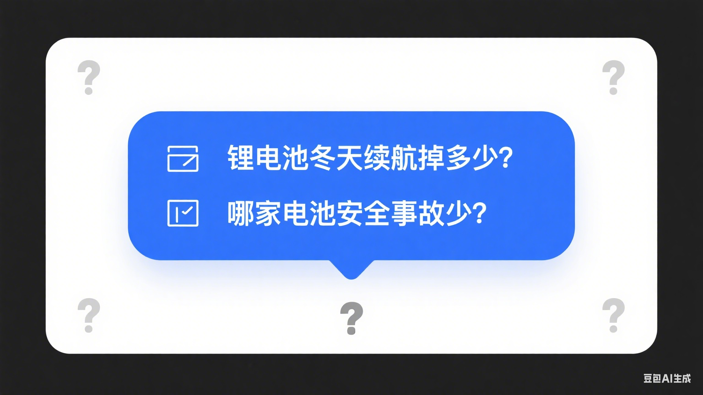

1. **搞懂AI爱引用什么信息**
拿这些问题去问不同AI，看看它们回答里引用的信息来自哪：是更喜欢专业测评网站的内容，还是用户社区的分享？爱用机构发布的数据，还是博主的体验？摸清AI“偏爱”的信息类型和来源。
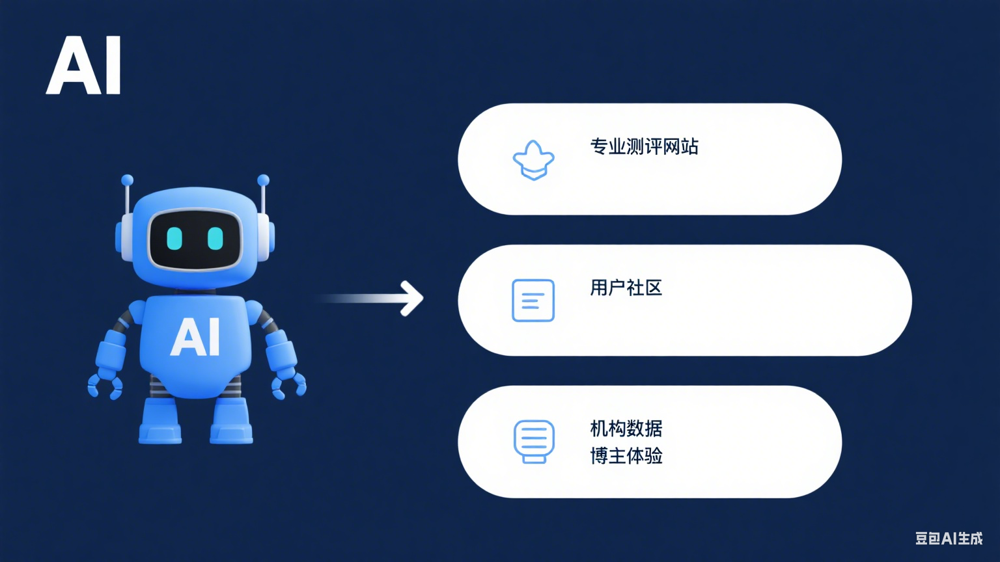

1. **按AI的“喜好”做内容**
AI爱用权威数据，就发带第三方检测报告的解析；爱用真实体验，就多推用户的长期使用分享；爱讲技术细节，就把能验证的技术参数说明白。在AI常找信息的平台上发这些内容，让它容易被抓到。
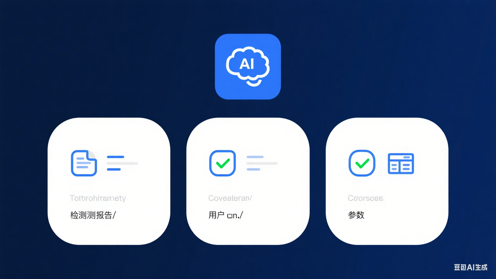

1. **找高引用的KOL传播**
观察AI引用的内容会发现，**粉丝多、传播广的内容未必会被引用**；反而是那些被AI频繁收录的KOL/KOC更关键——和他们合作发布品牌内容，更容易被AI认可和引用。
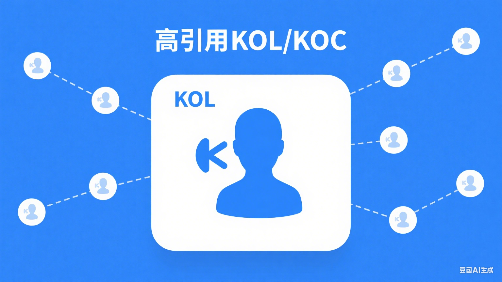

### ③最大卡点：信源信息难获取，传统方式行不通

核心问题在于：**AI引用的信源具有极强的“不可控性”**，直接导致信息获取链路全面受阻。

人工处理效率极低且难以标准化：不仅面临“效率低、成本高”的问题，更因信息形态的复杂性和专业性，**难以形成稳定、可复用的处理流程**，最终导致信源验证的可靠性和规模化能力双双受限。

但传统的技术手段也困难重重：因为无法预知AI会引用哪些平台，且各平台布局差异大，传统爬虫或python脚本行不通；**直接用AI识别，准确率低且成本高昂。**

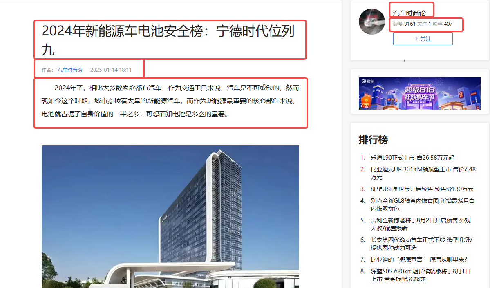

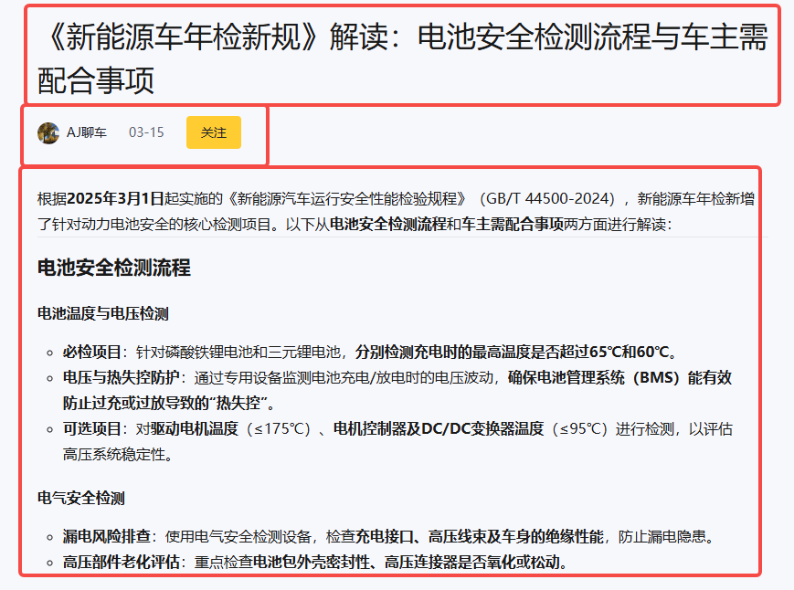

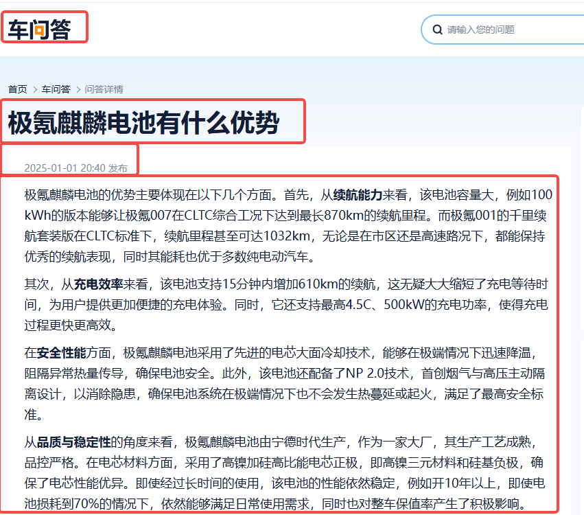

每个信源网页结构均不相同

## 八爪鱼：独家「预处理＋AI」模式

### 成本低、准确率高

八爪鱼凭借13年数据采集经验，独创**“智能预处理+AI精识别”**双引擎模式：系统先深度解析页面结构，智能定位并筛选关键元素，再由AI二次精准提取。

  
双重保障下，数据准确率远超行业常规方案，**且AI获取成本仅为传统方式的1/10**，提供**采集器＋RPA＋AI＋实施一站式服务，目前只有我们一家可以实现**，助力品牌高效突破GEO布局难点。

话不多说，先看视频

👇👇👇

[查看原视频](https://skieer.feishu.cn/wiki/QNWQwJHvTi6C7dk8ylFcdWTVnMe)

### 八爪鱼方案：不只是“解决问题”，更是“让GEO效果可量化”

前面提到的“信源难获取”“效率低”“准确率差”，本质上都是品牌在GEO布局中最痛的“隐性成本”——**投入了时间却看不到AI引用增长，花了钱却抓不住关键信源。**

而八爪鱼的“智能预处理+AI精识别”双引擎，恰恰把这些隐性成本变成“可计算的收益”：

#### ①精准度：从“猜”到“准”

八爪鱼的预处理引擎能自动剥离广告、冗余评论等干扰信息，最终提取的有效信息准确率达95%。这意味着品牌无需为“无效信息”浪费人力与时间，每一份投入都能精准指向有效信息挖掘，让资源用在实处。

#### ②效率：从“耗”到“省”

传统人工1天最多处理100条跨平台信源，八爪鱼系统1小时可完成1000条信源的解析提取，效率提升10倍以上。

更关键的是，它能将各类内容转化为统一的“AI友好型素材库”，品牌可直接复用这些素材优化内容发布，省去90%的人工整理时间，让效率提升看得见、算得清。

## 看同行怎么做：GEO实战案例，告诉你“被AI引用”能带来多少增长

### 新能源汽车品牌：被AI引用量提升210%，线索成本降40%

某二线新能源品牌曾因“电池安全性”认知度低，AI回答“电车电池哪家最安全”时几乎不被提及。

用八爪鱼进行信源分析并进行针对性的优化，半年之后，主流AI回答相关问题时，该品牌被引用频率从0.3次/100条提升至0.93次/100条，官网咨询量增长67%，线索成本较传统广告降低40%。

如果你也想让品牌在用户向AI提问时“被优先提及”，想让GEO不再是模糊的尝试，而是实实在在的落地，现在行动，扫码添加专属顾问，让你的品牌先一步成为AI答案里的“优先选项”。

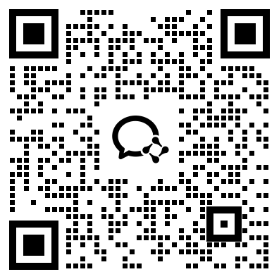

扫码获取企业专属方案

---

原文：[查看原文](https://skieer.feishu.cn/wiki/QNWQwJHvTi6C7dk8ylFcdWTVnMe)
