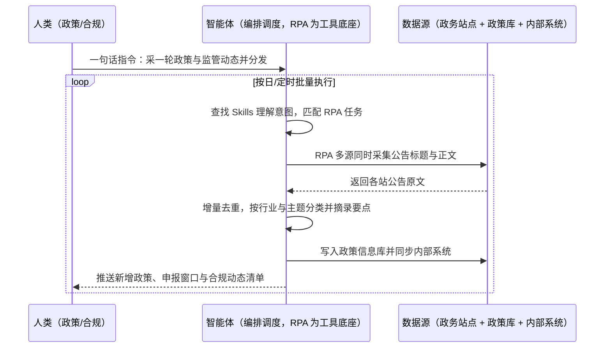

> 为企业搭建政策与政务公告情报底座。政策法规、行业补贴、监管处罚、项目招标分散在国家部委、地方厅局、监管机构与权威媒体等大量站点，发布不规律、格式不统一，人工逐个网站翻通知既漏又慢——错过申报截止就丢掉政策红利，监管动态看漏就埋下合规风险。本方案由智能体调度自动化工具，对多政务数据源同时采集、去重清洗后建成企业专属政策信息库，按日把新增政策与监管动态推送给责任部门，并通过接口同步到企业内部系统。按日批量执行，全程自动化，异常才打扰；数据源清单、关注口径与推送人部署前一次配置。

> Agent 自动化需开通企业功能
> 点击申请1个月免费权限
> [点击申请 →](https://skieer.feishu.cn/share/base/form/shrcnFwMayykP5iaL38fnZKTbrg)

## 一、用户与需求

核心矛盾：

- 政策分散不规律：政府资金申报通知散在各部门网站，发布时间无规律，逐个查找容易错过截止
- 法规更新频繁：合规管理要盯的法规与监管动态多，人工监控难度大、成本高
- 站点结构各异：各政务网站格式不统一，通用工具适配不了，单独开发脚本成本高
- 共享协同难：人工拿到的信息同步不进内部系统，无法流转、穿透查询与统计
- 覆盖面不足：只看几个常去的站，小众专项政策拿不到

适用客户：中小企业公共服务示范平台、政策信息服务商，科技 / 金融 / 医药 / 高新技术企业，垂直行业网站与项目集成服务商，中标方与政府项目服务商，招标信息大数据平台商。对政策红利与合规风险同时敏感的企业优先；部署后业务人员不需要写代码，一句话下达指令即可执行。

### 1.1 不同客户类型

| 类型 | 选择 | 建议 |
|-|-|-|
| 高科技/医药/金融企业（合规敏感） | 首选 | 强烈推荐（政策红利与合规风险双高） |
| 中小企业公共服务示范平台 | 首选 | 强烈推荐（服务多家企业，需批量触达） |
| 项目集成商与政府项目服务商 | 次选 | 一般推荐（政策与项目公告并采） |
| 垂直行业网站与数据平台商 | 次选 | 一般推荐（作为数据供给能力） |
| 无政策诉求的纯贸易企业 | 不做 | 价值有限 |

### 1.2 不同场景侧重

| 场景 | 最关注维度 | 核心逻辑 |
|-|-|-|
| 政策风向提醒 | 申报截止与补贴条件 | 通知与截止时间分散，错过就丢红利 |
| 合规风控 | 监管处罚与法规更新 | 更新频繁，人工监控覆盖不全 |
| 垂直行业信息整合 | 行业专项政策与标准 | 行业站数量多、结构各异 |
| 政府项目交付支撑 | 项目公告与资质要求 | 关联招投标与采购寻源 |
| 招投标项目整合 | 项目信息与时间节点 | 与商机线索同一数据源 |

### 1.3 不同角色用户

| 用户 | 需求 | 问题 | 投入时间（估算） |
|-|-|-|-|
| 政策/项目申报岗 | 不错过申报窗口 | 逐个网站翻通知，靠人盯 | 每天 1-2 小时 |
| 合规/法务 | 法规更新早知道 | 法规与处罚信息分散，人工难覆盖 | 每周数小时 |
| 战略/市场 | 看清政策与产业趋势 | 数据零散，出不了结构化洞察 | 每周整理 |
| 数科/IT | 数据进内部系统 | 采集与业务系统不通，人工导 | 项目制投入 |

---

## 二、现在的方法与问题

### 2.1 流程步骤与问题总结

| 序号 | 步骤 | 现在的方法 | 问题缺陷 |
|-|-|-|-|
| 1 | 定关注范围 | 人工列出常看的几个部门网站 | 覆盖窄，专项政策漏掉 |
| 2 | 逐站浏览 | 人工逐个网站翻通知公告 | 发布不规律，靠人反复看 |
| 3 | 筛政策 | 人工判断是否与自身相关 | 靠经验，口径不一 |
| 4 | 记录截止 | 人工抄录申报时间与条件 | 漏抄截止时间就丢机会 |
| 5 | 内部传递 | 群里发链接或邮件转附件 | 传递慢，责任人不明确 |
| 6 | 沉淀分析 | 人工归档到共享盘 | 无结构化库，无法统计与趋势分析 |

### 2.2 问题分析

**人工方式根因**

| 序号 | 根因 | 具体表现 |
|-|-|-|
| 1 | 数据源复杂 | 网站结构各异、无统一标准，工具难适配 |
| 2 | 更新频繁 | 需要固定频率巡检，人工节奏跟不上 |
| 3 | 筛选靠经验 | 相关性判断口径不统一 |
| 4 | 与内部系统脱节 | 信息进不了业务系统，无法流转与统计 |

**工具方式根因**

| 序号 | 根因 | 具体表现 |
|-|-|-|
| 1 | 通用采集工具不适配 | 政务站点结构差异大，需要逐站配置模板 |
| 2 | 缺清洗与分类 | 采集到的原文无法直接变成可用政策条目 |
| 3 | 缺分发机制 | 采完无自动推送与同步，仍需人工二次搬运 |

---

## 三、解决方案

### 3.1 功能概述

为企业打造的政务公告与政策数据采集方案，一句话调度多部门政务站点的采集、清洗与分发，输出企业专属政策信息库、每日政策推送与合规动态清单。

一句话下达指令（如「采一轮政策与监管动态，按部门推给对应负责人」），智能体通过查找 Skills 文档库理解意图、匹配 N 个 RPA 自动化任务（采集→去重→分类→入库→同步→推送），经 MCP 调度八爪鱼 RPA 同时对国家部委、地方厅局、监管机构与权威媒体等多源站点采集公告标题与正文，做增量比对只取新增；再由智能体按行业与主题做去重、分类与要点摘录，写入企业专属政策信息库，并通过接口同步到内部系统、按责任范围推送给政策申报岗与合规岗。全程自动化，运行状态实时反馈，跑完推送结果。

### 3.2 系统结合

| 要素 | 说明 |
|-|-|
| 客户现有工具盘点 | **未建库客户**：人工浏览 + 共享盘 + 群转发。       **已建库客户**（主流）：采集工具 + 内部知识库/OA + 数据平台 + 数据库 |
| 数据/能力来源 | 国家部委与地方厅局站点、监管机构公示平台、政府采购与公共资源交易平台、权威新闻媒体、企业自有政策与资质台账 |
| RPA 耦合动作 | 作为 Agent 的工具底座被调度执行：①解决逐站浏览翻通知的机械动作；②被智能体调度执行多源同时采集、翻页与正文抓取；③把清洗结果写入信息库并同步内部系统与推送渠道 |
| 耦合出的新价值 | 单系统给不了的端到端结论：多源政务信息汇成一库、按企业与行业口径分类到人、申报窗口与合规动态当天可见，**只推送命中关注口径的新增政策与合规风险清单** |

### 3.3 智能体执行流程

一句话下达指令，智能体自动调度；入参（数据源清单、关注行业与主题、推送责任范围、内部系统接口）部署时一次配置：

> Agent 自动化需开通企业功能
> 点击申请1个月免费权限
> [点击申请 →](https://skieer.feishu.cn/share/base/form/shrcnFwMayykP5iaL38fnZKTbrg)

### 3.4 为何这么设计

要同时回答三个问题：**为什么不能只用纯代码 Agent？为什么不能只用纯 RPA？为什么两者要结合？** 本场景的核心是"多源站点结构各异要天天采、原文要变成可用条目、结论要送到责任人手上"。

#### 1）逐项对比

| 对比维度 | 纯代码 Agent（Codex 等） | 纯 RPA（八爪鱼） | 智能体+RPA（MCP 结合） |
|-|-|-|-|
| 实现方式 | AI 写爬虫逐站抓取并解析 | 用采集模板按规则提取页面字段 | 智能体理解关注口径 + RPA 执行采集，AI 做分类摘录 |
| 站点适配 | 每站单独适配，改版即失效 | 模板化采集，新站可视化配置 | 模板覆盖多数站，智能体补分类与校验 |
| 分类与摘录 | 正则脆弱，规则变更即改代码 | 不擅长语义分类 | 智能体按行业主题分类并摘录要点 |
| 增量与时效 | 需自建增量与调度 | 支持定时与增量采集 | 智能体判定新增与优先级，RPA 执行 |
| 使用成本（总拥有成本） | 工程底座（反爬/调度/解析/告警）全自建长期维护 | 平台订阅，一个底座跑多个流程，边际成本低 | RPA 采集不消耗 AI token，仅分类摘录环节按量消耗 |
| 维护人要求 | 需懂代码、专人专职维护 | 业务人员可上手 | 业务人员看推送清单，异常有告警 |

#### 2）优劣势说明

|  | 纯代码 Agent（Codex 等） | 纯 RPA（八爪鱼） | 智能体+RPA（MCP 结合） |
|-|-|-|-|
| 优势 | 接口型站点抓取快；       批量文本处理强 | 模板化采集稳定，翻页与正文抓取擅长；       支持定时与增量；       业务人员可上手 | 智能体懂分类与摘录；       RPA 稳定执行多源采集；       与内部系统打通，异常有人管 |
| 劣势 | 站多适配量大、改版即失效；       维护成本高 | 缺语义理解与分类能力；       摘录仍需规则兜底 | 需先配置 MCP 连接；       本地电脑需保持开机（或云机） |

**特别提醒**：采集范围限于**公开发布的政务公告与政策信息，须遵守目标站点的访问规则与频率限制，不采集需授权或涉密内容；政策要点与申报截止时间涉及企业实际决策，AI 摘录结果须以原文为准并人工确认**；涉及公文转载与二次发布时，须符合内容使用规范与版权要求。

#### 3）结论

| 论点 | 说明 |
|-|-|
| 补齐 Agent 短板 | 多源站点的检索、翻页与正文抓取，纯代码/纯 Agent 适配量大且易失效，需 RPA 补位结合 |
| 确定性 vs 生成性 | 采集与去重是确定性工程，分类与摘录是生成性能力；关键结论以原文与人工确认为准 |
| 资产沉淀 | 站点模板、关注口径、分类规则沉淀在平台是"活的"，换人接手、扩行业主题都成立 |
| 风险无豁免 | 政务站点访问规则与合规要求无豁免，公开范围与频率是前提，不存在"用代码就更安全"的捷径 |
| 不消耗 AI token | 采集与去重由 RPA 本地执行不占 token，仅分类摘录环节按公告量消耗 AI |
| 时间 | 政策申报岗要的是当天就知道"有新政策、什么时候截止"，而不是每周翻一遍网站 |

### 3.5 功能清单

| 功能 | 系统 | 功能说明（解决问题） |
|-|-|-|
| 会话/一句话指令 | 智能体 | 1. 理解自然语言意图，查找 Skills 文档库。       2. 匹配对应 RPA 自动化任务、编排多任务。 |
| 多源同时采集 | RPA | 1. 解决逐站浏览翻通知、覆盖不足问题。       2. 作为工具被调度执行，同时对多部门站点采集标题与正文。 |
| 定时与增量 | RPA | 按设定频率巡检并只取新增，解决时效差与冗余问题。 |
| 去重与分类 | 智能体 | 按标题与正文指纹去重，按行业与主题分类，解决数据零散问题。 |
| 要点摘录 | 智能体 | 摘录政策要点、申报条件与截止时间，解决关键信息埋在正文问题。 |
| 信息库与同步 | 智能体、内部系统 | 写入企业专属政策信息库并同步内部系统，解决共享协同难问题。 |
| 按责任范围推送 | 智能体、协作平台 | 按关注口径把新增政策推给对应负责人，解决传递慢问题。 |
| 数据资产储存 | 本地电脑、云储存 | 1. Skills 资产：政务政策采集技能。       2. 数据储存：政策信息库 + 公告原始库。       3. 经验知识库：关注口径与分类规则回填。 |

### 3.6 智能体执行落地过程

部署时一次性配置入参（数据源清单、关注行业与主题、推送责任范围、内部系统接口），会话中一句话即可触发，无需重复输入。

**⚠️ 部署前提（不满足则方案无法跑起来）**：①RPA 需部署在**常开电脑/云机**上，并配置漏跑补跑机制；②须先确认各目标站点的访问规则与允许的采集频率；③关注口径（行业、主题、区域、资质门槛）需与政策申报与合规负责人确认一次（属实施成本）；④推送责任范围与升级规则需明确到人；⑤内部系统的写入权限与字段映射需提前约定；⑥首次配置（站点清单、关注口径、分类规则）需服务方/技术人员介入一次，属实施成本。

#### 1）配置（五步）

| 步骤 | 操作 | 说明 |
|-|-|-|
| 第一步 | 下载八爪鱼 RPA，导入政务采集模板 | 官网免费下载客户端；MCP 工具→添加应用 |
| 第二步 | 开启八爪鱼 RPA 的 MCP 服务端口 | 客户端→API-K→创建 API（名称自定义） |
| 第三步 | 在智能体中添加 MCP Server 连接 | 复制连接配置→智能体连接器→自定义连接器→配置 MCP→粘贴保存 |
| 第四步 | 验证工具列表 | 确认工具全部启用（即八爪鱼客户端内工具） |
| 第五步 | 测试运行效果 | 输入一句话指令，验证采集、分类与同步是否连通 |

| 类别 | 说明 |
|-|-|
| 智能体 | 主流智能体（支持 MCP 连接、Skills 加载、定时任务）。 |
| 智能体工具 | 1. **执行通道**：采集 + 去重 + 分类 + 入库 + 同步。       2. 数据取数与自动化执行：八爪鱼 RPA（MCP 协议接入）+ 采集器模板。       3. 分类摘录：智能体自带或接大模型。       4. 数据储存：政策信息库 / 知识库 / 多维表格。       5. IM：钉钉/飞书/企微（政策推送与告警）。 |
| 工作知识 | 1. 数据源清单与访问规则。       2. 关注行业、主题与资质门槛。       3. 分类规则与要点摘录口径。       4. 推送责任范围。 |
| 本地数据库 | 1. 政策信息库地址。       2. 公告原始库地址。       3. 采集台账与异常记录存档地址。 |

#### 2）执行

| 任务 | 产出 | 产出物接收人 |
|-|-|-|
| 接收一句话指令，匹配 RPA 任务 | 任务启动记录 | —— |
| 多源采集公告标题与正文 | 各站公告原文 | —— |
| 增量比对与去重 | 新增公告集 | —— |
| 分类与要点摘录 | 结构化政策条目 | 政策/合规 |
| 入库与内部系统同步 | 政策信息库 + 系统记录 | 政策/数科 |
| 按责任范围推送 | 政策推送清单 | 政策申报岗/合规岗 |
| 采集失败与异常汇总 | 异常清单 | 数科/运营 |

异常处理：

站点访问失败或改版 → 重试 1 次，仍失败跳过并告警，模板更新后恢复；

摘录字段缺失 → 该条标记待人工核对，并附原文链接，不阻塞入库；

重复公告 → 按标题与正文指纹归并为一条；

登录失效 → 自动重试 2 次，仍失败告警推 IM。

#### 3）结果

| 结果 | 说明 |
|-|-|
| 数据资产 | 政策信息库 + 公告原始库 + 采集台账，可检索可追溯。 |
| 分析报告 | 每日政策推送（含申报窗口与截止时间）+ 月度政策与监管动态汇总。 |
| Skills | 智能体 Skills：政务政策采集技能，关注口径与分类规则按月迭代。 |

> Agent 自动化需开通企业功能
> 点击申请1个月免费权限
> [点击申请 →](https://skieer.feishu.cn/share/base/form/shrcnFwMayykP5iaL38fnZKTbrg)

---

## 四、使用前后预估

> 本方案价值 = **多源政务信息自动采 → 分类摘录成条目 → 推送到责任人**。把政策与合规监控从"靠人盯几个网站"变成"系统每天送到手"。

| 指标 | 人工 | 纯代码 Agent | 智能体+自动化工具 |
|-|-|-|-|
| 数据源覆盖 | 常看的几个站 | 站点适配量大、改版即失效 | 多部门站点同时采集 |
| 采集时效 | 靠人反复看，常滞后 | 取决于脚本调度 | 定时 + 增量，新增当天可推 |
| 关键信息 | 人工从正文抄录 | 正则脆弱，正文变了就错 | AI 摘录要点 + 原文核查兜底 |
| 数据形态 | 共享盘零散文件 | 本地文件，无分类 | 结构化政策库，可按主题检索 |
| 部门共享 | 群转链接、邮件附件 | 需自建分发链路 | 自动同步内部系统 + 按范围推送 |
| 人力投入 | 每天 1-2 小时翻网站 | 需专人维护脚本 | 只看推送清单与异常 |

**说明**：本方案基于八爪鱼政务公告采集方案（政策风向提醒、合规风控、垂直行业信息整合、政府项目交付支撑、招投标项目整合）复刻实施路径；**AI 摘录结果须以原文为准并人工确认**；具体数据源数量与推送频率随企业关注范围而异（估算）。

---

## 五、效果证明

**《政务公告与政策数据采集智控：多源站点采集 + 政策合规推送》**

> 面向中小企业公共服务示范平台、科技 / 金融 / 医药企业与政府项目服务商，对国家部委、地方厅局、监管机构与权威媒体等多源政务站点采集政策法规、资金申报、监管处罚与项目公告，去重分类后建成企业专属政策信息库，并通过接口同步到企业内部系统、按责任范围推送给对应负责人。

| 效果 | 说明 |
|-|-|
| 提效 | 多源政务站点同时采集，定时 + 增量，新增政策与监管动态当天可取。原本人工每日 1-2 小时逐个网站翻通知，现在直接看分类推送。 |
| 降本 | 节约人力约 0.13-0.25 人（年 250-500 小时，按 2000 小时/人年折算）。节约人力用于政策解读、资金申报与合规应对等重点工作。 |
| 任务 | 覆盖国家部委、地方厅局、监管机构与权威媒体等多源站点；八爪鱼已服务 10000+ 企业/品牌/国央企。 |
| 提示 | AI 摘录结果以公告原文为准，申报条件与截止时间须人工确认。 |

案例详情：[政务 | 政务采集全链路智控解决方案 | 八爪鱼采集器](https://skieer.feishu.cn/wiki/LdKRwhs3uiYTfKkzVVkc0xljnge)

---

## 六、备注

### 6.1 Agent 支持

本方案不绑定具体智能体，主流 Agent 均可运行（需支持 MCP 连接、技能/Skills 加载与工具调用）：

| Agent/智能体 | 说明 |
|-|-|
| Workbuddy | 本方案运行平台，支持技能/Skills 上传加载、定时任务、MCP 工具调用与表格/报告处理 |
| 豆包（国内·字节） | 国内主流个人智能体，支持技能上传、定时任务与工具调用，上手成本低 |
| 通义千问（国内·阿里） | 支持 Agent 编排与插件生态，适合长文本分类与摘录场景 |
| DeepSeek（国内） | 推理能力强、成本低，适合大批量文本分类与要点提取 |
| ChatGPT（国外·OpenAI） | 海外主流通用智能体，支持 GPTs/Agent 模式与工具调用 |
| Claude（国外·Anthropic） | 长文本与结构化分析能力，原生支持 MCP 连接外部工具 |

### 6.2 名词解释

| 术语 | 说明 |
|-|-|
| 政务公告 | 政府与监管机构公开发布的通知、公告、公示等文件的统称 |
| 政策红利 | 企业符合条件可申请的补贴、奖励、税收优惠等政策收益 |
| 申报窗口 | 政策申报的开放时间区间，错过通常需等下一批 |
| 合规风控 | 依据法规与监管动态识别企业经营风险并提前应对 |
| 增量采集 | 只采集自上次之后新增的数据，避免重复并提升时效 |
| 多源同时采集 | 同时对多个部门与层级的站点采集，扩大覆盖面 |
| 要点摘录 | 从公告原文提取政策要点、申报条件与截止时间 |
| 垂直行业信息 | 面向特定行业的专项政策、标准与项目信息 |
| 原文核查 | 对 AI 摘录结果回看公告原文确认，作为准确性兜底 |
| 低频只读 | 控制访问频率、只读取不修改，降低站点风控风险 |
| MCP | Model Context Protocol，智能体连接外部工具的标准化通道 |
| Skills | 智能体可加载的预设技能资产，含流程与知识 |

> Agent 自动化需开通企业功能
> 点击申请1个月免费权限
> [点击申请 →](https://skieer.feishu.cn/share/base/form/shrcnFwMayykP5iaL38fnZKTbrg)

---

原文：[查看原文](https://skieer.feishu.cn/wiki/Ha88wM2zxiSIGekRql0cHLDKntg)
