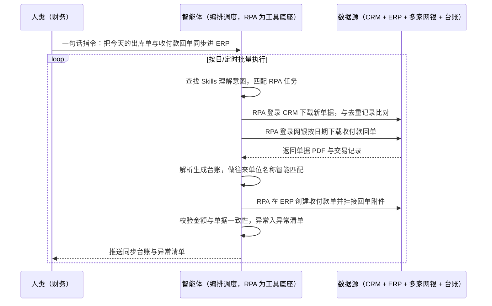

> 为制造业企业打通「销售前端 → 财务后端 → 银行」三段链路。销售用 CRM 管订单、财务用 ERP 管库存与凭证、资金在网银里进出，三者之间没有接口——自己做接口要花几十万且联调周期长，银行企业网银更不对外开放，于是出库单、收付款回单全靠财务手工下载、改名、上传、挂接，一天几十单，错传漏传直接影响成本核算与对账。本方案由智能体调度自动化工具，以非侵入方式打通 CRM、ERP 与多家网银，围绕「出库即同步、收款即入账、付款即归档」三条链自动流转，输出单据同步台账与异常清单。按日/定时执行，全程自动化，异常才打扰；单据匹配规则、命名规范与附件归档口径在部署前一次配置。

> Agent 自动化需开通企业功能
> 点击申请1个月免费权限
> [点击申请 →](https://skieer.feishu.cn/share/base/form/shrcnFwMayykP5iaL38fnZKTbrg)

## 一、用户与需求

核心矛盾：

- 接口成本高到不划算：CRM 与 ERP 之间的接口开发几十万元、联调周期长，投入产出说不通
- 银行侧根本不给接口：企业网银不开放直连，资金数据只能靠人下载
- 财务在系统间搬运：出库单 PDF、收付款回单、流水台账全靠手工下载、改名、上传、挂接
- 单号对不上就扯皮：银行回单上的单位名称与 ERP 里的往来单位不一致（后缀、简称差异），挂接不上要反复核对
- 账实有时差：出库不同步导致库存滞后，成本核算依据不足

适用客户：有 ERP + CRM + 多家网银的制造业与科技制造企业，尤其是接口预算受限、银行系统封闭、等不起自研排期的成长型企业。已上金蝶/用友/鼎捷等 ERP 且与 CRM 割裂的客户优先；部署后业务人员不需要写代码，一句话下达指令即可执行。

### 1.1 不同规模企业

| 类型 | 选择 | 建议 |
|-|-|-|
| 成长型制造/科技制造（多系统割裂） | 首选 | 强烈推荐（痛点最集中、见效最快） |
| 中大型制造（有合规留痕要求） | 首选 | 强烈推荐（RPA 留痕可满足审计） |
| 已自建完整接口的企业 | 不做 | 已有打通，无需重复投入 |
| 单一系统的小微企业 | 不做 | 无跨系统场景 |

### 1.2 不同链路侧重

| 链路 | 最关注维度 | 核心逻辑 |
|-|-|-|
| 出库单同步（CRM→ERP） | 不重不漏 | 一天几十单，漏传会直接导致库存与成本偏差 |
| 收款单同步（网银→ERP） | 客户名称匹配准确 | 名称后缀不一致会导致挂接失败 |
| 付款单同步（网银→ERP） | 单据精准挂接 | 单号不一致时人工要反复切换核对 |
| 附件归档 | 可追溯可审计 | 回单原件必须与 ERP 单据一一对应留档 |

### 1.3 不同角色用户

| 用户 | 需求 | 问题 | 投入时间（估算） |
|-|-|-|-|
| 资金会计 | 回单不漏、台账准 | 逐笔下载、改名、上传，跨系统搬运 | 每天数小时 |
| 应收/应付会计 | 单据及时入账 | 手工录入易错，月底对不上账要重查 | 每天数小时 |
| 财务负责人 | 账实一致、可审计 | 报表反复修正，月底结算拉长 | 复核与返工 |
| 管理层 | 及时拿到准确经营数据 | 数据滞后影响决策 | 看报表 |

---

## 二、现在的方法与问题

### 2.1 流程步骤与问题总结

| 序号 | 步骤 | 现在的方法 | 问题缺陷 |
|-|-|-|-|
| 1 | 出库单获取 | 人工登录 CRM 下载审批完成的单据 PDF | 一天几十单，逐单下载枯燥易漏 |
| 2 | 出库单上传 | 人工登录 ERP 搜索对应单据后添加附件 | 搜不到或保存失败无兜底 |
| 3 | 收付款回单下载 | 人工登录多家网银逐笔下载回单 | 多银行多账号，逐笔操作耗时 |
| 4 | 台账整理 | 人工把回单信息录入 Excel 台账 | 手工录入易错，月底与流水对不上 |
| 5 | 名称匹配 | 人工比对回单单位名与 ERP 往来单位 | 后缀/简称差异导致匹配失败 |
| 6 | 单据录入与挂接 | 人工在 ERP 创建收款单/付款单并上传附件 | 单号不一致要反复核对，扯皮成本高 |
| 7 | 异常处理 | 出错后回头查、改表、重传 | 无异常清单，问题闭环靠人记 |

### 2.2 问题分析

人工方式根因

| 序号 | 根因 | 具体表现 |
|-|-|-|
| 1 | 三系统割裂 | CRM、ERP、网银各管一段，数据靠人搬运 |
| 2 | 名称与单号不规范 | 银行回单与 ERP 命名规则不同，匹配靠人眼 |
| 3 | 量大且无校验 | 一天几十单，人工无法逐笔校验金额与单号 |
| 4 | 无异常闭环 | 漏传错传事后才发现，归因困难 |

**系统方式根因**

| 序号 | 根因 | 具体表现 |
|-|-|-|
| 1 | 接口成本高 | CRM↔ERP 接口几十万元且联调周期长 |
| 2 | 银行不开放 | 企业网银不提供直连接口，系统路线走不通 |
| 3 | 无预算与排期 | 自研要等排期，业务等不起 |

---

## 三、解决方案

### 3.1 功能概述

为制造业企业打造的业财一体零接口方案，一句话调度 CRM、ERP 与多家网银之间的单据与资金数据流转，输出单据同步台账、资金台账与异常清单。

一句话下达指令（如「把今天的出库单和收付款回单同步到 ERP」），智能体通过查找 Skills 文档库理解意图、匹配 N 个 RPA 自动化任务（下载→去重→解析→匹配→上传→归档），经 MCP 调度八爪鱼 RPA 自动登录 CRM 下载审批完成的新单据并与本地去重记录比对，登录 ERP 精确搜索对应单据添加附件；同时登录多家网银按日期筛选收付款记录、逐笔下载回单、解析生成按自然日命名的台账，做往来单位名称智能匹配后在 ERP 创建收付款单并挂接回单附件，最后把处理结果与异常清单推送业务群。全程自动化，运行状态实时反馈，跑完推送结果。

### 3.2 系统结合

| 要素 | 说明 |
|-|-|
| 客户现有工具盘点 | **未打通客户**（主流）：CRM（纷享销客/销售易等）+ ERP（金蝶云星空/用友/鼎捷）+ 多家企业网银 + Excel 台账 + 协作平台 |
| 数据/能力来源 | CRM 审批完成的出库/销售单据、ERP 库存与往来单位主数据、银行网银的回单与交易记录、本地台账与去重记录 |
| RPA 耦合动作 | 作为 Agent 的工具底座被调度执行：①解决逐单下载、改名、上传、挂接的机械动作；②被智能体调度执行登录、筛选、下载、解析与上传；③把台账、异常与附件归档落库并推送 |
| 耦合出的新价值 | 单系统给不了的端到端结论：出库即同步、收款即入账、付款即归档，账实零时差且每笔留痕可审计，**只推送金额不一致、名称匹配失败与上传异常清单** |

### 3.3 智能体执行流程

一句话下达指令，智能体自动调度；入参（单据来源、银行与账号清单、命名与匹配规则、归档路径、异常接收人）部署时一次配置：

> Agent 自动化需开通企业功能
> 点击申请1个月免费权限
> [点击申请 →](https://skieer.feishu.cn/share/base/form/shrcnFwMayykP5iaL38fnZKTbrg)

### 3.4 为何这么设计

要同时回答三个问题：**为什么不能只用纯代码 Agent？为什么不能只用纯 RPA？为什么两者要结合？** 本场景的核心是"银行侧没有接口、金额与单号必须逐笔校验、操作要留痕可审计"。

#### 1）逐项对比

| 对比维度 | 纯代码 Agent（Codex 等） | 纯 RPA（八爪鱼） | 智能体+RPA（MCP 结合） |
|-|-|-|-|
| 实现方式 | AI 写脚本调 CRM/ERP 接口与网银 | 模拟人登录各系统完成下载、上传、挂接 | 智能体理解匹配规则与校验口径 + RPA 执行操作 |
| 银行侧对接 | 企业网银无开放接口，走不通 | 页面级操作可覆盖多家网银 | 银行侧交给 RPA，智能体专注台账与判断 |
| 名称与单号匹配 | 需自写规则，后缀未覆盖即失败 | 不擅长语义匹配 | 智能体做名称智能匹配与差异判定 |
| 金额与单据校验 | 可代码化，规则变更即改代码 | 弱 | 智能体逐笔校验，异常自动拦截 |
| 使用成本（总拥有成本） | 接口开发几十万元 + 工程底座长期维护 | 平台订阅，一个底座跑多个流程，边际成本低 | RPA 本地执行不消耗 AI token，仅解析与校验环节需 AI |
| 合规留痕 | 需自建审计日志 | 每步操作留痕可追溯 | RPA 留痕 + 智能体台账，满足审计要求 |

技术栈速览：纯代码路线需 Python（requests/Playwright/pandas + PDF 解析库）或 Node（axios/playwright/pdf-parse）实现，并自行解决网银无接口、登录态维持、PDF 字段解析、名称模糊匹配、金额校验与调度告警。

#### 2）优劣势说明

|  | 纯代码 Agent（Codex 等） | 纯 RPA（八爪鱼） | 智能体+RPA（MCP 结合） |
|-|-|-|-|
| 优势 | 接口打通后速度快、可深度定制 | 网银与 ERP 页面操作稳定，下载/上传/挂接天生擅长；      
每步留痕可审计；      
不改动任何现有系统 | 智能体懂名称匹配与金额校验；      
RPA 稳定执行跨系统动作；      
异常自动拦截，有人闭环 |
| 劣势 | 银行无接口、CRM 接口费高昂；      
工程底座自建成本高；      
维护成本与 token 成本高 | 缺语义匹配与校验能力；      
异常判断仍需人工兜底 | 需先配置 MCP 连接；      
本地电脑需保持开机（或云机） |

**特别提醒**：本方案属**资金类流程**，必须保留人工复核兜底——**金额不一致、单据匹配失败、上传重试仍失败的单据一律转入异常清单，由财务人工处理，不自动放行**；所有操作全程留痕，回单原件与 ERP 单据一一对应归档，以满足财务合规与审计要求；银行账号与登录凭据需按最小权限原则管理。

#### 3）结论

| 论点 | 说明 |
|-|-|
| 补齐 Agent 短板 | 网银与 ERP 的逐笔操作，纯代码/纯 Agent 无接口走不通，需 RPA 补位结合 |
| 确定性 vs 生成性 | 下载、上传、挂接是确定性动作；名称匹配与金额校验是判断能力，二者边界清晰 |
| 资产沉淀 | 单据匹配规则、命名规范、异常口径沉淀在平台是"活的"，换人接手、增加银行或系统都成立 |
| 资金类底线 | 人工复核兜底与全流程留痕是资金场景的底线设计，纯自动化不可取 |
| 不消耗 AI token | 下载、上传、归档由 RPA 本地执行不占 token，仅解析匹配与校验环节需 AI |
| 时间 | 财务要的是"账实时准、月底不返工"，而不是每天在网银和 ERP 之间来回切 |

### 3.5 功能清单

| 功能 | 系统 | 功能说明（解决问题） |
|-|-|-|
| 会话/一句话指令 | 智能体 | 1. 理解自然语言意图，查找 Skills 文档库。      
2. 匹配对应 RPA 自动化任务、编排多任务。 |
| 出库单下载与去重 | RPA | 1. 解决逐单下载枯燥易漏问题。      
2. 按配置日期筛选审批完成单据，与本地去重记录比对后落地。 |
| 出库单上传挂接 | RPA | 扫描待上传目录，解析单据编码后在 ERP 精确搜索并添加附件，失败入异常目录。 |
| 收付款回单下载 | RPA | 1. 解决多银行多账号逐笔下载问题。      
2. 按日期范围筛选并逐单下载回单。 |
| 台账生成与名称匹配 | 智能体 | 解析回单生成按日台账，做往来单位名称智能匹配（含后缀差异）。 |
| 收付款单创建 | RPA | 在 ERP 创建收付款单、填写金额与用途并挂接回单附件。 |
| 金额与单据校验 | 智能体 | 逐笔校验单据编号与金额一致性，异常自动拦截不自动入账。 |
| 异常通知与归档 | 智能体、协作平台 | 异常清单推送财务群，原件与台账按规范归档留痕。 |
| 数据资产储存 | 本地电脑、云储存 | 1. Skills 资产：业财单据同步技能。      
2. 数据储存：台账库 + 回单附件库 + 异常记录。      
3. 经验知识库：匹配规则与命名规范回填。 |

### 3.6 智能体执行落地过程

部署时一次性配置入参（单据来源、银行与账号清单、命名与匹配规则、归档路径、异常接收人），会话中一句话即可触发，无需重复输入。

**⚠️ 部署前提（不满足则方案无法跑起来）**：①RPA 需部署在**常开电脑/云机**上，并配置漏跑补跑机制；②CRM、ERP 与各网银的登录态与凭据需按最小权限管理并定期更新；③往来单位对照表与匹配规则需与财务确认一次（属实施成本）；④附件命名规范与归档目录结构需书面约定；⑤**金额不一致/匹配失败的单据必须走人工复核，不得自动放行**；⑥首次配置（系统路径、匹配表、归档规则）需服务方/技术人员介入一次，属实施成本。

#### 1）配置（五步）

| 步骤 | 操作 | 说明 |
|-|-|-|
| 第一步 | 下载八爪鱼 RPA，导入制造业自动化模板 | 官网免费下载客户端；MCP 工具→添加应用 |
| 第二步 | 开启八爪鱼 RPA 的 MCP 服务端口 | 客户端→API-K→创建 API（名称自定义） |
| 第三步 | 在智能体中添加 MCP Server 连接 | 复制连接配置→智能体连接器→自定义连接器→配置 MCP→粘贴保存 |
| 第四步 | 验证工具列表 | 确认工具全部启用（即八爪鱼客户端内工具） |
| 第五步 | 测试运行效果 | 输入一句话指令，验证下载、匹配与上传挂接是否连通 |

| 类别 | 说明 |
|-|-|
| 智能体 | 主流智能体（支持 MCP 连接、Skills 加载、定时任务）。 |
| 智能体工具 | 1. **执行通道**：下载 + 解析 + 匹配 + 上传 + 归档。      
2. 数据取数与自动化执行：八爪鱼 RPA（MCP 协议接入）。      
3. 数据储存：台账库 + 附件库。      
4. IM：企业微信/飞书/钉钉（异常清单与日报推送）。 |
| 工作知识 | 1. 往来单位对照表与名称匹配规则。      
2. 单据与附件命名规范。      
3. 金额校验与异常判定阈值。      
4. 归档目录与留痕要求。 |
| 本地数据库 | 1. 台账库地址。      
2. 回单附件库地址。      
3. 异常清单与处理记录存档地址。 |

#### 2）执行

| 任务 | 产出 | 产出物接收人 |
|-|-|-|
| 接收一句话指令，匹配 RPA 任务 | 任务启动记录 | —— |
| 下载 CRM 新单据并去重 | 待上传单据集 | —— |
| 登录网银下载回单 | 回单原件与交易记录 | —— |
| 解析生成台账并名称匹配 | 收付款台账 | 财务 |
| ERP 创建单据并挂接附件 | ERP 单据与附件 | 财务 |
| 金额与单据校验 | 校验结果与异常清单 | 财务 |
| 推送台账与异常 | 群消息 | 财务负责人 |

异常处理：

名称匹配失败 → 台账留空并推送异常，由财务确认后补匹配规则；

金额比对不一致 → 该单据不入账，转入异常清单并通知具体单号与差异原因；

上传失败 → 重试 3 次，仍失败转异常目录并群通知；

单据搜索不到 → 保留原件待人工确认，不自动创建重复单据。

#### 3）结果

| 结果 | 说明 |
|-|-|
| 数据资产 | 单据同步台账 + 回单附件库 + 异常处理记录，可审计可追溯。 |
| 分析报告 | 每日同步日报：出库单数、收付款笔数、匹配成功率、异常清单。 |
| Skills | 智能体 Skills：业财单据同步技能，匹配规则与命名规范按月迭代。 |

> Agent 自动化需开通企业功能
> 点击申请1个月免费权限
> [点击申请 →](https://skieer.feishu.cn/share/base/form/shrcnFwMayykP5iaL38fnZKTbrg)

---

## 四、使用前后预估

> 本方案价值 = **出库即同步 → 收款即入账 → 付款即归档**。不改动任何现有系统、不依赖银行开放接口，把割裂的三段链路重新串起来。

| 指标 | 人工 | 纯代码 Agent | 智能体+自动化工具 |
|-|-|-|-|
| 系统对接成本 | —— | 接口开发几十万元、联调周期长 | 非侵入实施，无需接口开发 |
| 实施周期 | —— | 长（含开发与联调） | 案例口径：实施周期缩短 80%+ |
| 财务操作 | 逐笔下载/改名/上传，每天数小时 | 受网银无接口限制，走不通 | 全自动下载、解析、匹配与挂载 |
| 单据准确性 | 手工录入易错漏 | 取决于规则完整度 | 案例口径：数据流转 100% 精准 |
| 账实一致性 | 出库滞后影响成本核算 | 同上 | 出库即同步，账实零时差 |
| 异常闭环 | 事后才发现，靠人记 | 需自建告警 | 异常拦截 + 清单推送 + 人工复核 |

**说明**：案例数字来自八爪鱼客户实践（某导航定位芯片企业：以非侵入方式打通纷享销客、金蝶云星空与两家企业网银，覆盖出库单、收款单、付款单三条同步链路，实施周期缩短 80%+、节省几十万元接口费、数据流转 100% 精准）；本方案为按同口径复刻的实施路径，具体数值随系统数量与单据量而异（估算）。

---

## 五、效果证明

**《制造企业业财一体零接口自动化：出库单、收款单、付款单三链贯通》**

> 该企业处于国内导航定位芯片行业第一梯队。销售端用纷享销客、财务端用金蝶云星空，收款分散在招行与中行网银。因两套系统接口开发费用高（几十万元）、联调周期长，且企业网银不开放接口，两条技术路径均走不通。企业改为以非侵入方式打通四套系统，围绕「出库即同步、收款即入账、付款即归档」构建全链路财务供应链自动化闭环。

| 效果 | 说明 |
|-|-|
| 提效 | 出库单、收款单、付款单三条链路每日自动同步。原本财务需逐笔下载、改名、上传并挂接单据，现在全流程自动完成。 |
| 降本 | 节省接口开发费用 30 万元以上（原文：节省几十万接口费），实施周期缩短 80%+。原本需为四套系统开发接口并长期联调，现在非侵入实施即可打通；节约人力投入资金计划与经营分析等重点工作。 |
| 任务 | 数据流转 100% 精准，账实零时差，出库、收款、付款三条链路全覆盖。 |
| 任务 | 金额不一致或匹配失败一律转异常清单人工复核，不自动放行；全程留痕满足审计要求。 |

案例详情：[财务 | 业财一体：高科技制造企业借助八爪鱼RPA，零接口实现纷享销客、金蝶ERP、银行网银全链路自动化](https://skieer.feishu.cn/wiki/ICE1wbSMYicgwGkpxAqcVCBgnbb)

---

## 六、备注

### 6.1 Agent 支持

本方案不绑定具体智能体，主流 Agent 均可运行（需支持 MCP 连接、技能/Skills 加载与工具调用）：

| Agent/智能体 | 说明 |
|-|-|
| Workbuddy | 本方案运行平台，支持技能/Skills 上传加载、定时任务、MCP 工具调用与表格/报告处理 |
| 豆包（国内·字节） | 国内主流个人智能体，支持技能上传、定时任务与工具调用，上手成本低 |
| 通义千问（国内·阿里） | 支持 Agent 编排与插件生态，适合财务与供应链规则编排 |
| DeepSeek（国内） | 推理能力强、成本低，适合单据匹配与差异归因类任务 |
| ChatGPT（国外·OpenAI） | 海外主流通用智能体，支持 GPTs/Agent 模式与工具调用 |
| Claude（国外·Anthropic） | 长文本与结构化分析能力，原生支持 MCP 连接外部工具 |

### 6.2 名词解释

| 术语 | 说明 |
|-|-|
| CRM | 客户关系管理系统，本例为纷享销客，承载销售订单与出库审批 |
| ERP | 企业资源计划系统，本例为金蝶云星空，承载库存、往来单位与凭证 |
| 零接口 | 不通过系统间 API 对接，而是模拟人工在界面操作完成数据流转 |
| 非侵入式 | 不改动被操作系统的配置与数据，仅模拟人工在界面上操作 |
| 出库单同步 | 把 CRM 审批完成的出库单附件同步到 ERP 对应单据下 |
| 回单 | 银行出具的收款或付款凭证文件，需与 ERP 单据一一挂接留档 |
| 往来单位对照表 | 银行回单上的单位名称与 ERP 往来单位名称的匹配关系表 |
| 智能后缀匹配 | 识别 Limited、LTD、INC. 等公司名称后缀差异，提升匹配成功率 |
| 去重记录 | 本地维护的已处理单据清单，避免重复下载与重复入账 |
| 人工复核兜底 | 金额不一致或匹配失败时转人工处理，是资金类流程的底线设计 |
| 留痕 | 每一步操作的完整日志，用于合规审计与事后追溯 |
| MCP | Model Context Protocol，智能体连接外部工具的标准化通道 |
| Skills | 智能体可加载的预设技能资产，含流程与知识 |

> Agent 自动化需开通企业功能
> 点击申请1个月免费权限
> [点击申请 →](https://skieer.feishu.cn/share/base/form/shrcnFwMayykP5iaL38fnZKTbrg)

---

原文：[查看原文](https://skieer.feishu.cn/wiki/CXk2wzoekimg37kgoVyc1z9wn7e)
