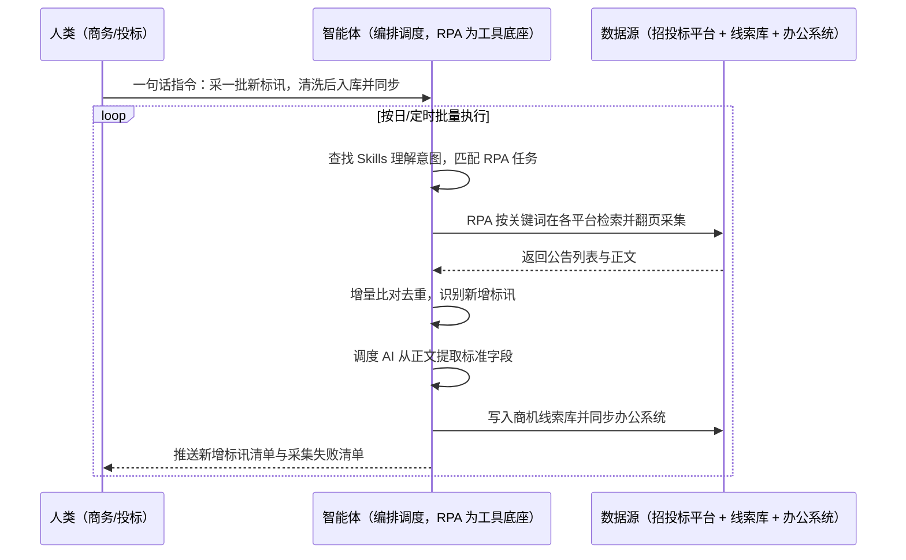

> 为承接政府与国央企业务的企业搭建招投标商机信息库。招标网站成千上万，国家级、聚合类、行业垂直各有各的格式，公告正文里混着招标单位、预算金额、投标截止时间、联系人等关键字段；人工逐个网站登录、翻页、复制、粘贴，一天下来收不了多少条，还常常因为漏看而错过投标截止时间。本方案由智能体调度自动化工具，对全网招投标平台定时与增量采集，再用 AI 把非结构化公告一键清洗成标准字段，自动汇总并同步到企业办公系统，输出商机线索库、每日标讯清单与竞标复盘数据。按日批量执行，全程自动化，异常才打扰；目标网站清单、关键词与字段规则在部署前一次配置。

> Agent 自动化需开通企业功能
> 点击申请1个月免费权限
> [点击申请 →](https://skieer.feishu.cn/share/base/form/shrcnFwMayykP5iaL38fnZKTbrg)

## 一、用户与需求

核心矛盾：

- 网站数量太大：招投标平台分散在国家级、聚合类与行业垂直站，个人与团队都覆盖不全
- 公告格式不统一：关键字段埋在正文里，靠正则表达式提取，网页一改版就失效
- 时效要求高：新标讯晚一天看到，可能就错过了投标窗口
- 共享难：一个人采完发文件给大家，数据进不了办公系统，无法流转、穿透查询与统计
- 账号成本高：平台账号按人头收费，无法让每个销售都去开账号

适用客户：承接政府或国央企业务的建筑与工程公司、供应商与制造商、服务提供商（及其数科部门），以及金融投资与风险管理机构、大数据服务公司。销售团队规模大、商机线索依赖招投标信息的企业优先；部署后业务人员不需要写代码，一句话下达指令即可执行。

### 1.1 不同客户类型

| 类型 | 选择 | 建议 |
|-|-|-|
| 建筑/工程公司（投标主力） | 首选 | 强烈推荐（标讯就是命脉） |
| 供应商与制造商（To G/To 央企） | 首选 | 强烈推荐（商机线索直接变现） |
| 服务提供商与集成商 | 次选 | 一般推荐（按行业站定向采集） |
| 金融投资与风险管理机构 | 次选 | 一般推荐（用于宏观与风险研判） |
| 大数据服务公司 | 次选 | 一般推荐（作为数据供给能力） |

### 1.2 不同数据用途

| 用途 | 最关注维度 | 核心逻辑 |
|-|-|-|
| 商机线索 | 时效与精准 | 早一天拿到，就多一天准备时间 |
| 市场情报 | 覆盖广度 | 只有全量覆盖才能看出趋势与格局 |
| 客户需求挖掘 | 招标单位与预算 | 提前联系潜在客户做早期沟通 |
| 竞标策略 | 历史中标公告 | 分析竞对中标与报价策略、中标原因 |
| 部门协同 | 与办公系统打通 | 数据要能流转、穿透查询与统计 |

### 1.3 不同角色用户

| 用户 | 需求 | 问题 | 投入时间（估算） |
|-|-|-|-|
| 销售/商务 | 每天拿到相关标讯 | 靠一个人采完发群，常常滞后 | 每天等他发 |
| 投标负责人 | 不漏关键截止时间 | 人工翻看容易错过窗口 | 每天巡检 |
| 市场/战略 | 掌握行业招标趋势 | 数据零散不成库，无法分析 | 每周整理 |
| 数科/IT | 数据进业务系统 | 采集与内部系统不通，人工导 | 项目制投入 |

---

## 二、现在的方法与问题

### 2.1 流程步骤与问题总结

| 序号 | 步骤 | 现在的方法 | 问题缺陷 |
|-|-|-|-|
| 1 | 圈定网站 | 人工列出常看的几个平台 | 覆盖有限，小众与垂直站被漏掉 |
| 2 | 逐站检索 | 人工登录各平台搜关键词、翻页 | 反复登录查找，效率低 |
| 3 | 抄录信息 | 人工从公告正文复制关键字段 | 字段埋得深，抄录易错易漏 |
| 4 | 整理归档 | 人工汇总成 Excel 或 Word | 格式不一，难以统计与检索 |
| 5 | 分发共享 | 人工在群里发文件或发邮件 | 传递效率低，无权限与版本管理 |
| 6 | 复盘分析 | 人工翻历史公告看竞对中标 | 无结构化数据，做不了系统分析 |

### 2.2 问题分析

**人工方式根因**

| 序号 | 根因 | 具体表现 |
|-|-|-|
| 1 | 数据源分散 | 网站成千上万，聚合平台也覆盖不全 |
| 2 | 无统一格式 | 公告结构各异，字段位置不固定 |
| 3 | 更新快 | 需要固定频率巡检，人工节奏跟不上 |
| 4 | 账号按人头收费 | 无法人人开账号，只能一人采全员用 |

**工具方式根因**

| 序号 | 根因 | 具体表现 |
|-|-|-|
| 1 | 正则提取脆弱 | 网页改版即失效，维护成本高 |
| 2 | 采集与业务系统脱节 | 采完的文件进不了办公系统，无法流转 |
| 3 | 缺增量机制 | 全量重采造成冗余，也看不出哪些是新增 |

---

## 三、解决方案

### 3.1 功能概述

为承接政府与国央企业务的企业打造的招投标商机自动化方案，一句话调度全网标讯采集、AI 结构化清洗与办公系统同步，输出商机线索库、每日标讯清单与竞标复盘数据。

一句话下达指令（如「把今天的新标讯采一遍，清洗后同步到线索库」），智能体通过查找 Skills 文档库理解意图、匹配 N 个 RPA 自动化任务（采集→清洗→去重→入库→同步→推送），经 MCP 调度八爪鱼 RPA 按关键词定时登录各类招投标平台批量采集公告列表与正文，做增量比对只取新增；再调度 AI 能力把非结构化公告清洗为「项目名称、招标编号、预算金额、招标单位、投标截止时间、开标时间、联系人」等标准字段，去重后写入商机线索库，并按规则同步到企业办公系统、向相关销售推送。全程自动化，运行状态实时反馈，跑完推送结果。

### 3.2 系统结合

| 要素 | 说明 |
|-|-|
| 客户现有工具盘点 | **未建库客户**：人工检索 + Excel/Word + 邮件或群发。       **已建库客户**（主流）：招投标聚合平台账号 + OA/协同办公系统 + CRM/线索系统 + 数据库 |
| 数据/能力来源 | 国家级招投标平台、聚合类平台、行业垂直招标网站、政府采购与公共资源交易平台、企业历史投标与中标记录 |
| RPA 耦合动作 | 作为 Agent 的工具底座被调度执行：①解决逐站登录检索翻页的机械动作；②被智能体调度执行关键词检索、翻页、抓取与下载；③把清洗后结构化数据写入线索库并同步办公系统 |
| 耦合出的新价值 | 单系统给不了的端到端结论：全网标讯汇成一库、字段标准可检索可统计、新增标讯当天可推送到人，**只推送命中关键词的新增标讯与采集失败清单** |

### 3.3 智能体执行流程

一句话下达指令，智能体自动调度；入参（目标网站与关键词、字段规则、线索库与同步对象、推送人）部署时一次配置：

> Agent 自动化需开通企业功能
> 点击申请1个月免费权限
> [点击申请 →](https://skieer.feishu.cn/share/base/form/shrcnFwMayykP5iaL38fnZKTbrg)

### 3.4 为何这么设计

要同时回答三个问题：**为什么不能只用纯代码 Agent？为什么不能只用纯 RPA？为什么两者要结合？** 本场景的核心是"网站数量极多、公告是非结构化文本要判得准、每天都要增量巡检"。

#### 1）逐项对比

| 对比维度 | 纯代码 Agent（Codex 等） | 纯 RPA（八爪鱼） | 智能体+RPA（MCP 结合） |
|-|-|-|-|
| 实现方式 | AI 写爬虫抓取并正则解析字段 | 用采集模板按规则提取页面字段 | 智能体理解字段规则 + RPA 执行采集，AI 清洗正文 |
| 网站覆盖 | 每类站单独适配，改版即失效 | 模板化采集，新站可视化配置 | 模板覆盖多数站，智能体补规则与校验 |
| 非结构化正文清洗 | 正则脆弱，正文变了就错 | 不擅长语义理解 | 智能体用大模型抽取字段，适应性更强 |
| 增量与时效 | 需自建增量逻辑与调度 | 支持定时与增量采集 | 智能体判定新增与优先级，RPA 执行 |
| 使用成本（总拥有成本） | 工程底座（反爬/调度/解析/告警）全自建长期维护 | 平台订阅，一个底座跑多个流程，边际成本低 | RPA 采集不消耗 AI token，仅清洗环节按量消耗 |
| 维护人要求 | 需懂代码、专人专职维护 | 业务人员可上手 | 业务人员看线索清单，异常有告警 |

#### 2）优劣势说明

|  | 纯代码 Agent（Codex 等） | 纯 RPA（八爪鱼） | 智能体+RPA（MCP 结合） |
|-|-|-|-|
| 优势 | 接口型站点抓取快；       批量数据处理强 | 模板化采集稳定，翻页与下载天生擅长；       支持定时与增量；       业务人员可上手 | 智能体懂语义抽取与字段校验；       RPA 稳定执行全站采集；       与办公系统打通，异常有人管 |
| 劣势 | 站多适配量大、改版即失效；       正则维护成本高 | 缺语义理解与正文深挖能力；       复杂字段仍需规则兜底 | 需先配置 MCP 连接；       本地电脑需保持开机（或云机） |

**特别提醒**：**大模型 AI 解析无法保证 100% 正确，字段有疑虑时须对比原文确认**——重要字段（预算金额、投标截止时间、招标单位）建议在提交投标前人工复核；采集范围限于公开可访问的招投标信息，**须遵守目标网站的访问规则与频率限制**，不采集需登录且无授权的受限内容；涉及个人信息（联系人电话、邮箱）的字段按合规口径留存与使用。

#### 3）结论

| 论点 | 说明 |
|-|-|
| 补齐 Agent 短板 | 上千站点的登录、检索、翻页与下载，纯代码/纯 Agent 适配量巨大且易失效，需 RPA 补位结合 |
| 确定性 vs 生成性 | 采集与增量去重是确定性工程，正文抽取是生成性能力；字段准确性靠人工复核兜底，边界清晰 |
| 资产沉淀 | 网站模板、关键词库、字段规则沉淀在平台是"活的"，换人接手、扩行业站都成立 |
| 风险无豁免 | 各站点的访问规则与频控无豁免，合规频率与授权范围是前提，不存在"用代码就更安全"的捷径 |
| 不消耗 AI token | 检索与采集由 RPA 本地执行不占 token，仅正文清洗按公告量消耗 AI |
| 时间 | 销售要的是每天一上班就有相关新标讯，而不是等一个人手工采完再发群 |

### 3.5 功能清单

| 功能 | 系统 | 功能说明（解决问题） |
|-|-|-|
| 会话/一句话指令 | 智能体 | 1. 理解自然语言意图，查找 Skills 文档库。       2. 匹配对应 RPA 自动化任务、编排多任务。 |
| 全网标讯采集 | RPA | 1. 解决网站多、人工逐个检索翻页问题。       2. 作为工具被调度执行，按关键词批量采集公告列表与正文。 |
| 定时与增量 | RPA | 按设定频率巡检并只取新增，解决时效差与数据冗余问题。 |
| AI 字段清洗 | 智能体 | 1. 从非结构化正文抽取项目名称、编号、预算、招标单位、截止时间、联系人等字段。       2. 过滤无效信息，解决正则脆弱问题。 |
| 去重与入库 | 智能体、数据库 | 按项目编号与标题指纹去重后写入商机线索库，解决数据不沉淀问题。 |
| 办公系统同步 | RPA | 把结构化标讯同步到 OA/协同办公系统，解决信息共享难问题。 |
| 线索推送 | 智能体、协作平台 | 按业务范围把新增标讯推给对应销售，解决分发滞后问题。 |
| 数据资产储存 | 本地电脑、云储存 | 1. Skills 资产：招投标采集与清洗技能。       2. 数据储存：商机线索库 + 标讯原始库 + 复盘数据集。       3. 经验知识库：关键词与字段规则回填。 |

### 3.6 智能体执行落地过程

部署时一次性配置入参（目标网站与关键词、字段规则、线索库与同步对象、推送人），会话中一句话即可触发，无需重复输入。

**⚠️ 部署前提（不满足则方案无法跑起来）**：①RPA 需部署在**常开电脑/云机**上，并配置漏跑补跑机制；②目标平台账号的登录态需维护，采集频率须在平台规则内；③关键词库与关注区域、行业分类需与商务/投标负责人确认一次（属实施成本）；④字段抽取规则需先跑一批样本校准，重要字段保留人工复核；⑤线索库与办公系统的写入权限与字段映射需提前约定；⑥首次配置（网站清单、关键词、字段模板）需服务方/技术人员介入一次，属实施成本。

#### 1）配置（五步）

| 步骤 | 操作 | 说明 |
|-|-|-|
| 第一步 | 下载八爪鱼 RPA，导入招投标采集模板 | 官网免费下载客户端；MCP 工具→添加应用 |
| 第二步 | 开启八爪鱼 RPA 的 MCP 服务端口 | 客户端→API-K→创建 API（名称自定义） |
| 第三步 | 在智能体中添加 MCP Server 连接 | 复制连接配置→智能体连接器→自定义连接器→配置 MCP→粘贴保存 |
| 第四步 | 验证工具列表 | 确认工具全部启用（即八爪鱼客户端内工具） |
| 第五步 | 测试运行效果 | 输入一句话指令，验证采集、清洗与同步是否连通 |

| 类别 | 说明 |
|-|-|
| 智能体 | 主流智能体（支持 MCP 连接、Skills 加载、定时任务）。 |
| 智能体工具 | 1. **执行通道**：采集 + 清洗 + 去重 + 入库 + 同步。       2. 数据取数与自动化执行：八爪鱼 RPA（MCP 协议接入）+ 采集器模板。       3. AI 清洗：智能体自带或接大模型。       4. 数据储存：线索库 / 数据库 / 多维表格。       5. IM：钉钉/飞书/企微（线索推送与异常告警）。 |
| 工作知识 | 1. 目标网站清单与访问规则。       2. 关键词库与行业分类。       3. 字段抽取规则与校验口径。       4. 线索分配与推送规则。 |
| 本地数据库 | 1. 商机线索库地址。       2. 标讯原始库地址。       3. 采集台账与异常记录存档地址。 |

#### 2）执行

| 任务 | 产出 | 产出物接收人 |
|-|-|-|
| 接收一句话指令，匹配 RPA 任务 | 任务启动记录 | —— |
| 按关键词逐站检索翻页采集 | 各站公告列表与正文 | —— |
| 增量比对与去重 | 新增标讯集 | —— |
| AI 字段抽取与清洗 | 结构化标讯数据 | 商务/投标 |
| 入库与办公系统同步 | 线索库 + 系统记录 | 商务/数科 |
| 按业务范围推送线索 | 线索清单 | 销售/商务 |
| 采集失败与异常汇总 | 异常清单 | 数科/运营 |

异常处理：

网站访问失败或改版 → 重试 1 次，仍失败跳过该站并告警，模板更新后恢复；

字段抽取缺失 → 该条标记待人工核对，不阻塞其他记录入库；

重复标讯 → 按项目编号与标题指纹归并为一条；

账号登录失效 → 自动重试 2 次，仍失败告警推 IM。

#### 3）结果

| 结果 | 说明 |
|-|-|
| 数据资产 | 商机线索库 + 标讯原始库 + 复盘数据集，可检索可追溯。 |
| 分析报告 | 每日标讯清单（按行业/区域/金额分档）与月度招标趋势报告。 |
| Skills | 智能体 Skills：招投标采集与清洗技能，关键词与字段规则按月迭代。 |

> Agent 自动化需开通企业功能
> 点击申请1个月免费权限
> [点击申请 →](https://skieer.feishu.cn/share/base/form/shrcnFwMayykP5iaL38fnZKTbrg)

---

## 四、使用前后预估

> 本方案价值 = **全网标讯自动采 → AI 清洗成标准字段 → 进线索库并推送到人**。把商机获取从"一个人手工采全员等"变成"系统每天自动送到手上"。

| 指标 | 人工 | 纯代码 Agent | 智能体+自动化工具 |
|-|-|-|-|
| 覆盖平台 | 常看的几个站 | 站点适配量大、改版即失效 | 按清单覆盖国家级、聚合与行业垂直站 |
| 采集时效 | 一人采完再发群，常滞后 | 取决于脚本调度 | 定时 + 增量，新标讯当天到人 |
| 字段提取 | 人工从正文抄，易漏易错 | 正则脆弱，正文变了就错 | AI 抽取 + 原文复核兜底 |
| 数据形态 | Excel/Word 零散文件 | 本地文件，无关联 | 结构化线索库，可检索可统计 |
| 部门共享 | 发文件、发邮件 | 需自建分发链路 | 自动同步办公系统，按范围推送 |
| 账号成本 | 无法人人开账号 | 同上 | 一份采集能力全员共享 |

**说明**：本方案基于八爪鱼招投标自动化方案框架（数据采集 + AI 智能清洗 + 自动同步业务系统）复刻实施路径；**大模型解析无法保证 100% 正确，重要字段须对比原文复核**；具体覆盖站点数与线索量随目标行业与关键词范围而异（估算）。

---

## 五、效果证明

**《招投标商机线索自动化：全网标讯定时采集 + AI 字段清洗入库》**

> 面向承接政府或国央企业务的建筑与工程公司、供应商与制造商、服务提供商及其数科部门，对国家级、聚合类与行业垂直招投标平台定时与增量采集，再由 RPA + Agent 把非结构化公告清洗为「项目名称、招标编号、预算金额、招标单位、投标截止时间、开标时间、联系人」等标准字段，自动汇总并同步到企业 OA/办公系统，搭建商机信息库。

| 效果 | 说明 |
|-|-|
| 提效 | 标讯采集由人工每日 2-3 小时逐网站检索，变为定时 + 增量自动采集，关键字段分钟级批量提取。 |
| 降本 | 节约人力约 0.25-0.4 人（年 500-750 小时，按 2000 小时/人年折算）。原本需专人每日搜集整理标讯，现在自动采集推送；节约人力用于标书准备、资质材料与客户跟进等重点工作。 |
| 任务 | 覆盖国家级、聚合类与行业垂直招投标平台，内置常用招投标采集模板；标讯当天推送相关人员，不再依赖一人采完全员等。 |
| 提示 | 大模型 AI 解析无法保证 100% 正确，字段有疑虑须对比原文确认。 |

案例详情：[政务 | 招投标自动化应用方案 | 八爪鱼RPA](https://skieer.feishu.cn/wiki/CpdcwraRHi6WsWkmAnzcseqInbg)

---

## 六、备注

### 6.1 Agent 支持

本方案不绑定具体智能体，主流 Agent 均可运行（需支持 MCP 连接、技能/Skills 加载与工具调用）：

| Agent/智能体 | 说明 |
|-|-|
| Workbuddy | 本方案运行平台，支持技能/Skills 上传加载、定时任务、MCP 工具调用与表格/报告处理 |
| 豆包（国内·字节） | 国内主流个人智能体，支持技能上传、定时任务与工具调用，上手成本低 |
| 通义千问（国内·阿里） | 支持 Agent 编排与插件生态，适合长文本抽取与结构化场景 |
| DeepSeek（国内） | 推理能力强、成本低，适合大批量文本抽取与分类任务 |
| ChatGPT（国外·OpenAI） | 海外主流通用智能体，支持 GPTs/Agent 模式与工具调用 |
| Claude（国外·Anthropic） | 长文本与结构化分析能力，原生支持 MCP 连接外部工具 |

### 6.2 名词解释

| 术语 | 说明 |
|-|-|
| 招投标数据 | 招标公告、中标公告、询价公告等文件的统称，是 B2B 行业的市场风向标 |
| 增量采集 | 只采集自上次之后新增的数据，避免重复并提升时效 |
| 字段抽取 | 从非结构化公告正文中识别并提取项目名称、金额、截止时间等关键字段 |
| 结构化 | 把自由文本转成有固定字段、可检索可统计的数据 |
| 商机线索库 | 汇集标讯并附状态跟踪的数据库，供销售认领与跟进 |
| 聚合类平台 | 汇集多家招标信息的综合平台，覆盖广但粒度有限 |
| 行业垂直站 | 面向特定行业的招标网站，数量多、覆盖窄但信息更准 |
| 竞标复盘 | 基于历史中标公告分析竞对中标情况与报价策略 |
| 原文复核 | 对 AI 抽取的关键字段回看公告原文确认，作为准确性兜底 |
| 低频只读 | 控制访问频率、只读取不修改，降低网站风控风险 |
| MCP | Model Context Protocol，智能体连接外部工具的标准化通道 |
| Skills | 智能体可加载的预设技能资产，含流程与知识 |

> Agent 自动化需开通企业功能
> 点击申请1个月免费权限
> [点击申请 →](https://skieer.feishu.cn/share/base/form/shrcnFwMayykP5iaL38fnZKTbrg)

---

原文：[查看原文](https://skieer.feishu.cn/wiki/SIEbw5XkgiazqzkrrC9csaY0nce)
