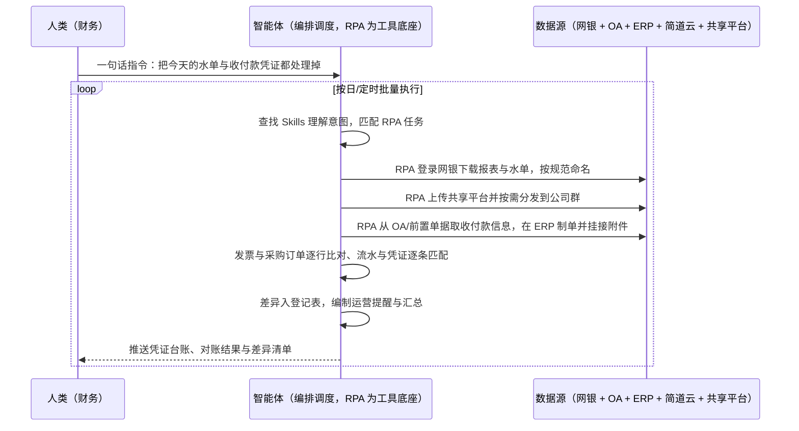

> 为合规要求严格的医药与上市药企打造财务全流程自动化。财务流程横跨 OA、ERP、网银、简道云、水单共享平台等多个系统，网银水单下载、凭证制单、发票比对、银企对账等重复性工作占日常工作量八成以上；而医药行业的财务合规审计要求逐笔可追溯、结果 100% 准确，人工既累又难保证。本方案由智能体调度自动化工具，把网银操作、凭证制单、自动核对与财务运营四类场景自动跑起来，输出资金台账、凭证与对账结果、异常清单。按日/定时执行，全程自动化，异常才打扰；凭据权限、字段映射与对账口径在部署前一次配置。

> Agent 自动化需开通企业功能
> 点击申请1个月免费权限
> [点击申请 →](https://skieer.feishu.cn/share/base/form/shrcnFwMayykP5iaL38fnZKTbrg)

## 一、用户与需求

核心矛盾：

- 系统多、切换累：OA、ERP、网银、简道云、水单共享平台五套系统，财务每天在系统间来回切
- 重复工作占比高：网银水单下载、凭证制单、报表导出等重复性操作占日常工作量 80% 以上（案例口径）
- 准确性要求 100%：发票与采购订单比对、银企对账容不得差错，人工逐笔核对耗时且难免遗漏
- 合规留痕硬要求：上市药企审计要求每一步操作可追溯，人工操作记录不成体系
- 值钱的事没人做：人力被低价值操作占满，财务分析、预算与风控无暇顾及

适用客户：医药、生物制药、医疗器械等合规要求严格的行业企业，以及财务岗位多、系统多、审计要求高的上市与拟上市企业。资金往来密集、有银企对账与发票比对场景的制造与研发型企业优先；部署后业务人员不需要写代码，一句话下达指令即可执行。

### 1.1 不同客户类型

| 类型 | 选择 | 建议 |
|-|-|-|
| 上市/拟上市药企（审计严） | 首选 | 强烈推荐（留痕与准确性要求最高） |
| 医药与医疗器械制造企业 | 首选 | 强烈推荐（系统多、对账量大） |
| 生物制药 CDMO/CRO | 首选 | 强烈推荐（付款类型多、凭证字段复杂） |
| 通用制造业财务 | 次选 | 一般推荐（可按场景裁剪） |
| 财务系统单一的小微企业 | 不做 | 无跨系统场景 |

### 1.2 不同场景侧重

| 场景 | 最关注维度 | 核心逻辑 |
|-|-|-|
| 网银操作 | 水单不丢、命名规范 | 逐笔下载改名上传，量大且枯燥 |
| 凭证制单 | 字段准确、附件齐全 | 摘要字段多（OA 单号、项目号等），手工易错 |
| 自动核对 | 逐笔一致、差异可追 | 发票与 PO、银行流水与 ERP 凭证必须笔笔对上 |
| 财务运营 | 提醒及时、汇总准确 | 长账龄预付款、工资分摊、报工汇总靠人推 |

### 1.3 不同角色用户

| 用户 | 需求 | 问题 | 投入时间（估算） |
|-|-|-|-|
| 资金会计 | 水单自动归档分发 | 每天在网银与共享平台之间逐笔处理 | 每天数小时 |
| 应收/应付会计 | 凭证自动生成 | 逐项填写摘要字段，字段多易错 | 每天数小时 |
| 总账会计 | 对账零差错 | 逐笔核对银行流水与账务凭证 | 月末集中加班 |
| 财务负责人 | 合规可审计、人有价值产出 | 重复工作占八成，分析无暇顾及 | 复核与返工 |

---

## 二、现在的方法与问题

### 2.1 流程步骤与问题总结

| 序号 | 步骤 | 现在的方法 | 问题缺陷 |
|-|-|-|-|
| 1 | 网银报表下载 | 人工登录网银按条件查询并下载各类台账 | 多账号多次操作，重复枯燥 |
| 2 | 水单下载归档 | 人工逐笔下载水单并手工重命名保存 | 命名不规范，找单靠搜索 |
| 3 | 水单分发 | 人工上传共享平台并逐个发送到对应公司群 | 权限维护与分发靠人，易漏发 |
| 4 | 凭证制单 | 人工在 ERP 创建收付款单与银行凭证并逐项填摘要 | 字段多、易错，耗时长 |
| 5 | 发票与 PO 比对 | 人工逐个打开两份 PDF 逐行核对 | 逐笔比对耗时，差异易漏 |
| 6 | 银企对账 | 人工把银行流水与 ERP 凭证逐条匹配 | 月末集中核对，出错要重查 |
| 7 | 运营提醒与汇总 | 人工整理清单、写邮件、导表合并 | 靠人推，时效与完整性难保证 |

### 2.2 问题分析

**人工方式根因**

| 序号 | 根因 | 具体表现 |
|-|-|-|
| 1 | 系统割裂 | 五套系统无贯通，数据靠人搬运 |
| 2 | 重复动作占比高 | 下载、改名、上传、录入等占日常八成以上 |
| 3 | 逐笔核对靠人眼 | 发票与 PO、流水与凭证的比对极易遗漏 |
| 4 | 留痕不成体系 | 人工操作记录零散，审计取证成本高 |

**系统方式根因**

| 序号 | 根因 | 具体表现 |
|-|-|-|
| 1 | 网银不开放 | 银行侧无直连接口，系统路线走不通 |
| 2 | 字段映射复杂 | 凭证摘要字段多且来源分散，难以规则化 |
| 3 | 人工环节不可省 | 合规要求下判断与复核仍需人，但可自动化的部分没人自动 |

---

## 三、解决方案

### 3.1 功能概述

为医药与上市药企打造的财务全流程自动化方案，一句话调度网银操作、凭证制单、自动核对与财务运营四类场景，输出资金台账、凭证与对账结果、运营提醒与异常清单。

一句话下达指令（如「把今天的网银水单和收付款凭证都处理掉」），智能体通过查找 Skills 文档库理解意图、匹配 N 个 RPA 自动化任务（下载→命名→归档→分发→制单→核对→提醒），经 MCP 调度八爪鱼 RPA 自动登录网银按条件下载报表与水单、按规范命名后上传共享平台并按需分发；再从 OA 与前置单据提取收付款信息，在 ERP 自动创建收付款单与银行凭证、逐项填写摘要并挂接水单附件；同时完成发票与采购订单逐行比对、银行流水与 ERP 凭证逐条匹配，差异写入登记表并通知责任人。全程自动化，运行状态实时反馈，跑完推送结果。

### 3.2 系统结合

| 要素 | 说明 |
|-|-|
| 客户现有工具盘点 | **未打通客户**（主流）：OA 系统 + ERP（用友/金蝶/浪潮等）+ 多家网银 + 简道云 + 水单共享平台 + Excel |
| 数据/能力来源 | OA 审批流与前置单据、ERP 总账与往来单位主数据、网银报表与回单、简道云报工数据、共享平台水单目录 |
| RPA 耦合动作 | 作为 Agent 的工具底座被调度执行：①解决逐笔下载、改名、上传、录入的机械动作；②被智能体调度执行登录、查询、下载、制单与比对；③把台账、凭证附件、差异清单落库并推送 |
| 耦合出的新价值 | 单系统给不了的端到端结论：五系统数据连贯、凭证与附件一一对应、对账逐笔可追，**只推送金额差异、字段缺失与对账不平清单** |

### 3.3 智能体执行流程

一句话下达指令，智能体自动调度；入参（银行与账号清单、命名规则、凭证字段映射、对账口径、异常接收人）部署时一次配置：

> Agent 自动化需开通企业功能
> 点击申请1个月免费权限
> [点击申请 →](https://skieer.feishu.cn/share/base/form/shrcnFwMayykP5iaL38fnZKTbrg)

### 3.4 为何这么设计

要同时回答三个问题：**为什么不能只用纯代码 Agent？为什么不能只用纯 RPA？为什么两者要结合？** 本场景的核心是"银行侧没有接口、合规要求逐笔可追溯、金额必须笔笔对得上"。

#### 1）逐项对比

| 对比维度 | 纯代码 Agent（Codex 等） | 纯 RPA（八爪鱼） | 智能体+RPA（MCP 结合） |
|-|-|-|-|
| 实现方式 | AI 写脚本调 ERP 接口与网银 | 模拟人登录五套系统完成下载、制单、比对 | 智能体理解字段映射与对账口径 + RPA 执行操作 |
| 银行侧对接 | 企业网银无开放接口，走不通 | 页面级操作可覆盖多家网银与共享平台 | 银行侧交给 RPA，智能体专注制单与核对 |
| 凭证字段填充 | 需自写映射，字段变更即改代码 | 按规则逐项填入，路径统一 | 智能体维护映射与校验，RPA 执行录入 |
| 逐笔比对 | 可代码化，规则变更即改代码 | 弱，需导出后处理 | 智能体做逐行/逐条比对与差异判定 |
| 使用成本（总拥有成本） | 接口开发与工程底座全自建长期维护 | 平台订阅，一个底座跑多个流程，边际成本低 | RPA 本地执行不消耗 AI token，仅比对与校验环节需 AI |
| 合规留痕 | 需自建审计日志 | 每步操作留痕，可追溯 | RPA 留痕 + 智能体台账，满足审计取证 |

#### 2）优劣势说明

|  | 纯代码 Agent（Codex 等） | 纯 RPA（八爪鱼） | 智能体+RPA（MCP 结合） |
|-|-|-|-|
| 优势 | 接口打通后速度快、可深度定制 | 五系统页面操作稳定，下载/制单/上传天生擅长；       每步留痕可审计；       不改动任何现有系统 | 智能体懂字段映射与逐笔比对；       RPA 稳定执行跨系统动作；       差异自动拦截，异常有人闭环 |
| 劣势 | 银行无接口、系统适配工作量大；       工程底座自建成本高；       维护成本与 token 成本高 | 缺语义判断与差异归因能力；       异常仍需人工兜底 | 需先配置 MCP 连接；       本地电脑需保持开机（或云机） |

**特别提醒**：本方案属**资金与合规敏感流程**，必须保留人工复核兜底——**金额不一致、发票与采购订单比对不符、银企对账不平的项目一律转入差异清单由财务人工处理，不自动入账、不自动放行**；所有操作全程留痕，水单原件与凭证一一对应归档，以满足医药行业与上市公司的合规审计要求；银行与系统凭据按最小权限管理并定期轮换。

#### 3）结论

| 论点 | 说明 |
|-|-|
| 补齐 Agent 短板 | 网银与五套系统的逐笔操作，纯代码/纯 Agent 无接口走不通，需 RPA 补位结合 |
| 确定性 vs 生成性 | 下载、制单、录入是确定性动作；比对与差异归因是判断能力，二者边界清晰 |
| 资产沉淀 | 命名规范、字段映射、对账口径沉淀在平台是"活的"，换人接手、增加银行或系统都成立 |
| 资金类底线 | 人工复核兜底与全流程留痕是资金与合规场景的底线设计，纯自动化不可取 |
| 不消耗 AI token | 下载、制单、归档由 RPA 本地执行不占 token，仅比对与提醒编制环节需 AI |
| 时间 | 财务要的是"账准、可审计、还有时间做分析"，而不是每天当数据搬运工 |

### 3.5 功能清单

| 功能 | 系统 | 功能说明（解决问题） |
|-|-|-|
| 会话/一句话指令 | 智能体 | 1. 理解自然语言意图，查找 Skills 文档库。       2. 匹配对应 RPA 自动化任务、编排多任务。 |
| 网银报表与水单下载 | RPA | 1. 解决逐笔下载、重复操作问题。       2. 按预设条件查询下载往来明细、收款台账、付款台账与水单。 |
| 水单命名与归档 | RPA | 按「类别+收付款日期+对方账户名称+币种+金额+水单编号」规范自动重命名并归档。 |
| 水单分发 | RPA | 维护共享平台目录权限并按需把水单发送到对应公司群或指定人员。 |
| 收付凭证自动制单 | RPA | 从 OA 与前置单据提取信息，在 ERP 创建收付款单与银行凭证并填全摘要字段、挂接水单附件。 |
| 发票与采购订单比对 | 智能体、RPA | 提取双方商品信息逐行比对数量、单价与金额，差异写入登记表。 |
| 银企对账 | 智能体、RPA | 从银行流水逐笔提取信息与 ERP 凭证逐条匹配，完成余额对账并标记不平项。 |
| 财务运营提醒 | 智能体、RPA | 长账龄预付款冲账提醒、工资分摊与冲回凭证、多系统报工数据汇总与未报工提醒。 |
| 数据资产储存 | 本地电脑、云储存 | 1. Skills 资产：财务全流程自动化技能。       2. 数据储存：资金台账 + 凭证与附件库 + 对账记录。       3. 经验知识库：字段映射与对账口径回填。 |

### 3.6 智能体执行落地过程

部署时一次性配置入参（银行与账号清单、命名规则、凭证字段映射、对账口径、异常接收人），会话中一句话即可触发，无需重复输入。

**⚠️ 部署前提（不满足则方案无法跑起来）**：①RPA 需部署在**常开电脑/云机**上，并配置漏跑补跑机制；②网银、ERP、OA、共享平台的登录态与凭据需按最小权限管理并定期轮换；③凭证摘要字段映射与命名规则需与财务负责人确认一次（属实施成本）；④对账与比对口径、差异判定阈值需书面固化；⑤**差异与不平项必须走人工复核，不得自动入账**；⑥首次配置（系统路径、映射表、归档规则）需服务方/技术人员介入一次，属实施成本。

#### 1）配置（五步）

| 步骤 | 操作 | 说明 |
|-|-|-|
| 第一步 | 下载八爪鱼 RPA，导入财务自动化模板 | 官网免费下载客户端；MCP 工具→添加应用 |
| 第二步 | 开启八爪鱼 RPA 的 MCP 服务端口 | 客户端→API-K→创建 API（名称自定义） |
| 第三步 | 在智能体中添加 MCP Server 连接 | 复制连接配置→智能体连接器→自定义连接器→配置 MCP→粘贴保存 |
| 第四步 | 验证工具列表 | 确认工具全部启用（即八爪鱼客户端内工具） |
| 第五步 | 测试运行效果 | 输入一句话指令，验证下载、制单与对账是否连通 |

| 类别 | 说明 |
|-|-|
| 智能体 | 主流智能体（支持 MCP 连接、Skills 加载、定时任务）。 |
| 智能体工具 | 1. **执行通道**：下载 + 命名 + 归档 + 制单 + 比对 + 提醒。       2. 数据取数与自动化执行：八爪鱼 RPA（MCP 协议接入）。       3. 数据储存：资金台账与凭证附件库。       4. IM：企业微信/飞书/钉钉（差异清单与日报推送）。 |
| 工作知识 | 1. 命名规范与归档目录结构。       2. 凭证摘要字段映射与来源。       3. 对账与比对口径、差异阈值。       4. 异常升级路径与复核要求。 |
| 本地数据库 | 1. 资金台账地址。       2. 凭证与附件库地址。       3. 对账与差异处理记录存档地址。 |

#### 2）执行

| 任务 | 产出 | 产出物接收人 |
|-|-|-|
| 接收一句话指令，匹配 RPA 任务 | 任务启动记录 | —— |
| 下载网银报表与水单 | 报表与回单原件 | —— |
| 命名、归档与分发 | 规范水单库 + 分发记录 | 资金会计 |
| 收付凭证制单 | ERP 凭证 + 附件 | 应收/应付会计 |
| 发票与 PO 比对 | 比对结果与差异登记表 | 应付会计 |
| 银企对账 | 对账结果与不平项清单 | 总账会计 |
| 运营提醒与汇总 | 提醒邮件/消息 + 汇总表 | 相关责任人 |

异常处理：

金额不一致 → 该笔不入账，转入差异清单并通知具体单号与差异原因；

发票与 PO 不符 → 记录差异行并推送责任人，不自动通过；

对账不平 → 标记不平项并保留两侧原始数据，人工核查后重跑；

系统登录失效 → 自动重试 2 次，仍失败告警推 IM。

#### 3）结果

| 结果 | 说明 |
|-|-|
| 数据资产 | 资金台账 + 凭证与附件库 + 对账与差异记录，可审计可追溯。 |
| 分析报告 | 每日财务处理日报：水单数、凭证数、对账结果、差异清单。 |
| Skills | 智能体 Skills：财务全流程自动化技能，字段映射与对账口径按月迭代。 |

> Agent 自动化需开通企业功能
> 点击申请1个月免费权限
> [点击申请 →](https://skieer.feishu.cn/share/base/form/shrcnFwMayykP5iaL38fnZKTbrg)

---

## 四、使用前后预估

> 本方案价值 = **网银操作与凭证制单自动跑 → 逐笔自动核对 → 差异人工兜底**。把财务从"确保不出错"的机械劳动里解放出来，去做真正影响经营的分析与风控。

| 指标 | 人工 | 纯代码 Agent | 智能体+自动化工具 |
|-|-|-|-|
| 网银操作 | 人工逐笔下载/上传（案例口径） | 网银无接口，走不通 | 全自动下载、命名、归档与分发 |
| 凭证制单 | 手动逐项录入（案例口径） | 受字段映射与接口限制 | 自动提取信息并一键生成，附件自动挂接 |
| 对账准确率 | 依赖人工核对（案例口径） | 取决于规则完整度 | 案例口径：100%（机器逐笔比对） |
| 人力投入 | 重复操作占日常八成以上（案例口径） | 需专人维护脚本 | 案例口径：重复操作减少 80%+ |
| 合规留痕 | 记录零散，审计取证难 | 需自建审计日志 | 每步留痕可追溯，满足审计要求 |
| 方法论 | 在会计个人手里 | 在个人脚本里 | Skills 映射与对账规则资产沉淀 |

**说明**：案例数字来自八爪鱼客户实践（某 ADC CDMO 港股上市药企：覆盖网银操作、凭证制单、对账核对、财务运营等 11 大财务场景，打通 OA、ERP、网银、简道云、水单共享平台 5 大系统，重复操作自动化 80%、凭证制单与对账 0 差错）；本方案为按同口径复刻的实施路径，具体场景数与人力节约幅度随系统数量与单据量而异（估算）。

---

## 五、效果证明

**《生物制药龙头财务全流程自动化：11 大场景、5 大系统全链路打通》**

> 该企业为国内 ADC（抗体偶联药物）CDMO 领域龙头、港股上市生物药企，财务流程横跨 OA、ERP、网银、简道云、水单共享平台 5 大系统，网银水单下载、凭证制单、报表导出等重复性工作占日常工作量 80% 以上。企业引入八爪鱼 RPA，覆盖网银操作、凭证制单、对账核对、财务运营等 11 大财务场景，实现财务流程从「人工逐笔操作」到「全链路自动化」的转型。

| 效果 | 说明 |
|-|-|
| 提效 | 11 大财务场景、5 大系统全流程自动化。原本网银水单下载、凭证制单、报表导出等重复性工作占日常工作量 80% 以上，现在由机器人执行，重复操作自动化 80%+。 |
| 降本 | 节约人力约 1-1.25 人（年 2000-2500 小时，按 2000 小时/人年折算）。原本财务团队大量工时耗在逐笔操作，现在转向预算分析、资金规划与合规审计配合等重点工作。 |
| 任务 | 凭证制单与对账 0 差错，对账准确率 100%（机器逐笔比对）。 |
| 任务 | 每笔比对全程留痕可追溯，满足上市药企财务合规与审计要求。 |

案例详情：[财务：生物制药龙头的财务全流程自动化实践](https://skieer.feishu.cn/wiki/OUdnwfR1ziqfwokvJr2cArWMnLf)

---

## 六、备注

### 6.1 Agent 支持

本方案不绑定具体智能体，主流 Agent 均可运行（需支持 MCP 连接、技能/Skills 加载与工具调用）：

| Agent/智能体 | 说明 |
|-|-|
| Workbuddy | 本方案运行平台，支持技能/Skills 上传加载、定时任务、MCP 工具调用与表格/报告处理 |
| 豆包（国内·字节） | 国内主流个人智能体，支持技能上传、定时任务与工具调用，上手成本低 |
| 通义千问（国内·阿里） | 支持 Agent 编排与插件生态，适合财务规则与对账口径编排 |
| DeepSeek（国内） | 推理能力强、成本低，适合逐笔比对与差异归因类任务 |
| ChatGPT（国外·OpenAI） | 海外主流通用智能体，支持 GPTs/Agent 模式与工具调用 |
| Claude（国外·Anthropic） | 长文本与结构化分析能力，原生支持 MCP 连接外部工具 |

### 6.2 名词解释

| 术语 | 说明 |
|-|-|
| 网银水单 | 银行出具的收付款凭证文件，需按规范命名归档并分发 |
| 凭证制单 | 在 ERP 中创建收付款单与银行凭证并填写摘要、挂接附件的过程 |
| 摘要字段 | 凭证上的说明信息，如付款日、OA 单号、申请人、项目号等 |
| 采购订单（PO） | 采购环节的订单文件，需与发票逐行比对数量、单价与金额 |
| 银企对账 | 把银行流水与 ERP 账务凭证逐条匹配，核对余额与对方信息 |
| 长账龄预付款 | 挂账时间较长的预付账款，需提醒申请人推动冲账 |
| 工资分摊 | 把工资成本按规则分摊到各成本中心的账务处理 |
| 报工数据 | 员工与设备的工作量记录，用于工时与成本归集 |
| 差异清单 | 比对不符或对账不平的项目清单，转人工复核 |
| 人工复核兜底 | 资金与合规类流程的底线设计，异常不自动放行 |
| 留痕 | 每一步操作的完整日志，用于合规审计与事后追溯 |
| MCP | Model Context Protocol，智能体连接外部工具的标准化通道 |
| Skills | 智能体可加载的预设技能资产，含流程与知识 |

> Agent 自动化需开通企业功能
> 点击申请1个月免费权限
> [点击申请 →](https://skieer.feishu.cn/share/base/form/shrcnFwMayykP5iaL38fnZKTbrg)

---

原文：[查看原文](https://skieer.feishu.cn/wiki/KMGSwRMyEi4hyJkRXwScGRnQnWf)
