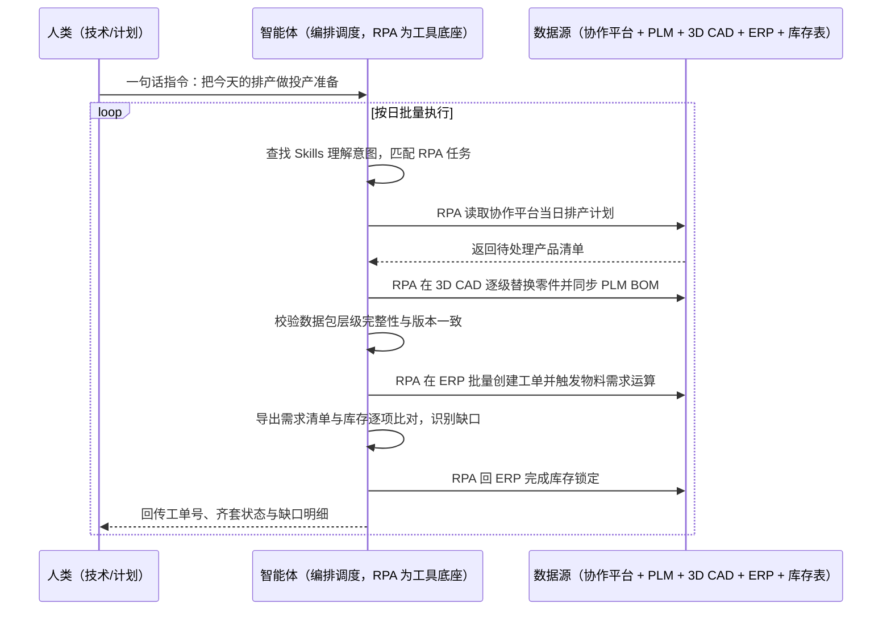

> 为多品种定制化制造企业打通投产准备的最后 1 公里。产品型号繁杂、每日排产都在变，投产前技术侧要完成当天的图纸替换与工程变更、把 PLM 里的技术数据包完整下发到生产端，生产侧还要跨系统建工单、跑物料需求、对库存、锁料、回传结果——两道工序一前一后，任何一层版本偏差或缺料算错，都会顺着链条传到车间，做出来才发现只能报废重来。本方案由智能体调度自动化工具，把技术侧「图纸自动替换 + BOM 同步」与生产侧「工单下达 + 物料齐套核查」两段流程连成一条自动链路，输出当日投产数据包与工单齐套台账。按日批量执行，全程自动化，异常才打扰；排产来源、BOM 规则与库存比对口径在部署前一次配置。

> Agent 自动化需开通企业功能
> 点击申请1个月免费权限
> [点击申请 →](https://skieer.feishu.cn/share/base/form/shrcnFwMayykP5iaL38fnZKTbrg)

## 一、用户与需求

核心矛盾：

- 图纸层层嵌套：总装图挂部件图、部件图挂零件图，一个通用件变更几十个系列都要跟着改，人工替换极易漏子部件
- 跨三系统搬运：排产计划在协作平台、建工单在 ERP、对库存在表格里，计划员每天来回复制粘贴
- 前面错一点后面全乱：BOM 装配错，下游物料需求就算错，差错顺链条一路下传，返工要重走全流程
- 交接无留痕：谁改的、改了什么版本、哪一步出错，事后查不清
- 数据包时效硬：当天投产前必须下发到位，晚一步车间就停等

适用客户：多品种、小批量、定制化程度高的装备制造与机械制造企业（工艺装备、包装机械、专用设备等），以及排产每日变动、技术数据与工单需每日重新准备的离散制造企业。已上 PLM/ERP（鼎捷、金蝶、用友等）但系统之间未打通的客户优先；部署后业务人员不需要写代码，一句话下达指令即可执行。

### 1.1 不同规模企业

| 类型 | 选择 | 建议 |
|-|-|-|
| 多品种定制化装备制造 | 首选 | 强烈推荐（每日投产准备量最大） |
| 中大型离散制造（有 PLM+ERP） | 首选 | 强烈推荐（系统割裂痛点最突出） |
| 标准化大批量生产 | 次选 | 一般推荐（变更频率低，价值有限） |
| 无 PLM/ERP 的小型工厂 | 不做 | 先做系统基础，再谈自动化 |

### 1.2 不同场景侧重

| 场景 | 最关注维度 | 核心逻辑 |
|-|-|-|
| 技术侧图纸变更 | 版本准确、子件不漏 | 通用件变更牵动多系列，人工核对到不了底 |
| 生产侧工单下达 | 齐套准确、锁料不错 | 缺料算错会导致车间停工待料 |
| 多层级 BOM | 层级完整、引用一致 | 任一层缺失都会导致生产异常 |
| 变更频繁的产品线 | 当日变更当日清 | 变更积压会连锁影响后续排产 |

### 1.3 不同角色用户

| 用户 | 需求 | 问题 | 投入时间（估算） |
|-|-|-|-|
| 技术/工艺工程师 | 图纸与 BOM 准确下发 | 在 3D CAD 与 PLM 之间往返装配，固定耗时 6-8 小时/天（案例口径） |  |
| 计划专员 | 工单与齐套结果不出错 | 五环节跨三系统手工操作，顺序不可颠倒（案例口径：2-3 小时/天） |  |
| 车间主任 | 开工即有线、不待料 | 缺料与版本错误到车间才发现 |  |
| 生产负责人 | 停产风险下降、交付准时 | 差错无留痕，归因困难 |  |

---

## 二、现在的方法与问题

### 2.1 流程步骤与问题总结

| 序号 | 步骤 | 现在的方法 | 问题缺陷 |
|-|-|-|-|
| 1 | 读取当日排产 | 人工在协作平台群里看当天计划 | 计划分散在群消息，抄录易漏 |
| 2 | 图纸替换 | 人工在 3D CAD 打开总装图，逐级替换零件 | 层级深、关联多，易错版本或漏子部件 |
| 3 | BOM 同步 | 人工在 PLM 触发 BOM 初始化与同步 | 与图纸替换脱节，顺序错就白做 |
| 4 | 建工单 | 人工登录 ERP 逐条创建生产工单 | 数量型号多，逐条录入手工错误率高 |
| 5 | 跑物料需求 | 人工在 ERP 触发运算并导出清单 | 依赖前序 BOM 正确，错一点全错 |
| 6 | 对库存与锁料 | 人工把清单导到表格与库存逐项比对后回 ERP 锁料 | 比对靠眼，缺料漏判 |
| 7 | 回传结果 | 人工把工单号与齐套结果发回协作平台群 | 结果无结构化留痕 |

### 2.2 问题分析

人工方式根因

| 序号 | 根因 | 具体表现 |
|-|-|-|
| 1 | 数据多层级嵌套 | 一套产品数据层层引用，人工替换覆盖不到底 |
| 2 | 系统割裂 | 协作平台、PLM、3D CAD、ERP、表格五处靠人串联 |
| 3 | 动作顺序强约束 | 步骤不可颠倒，任一步中断就要重来 |
| 4 | 无校验机制 | 差错只有到车间才暴露，返工成本高 |

**系统方式根因**

| 序号 | 根因 | 具体表现 |
|-|-|-|
| 1 | 系统间无接口 | PLM 与 3D CAD、ERP 与库存表之间无直连通道，接口开发成本高周期长 |
| 2 | 人工环节替代不了规则 | 即便上了系统，装配规则、齐套判断仍靠人点 |
| 3 | 缺执行留痕 | 每一步的操作结果与异常无结构化记录 |

---

## 三、解决方案

### 3.1 功能概述

为多品种定制化制造企业打造的投产准备自动化方案，一句话调度技术侧图纸替换与 BOM 同步、生产侧工单下达与物料齐套核查，输出当日投产数据包与工单齐套台账。

一句话下达指令（如「把今天的排产做投产准备」），智能体通过查找 Skills 文档库理解意图、匹配 N 个 RPA 自动化任务（取计划→换图纸→同步 BOM→建工单→跑需求→对库存→锁料→回传），经 MCP 调度八爪鱼 RPA 自动读取协作平台的当日排产计划，登录 PLM 逐条读取待处理产品清单、打开 3D CAD 按预设规则完成零件查找装配与替换并触发 BOM 初始化同步；随后登录 ERP 逐条创建工单、触发物料需求运算，导出清单与库存逐项比对、识别缺口并完成锁料，最后把工单号、齐套状态与缺口明细回传协作平台群。全程自动化，运行状态实时反馈，跑完推送结果。

### 3.2 系统结合

| 要素 | 说明 |
|-|-|
| 客户现有工具盘点 | **未打通客户**（主流）：PLM（鼎捷等）+ 3D CAD（SOLIDWORKS 等）+ ERP（鼎捷 E10/金蝶/用友）+ 协作平台（飞书/钉钉）+ Excel 库存表 |
| 数据/能力来源 | 协作平台排产计划、PLM 技术数据包（图纸层级与 BOM 明细）、3D CAD 模型文件、ERP 工单与库存主数据、仓库实际库存 |
| RPA 耦合动作 | 作为 Agent 的工具底座被调度执行：①解决跨系统逐条录入与逐层替换的机械动作；②被智能体调度执行取计划、换图纸、建工单、跑运算、比对与锁料；③把结果结构化回传协作平台并登记台账 |
| 耦合出的新价值 | 单系统给不了的端到端结论：技术侧与生产侧合成一条链，数据包完整性与齐套结果可校验、可追溯，**只推送缺料、版本异常与执行失败清单** |

### 3.3 智能体执行流程

一句话下达指令，智能体自动调度；入参（排产来源、产品与图纸规则、库存比对口径、回传对象）部署时一次配置：

> Agent 自动化需开通企业功能
> 点击申请1个月免费权限
> [点击申请 →](https://skieer.feishu.cn/share/base/form/shrcnFwMayykP5iaL38fnZKTbrg)

### 3.4 为何这么设计

要同时回答三个问题：**为什么不能只用纯代码 Agent？为什么不能只用纯 RPA？为什么两者要结合？** 本场景的核心是"数据层级深、系统无接口、动作顺序强约束且每天都要跑一遍"。

#### 1）逐项对比

| 对比维度 | 纯代码 Agent（Codex 等） | 纯 RPA（八爪鱼） | 智能体+RPA（MCP 结合） |
|-|-|-|-|
| 实现方式 | AI 写脚本调 PLM/ERP 接口与 CAD 自动化 | 模拟人在各系统页面完成替换、录入、比对 | 智能体理解图纸规则与齐套口径 + RPA 执行动作 |
| 系统对接 | PLM/CAD/ERP 若无开放接口即走不通 | 页面级操作可覆盖三系统 | 无接口环节交给 RPA，智能体专注规则与校验 |
| 图纸层级处理 | 需自行解析引用关系，规则变更即改代码 | 按预设规则逐级操作，路径统一可追溯 | 智能体校验层级完整性，RPA 执行替换 |
| 库存比对与齐套 | 可代码化，但口径一变即改代码 | 可导出后比对，判断能力弱 | 智能体做缺口识别与齐套判定 |
| 使用成本（总拥有成本） | 工程底座（登录态/调度/解析/告警）全自建长期维护 | 平台订阅，一个底座跑多个流程，边际成本低 | RPA 本地执行不消耗 AI token，仅规则与校验环节需 AI |
| 维护人要求 | 需懂代码、专人专职维护 | 业务人员可上手 | 业务人员看台账与异常清单，异常有人管 |

#### 2）优劣势说明

|  | 纯代码 Agent（Codex 等） | 纯 RPA（八爪鱼） | 智能体+RPA（MCP 结合） |
|-|-|-|-|
| 优势 | 接口型操作快，批量数据处理强；      
可深度定制 | 三系统页面操作稳定，替换/录入/比对天生擅长；      
平台模板沉淀可复用；      
业务人员可上手 | 智能体懂图纸规则与齐套判断；      
RPA 稳定执行跨系统动作；      
执行留痕可追溯，异常有人管 |
| 劣势 | PLM/CAD 无接口时走不通；      
规则变更即需改代码；      
维护成本与 token 成本高 | 缺语义与规则校验能力；      
复杂判断仍需人工兜底 | 需先配置 MCP 连接；      
本地电脑需保持开机（或云机） |

**特别提醒**：本方案不改动任何现有系统，属**非侵入式实施；但图纸与 BOM 的装配规则必须由技术负责人确认并书面固化，规则未冻结前不得直接投产使用**；投产数据包与齐套结果建议保留人工抽检环节，尤其是新产品的首次投产。

#### 3）结论

| 论点 | 说明 |
|-|-|
| 补齐 Agent 短板 | 跨三系统逐条操作、逐层替换的执行动作，纯代码/纯 Agent 都难长期稳定，需 RPA 补位结合 |
| 确定性 vs 生成性 | 替换、录入、锁料是确定性动作，必须步骤完整、结果可预期；规则理解与校验用智能体，各司其职 |
| 资产沉淀 | 装配规则、齐套口径、库存比对规则沉淀在平台是"活的"，换人接手、换产品线都成立 |
| 风险无豁免 | 制造数据错误不会因"用代码"自动消失，安全取决于规则冻结、版本校验与人工抽检 |
| 不消耗 AI token | 图纸替换、工单录入、比对锁料由 RPA 本地执行不占 token，仅规则校验与报告环节需 AI |
| 时间 | 车间要的是开工即有线、不待料，而不是每天等两个岗位各花几小时手工准备 |

### 3.5 功能清单

| 功能 | 系统 | 功能说明（解决问题） |
|-|-|-|
| 会话/一句话指令 | 智能体 | 1. 理解自然语言意图，查找 Skills 文档库。      
2. 匹配对应 RPA 自动化任务、编排多任务。 |
| 排产计划读取 | RPA | 1. 解决排产分散在群消息、人工抄录易漏问题。      
2. 作为工具被调度执行，读取协作平台当日计划。 |
| 图纸自动替换 | RPA | 1. 解决逐级替换易错版本、漏子部件问题。      
2. 在 3D CAD 按预设规则完成零件查找、装配与替换。 |
| BOM 同步 | RPA | 触发 PLM 的 BOM 初始化与同步，把更新后的技术数据包下发生产端。 |
| 数据包校验 | 智能体 | 校验层级完整性与版本一致性，任何一层缺失即拦并告警。 |
| 工单批量创建 | RPA | 按排产在 ERP 逐条创建生产工单并触发物料需求运算。 |
| 物料齐套核查 | 智能体、RPA | 导出需求清单与库存逐项比对、识别缺口并回 ERP 锁料。 |
| 结果回传与台账 | 智能体、协作平台 | 回传工单号、齐套状态与缺口明细，形成可追溯台账。 |
| 数据资产储存 | 本地电脑、云储存 | 1. Skills 资产：投产准备自动化技能。      
2. 数据储存：投产数据包 + 工单齐套台账。      
3. 经验知识库：装配规则与齐套口径回填。 |

### 3.6 智能体执行落地过程

部署时一次性配置入参（排产来源、产品与图纸规则、库存比对口径、回传对象），会话中一句话即可触发，无需重复输入。

**⚠️ 部署前提（不满足则方案无法跑起来）**：①RPA 需部署在**常开电脑/云机**上，并配置漏跑补跑机制；②PLM、3D CAD、ERP 与协作平台的登录态需维护，多账号建议环境隔离；③图纸装配规则与 BOM 同步顺序必须由技术负责人确认并固化（属实施成本）；④库存比对口径与齐套判定规则需与计划/仓库确认一次；⑤新产品首次投产建议保留人工确认节点；⑥首次配置（系统路径、规则、比对模板）需服务方/技术人员介入一次，属实施成本。

#### 1）配置（五步）

| 步骤 | 操作 | 说明 |
|-|-|-|
| 第一步 | 下载八爪鱼 RPA，导入制造业自动化模板 | 官网免费下载客户端；MCP 工具→添加应用 |
| 第二步 | 开启八爪鱼 RPA 的 MCP 服务端口 | 客户端→API-K→创建 API（名称自定义） |
| 第三步 | 在智能体中添加 MCP Server 连接 | 复制连接配置→智能体连接器→自定义连接器→配置 MCP→粘贴保存 |
| 第四步 | 验证工具列表 | 确认工具全部启用（即八爪鱼客户端内工具） |
| 第五步 | 测试运行效果 | 输入一句话指令，验证换图、建单与齐套核查是否连通 |

| 类别 | 说明 |
|-|-|
| 智能体 | 主流智能体（支持 MCP 连接、Skills 加载、定时任务）。 |
| 智能体工具 | 1. **执行通道**：取计划 + 换图纸 + 建工单 + 比对锁料 + 回传。      
2. 数据取数与自动化执行：八爪鱼 RPA（MCP 协议接入）。      
3. 数据储存：投产数据包与齐套台账。      
4. IM/协作：企业微信/飞书/钉钉（MCP 或 webhook 配置）。 |
| 工作知识 | 1. 产品与图纸装配规则。      
2. BOM 同步顺序与校验点。      
3. 库存比对与齐套判定口径。      
4. 异常升级路径。 |
| 本地数据库 | 1. 投产数据包存放地址。      
2. 工单齐套台账地址。      
3. 执行日志存档地址。 |

#### 2）执行

| 任务 | 产出 | 产出物接收人 |
|-|-|-|
| 接收一句话指令，匹配 RPA 任务 | 任务启动记录 | —— |
| 读取协作平台排产计划 | 待处理产品清单 | —— |
| 图纸替换与 BOM 同步 | 更新后的技术数据包 | 技术/工艺 |
| 数据包完整性与版本校验 | 校验结果 | 技术/工艺 |
| ERP 建工单与物料需求运算 | 工单与需求清单 | 计划 |
| 库存比对与锁料 | 齐套结果与缺口明细 | 计划/仓库 |
| 回传结果与台账登记 | 齐套台账 + 群消息 | 计划/车间 |

异常处理：

图纸规则未命中 → 跳过该产品并告警，不产出该产品数据包；

BOM 同步失败 → 重试 1 次，仍失败告警并保留中间状态；

物料缺口 → 列入缺口清单并回传协作平台，由计划人工决策补料或调整排产；

系统登录失效 → 自动重试 2 次，仍失败告警推 IM。

#### 3）结果

| 结果 | 说明 |
|-|-|
| 数据资产 | 投产数据包 + 工单齐套台账 + 执行日志，可复用可追溯。 |
| 分析报告 | 每日投产准备日报：处理产品数、齐套率、缺口明细、异常项。 |
| Skills | 智能体 Skills：投产准备自动化技能，装配规则与齐套口径按月迭代。 |

> Agent 自动化需开通企业功能
> 点击申请1个月免费权限
> [点击申请 →](https://skieer.feishu.cn/share/base/form/shrcnFwMayykP5iaL38fnZKTbrg)

---

## 四、使用前后预估

> 本方案价值 = **技术侧自动换图 → 生产侧自动建单核对 → 结果回传**。把两个岗位从跨系统搬运里解放出来，让投产准备从"每天几小时手工"变成"开工前自动就绪"。

| 指标 | 人工 | 纯代码 Agent | 智能体+自动化工具 |
|-|-|-|-|
| 图纸替换与 BOM 同步 | 1 人 6-8 小时/天（案例口径） | 受 PLM/CAD 接口限制 | 按规则自动执行，替代其中 4-5 小时 |
| 工单下达与齐套核查 | 2-3 小时/天（案例口径） | 接口不开放即走不通 | 跨三系统自动完成 |
| 数据流转差错 | 手抄手录，错漏难免 | 取决于规则完整度 | 案例口径：数据流转 0 差错、100% 精准 |
| 执行留痕 | 无结构化记录 | 需自建日志 | 每步留痕，可事后追溯 |
| 每日节省 | —— | —— | 案例口径：每日节省 10+ 小时 |
| 方法论 | 在工程师与计划员手里 | 在个人脚本里 | Skills 规则与口径资产沉淀 |

**说明**：案例数字来自八爪鱼客户实践（某染整装备制造企业：技术侧图纸与 BOM 自动装配、生产侧工单下达与物料齐套核查自动化，替代技术侧每日 4-5 小时、生产侧每日 2-3 小时重复操作，每日节省 10+ 小时、数据流转 0 差错）；本方案为按同口径复刻的实施路径，具体数值随产品复杂度与 BOM 层级而异（估算）。

---

## 五、效果证明

**《制造企业投产准备自动化：技术侧图纸 / BOM 、生产侧工单齐套》**

> 该企业深耕染整装备领域十余年，核心产品在细分领域市占率领先。产品型号繁杂、排产几乎每日动态变化，投产前技术侧需完成当日图纸替换与 BOM 同步，生产侧还需跨三个系统建工单、跑物料需求、与库存比对并锁料。引入八爪鱼 RPA 后，技术侧与生产侧两段流程实现自动化，操作路径统一、步骤完整可追溯。

| 效果 | 说明 |
|-|-|
| 提效 | 10小时/日，2500/年。技术侧节约 4-5 小时/日、生产侧节约 2-3 小时/日 |
| 降本 | 节约人力1.2人，15 万 |
| 任务 | 数据流转 0 差错 |
| 任务 | 100% 精准 |

案例详情：[生产制造 | 从图纸变更到工单下达，八爪鱼RPA打通投产准备最后 1 公里](https://skieer.feishu.cn/wiki/TtbwwnLZJiuUUlk2meRcMVuanPd)

---

## 六、备注

### 6.1 Agent 支持

本方案不绑定具体智能体，主流 Agent 均可运行（需支持 MCP 连接、技能/Skills 加载与工具调用）：

| Agent/智能体 | 说明 |
|-|-|
| Workbuddy | 本方案运行平台，支持技能/Skills 上传加载、定时任务、MCP 工具调用与表格/报告处理 |
| 豆包（国内·字节） | 国内主流个人智能体，支持技能上传、定时任务与工具调用，上手成本低 |
| 通义千问（国内·阿里） | 支持 Agent 编排与插件生态，适合制造与供应链场景的规则编排 |
| DeepSeek（国内） | 推理能力强、成本低，适合规则打分与归因分析类任务 |
| ChatGPT（国外·OpenAI） | 海外主流通用智能体，支持 GPTs/Agent 模式与工具调用 |
| Claude（国外·Anthropic） | 长文本与结构化分析能力，原生支持 MCP 连接外部工具 |

### 6.2 名词解释

| 术语 | 说明 |
|-|-|
| PLM | 产品生命周期管理系统，管理图纸、BOM 与工程变更（本例为鼎捷 PLM） |
| 3D CAD | 三维设计软件（本例为 SOLIDWORKS），图纸与装配在此完成 |
| 技术数据包 | 一套产品的图纸层级与其对应 BOM 明细的组合，需完整下发才能投产 |
| BOM | 物料清单，描述产品由哪些零件与部件构成及其用量 |
| 多层级引用 | 总装图挂部件图、部件图挂零件图的嵌套关系，任一层缺失都会导致生产异常 |
| ERP | 企业资源计划系统（本例为鼎捷 E10），承载工单、库存与成本 |
| MRP | 物料需求计划运算，依据 BOM 与库存推算需采购与领料的物料 |
| 齐套核查 | 比对物料需求与实际库存，确认该工单的料是否配齐 |
| 锁料 | 把库存预留给指定工单，避免被其他工单占用 |
| 排产计划 | 计划部门给出的当日生产安排，明确做什么产品、做多少台 |
| 非侵入式 | 不改动被操作系统的配置与数据，仅模拟人工在界面上操作 |
| MCP | Model Context Protocol，智能体连接外部工具的标准化通道 |
| Skills | 智能体可加载的预设技能资产，含流程与知识 |

> Agent 自动化需开通企业功能
> 点击申请1个月免费权限
> [点击申请 →](https://skieer.feishu.cn/share/base/form/shrcnFwMayykP5iaL38fnZKTbrg)

---

原文：[查看原文](https://skieer.feishu.cn/wiki/IMzcwFMCFiVF5bkpDN0cRSTwnad)
